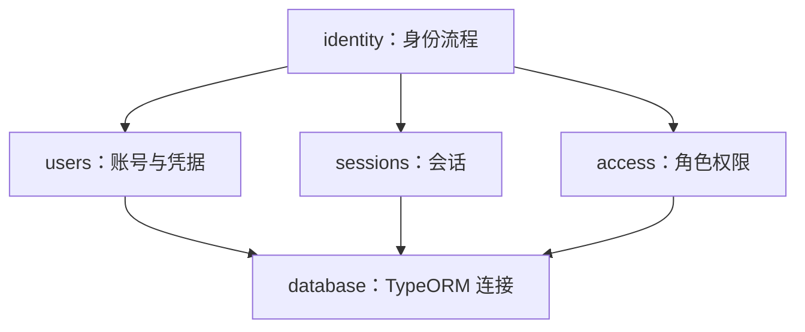
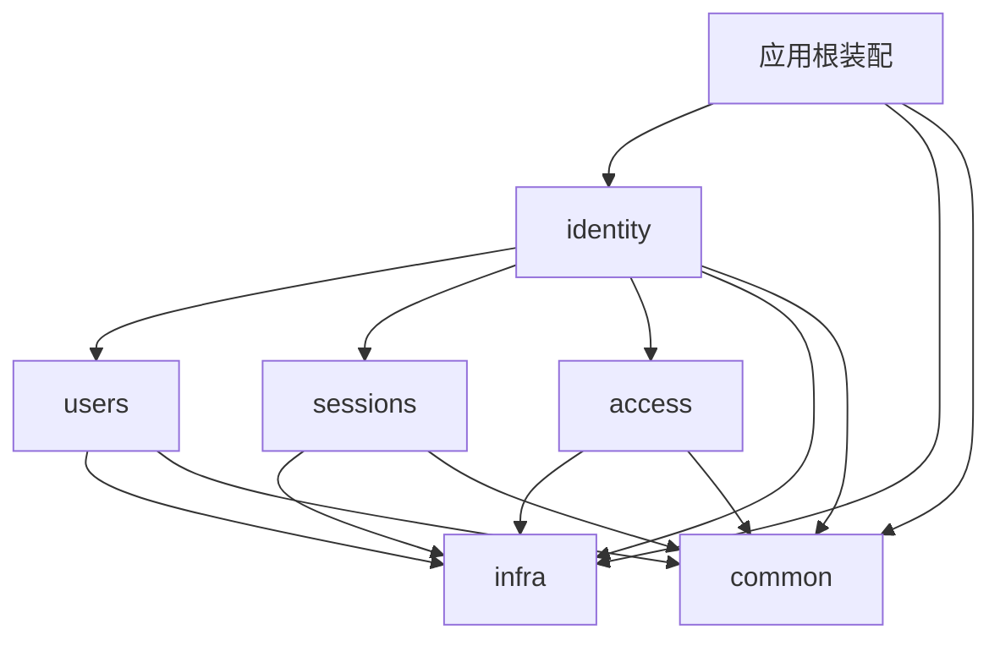

# 访谈与交付历史归档（2026-10-15）

本文件保留 Q225 文档迁移前的完整原文；正文仅插入稳定章节锚点，没有删减原始文字、代码块或外部来源。

这是历史依据，不是现行规范。原文中的“当前”“待确认”“下一步”和 Executed 均指当时状态；尤其末尾 Q225 的待确认文字已由 [Q225 确认记录](225-document-organization.md) 替代。旧架构 v1、未采用方案和早期建议不能作为实施要求。历史验收不等于本轮重新执行。

当前入口：[PRD](../prd.md) · [决策索引](README.md)。本文件冻结保存，后续修改当前规范，并新增对应决策记录。

<!-- archived-original-start -->
# Gvueter Lite PRD

更新时间：2026-10-15

状态：需求与封装设计访谈进行中。本文是本轮讨论的统一记录，已确认事项作为后续设计依据；待定项需要继续讨论。方案与确认本身不表示功能或封装已经实现；已执行部分以各阶段验收记录为准。

<a id="legacy-1"></a>

## 1. 产品定位与研究目标

Gvueter Lite 是面向个人与熟悉 Vue 的小团队、便于复制源码后二次开发的生产级轻量管理后台模板。支持开发者与 AI 协作开发，以现代化、新、简洁、方便、清晰为核心，交付完整的公共能力、统一开发约定与可验证的工程质量。

2026-10-15 用户进一步明确：不需要过于保守，核心是“现代化、新、简洁、方便、清洗”；此处将最后一项按“清晰”理解。该原则用于后续设计取舍：

- 从生产业务接入流程确定模板责任，再选择原生能力、适配层与公共封装。库支持某个功能只能证明底层可行，不能据此认定模板已经完成该能力或无需封装。
- 公共封装负责稳定契约、默认策略、能力组合和一致的开发体验；复用底层机制，同时把跨库协调和重复规则集中到模板中，业务页面主要表达业务差异。
- 默认路径服务常见业务和便利体验；额外限制、强制请求或特殊流程需有明确业务依据，不能仅凭假设的极端情况扩大基础复杂度。
- 选用当前生态中积极维护且有实际收益的能力，具体版本和组合通过实际验证确定。
- 方案说明给出清楚的默认做法和必要扩展点，常规实现细节汇总到可审阅方案，访谈聚焦影响架构、业务行为和使用体验的取舍。

此轮明确的是设计原则，不自动改写其他已确认的具体业务契约；Q198 随后由用户明确确认 B，编辑初始化复用新鲜、完整、未失效的详情缓存。

2026-10-15 用户进一步纠正：“目前的问题可以通过正确使用内置能力解决”不能作为设计终点，目的是构造生产级模板。本 PRD 据此明确：Lite 限定功能范围与架构规模，所选核心能力按生产质量完整交付；封装厚薄取决于需要承担的职责，不能以少写一层代码或库已有 API 为唯一标准。正确使用依赖是实现基础，模板的验收单位是业务接入与完整流程。此澄清用于解释既有薄封装决定，不把它改成少承担职责，也不自动扩展未选定的业务功能。

本轮全部重新规划，不以旧版源码、目录、功能或设计文档作为基线。参考外部免费开源 Admin 模板的实际工程方案，结合本轮需求选择适合 Lite 的设计。

研究覆盖八个方面：

1. 目录组织与职责边界。
2. 公共组件与 composable 的封装。
3. HTTP 请求、服务器资源与客户端状态管理。
4. 开发、部署、个人偏好及管理员配置。
5. 路由、菜单与权限。
6. 工程工具、依赖、检查与构建。
7. 新增业务时的扩展方式与长期维护。
8. 各项方案组成的整体架构。

交付顺序：先形成外部模板的源码对比与设计建议，再为确认值得采用的部分形成具体架构、接口与实施方案。实现阶段另行确认。

<a id="legacy-2"></a>

## 2. 已确认的产品边界

| 议题 | 决定 |
| --- | --- |
| 主目标 | 规划 Gvueter Lite，同时使其可作为后续项目底座；侧重当前产品。 |
| 后续项目 | 技术栈基本相同的管理后台，业务、页面和品牌可以不同。 |
| 使用方式 | 复制源码后直接开发，各项目可以独立修改和演进。 |
| 主要使用者 | 个人与 AI 协作开发，以及熟悉 Vue 的小团队。 |
| 前后端范围 | 前端为主，搭配可跑通流程的参考后端，前端允许对接其他后端。 |
| 组织范围 | 单组织后台，每次部署服务一个组织；首版保持轻量。 |
| 设计取舍 | 生产级交付，现代化、新、简洁、方便、清晰；按模板应承担的完整职责决定封装边界，基础机制复用成熟依赖。 |
| 调整原则 | 简单、渐进改进为默认；扩大目录或模块调整范围需逐项论证。 |
| 参考范围 | 免费开源模板，Vue 3 为主，允许借鉴其他框架的工程思路。 |

<a id="legacy-3"></a>

## 3. 功能范围

<a id="legacy-3-1"></a>

### 3.1 必备基础

首版需要完整的基本管理流程，以代表性 CRUD 验证公共封装：

- 登录与账号会话流程。
- 后台布局与导航。
- 单组织内的账号、角色与权限基础。
- 主题与国际化。
- HTTP 请求及错误处理基础。
- 代表性的列表、查询、新增、编辑和删除流程。
- 配置式表单、表格与弹窗等公共能力。

上述能力的具体业务、权限粒度、交互和接口仍需细化。

首版布局已在 Q125 确认为单一侧栏布局，Q126 确认顶部设置按钮打开右侧显示偏好抽屉；Q127 确认只保证桌面使用，窄屏保留桌面最小宽度并允许整体滚动，不纳入基础手机适配。桌面最小宽度与验收视口在具体方案中定义。

<a id="legacy-3-2"></a>

### 3.2 按实际场景选择

上传、富文本、图表、导入导出、复杂表单等能力按需要选择，不因参考模板拥有这些能力就自动纳入首版。

多租户、复杂插件平台以及可视化页面配置不作为默认底座能力。

<a id="legacy-4"></a>

## 4. 技术方向与公共封装

<a id="legacy-4-1"></a>

### 4.1 已选方向

- 前端采用 Vue、Vite，并使用 Vite Plus。
- 使用 shadcn-vue，围绕实际需要做二次封装。
- 表单状态与校验采用 TanStack Form＋Zod（Q149 B）；字段状态策略、控件绑定及提交过滤由本项目封装实现，精确兼容版本在实施方案中确认。
- 遵循严格 TypeScript、避免 `any` 的项目要求。
- 参考后端采用 NestJS 12＋TypeScript＋原生 ESM，HTTP adapter 已确认 Express，业务数据库已确认 PostgreSQL，数据访问层已确认 TypeORM。以 Nest 官方 typescript-starter 为最小基础骨架，再接入 PostgreSQL／TypeORM，随前端需求逐步补充能力；包管理器已确认 pnpm，精确依赖候选与验证范围见第 9.21、9.23 节及基础工程实施方案。
- 参考后端认证采用服务端会话，浏览器通过 HttpOnly Cookie 携带会话标识；具体认证库与会话存储继续细化。

<a id="legacy-4-2"></a>

### 4.2 二次封装原则

按实际能力封装。基础 Button、Input 等可直接使用；表格、表单、确认弹窗等存在共同职责时，再增加公共封装。不要求为每个基础组件创建一层转发包装。

此处的薄封装指职责聚焦、接口清楚，不限制必要实现的体量。某项能力即使可由库 API 分散完成，只要各业务页面仍需反复协调相同的状态、错误、生命周期或配置规则，就应评估由模板集中提供完整能力。是否封装需看接入成本、行为一致性、可维护性与验证结果；不能只以原生 API 是否存在作结论。

特殊业务通过明确的扩展接口表达。稳定且有真实复用需求的能力，再进入公共封装。基础 UI、能力封装、业务专用组件的具体目录与依赖方向待定。

shadcn-vue 采用组件源码分发方式，项目需要维护加入本地的组件及自有封装。二次封装的设计应考虑上游更新和本地修改的边界。

官方参考：[源码分发说明](https://www.shadcn-vue.com/docs/introduction)、[Data Table](https://www.shadcn-vue.com/docs/components/data-table)。

<a id="legacy-4-3"></a>

### 4.3 生产级公共能力的交付标准

以下是对用户生产级目标的具体化，作为后续方案审阅与验收依据，不表示功能已经实现。

| 维度 | 模板交付责任 |
| --- | --- |
| 公共契约 | 字段、查询、提交、组件方法、状态输出与扩展入口有明确类型和语义，业务页面无需逐次组合底层细节来获得相同行为。 |
| 流程完整性 | 在已确认范围内统一初始化、加载、成功、失败、重试、关闭与清理；跨组件和跨库的协调有明确归属，不留给每个页面重新处理。 |
| 开发体验 | 提供可靠默认值、必要覆盖点、可运行示例和接入步骤；新增普通业务页面主要提供字段、列、查询／保存函数及业务规则。 |
| 工程验证 | 对真实风险和关键行为做自动验证，覆盖类型、依赖边界、局部行为、构建及关键浏览器流程；模拟示例与真实联调验收分别报告。 |
| 生产接入 | 已选认证权限、配置校验、错误反馈、构建部署和账号状态隔离等有明确接入及验收方式；示例代码、模拟模式与生产产物的边界可检查。 |

以编辑表单为例，Vue Query 能提供缓存只解决了一个底层机制；模板仍须交付查询键与失效约定、编辑初始化快照、读取失败反馈、提交锁定、保存后的资源更新、关闭清理及对应验证。具体资源和业务判断仍由页面显式提供，共同机制由公共能力承担。Q198 的 A／B 是该完整流程内的新鲜度策略，不是是否建设生产级封装的选择。

<a id="legacy-5"></a>

## 5. 配置分层

| 配置类别 | 首版定位 | 内容 |
| --- | --- | --- |
| 开发者配置 | 必备 | 品牌、默认布局、路由、模块启用等，通过源码配置。 |
| 部署配置 | 必备 | API 地址、部署路径等，通过环境或部署文件配置。 |
| 个人偏好 | 必备 | 主题、语言、侧栏状态等，由用户修改并在浏览器本地持久化；同一浏览器共享，首版不按账号同步到后端。 |
| 管理员设置 | 可选 | 业务参数、全局功能开关等，保存到后端，无需重新部署。 |
| 动态页面配置 | 按明确场景决定 | 管理员通过界面调整菜单结构、表单字段或页面内容。 |

个人偏好归属已在 Q114 确认为浏览器本地；首版语言已在 Q113 确认为简体中文与英语。Q115–Q118 已确认语言默认跟随浏览器、不支持时回退简体中文，主题默认跟随系统；保存用户显式选择的字段覆盖，并同步同源同应用的其他窗口。显示偏好逐字段覆盖项目默认，再覆盖内置默认，未选择的字段随新版默认更新。Q119 已选构建时部署配置，Q120 已选关键配置校验与明确报错；Q121 已确认首版提供业务设置接入说明，有具体需求后在对应业务中实现设置页面。Q122–Q124 已确认保存失败时临时使用并提示、升级保留合法字段，以及统一恢复显示默认入口。具体配置来源、校验、持久化介质及兼容迁移实现继续定义。开发者编写表单字段配置，不等同于管理员通过界面动态设计表单。

<a id="legacy-6"></a>

## 6. 配置式表单

<a id="legacy-6-1"></a>

### 6.1 设计方向与职责

默认采用开发者编写字段配置、公共表单生成字段的方式。

表单配置负责字段、控件、校验、布局与联动。业务页面负责取得编辑记录、调用保存 API，以及保存成功后的业务操作。公共表单提供统一提交入口；不在字段配置中混入列表刷新、业务 URL 或特定业务流程。

Q196 已确认 B：公共表单组件内部创建并管理状态，页面通过 props 提供配置、初始值和可等待的保存回调，通过少量 ref 方法控制初始化、重置或提交。内部可使用 composable 组织逻辑，但不要求业务页面先创建表单控制对象；精确方法与类型后续确定。

Q199 已确认 A：提供组合好的 FormDialog／FormDrawer，作为普通新增、编辑的默认入口，统一加载呈现、初始化、校验、提交锁定、未保存保护和关闭清理；独立表单、通用弹窗／抽屉继续支持特殊组合。页面提供业务字段、取数／保存函数及资源更新规则，组合组件不依赖具体业务模块。组件名称与精确接口在方案中落定。

Q200 已确认 A：普通新增／编辑明确保存成功后默认关闭容器，并按业务声明更新或失效关联查询。写入成功和后续列表刷新失败分别处理；保存失败保留输入，结果未知遵守核实流程。

Q201 已确认 B：编辑容器以 props＋v-model:open 为默认公开契约，页面持有打开状态和有类型的编辑上下文，表单字段状态由组件内部持有。容器继续统一加载、初始化、提交与关闭协调；少量 ref 方法只用于必要命令，不增加第二份打开状态。

Q202 已确认 A：FormDialog／FormDrawer 以 open／context／fields／load／submit／saved 为核心契约；公共能力承接完整编辑生命周期，页面声明业务差异，保存结果与后续资源刷新结果分开处理。精确类型及扩展接口继续细化，尚未实施。

Q203 已确认 A：常用控件通过明确的 control 类型配置，项目统一适配并关联字段名、值和控件 props 的类型；特殊字段保留插槽、渲染函数及局部自定义组件入口，无需为一次性控件建立全局注册。

Q204 已确认 A：单字段 Zod 规则放在字段配置中，跨字段规则单独声明依赖与错误目标。公共表单统一执行条件字段的校验参与及提交过滤，不要求业务页面自行过滤错误；校验时机沿用已确认约定。

Q205 已确认 A：首批内置单行文本、多行文本、密码、数字、单选、多选、开关、单个勾选框和纯日期九类控件，采用稳定编辑值契约。文本空值为空字符串，数字／单选／纯日期清空为 null，多选为空数组，布尔控件为 true／false，纯日期为 YYYY-MM-DD；清空与提交省略分开处理，底层组件差异由公共适配承接。

Q206 已确认 A：提交类型根据明确配置区分确定提交与可能省略的字段，仅后者可选；固定字段表单不额外可选化，动态配置无法静态判断时诚实降级。公共层负责实际过滤，不让页面重复手写条件过滤或提交类型；此规则不代替后端字段权限控制。

Q207 已确认 A：异步选项默认由业务提供资源查询配置工厂 optionsSource，公共选项控件承接 Vue Query 和既定交互流程；静态选项直接传数组，页面持有查询并传入数据／状态保留为特殊组合方式。查询键及业务请求仍由资源侧定义。

Q208 已确认 A：单条候选项默认使用 label／value／可选 disabled，同时允许保留原始业务对象，通过类型化访问器读取标签、ID 和禁用状态。插槽／渲染函数可访问原对象，表单仍只保存 ID 或 ID 数组，不要求业务先统一转换选项数组。

Q209 已确认 A：异步选项沿用资源响应，全量数组和标准 records／total 分页结构提供默认接入，特殊结构显式读取；明确区分全量与分页查询，复用 Vue Query 分页能力，由公共控件承接点击加载更多及并发协调。下一页规则仍由资源配置声明，不猜测业务协议。

Q210 已确认 A：联动默认由被影响字段声明依赖及显式清值策略，公共层统一调度；声明依赖本身不清值，初始化／回填／重置不误触发清空，用户操作引起的合法级联按明确依赖执行，自动改值链禁止循环。

Q211 已确认 A：自定义字段默认只替换输入区域，公共字段外壳继续承担标题、说明、错误和布局；完整字段替换作为显式扩展。插槽、渲染函数和组件适配共同遵守有类型的值更新、失焦、交互状态、错误关联及焦点协议，不创建第二份字段状态。

Q212 已确认 A：公开 validate／submit／reset／focusField，编辑容器另提供 requestClose，以及对应只读状态。所有命令复用默认交互流程并遵守生命周期、提交锁定和关闭保护；打开及初始化仍由 open／context／load 承担，具体返回类型在类型方案中验证。

<a id="legacy-6-2"></a>

### 6.2 首版必备能力

| 能力 | 范围 |
| --- | --- |
| 常见控件 | Q205 已确认九类：单行文本、多行文本、密码、数字、单选、多选、开关、单个勾选框、纯日期；值与清空契约见 9.91，适配签名仍待验证。 |
| 校验 | 必填、长度、邮箱格式、自定义规则。 |
| 简单布局 | 列数、字段跨列、分组、说明文字。 |
| 字段联动 | 条件显示、禁用，以及一个字段变化后重置另一个字段。 |
| 异步选项 | 从 API 取得角色、部门等选项，具备加载与失败状态。 |

动态字段组以及上传、富文本、树选择等扩展控件按实际场景选择。

<a id="legacy-6-3"></a>

### 6.3 特殊字段扩展

默认通过字段插槽或自定义组件实现特殊字段，并接入同一套表单状态与校验。例如，管理范围字段可以组合部门树、说明与预览。

特殊字段形成稳定复用需求后，再考虑纳入公共配置能力。

<a id="legacy-6-4"></a>

### 6.4 隐藏、业务禁用与只读字段

隐藏字段的默认行为：保留填写内容，不参与输入校验，不包含在提交内容中；字段再次显示时恢复填写内容。业务禁用与只读采用下述各自规则，不能将隐藏字段的提交策略统一套用到只读字段。

允许字段单独覆盖默认策略。Q146–Q147 已确认：业务禁用字段保留值、不参与输入校验、不提交，重新启用时恢复原值；只读字段保留并提交已有值，不参与用户输入校验。字段的具体覆盖接口继续定义，服务端仍按业务契约验证提交内容。

提交期间的临时 UI 锁定与业务禁用分别管理，不得因为提交时禁用控件而剔除已经准备的提交字段。

示例：管理员角色下填写管理范围，改成普通用户后该字段隐藏并停止校验，提交不包含管理范围；切回管理员时恢复之前填写的范围。

<a id="legacy-6-5"></a>

### 6.5 初始化与失败处理

- 每次打开表单重新初始化。
- 新增表单使用默认值；编辑表单使用业务提供的记录。
- 重新初始化时重置字段、错误和提交状态。
- 提交失败保留本次输入。
- Q148 已确认提交期间阻止重复提交，锁定本次输入、重置及表单关闭；请求结束后恢复操作，失败保留输入。
- Q150 已确认首次离开字段或提交时展示输入错误，已有错误的字段修改时及时更新提示；Q151 已确认重置回本次打开时的初始化快照，清错误并重置修改状态，不重新请求服务器。
- Q152–Q154 已确认按当前业务值与本次初始化快照的差异判定未保存；整体复查 Q55 A 补充：控件尚未形成合法业务值的未完成／非法编辑内容也纳入丢弃保护，纯显示格式变化不算修改。修改字段后清该字段旧服务端错误；提交校验失败后滚动并聚焦首个可见、可编辑且可聚焦的错误字段。
- Q155–Q157 已确认 A、B、A：用户主动改变上级时清空联动下级选择；异步选项失败只弹提示，再次打开下拉框时重试；明确失效的原有选项保留并标记不可用，由用户按字段规则处理。
- Q158–Q160 已确认 A：异步候选列表默认首次展开时加载，字段可配置提前加载；完整小集合默认本地搜索，大集合显式远程搜索；编辑名称优先由记录／页面提供，缺失且缓存不能补齐时显式配置按 ID 补查。
- Q161–Q163 已确认 A：远程搜索默认停止输入 300 毫秒后查询，可按字段调整；启用分批候选时点击“加载更多”追加；自动改值联动显式声明单向依赖并禁止循环。
- 关闭后，下次打开重新初始化；首版不默认保留跨次打开的草稿。
- Q197 已确认 A：编辑弹窗／抽屉关闭完成后卸载表单，下次打开重新创建；先遵守提交锁定与未保存内容保护，共享查询缓存继续按自身生命周期管理。
- Q198 已确认 B：同账号、同记录且完整、新鲜、未失效的详情缓存可用于初始化，默认新鲜期 30 秒；过期、失效或缺失时等查询完成，再建立本次独立编辑快照，后台更新不覆盖正在编辑的输入。

<a id="legacy-6-6"></a>

### 6.6 待细化

- 所选 TanStack Form＋Zod 的精确版本、schema 接入与验证。
- 字段配置、字段名与控件 props 的类型约束。
- 自动改值联动已确认显式声明单向无环依赖；执行顺序、去重及循环配置报错的精确接口继续定义。
- 异步选项已确认上级变化清下级、失败弹错并重新打开重试、保留明确失效原值、默认展开加载、本地／远程搜索分工、已有名称优先回显、远程搜索默认防抖 300 毫秒和分批结果点击加载更多；请求竞争、选项契约及状态接口继续定义。
- 禁用、只读和字段级隐藏策略的具体接口。
- 提交锁定与重置的精确接口、字段错误与服务端错误的协作。

<a id="legacy-7"></a>

## 7. 表格请求与请求状态

请求状态已确认使用 Vue Query；表格入口已确认采用 B：请求表格容器。接口与具体交互默认值继续细化。

<a id="legacy-7-1"></a>

### 7.1 已查阅的源码做法

| 模板 | 表格请求与状态做法 | 源码入口 |
| --- | --- | --- |
| Pure Admin | 页面私有 `useUser` 请求 API 并维护列表与 loading；页面把结果传给表格，刷新调用 `onSearch`。 | [页面](https://github.com/pure-admin/vue-pure-admin/blob/main/src/views/system/user/index.vue)、[业务 hook](https://github.com/pure-admin/vue-pure-admin/blob/main/src/views/system/user/utils/hook.tsx) |
| Soybean Admin | 公共 `useNaivePaginatedTable` 接收 API 函数，管理请求及分页；表格组件接收结果，业务操作触发再次获取。业务用户页位于 example 分支。 | [用户页](https://github.com/soybeanjs/soybean-admin/blob/example/src/views/manage/user/index.vue)、[表格 hook](https://github.com/soybeanjs/soybean-admin/blob/main/src/hooks/common/table.ts)、[状态核心](https://github.com/soybeanjs/soybean-admin/blob/main/packages/hooks/src/use-table.ts) |
| Vben Admin | 同一封装支持静态行和 `proxyConfig.ajax.query` 请求代理；通过表格实例的 `query/reload` 刷新。所查调用是 playground 示例。 | [静态示例](https://github.com/vbenjs/vue-vben-admin/blob/main/playground/src/views/examples/vxe-table/basic.vue)、[请求示例](https://github.com/vbenjs/vue-vben-admin/blob/main/playground/src/views/examples/vxe-table/form.vue)、[实例 API](https://github.com/vbenjs/vue-vben-admin/blob/main/packages/effects/plugins/src/vxe-table/api.ts) |

Inspected：以上依据源码阅读，未运行模板。部分 CRUD 操作是演示占位；局部加载与刷新能力不代表具备完整、跨页面的服务器查询缓存。不能据这些调用链断言整个模板仓库都没有查询缓存。

<a id="legacy-7-2"></a>

### 7.2 已确认的表格入口

默认采用请求表格容器，用户已确认公开组件名称为 DataTable。Q213 已确认 A：以直接 props 的组件作为默认入口，容器内部组合查询与交互逻辑；搜索字段与列配置独立，普通页面不维护镜像状态。页面提供查询键、查询参数、请求函数与列等配置，容器内部通过 Vue Query 组织查询，再将结果交给展示表格。命名不改变职责，内部纯展示组件的精确名称另定。

保持独立查询核心与展示表格，容器负责组合。新增、编辑、删除、权限与保存后的资源失效规则仍由业务负责；具体公共接口、状态输出和交互默认值继续讨论。

Q215 已确认 A：首批公开 refresh／submitSearch／resetSearch／clearSelection／resetLayout，以及只读 selectedIds／selectedRows／isLoading／isFetching／error；默认控件、插槽和组件 ref 复用同一行为路径，精确类型与返回签名继续验证。

Q216 已确认 A：通过可选 query-context 传入页面持有的外部查询条件，条件有效变化时容器统一回第一页、清理勾选并切换查询，保留已应用搜索、未提交草稿、排序和列布局。外部部门树由页面组合，不属于 DataTable 内部的树形表格能力。

Q217 已确认 A：可选 query-enabled 默认 true，业务前置条件未满足时保留组件及搜索输入，显示可定制等待提示、清除勾选并阻止查询；不以等待条件冒充加载或无结果。

Q218 已确认 A：提供按页面显式开启的 URL 同步适配，默认不改地址；页面声明可同步字段和类型，公共层协调有效查询条件的读取、校验与写入。草稿、勾选、列表结果及敏感字段不写 URL，表格核心不直接依赖具体路由。

Q219／Q220 已确认 A：URL 同步默认替换当前历史条目；有效外部地址导航恢复已应用条件，并同步恢复该协议管理的搜索字段草稿。表格自身翻页等地址回写不覆盖未提交输入，不改变业务编辑表单的未保存保护。

Q164 已确认 TanStack Table 管行列与表格交互，shadcn-vue Table 提供界面，Vue Query 继续管理服务器请求与缓存。Q165 已确认普通列配置、复杂单元格优先 Vue 作用域插槽，同时必需支持渲染函数编写；Q172 已确认同格插槽优先，缺失时再用渲染函数，两者均无时默认展示，插槽有意返回空内容不触发回退。Q214 已确认 A：单元格插槽按稳定列 ID 使用 cell-<列ID> 命名，例如 cell-status；精确类型继续验证。

Q166 已确认 B：首版提供列显隐、拖拽调整列顺序及列宽调整，按表格需要开启。Q167–Q169 已确认 A：以稳定表格／列 ID 本地保存布局，固定左／右列由开发配置，普通纯文本默认单行省略且可查看全文、允许列覆盖换行。Q170–Q171 已确认保留合法用户顺序时新增普通列追加末尾，提供只重置当前表显隐／顺序／宽度的入口。精确接口继续定义；不自动增加行拖拽、导出或虚拟滚动能力。

Q176–Q178 已确认 A：提供可选轻量操作按钮组，API／授权／mutation 状态由页面负责；无操作权限默认隐藏，有权限但业务不允许时可禁用并说明原因；批量操作点击时复制目标 ID，确认文案和请求使用同一快照，仍按执行时权限和业务状态校验。

Q179–Q181 已确认 A：单行与批量删除统一使用模态确认弹窗，展示目标记录或数量，确认后才发送删除请求；行内写操作期间只限制本次目标记录的重复／冲突写操作，其他记录、搜索和分页仍可用，但仍遵守模态层交互限制；批量操作完整成功后取消本次目标 ID 的勾选，保留期间另选且仍合法的其他记录。

Q182–Q183 已确认 A：删除确认弹窗在请求期间保留并限制关闭／重复确认，明确成功后关闭，明确失败保留并恢复操作；适合单个数据库事务的常规小批量写操作默认全部成功或全部不执行，由后端保证事务与业务校验，外部系统／长任务另行论证。超时或响应丢失仍可能导致结果未知，不自动重试写入。

Q184 已确认 A：写请求结果未知时，页面有适用查询且当前允许读取，则主动触发一次相关数据的只读核实；不自动重发写请求、不新增持续轮询。核实依据由具体业务契约提供，无法确认时继续提示结果未知，不能根据当前分页缺少记录或一次旧状态读取判定写入结果。整体复查 Q57 A 补充：未知状态独立于弹窗保存，关闭重开不解除相关冲突写操作的保护，相关缓存标记失效；核实结果或安全重试依据由业务提供。

Q186 已确认 A，采用澄清后的薄封装原则：原生 API 和类型适合时直接复用，涉及项目统一规则或明确使用收益时才增加自有接口，保留公开的底层扩展入口。容器持有的状态遵守统一更新路径，不为改名另包一层，不另造完整表格 API。

<a id="legacy-7-3"></a>

### 7.3 已确认的请求状态方向

使用 Vue Query 统一管理服务器资源与请求状态，业务明确声明刷新规则。公共封装保持薄，缓存、重试及刷新等默认行为继续讨论。

HTTP 传输、查询状态和客户端交互状态分别承担职责。HTTP 客户端已选 Axios 薄封装，Vue Query 管服务器资源，Pinia 管跨页客户端状态；具体公共 API 与错误展示协作继续定义。

Q185 已确认 A：同一资源的列表、详情等查询键按资源就近统一定义，与该资源 API 放在同一职责区域；各页面和写后失效逻辑复用，所有影响结果的参数进入查询键，不新增项目级单文件查询键注册表。精确文件名在目录方案中确定。

<a id="legacy-7-4"></a>

### 7.4 表格请求组织方式的设计比较：已选择 B

两种方式均使用 Vue Query。区别是查询由页面调用公共 composable，还是由表格容器在内部调用。不能把该选择理解成“只有外部 composable 才能使用查询缓存”。

以下为调用形态示意，`useListQuery`、`TableView`、`DataTable` 和相关业务 API 尚未实现；DataTable 已确认为默认请求表格的公开名称，TableView 仅为此比较中纯展示组件的占位名称，其他精确接口未确认，也未执行类型检查或运行验证。示例中的公共查询核心需要把查询参数纳入完整查询键，并将 AbortSignal 传递到请求函数。

#### A. 页面使用共享请求 composable，表格接收状态

```vue
<script setup lang="ts">
const userSearch = ref({ keyword: '', page: 1, pageSize: 20 })
const { rows, total, isFetching, error } = useListQuery({
  queryKey: ['users', 'list'],
  params: userSearch,
  request: fetchUsers,
})
</script>

<template>
  <TableView
    :rows="rows"
    :columns="userColumns"
    :total="total"
    :loading="isFetching"
    :error="error"
    v-model:page="userSearch.page"
    v-model:page-size="userSearch.pageSize"
  />
</template>
```

页面持有筛选参数、查询订阅和业务操作，公共 composable 提供查询状态。其他展示组件可以使用同一查询结果。表格负责展示与分页交互，不复制一份可独立修改的服务器结果。

#### B. 表格容器接收查询配置，在内部管理查询

```vue
<script setup lang="ts">
const userSearch = ref({ keyword: '', page: 1, pageSize: 20 })
</script>

<template>
  <DataTable
    :query-key="['users', 'list']"
    :params="userSearch"
    :request="fetchUsers"
    :columns="userColumns"
    v-model:page="userSearch.page"
    v-model:page-size="userSearch.pageSize"
  />
</template>
```

表格容器内部调用同一查询核心，再将结果交给展示表格。页面接线较少；外部组件要读取该订阅的 loading、错误或结果，需要另行明确共享查询或状态输出接口。

#### 比较与刷新

| 方面 | A：查询在外部 | B：查询在表格容器内部 |
| --- | --- | --- |
| 页面调用 | 需要连接查询结果与表格属性。 | 提供查询参数、函数和列即可，接线较少。 |
| 职责可见性 | 页面可直接读取和组合查询状态。 | 查询订阅由表格容器持有，调用者需了解容器约定。 |
| 多种展示 | 表格、卡片等可以直接使用同一订阅。 | 可通过相同查询键共享缓存；状态输出与其他展示接入需设计。 |
| 公共接口 | 表格专注展示，查询逻辑由 composable 复用。 | 容器还需要查询键、请求函数、参数和刷新等接口。 |
| Lite 成本 | 页面连接代码较多，职责分工直接。 | 常规列表调用简短，容器承担更多约定。 |

两者都可在保存成功后按完整资源范围失效查询。使用 Vue Query 的 B 方案也可以使用查询失效，不必依赖表格 ref 刷新；Vben 原代理示例的实例刷新方式不是本项目必须沿用的要求。

```ts
await queryClient.invalidateQueries({ queryKey: ['users', 'list'] })
```

示例前缀应在后续账号隔离、请求参数与查询键规范中细化。默认入口已选择 B；示例中的精确公共接口尚未确认。B 复用同一查询核心，避免额外维护一套请求状态。

#### B 的主要成本与控制方向

- 接口职责更多：需要明确查询键、筛选参数、分页排序、查询启用条件以及返回结果的约定。首版应支持一个清楚的常规列表流程，再按实际场景扩展。
- 页面外部使用查询状态需要额外接口：例如统计区要读取 loading、批量按钮要判断查询是否成功。可通过明确的插槽状态或独立查询核心解决，避免大量临时 emit 和 ref 方法。
- 查询订阅受表格容器生命周期影响：切换展示方式或卸载组件时，需要明确缓存与重新挂载后的查询行为。挂载位置的选择不等于查询缓存是否存在，也不意味着卸载必然清空缓存。
- 容器容易扩大到业务流程：新增、编辑、删除、权限、详情请求和保存后的资源失效规则仍由业务负责。请求容器只组合查询与表格，不吸收所有 CRUD 职责。

已确认让 B 成为常规列表默认调用入口，同时保留独立的查询核心和展示表格。Vue Query 的结果不另存一份可独立修改的列表缓存，查询机制可以用于其他展示。具体状态输出与扩展接口待定。

官方参考：[Vue Query 响应式查询](https://tanstack.com/query/latest/docs/framework/vue/reactivity)、[写入后的查询失效](https://tanstack.com/query/latest/docs/framework/vue/guides/invalidations-from-mutations)。

<a id="legacy-7-5"></a>

### 7.5 已确认的搜索、分页与选择行为

| 问题 | 已确认决定 |
| --- | --- |
| Q29：搜索触发 | 默认点击搜索或按回车后查询；提交新筛选条件时回到第一页。 |
| Q30：分页 | 默认服务端分页，请求携带页码和每页数量，后端返回当前页记录与总数。 |
| Q31：勾选范围 | 默认仅勾选当前页；翻页或提交新筛选条件时清空选择。 |
| Q32：搜索区域 | 容器接收搜索字段配置，复用配置式表单；特殊内容通过插槽扩展；业务决定是否显示搜索区域及搜索字段含义。 |

Q173–Q175 已确认：行键默认读取记录 id 且页面可覆盖，必须稳定唯一；默认每页 20 条，可选 10／20／50／100，页面可覆盖，改变数量后回第一页并清选择；同一查询成功刷新后保留当前页仍可勾选的业务 ID，移除消失或不能勾选者，失败不据此清空。精确行键类型、允许数量与查询／勾选接口继续设计。

搜索表单的填写状态与已提交查询条件分开。用户填写字段时不提前修改当前查询；提交搜索后更新查询条件，再触发列表请求。7.4 示例中的 `params` 表示已提交的查询条件及分页参数，不代表表单输入草稿。

自动搜索、前端全量分页和跨页选择不作为首版默认要求，后续有实际场景再评估。

<a id="legacy-7-6"></a>

### 7.6 已确认的排序、加载与保存后分页

| 问题 | 已确认决定 |
| --- | --- |
| Q33：排序 | 默认单列服务端排序，由业务显式声明可排序列。 |
| Q34：翻页加载 | 目标页有缓存时可以显示该页缓存；首次加载及无缓存翻页显示加载状态，不展示上一页记录；同一查询后台刷新保留结果并显示刷新状态。 |
| Q35：保存后的分页 | 默认保留当前查询与页码；删除导致当前页超出有效范围时回到有效页；允许业务明确覆盖。 |

查询新鲜期已确认为默认 30 秒；错误反馈已确认为弹提示、保持当前查询空或已有结果，见 Q103–Q104。精确公共接口、列扩展及其他查询生命周期规则继续细化。

<a id="legacy-8"></a>

## 8. 目录与模块职责

<a id="legacy-8-1"></a>

### 8.1 外部源码参考

Inspected：已查阅外部模板的目录与实际引用，未运行其检查，也不以其目录作为本项目的既定规范。

| 模板 | 实际组织 | 证据 |
| --- | --- | --- |
| Pure Admin／main | 顶层按职责组织；页面私有表单与 hook 就近放在用户页面目录；业务 API 在顶层 api 目录。 | [页面 hook](https://github.com/pure-admin/vue-pure-admin/blob/main/src/views/system/user/utils/hook.tsx)、[业务 API](https://github.com/pure-admin/vue-pure-admin/blob/main/src/api/system.ts) |
| Soybean Admin／example | 页面私有搜索区和抽屉位于当前页面 modules；API 与接口类型分别放在 service/api、typings/api。该分支包含演示占位操作。 | [用户页面](https://github.com/soybeanjs/soybean-admin/blob/example/src/views/manage/user/index.vue)、[业务 API](https://github.com/soybeanjs/soybean-admin/blob/example/src/service/api/system-manage.ts) |
| Vben Admin／main | 每个应用有 views、api、adapter 等职责目录；跨应用公共能力位于 workspace packages。表格功能示例在页面内声明局部类型。 | [表格示例](https://github.com/vbenjs/vue-vben-admin/blob/main/playground/src/views/examples/vxe-table/form.vue)、[用户 API](https://github.com/vbenjs/vue-vben-admin/blob/main/apps/web-ele/src/api/core/user.ts) |

<a id="legacy-8-2"></a>

### 8.2 已确认的目录方向

| 问题 | 已确认决定 |
| --- | --- |
| Q36：顶层组织 | 顶层按职责分目录，内部按实际需要按业务分组。目录示意为 pages、api、composables、types 等；精确清单在方案阶段确定。 |
| Q37：UI 源码与自有封装 | shadcn-vue 社区 UI 源码与自有能力封装分开；自有表单、表格、弹窗等按能力组织。 |
| Q38：页面私有代码 | 私有组件与逻辑就近放在页面目录，形成稳定共享职责后再提取；共享与否按职责判断。 |
| Q39：前后端源码交付 | 前端与参考后端采用两个独立仓库，分别开发、构建，通过明确 API 契约协作。 |

Q187 已确认 A：前端组件／函数的局部测试与源码就近放置，跨页面浏览器流程测试集中在项目测试目录；按关键行为和回归风险选择用例，不机械为每个文件配测试。精确目录、文件命名、导入边界、接口契约与仓库协作方式继续细化。

Q191 已确认 B：Vue 常用函数和约定范围的 UI 组件自动导入，业务 API 与业务逻辑仍显式导入。Q192 已确认 A：自有公共能力按能力目录提供小型公开入口，显式维护导出清单；内部实现直接相对导入，不建立全项目总入口。自动导入的精确范围及与公开入口的衔接继续设计。

Q193–Q194 已确认 A：自动导入包含明确名单内的 shadcn-vue 基础 UI 与自有公共能力组件，自有组件解析到公开入口；模板外的 TS／渲染函数使用组件值时显式导入。Vue 常用函数仍按 Q191 自动导入，业务依赖和类型显式导入，页面私有组件不自动扫描。

<a id="legacy-8-3"></a>

### 8.3 已确认的类型与依赖边界管理

| 问题 | 已确认决定 |
| --- | --- |
| Q40：类型归属 | 跨层共享的业务／能力纯类型按归属放在顶层 types；文件和组件私有类型就近；校验规则、错误类等运行时内容留所属实现。 |
| Q41：依赖边界管理 | 文档配合少量自动检查，覆盖关键边界，保持规则可读和错误可定位。 |

关键检查范围包括 API 不反向依赖页面组件、通用能力不引用具体业务、页面私有代码不被其他页面直接引用。精确检查规则与例外机制在方案阶段明确。

<a id="legacy-8-4"></a>

### 8.4 已确认的客户端状态与路由来源

| 问题 | 已确认决定 |
| --- | --- |
| Q42：跨页客户端状态 | Pinia 管理确需跨页共享的客户端状态；组件／composable 管理局部交互；服务器资源由 Vue Query 管理。 |
| Q43：路由与菜单来源 | 前端显式配置路由，从标题、图标、排序、权限等元信息生成菜单；后端提供用户授权信息。Q139 已确认登录恢复身份和权限后筛选源码业务路由并动态注册，不改为接口管理菜单。 |

前端导航与按钮展示使用授权信息；服务端负责 API 最终授权。首版权限模型见第 9 节，授权信息契约、认证会话及查询缓存的精确生命周期继续细化。

官方参考：[Vue Query 与客户端状态工具的分工](https://tanstack.com/query/latest/docs/framework/vue/guides/does-this-replace-client-state)、[Pinia 使用范围](https://pinia.vuejs.org/getting-started.html)。

<a id="legacy-9"></a>

## 9. 参考后端、部署与权限

<a id="legacy-9-1"></a>

### 9.1 已确认方向与当前访谈问题

| 问题 | 当前状态 | 决定或建议 |
| --- | --- | --- |
| Q44：参考后端技术栈 | 已确认 NestJS 12。 | 采用 NestJS 12＋TypeScript，应用自身 ESM 方向也已由 Q48 确认。 |
| Q45：默认部署入口 | 已确认 A。 | 同源入口，前端通过 /api 访问反向代理后的后端，本地使用 Vite 代理。 |
| Q46：授权方式 | 已确认 A。 | CASL；用户关联角色，角色关联 action＋subject 权限；首版支持资源类型级操作权限，条件及字段权限按明确场景选择。 |
| Q47：导航与页面缓存 | 已确认 B。 | 多标签页是必备能力，页面缓存规则继续讨论。 |
| Q48：后端应用模块制式 | 已确认 A。 | 后端应用自身采用 ESM。 |

已确认单角色与基础角色维护界面。登录方式、认证协议、数据归属约束、错误与接口契约继续细化。

<a id="legacy-9-2"></a>

### 9.2 已查证的工具与浏览器边界

Inspected（2026-10-12）：官方已发布 NestJS v12；本次官方 Releases 页面最新列出 v12.1.1。核心包采用 ESM，应用自身仍可选择 CommonJS；新建 ESM 项目默认使用 Vitest。精确依赖及 Node 版本在实施方案中锁定，并分别核对框架运行与 CLI 生成器要求。

Nest 提供 module、controller、provider/service 等组织方式与 OpenAPI 集成。契约需要 DTO 装饰器／插件元数据，或 v12 支持的显式 Standard Schema 等来源，不能只依赖 TypeScript 类型；具体校验与契约生成方案待定。

同源入口与认证机制是不同决策。若后续选 Cookie 登录态，需要同时设计修改请求的 CSRF 防护；跨域 Cookie 则还需要明确的来源和凭据配置。具体协议与防护组合尚未选择。

来源：[Nest Releases](https://github.com/nestjs/nest/releases)、[Nest v12 迁移指南](https://docs.nestjs.com/migration-guide)、[Nest OpenAPI 类型说明](https://docs.nestjs.com/openapi/types-and-parameters)、[MDN CORS](https://developer.mozilla.org/en-US/docs/Web/HTTP/Guides/CORS)、[OWASP CSRF 防护](https://cheatsheetseries.owasp.org/cheatsheets/Cross-Site_Request_Forgery_Prevention_Cheat_Sheet.html)。

<a id="legacy-9-3"></a>

### 9.3 已确认的 CASL 首版模型

CASL 是权限判断工具，不自动提供账号、角色维护界面或角色分配流程。角色可以作为权限集合；CASL 使用 action（操作）与 subject（业务资源），还可用 conditions（资源条件）及 fields（字段范围）细化规则。

已确认的 Lite 流程为：用户关联角色 → 后端汇总有效权限规则 → 前端以 CASL 判断菜单、路由及按钮 → 后端依据可信的账号授权信息独立校验每次业务操作。前端展示使用的规则不作为后端授权依据。

| 示例 | CASL 判断语义 |
| --- | --- |
| 只读人员可以查看某业务资源列表 | read＋BusinessResource |
| 获授权人员可以新增该业务资源 | create＋BusinessResource |
| 获授权人员可以编辑该业务资源 | update＋BusinessResource |
| 获授权人员可以删除该业务资源 | delete＋BusinessResource，单独授权，不由可编辑自动推导。 |

BusinessResource 仅为可委托业务资源的语义占位，不新增实际模块。用户／角色管理遵守后端 Q54 的超级管理员专属规则，不作为普通角色可勾选权限的示例。

首版只支持上述资源类型级操作权限；“只能编辑本人创建的记录”等条件权限，以及“可改昵称但不可改角色”等字段权限，按明确业务场景扩展。权限集合默认不授予未配置的操作。已确认提供自定义角色和权限勾选界面，每个用户分配一个角色。

条件权限需要区分资源类型检查和具体记录检查；后端仍需对实际记录、列表可见范围及写入字段执行对应约束。选用 CASL 并不自动完成这些业务约束。

来源：[CASL 官方模型与示例](https://github.com/stalniy/casl)、[CASL 角色示例](https://github.com/stalniy/casl/blob/master/docs-src/src/content/pages/cookbook/roles-with-static-permissions/en.md)、[CASL Vue 集成](https://github.com/stalniy/casl/blob/master/packages/casl-vue/README.md)。本节流程已作为需求确认，尚未实现。

#### 后端 Q54：用户／角色管理的完整访问边界（已确认 A）

2026-10-15 整体 PRD review 后，用户确认 Q54 A：用户及角色管理入口整体属于超级管理员专属，包括管理列表、详情和全部管理写操作。该决定补齐 Q69／Q91 的查看边界，并修正本节原先以 User 管理权限作为可分配示例的歧义；不重新开放普通角色委托管理。

- 普通角色的可选权限目录不包含用户／角色管理权限。前端菜单、路由、按钮与后端 API 使用一致规则；后端依据可信身份和当前授权执行超级管理员专属约束，角色保存也不能通过手工提交这些权限绕过目录限制。精确权限标识和实现方式在认证授权方案中定义。
- 本人资料和本人改密继续通过独立契约开放，仅允许操作本人及明确可编辑字段，不借管理详情接口开放其他账号信息。
- 普通业务确需选择人员时，由该业务按其权限提供最小候选信息，例如 ID、名称；候选接口不等于账号管理列表／详情，也不能借此返回凭据、会话或不需要的账号资料。仅在具体业务需要时实现。
- Q66／Q92 的超级管理员保护规则继续适用，专属入口不解除禁止自停用／自删除／自降级及至少保留一个启用超级管理员的约束。

后续验收应覆盖：普通角色不出现相关授权选项；直接访问管理页面／API 和伪造权限提交均不能越权；本人操作与有授权业务候选正常工作且只返回必要字段。Inspected：本轮已同步需求正文、示例和决策追踪；认证业务尚未实现，未执行这些业务验收。

<a id="legacy-9-4"></a>

### 9.4 已确认多标签页，缓存规则继续讨论

多标签页是应用内部的页面切换栏，例如顶部同时显示“首页 ×／用户管理 ×／角色管理 ×”，可切换或关闭；这些页面仍在同一个浏览器标签内。

普通导航可以使用菜单和浏览器前进／后退。多标签导航便于多个管理页面之间反复切换，但需要额外定义标签身份、关闭后的跳转、参数不同的详情是否分别开标签、退出后的清理等行为。

标签导航与页面缓存分别决策：显示标签不保证页面状态保留；KeepAlive 可保留组件实例的本地输入、滚动等状态；Vue Query 缓存的是服务器资源，不能代替表单输入等页面状态管理。应用可有标签而不缓存页面，也可无标签而选择性缓存页面。

Q47 已确认 B：首版提供多标签导航；具体页面缓存及标签行为继续讨论。

Inspected：Vue 官方说明 KeepAlive 缓存组件实例。外部模板可能将标签与缓存联动，例如 Vben 的路由 keepAlive 配置仅在启用标签页时有效；本项目是否解耦是自身设计选择。

来源：[Vue KeepAlive](https://vuejs.org/guide/built-ins/keep-alive.html)、[Vben 路由 keepAlive](https://doc.vben.pro/guide/essentials/route.html#keepalive)。

<a id="legacy-9-5"></a>

### 9.5 已确认的标签身份、页面缓存与导航恢复

| 问题 | 已确认决定 | 边界 |
| --- | --- | --- |
| Q49：页面缓存默认值 | A：默认不缓存，由路由显式启用。 | 列表等有明确保留状态需求的页面可启用，新页面先使用普通生命周期。 |
| Q50：标签身份 | A：按路由名＋路径参数区分，query 默认不拆标签，允许业务指定。 | 不同记录详情可分别开标签，列表筛选参数变化不默认产生新标签；同一标签的当前导航参数更新方式继续细化。 |
| Q51：浏览器刷新后的恢复 | A：恢复合法的标签列表与当前导航，页面本地状态重新初始化。 | 标签导航元信息与页面草稿、组件实例、请求缓存分别管理。持久化介质与权限过滤细节后续确定。 |
| Q52：关闭当前标签后的去向 | A：优先左侧相邻标签，无左侧则右侧，无其他则进入约定首页。 | 关闭非当前标签不触发导航。 |

Q49–Q52 已确认。缓存实例关闭／刷新／淘汰规则、缓存容量、未保存内容保护、标签操作清单、固定标签、授权变化与退出清理等继续细化。

<a id="legacy-9-6"></a>

### 9.6 外部模板的标签与缓存参考

Inspected：查阅官方文档／main 源码，未运行；本项目的默认行为以 Q49–Q52 等确认结果为依据。

| 模板 | 查阅结论与证据边界 |
| --- | --- |
| Vben | 标签身份优先 query.pageKey，默认 fullPath，可设 fullPathKey=false 改用 path。文档提供当前路由刷新；本次未确认关闭时的实例清理粒度。[官方路由文档](https://doc.vben.pro/guide/essentials/route.html) |
| Pure | 标签新增去重比较 path、query 与 params；MultiTagsCache 保存标签元信息，本次未确认组件实例的关闭清理行为。[multiTags store](https://github.com/pure-admin/vue-pure-admin/blob/main/src/store/modules/multiTags.ts) |
| Soybean | 标签默认 path，multiTab 时加入排序后的 query；内容实例 key 使用标签 id，缓存重置却按 route name 排除。依 Vue 机制推断，这可能影响同组件其他动态实例，需执行验证后下结论。[标签身份](https://github.com/soybeanjs/soybean-admin/blob/main/src/store/modules/tab/shared.ts)、[内容区](https://github.com/soybeanjs/soybean-admin/blob/main/src/layouts/modules/global-content/index.vue)、[路由缓存](https://github.com/soybeanjs/soybean-admin/blob/main/src/store/modules/route/index.ts) |

设计时分别定义标签关闭、页面组件销毁和服务器资源重新获取；避免仅以路由名清缓存却承诺精确到单个动态标签实例。

<a id="legacy-9-7"></a>

### 9.7 已确认的标签关闭、刷新与未保存内容保护

| 问题 | 已确认决定 | 边界 |
| --- | --- | --- |
| Q53：关闭标签的状态清理 | A：释放该标签的页面实例和本地状态，保留共享 Query 数据缓存。 | 再次打开初始化页面状态，服务器资源缓存按自身生命周期管理，不因关标签清理其他观察者使用的数据。 |
| Q54：标签栏刷新按钮 | A：刷新当前页登记的服务器查询，保留筛选、分页及输入。 | 页面定义自身查询刷新范围，标签容器不批量清空全局 Query 缓存。 |
| Q55：未保存内容保护 | A：页面显式登记未保存编辑状态，可能丢失内容的操作先确认。 | Q152 及整体复查 Q55 A 确认：业务值与本次初始化快照的差异、尚未形成合法业务值的未完成／非法编辑内容均纳入保护；恢复原值且没有这类编辑内容后不再提醒。普通缓存标签切换不丢弃内容时无需确认，筛选变化不默认视为未保存业务编辑。浏览器刷新／关闭使用原生离开提示的可用边界，不能承诺强制拦截或自定义提示文案。 |
| Q56：非当前标签的自动查询 | A：默认暂停其自动查询，切回时按数据新鲜度更新，业务可声明后台需要。 | 约束的是该页面的查询观察者，不阻止其他当前页面使用同一 key 更新共享数据。是否取消已在途请求单独定义。 |

以上需求已确认，尚未实现。KeepAlive 失活不等于卸载；Vue Query 数据缓存与页面实例生命周期不同。仅采用 KeepAlive 不能自动达成精确关闭某个标签实例或暂停隐藏页请求；具体实现与验证在方案阶段论证。

官方参考：[Vue KeepAlive](https://vuejs.org/guide/built-ins/keep-alive.html)、[Vue Query 缓存生命周期](https://tanstack.com/query/latest/docs/framework/vue/guides/caching)、[Vue Query 禁用自动查询](https://tanstack.com/query/latest/docs/framework/vue/guides/disabling-queries)。

Inspected：KeepAlive 公开 include／exclude 按组件名筛选，没有按标签 key 删除单个实例的公开 API；精确释放需要在方案阶段确定实现方式。Vue Query 当前 useBaseQuery 在 scope dispose 时取消订阅，并不自动绑定页面失活／激活。依据 Q56 A，需要显式管理观察者启用状态；禁用时缓存仍可被标记失效，但不自动重取，重新启用且数据 stale 时再更新。以下为源码查阅，未运行，实施时应固定依赖版本后验证。

来源：[KeepAlive API](https://vuejs.org/api/built-in-components.html#keepalive)、[Vue Query useBaseQuery](https://github.com/TanStack/query/blob/main/packages/vue-query/src/useBaseQuery.ts)、[QueryObserver](https://github.com/TanStack/query/blob/main/packages/query-core/src/queryObserver.ts)、[QueryClient](https://github.com/TanStack/query/blob/main/packages/query-core/src/queryClient.ts)。

<a id="legacy-9-8"></a>

### 9.8 已确认的标签操作、容量及持久化

| 问题 | 当前状态 | 决定或待确认内容 |
| --- | --- | --- |
| Q57：首版标签操作 | 已确认 A。 | 刷新当前、关闭当前、关闭其他、关闭全部；批量关闭也必须遵循未保存编辑保护，具体确认和取消行为继续定义。 |
| Q58：标签与缓存容量 | 已确认 A。 | 限制打开标签数量，不自动淘汰仍打开页面的缓存；初始最多 20 个标签，可由开发者配置，到限提示先关闭，不自动关标签或丢弃页面状态。该数量是初始产品设置，未经过性能验证。 |
| Q59：标签元信息持久化 | 已确认 A。 | 当前浏览器标签会话内恢复，使用 sessionStorage；不提供跨会话恢复承诺。存储不可用时的降级、账号归属、路由／权限过滤及退出清理在契约中定义。 |
| Q60：同标签身份的新 query | 已确认 A。 | 更新该标签的目标地址并激活既有标签；例如 /users?status=enabled 再访问 /users?status=disabled 不新开标签，但使用最新目标 query；页面是否用 query 驱动搜索属于页面约定。 |

Q57–Q60 已确认。Q58 A 保留仍打开且已启用缓存页面的实例，直到用户关闭或其他已定义的主动销毁操作；不承诺非缓存页面保留状态，也不保留浏览器刷新前的内存实例。Q60 A 不意味着重建整个页面；页面监听相关导航参数，若更新会丢弃业务编辑内容，仍适用 Q55。

Q59 已选择 A：在同一个浏览器标签内，后台打开的“首页、用户管理、角色管理”等内部标签可在刷新时恢复。只保存导航元信息，不恢复编辑草稿或刷新前的组件实例。浏览器自身可能恢复页面会话，不能解释为所有浏览器重启或恢复操作必然清空。

Inspected：Vue 的 KeepAlive max 会按 LRU 销毁实例，不能直接把它当作未保存内容保护机制。sessionStorage 按源与浏览器标签会话管理，支持刷新恢复；有 opener 的新窗口可能获得初始副本，之后各自独立。localStorage 同源共享并跨浏览器会话保存，不自动提供应用状态同步。Vue Router 可复用路由组件，参数变化需监听具体属性或使用更新守卫。

来源：[KeepAlive 容量](https://vuejs.org/guide/built-ins/keep-alive.html#max-cached-instances)、[sessionStorage](https://developer.mozilla.org/en-US/docs/Web/API/Window/sessionStorage)、[localStorage](https://developer.mozilla.org/en-US/docs/Web/API/Window/localStorage)、[Vue Router 更新守卫](https://router.vuejs.org/guide/advanced/composition-api.html#navigation-guards)。

<a id="legacy-9-9"></a>

### 9.9 已确认的固定入口、批量关闭与角色管理

| 问题 | 已确认决定 | 边界 |
| --- | --- | --- |
| Q61：固定首页标签 | A：首页固定在最左侧且不可关闭。 | 关闭其他／全部时保留固定首页，首页必须是当前用户有权访问的约定入口；Q135 已确认所有有效登录账号可访问基础首页，业务内容另行检查权限。 |
| Q62：批量关闭与未保存内容 | A：先检查所有目标页面，有未保存内容则一次确认，取消时一个也不关。 | 确认发生在关闭前，检查／确认期间若目标页面状态变化，需要再次保证关闭条件成立，不提前丢弃任何目标的编辑内容。 |
| Q63：主动退出后非业务偏好 | A：保留主题、语言等显示偏好。 | 业务状态和账号授权信息必须独立清理，不能以保留显示偏好为由跨账号复用。Q114 已确认显示偏好归属浏览器本地并共享，具体持久化介质与版本策略继续细化。 |
| Q64：角色管理入口 | A：提供自定义角色、勾选已有操作权限、给用户分配角色的基础界面。 | 可选权限目录由开发者定义，不在界面创建任意 action／subject 或编写 CASL 条件。单角色与内置管理员已确认，具体分配职责继续细化。 |

Q61–Q64 已确认，尚未实现。账号会话终止或切换时，不能保留可被下一账号使用的权限规则、业务查询结果、页面实例或标签工作区；精确清理顺序、在途响应隔离及服务端会话终止协议在认证方案中定义。依据 Q63 保留主题、语言等非业务偏好。

Inspected：QueryClient.clear 清理 query 与 mutation 缓存，不代替页面／Pinia／标签清理；invalidateQueries 也不删除缓存。CASL ability.update 可替换规则，但角色编辑及分配界面需应用自行提供。浏览器 beforeunload 提示需要用户交互，且不能保证移动端等所有场景触发；应用内关闭保护和浏览器离开提示分别实现。

来源：[QueryClient 源码](https://github.com/TanStack/query/blob/main/packages/query-core/src/queryClient.ts)、[CASL Ability API](https://stalniy.github.io/casl/en/api/casl-ability#update)、[MDN beforeunload](https://developer.mozilla.org/en-US/docs/Web/API/Window/beforeunload_event)。此处只查阅资料，未实现或执行认证流程。

<a id="legacy-9-10"></a>

### 9.10 已确认的角色分配与变更规则

| 问题 | 已确认决定 | 边界 |
| --- | --- | --- |
| Q65：每个用户的角色数量 | A：单角色。 | 需要组合职责时创建包含对应操作权限的角色，首版不提供多角色合并。 |
| Q66：内置超级管理员 | A：提供受保护的内置角色，拥有全部操作权限。 | 内置角色不可删除或通过普通角色编辑缩减权限，至少保留一个启用的超级管理员账号，初始化与超级管理员身份分配职责另行定义。 |
| Q67：删除仍被用户使用的角色 | A：拒绝删除并提示先调整用户角色。 | 避免删除角色同时意外改变用户访问能力。 |
| Q68：授权变更的生效方式 | A：后端后续请求使用当前有效授权，前端在登录、浏览器刷新、权限请求被拒绝等节点同步，无实时推送。 | 首版不引入实时通知通道。普通无权访问不等于登录过期；Q136 已确认同步后移除不可访问标签并释放原页面，当前受影响页面显示无权访问。精确同步、错误分类和缓存清理流程在契约中细化。 |

Q65–Q68 已确认，尚未实现。若以后扩展多角色，只有在不引入拒绝规则、条件和字段规则的情况下，allow 操作权限并集才可直接作为简化模型；CASL 规则顺序会影响混合 can／cannot 的结果，不能将通用规则简单合并成集合。管理员分配权限的上限、自我角色变更及并发防自锁等继续细化。

Inspected：CASL 支持自行接入固定或持久化角色权限，角色数量及 UI 生效协议是本项目决策。OWASP 建议每次请求校验授权并默认拒绝未授权操作；不将登录时获取的前端权限快照作为后端最终依据。

来源：[CASL 固定角色](https://github.com/stalniy/casl/blob/master/docs-src/src/content/pages/cookbook/roles-with-static-permissions/en.md)、[CASL 规则顺序](https://github.com/stalniy/casl/blob/master/docs-src/src/content/pages/guide/intro/en.md)、[OWASP 授权检查](https://cheatsheetseries.owasp.org/cheatsheets/Authorization_Cheat_Sheet.html)。

<a id="legacy-9-11"></a>

### 9.11 已确认的权限管理职责与登录方案

| 问题 | 当前状态 | 决定或待确认内容 |
| --- | --- | --- |
| Q69：角色与角色分配管理者 | 已确认 A。 | 仅超级管理员编辑角色权限、给用户分配角色；不引入首版委托授权模型。普通账号资料编辑不包含角色变更，后端需独立约束。 |
| Q70：首版登录标识 | 已确认 A。 | 用户名＋密码；邮件、验证码、第三方登录按明确场景再扩展。登录方式不自动决定账号资料是否包含邮箱。 |
| Q71：账号创建入口 | 已确认 A。 | 管理者创建，无公开注册；管理者范围、角色初始分配与首次密码设置继续细化。 |
| Q72：参考后端登录态 | 已确认 A。 | 服务端保存并校验会话状态，浏览器通过 HttpOnly Cookie 携带会话标识；具体库及存储方案继续论证。 |

Q69–Q72 已确认。Cookie 是凭据传输与存储方式，不必然等于服务端会话；Q72 A 明确要求服务端保存和校验会话状态。服务端遵循当前授权校验，不能将长期固定的旧权限快照视为最终授权。Cookie 修改请求需要 CSRF 防护，具体防护方案继续细化。

Inspected：Nest 官方提供 session 集成说明，示例默认内存 store 不适用于生产；生产会话存储、HTTPS／Cookie 属性和代理设置需在方案阶段明确。此处未安装认证依赖或修改认证逻辑。

来源：[Nest Session](https://docs.nestjs.com/techniques/session)、[OWASP 会话管理](https://cheatsheetseries.owasp.org/cheatsheets/Session_Management_Cheat_Sheet.html)、[OWASP CSRF](https://cheatsheetseries.owasp.org/cheatsheets/Cross-Site_Request_Forgery_Prevention_Cheat_Sheet.html)。

<a id="legacy-9-12"></a>

### 9.12 Q72 登录态比较依据：已选择 A

比较对象是本轮两个明确方案：A 是服务端保存会话状态，Cookie 只携带会话标识；B 的 access token 暂存在前端内存，refresh token 在 HttpOnly Cookie 中。若 B 的 access token 使用 JWT，可由服务端验证签名及声明，但不能因此忽略当前账号状态和授权规则。

| 维度 | A：服务端会话 | B：短期 access token＋refresh token |
| --- | --- | --- |
| 普通请求 | 浏览器按 Cookie 策略附带会话标识，后端查验有效会话。 | 前端附带 Authorization Bearer access token，后端验证凭据及当前授权。 |
| 浏览器刷新 | Cookie 有效且服务端会话有效时，通过当前账号接口恢复。 | 内存 access token 丢失；先通过 refresh Cookie 获取新 access token，再恢复账号信息。 |
| 前端封装 | 初始化、当前账号查询、登录过期与退出；无需维护 access token 刷新队列。 | 增加 token 内存持有、到期刷新、并发合并、失败处理及请求重试边界。业务 mutation 不应无条件自动重试。 |
| 服务端存储 | 保存会话标识、账号归属和有效期等；可选数据库或适合的共享 store，不必强制 Redis。 | 通常仍需维护可撤销的 refresh token 状态，选择轮换时需原子更新；立即撤销 access token 另需策略。 |
| 退出和停用 | 终止对应会话或账号会话，并清 Cookie；授权检查仍校验当前账号状态。 | 撤销 refresh token 只阻止续期。若 JWT 只验签和过期，已发放 access token 可能继续有效；需按目标设计当前账号校验或撤销机制。 |
| 多实例部署 | API 实例共同使用有效会话存储。 | JWT 验证可减少对共享会话凭据查验的依赖，但刷新、撤销、账号和权限状态仍需协调。 |
| 跨客户端接入 | 可以支持，浏览器同源默认最省接入配置；跨源 Cookie 接入另有浏览器要求。 | Bearer API 更便于已有 token 客户端接入；本轮 Cookie refresh 方案跨源浏览器接入仍需凭据配置，不能宣称自动解决跨域。 |
| 安全职责 | HTTPS、Cookie 属性、会话期限及终止、CSRF 和密码保护。 | 同样需要 HTTPS、期限及撤销、密码保护；Cookie refresh／logout 端点仍需 CSRF 防护，内存 access token 可被执行中的页面脚本访问。 |

优劣判断：A 将登录状态集中管理，符合本项目的同源浏览器后台与即时权限校验目标，代价是维护可靠会话存储。B 适合明确的 Bearer 客户端接入或多服务凭据验证需求，代价是维护双凭据生命周期和刷新并发；并非必然比 A 安全、快或无状态。两种方案均可正确实现，本轮不将任选其一等同于已解决所有认证边界。

用户已确认 A。保留以上比较作为选型依据，B 不作为首版默认登录方案。会话持久登录时长、设备范围、会话存储、认证依赖及恢复流程继续细化。此前的 sessionStorage 决策只用于标签导航，不用于保存登录凭据，也不决定登录持续多久。

Inspected：对照 Nest 官方会话文档及 OWASP 会话、JWT 和 CSRF 说明；上述成本与适配结论为结合本项目边界的设计判断，未实现或性能测试。

来源：[Nest Session](https://docs.nestjs.com/techniques/session)、[OWASP 会话管理](https://cheatsheetseries.owasp.org/cheatsheets/Session_Management_Cheat_Sheet.html)、[OWASP JWT 撤销说明](https://cheatsheetseries.owasp.org/cheatsheets/REST_Security_Cheat_Sheet.html#jwt)、[OWASP CSRF](https://cheatsheetseries.owasp.org/cheatsheets/Cross-Site_Request_Forgery_Prevention_Cheat_Sheet.html)。

<a id="legacy-9-13"></a>

### 9.13 Q72 补充：服务端会话与 JWT、会话有效期

用户在比较后已确认 Q72 A。JWT 是携带声明的 token 格式，A 是服务端维护登录会话的方案；JWT 也可通过 Cookie 携带，因此比较时以第 9.12 节的两个完整方案为准。

本项目建议 A：同源后台的前端维护成本较低，后端集中终止会话比较直接；需要维护可靠会话存储。JWT access token 适合明确的 Bearer 接入或多个服务验证凭据的场景，但签名验证与 exp 检查不能自动完成当前账号状态、权限与即时撤销要求。

A 没有固定有效期，需分别设计空闲期限与绝对期限。以下仅是帮助理解的初始建议，不是已确认配置：

| 期限 | 示例建议 | 含义 |
| --- | --- | --- |
| 空闲期限 | 30 分钟 | 连续 30 分钟无被会话策略计为活动的请求时失效；活动请求可更新空闲计时。 |
| 绝对期限 | 8 小时 | 从登录开始算，持续使用也不超过 8 小时；重新登录建立新会话。 |

例如 09:00 登录，10:00 最后一次有效活动请求，之后没有活动则 10:30 失效；若一直使用且不触发空闲超时，则 17:00 达到绝对期限。后台自动请求是否计为活动需要在后续方案中明确，不能把任何网络请求都默认当作用户操作。

Cookie 的 Expires／Max-Age 与服务端会话期限也需要配合；Cookie 仍在不意味着服务端会话仍有效，不能仅依赖浏览器删除 Cookie 实现超时。JWT 的 exp 同样由签发者配置，没有统一规定的有效时长；双 token 方案还要分别定义 access 与 refresh 的期限。

Inspected：OWASP 区分空闲与绝对超时并要求服务端执行；RFC 7519 定义 JWT exp 声明。此处的 30 分钟／8 小时仅保留为概念示例；当前已确认普通登录空闲 8 小时／绝对 24 小时，记住登录空闲 7 天／绝对 30 天。

来源：[OWASP 会话超时](https://cheatsheetseries.owasp.org/cheatsheets/Session_Management_Cheat_Sheet.html#session-expiration)、[RFC 7519 exp](https://www.rfc-editor.org/rfc/rfc7519.html#section-4.1.4)。

<a id="legacy-9-14"></a>

### 9.14 Q72 补充：登录时的“记住我”

用户询问 A 是否支持“记住我”，并随后确认采用 A 认证方案及 Q73：首版提供“记住我”，默认不勾选。Q78 已确认记住登录空闲 7 天、绝对 30 天，具体活动计入与 Cookie 配合规则继续细化。

“记住我”指在允许的有效期内保持登录，不保存用户密码。登录请求可提交 rememberMe 选项，由后端从允许的策略中选择 Cookie 持久期限及服务端会话期限；期限不由前端任意指定。

| 登录模式候选 | Cookie 与会话策略 |
| --- | --- |
| 普通登录 | 使用较短服务端会话策略；Cookie 是否为 session cookie 待方案确定，不能把关闭浏览器视为可靠的即时退出。 |
| 勾选“记住我” | 使用持久 Cookie，配合单独的较长服务端空闲和绝对期限；重新访问时验证会话并恢复当前账号与当前权限。 |

仅延长 Cookie 的 Max-Age／Expires 不够；若服务端仍使用前述示例的 30 分钟空闲／8 小时绝对期限，隔天仍会失效。依据 Q74、Q78，普通登录空闲 8 小时／绝对 24 小时，“记住我”空闲 7 天／绝对 30 天；活动延长空闲计时但不突破绝对期限。

显式退出必须终止对应服务端会话并清理 Cookie 与账号状态；持久登录不跳过停用账号和当前权限的检查。此前 Q59 的 sessionStorage 标签恢复规则保持独立，记住登录不自动延长标签工作区的保存承诺。

Inspected：MDN 说明 Max-Age／Expires 可配置 Cookie 持久期，session cookie 可能随浏览器会话恢复；OWASP 要求服务端执行会话期限。未修改登录界面或认证逻辑。

来源：[MDN Set-Cookie](https://developer.mozilla.org/en-US/docs/Web/HTTP/Reference/Headers/Set-Cookie)、[OWASP 会话期限](https://cheatsheetseries.owasp.org/cheatsheets/Session_Management_Cheat_Sheet.html#session-expiration)。

<a id="legacy-9-15"></a>

### 9.15 会话策略：Q73–Q76 已确认

| 问题 | 当前状态 | 决定或当前讨论方向 |
| --- | --- | --- |
| Q73：“记住我”首版范围 | 已确认 A。 | 提供登录勾选项，默认不勾选；期限见已确认的 Q78，Cookie 持久规则继续细化。 |
| Q74：普通登录期限 | 已确认空闲 8 小时、绝对 24 小时。 | 两项均可配置，计入活动的请求更新空闲计时，但不突破本次登录绝对期限；具体活动口径继续定义。 |
| Q75：不同浏览器／设备的会话 | 已确认 A。 | 允许多个独立会话，普通退出只终止当前浏览器会话；共享同一 Cookie 的窗口并非独立设备会话。停用账号、密码变更和全部退出继续细化。 |
| Q76：首版会话存储 | 已确认 A：数据库保存权威会话。 | 全面性优先，提供已确认的完整会话能力；账号及会话变更的事务、期限校验、并发、索引、活动写入节流与清理在方案中落实。数据库产品、ORM 与认证依赖另行选择。 |

Q73–Q76 已确认，尚未实现。认证具体依赖仍未选择；HTTP adapter 已在后端选型访谈中确认 Express，不因引用 express-session 资料就确定使用该中间件。生产不采用默认 MemoryStore；会话期限校验与历史过期记录清理是分别需要完成的职责。

Inspected：express-session 官方兼容 store 列表包含数据库与 Redis 方案。多个 API 实例共用有效 store，并保持凭据和期限配置一致，可共享会话；此为部署设计推论，尚未执行验证。同一浏览器符合 Cookie 范围的窗口可共享会话，因此“退出当前会话”不能承诺只影响当前标签。

来源：[官方会话 store 列表](https://github.com/expressjs/session#compatible-session-stores)、[OWASP 浏览器窗口会话](https://cheatsheetseries.owasp.org/cheatsheets/Session_Management_Cheat_Sheet.html#disable-web-browser-cross-tab-sessions)。

<a id="legacy-9-16"></a>

### 9.16 会话体验与存储全面性：研究依据及 Q77–Q78

用户要求 Q76 首先考虑全面性。这是会话存储选型的明确优先级调整，不自动把其他可选功能或大型基础设施纳入 Lite 首版。

Inspected：Better Auth 官方当前默认 session.expiresIn 为 7 天，达到更新间隔且会话被使用时可滑动延长；文档示例 updateAge 为 1 天。这证明长期会话是可实现的产品策略，不是后台行业统计，也不是固定绝对 7 天的同义表达。本项目尚未选用 Better Auth，不照搬其默认值。[官方会话期限](https://better-auth.com/docs/concepts/session-management#session-expiration)

| 评价维度 | 关系型数据库方案 | Redis 方案 |
| --- | --- | --- |
| 会话列表及单端／全端撤销 | 可按账号查询、删除或标记失效，维护索引。 | 可实现，通常需维护账号到会话集合的索引及过期索引清理。 |
| 空闲与绝对期限 | 保存时间字段，请求时校验，历史记录定期清理。 | TTL 可自动过期删除；组合期限和续期上限仍需业务定义。 |
| 账号／密码变更与撤销 | 可在支持的业务仓储中使用同一数据库事务；第三方 store 不一定自动参与。 | Redis 内可做原子操作；和业务数据库跨存储变更需额外协调。 |
| 多实例 | 共用数据库记录并统一会话配置。 | 共用会话键并统一配置。 |
| 请求负载 | 索引、连接池、活动写入节流及数据库负载需要评估。 | 内存键访问适合高频读写，索引更新和原子续期仍需设计；本项目尚无基准测试。 |
| 重启及故障恢复 | 依赖数据库持久化、复制和读写配置，不能笼统保证零丢失。 | 依赖 RDB／AOF 和复制配置；默认异步复制在切换时可能丢写入，WAIT 不等于强一致。 |

这些覆盖差异包含基于存储原语的设计判断，两者都可以实现完整会话能力。不能把数据库等同于简版或 Redis 等同于天然完整。Redis 故障若丢失撤销写入，旧会话可能重新可用，这是故障模式推论，需要方案和执行验证；数据库也须明确相应耐久性保证。会话存储故障不得降级为跳过认证。

来源：[Redis EXPIRE](https://redis.io/docs/latest/commands/expire/)、[Redis 二级索引](https://redis.io/docs/latest/develop/clients/patterns/indexes/)、[Redis 持久化](https://redis.io/docs/latest/operate/oss_and_stack/management/persistence/)、[Redis 复制](https://redis.io/docs/latest/operate/oss_and_stack/management/replication/)、[PostgreSQL 事务](https://www.postgresql.org/docs/current/tutorial-transactions.html)。只查阅资料，未部署或压测。

| 问题 | 当前状态 | 决定与边界 |
| --- | --- | --- |
| Q77：完整会话能力作为选型要求 | 已确认 A。 | 后端提供会话列表、撤销当前／指定／其他／全部会话、期限与续期、停用账号失效、多实例及重启恢复，并定义并发和故障保证；设备管理 UI 是否首版提供另行确认。不能把存储支持误作接口已实现。 |
| Q78：“记住我”期限 | 已确认 A。 | 空闲 7 天、绝对 30 天，均可配置；活动仅更新空闲计时，不超过本次登录绝对期限。自动请求计入活动、凭据轮换与敏感操作再认证另行细化。 |

Q74、Q76、Q77、Q78 已确认，尚未实现；Q76 采用数据库权威 store。方案以已确认的完整能力为基线，精确可靠性、故障和并发要求在方案阶段明确。

<a id="legacy-9-17"></a>

### 9.17 Q74：成熟实现的期限参考与已确认决定

Inspected（2026-10-13）：核实官方当前文档，未运行。以下是具体模块／库的默认，不代表大多数 Admin 的实际部署，也不自动表示“普通登录”和“记住我”采用同一策略。

| 官方参考 | 期限含义 |
| --- | --- |
| Nest 当前 @nestjs/authentication | 默认 session.idleTtl 为 1 天，absoluteTtl 为 7 天；活动延长空闲计时，不突破本次会话绝对期限。这是该模块的默认，不是所有 Nest 应用的强制默认。 |
| Better Auth | 默认 expiresIn 为 7 天，达到更新间隔并使用会话时可把到期时间更新为当前时间加 7 天；文档示例 updateAge 为 1 天，它是更新间隔，不是空闲期限，也不是绝对 7 天。 |

来源：[Nest 认证模块选项](https://docs.nestjs.com/security/authentication#module-options)、[Better Auth 会话期限](https://better-auth.com/docs/concepts/session-management#session-expiration)。

用户在查阅参考后明确选择普通登录空闲 8 小时、绝对 24 小时，均可配置；本项目以该决定为准，不照搬参考库默认值。普通登录 Cookie 的跨浏览器会话持久性仍需在方案中明确。

<a id="legacy-9-18"></a>

### 9.18 会话存储与长会话配套规则：Q76、Q79–Q81 已确认

| 问题 | 当前状态 | 决定或待确认内容 |
| --- | --- | --- |
| Q76：首版权威会话存储 | 已确认 A：数据库。 | 完整会话查询、持久记录及与账号／密码变更协调事务作为设计目标；全面性优先。数据库具体实现、性能与耐久性方案需明确，Redis 不作为首版权威会话存储。 |
| Q79：登录会话管理界面 | 已确认 B。 | 首版提供已确认的完整后端 API，管理 UI 后续按场景选择；会话 API 不得越权访问或撤销他人会话。 |
| Q80：敏感操作的近期密码复核 | 已确认 B。 | 首版依赖有效登录会话及当前操作权限，不增加统一的近期密码复核窗口；具体改密等业务流程的必要校验随后定义。 |
| Q81：延长空闲计时的活动 | 已确认 A。 | 正常业务请求计入，心跳、纯会话检测、后台自动刷新不计入；需明确服务器可执行的请求分类约定，活动提示不代替身份与授权检查。纯本地输入不必然产生活动请求。 |

Q76、Q79–Q81 已确认，尚未实现。数据库作为权威 store 的决定基于一致性与查询职责，前提是业务仓储与会话状态操作正确参与同一数据库事务；不能假定第三方 session store 自动具有该能力。会话存储发生故障时不得绕过认证；API 多实例、重启恢复和撤销并发需要在选定方案中验证，尚无性能测试结果。

Inspected：Nest 与 Better Auth 官方展示会话列表与撤销接口。Better Auth 的 freshAge 可配置成 5 分钟，但判据是会话创建时间；本项目 Q80 已选择不增加统一近期密码复核，不套用该机制作为当前需求。Q81 排除后台请求是本项目已选的额外活动策略，需在服务端落实。

来源：[Nest 会话管理](https://docs.nestjs.com/security/authentication#let-customers-manage-their-sessions)、[Better Auth 会话新鲜度](https://better-auth.com/docs/concepts/session-management#session-freshness)、[PostgreSQL 事务](https://www.postgresql.org/docs/current/tutorial-transactions.html)、[OWASP 空闲超时](https://cheatsheetseries.owasp.org/cheatsheets/Session_Management_Cheat_Sheet.html#idle-timeout)。

<a id="legacy-9-19"></a>

### 9.19 Q76：以完整会话场景比较数据库与 Redis

用户希望理解取舍，不仅考虑部署复杂度。两种选择不改变已确认的登录方式和会话 API 范围；它们主要改变后端存储及一致性实现。

数据库方案在业务数据库维护会话记录，可用账号 ID 查询一个用户的全部会话；每次验证会话时检查期限与撤销状态，过期历史记录另做清理。优势是查询、持久记录与业务事务可以统一；代价是会话读写占用数据库连接和负载，需要索引、连接池、活动时间写入节流及清理策略，实际性能需测试。

Redis 方案以会话键保存状态，内存键访问和原生 TTL 便于会话验证与到期删除。完整实现还需账号到会话的索引、索引清理和原子续期／撤销；有些认证库可承担部分职责。持久登录和重启恢复需要明确持久化、复制及故障配置；不能把进程内存当作耐久性保证，也不能断言 Redis 不支持持久化。

例子：超级管理员停用一个账号，并要求其所有会话失效。账号和会话位于同一数据库且使用同一事务时，可让两步共同提交或回滚；账号在数据库、会话在 Redis 时，需要处理跨存储的部分成功和并发。依据已确认要求，停用账号的后续请求仍须被拒绝，即使 Redis 撤销暂时失败，也不能只因会话键还存在就放行；权威账号状态校验、版本或其他协调策略在方案中落实。

重启、故障恢复和备份恢复都需要防止旧撤销状态被错误恢复，具体保证依赖部署方案。数据库共用事务不自动包含前端状态更新，也不能自动保证任意多存储状态一致。

用户比较后已确认 Q76 采用 A：数据库作为权威会话存储，理由是本项目完整会话查询及账号状态／撤销一致性目标。Redis 的 TTL 和内存访问在高频会话负载下有价值，但本项目没有实测规模或性能证据，不以“更快”作为已验证结论。此为已确认的设计选择，尚未实现；会话存储选择本身不直接确定 ORM 或认证依赖；业务数据库 PostgreSQL 已在后端选型访谈中另行确认。

Inspected：对照 PostgreSQL 事务、Redis TTL／持久化／复制官方资料，未部署、压测或实现上述流程。

来源：[PostgreSQL 事务](https://www.postgresql.org/docs/current/tutorial-transactions.html)、[Redis EXPIRE](https://redis.io/docs/latest/commands/expire/)、[Redis 持久化](https://redis.io/docs/latest/operate/oss_and_stack/management/persistence/)、[Redis 复制](https://redis.io/docs/latest/operate/oss_and_stack/management/replication/)。

<a id="legacy-9-20"></a>

### 9.20 账号初始化与密码生命周期：Q82–Q85 已确认

Q82–Q85 已确认，尚未实现。本人修改密码时验证当前密码，与 Q80 不设置通用近期密码复核窗口分别定义。下表中的剩余建议不自动成为已确认需求。

| 问题 | 待选择方案 | 当前建议与待落实边界 |
| --- | --- | --- |
| Q82：初始超级管理员创建 | 已确认 A：部署者执行显式的一次性初始化命令。 | 无固定默认密码，凭据不进入普通日志；重复与并发初始化不能绕过账号约束。具体命令、凭据输入与恢复流程继续定义。 |
| Q83：管理者创建账号／重置密码的交付方式 | 已确认 A：临时密码，下一次登录强制修改。 | 临时密码由系统生成且有效期 24 小时，见 Q87–Q88；可信交付渠道继续明确，后端限制改密前可用操作。管理员重置时依据已确认 Q86 撤销全部旧会话。 |
| Q84：本人修改密码后的登录状态 | 已确认 A：验证旧密码，撤销其他会话，轮换当前会话并保留当前登录。 | 旧当前会话标识也必须失效；不能只修改 Cookie 或前端状态。服务端完成密码及会话变更的一致性操作，撤销后续期不得恢复旧会话。 |
| Q85：未登录时自助找回密码 | 已确认 A：首版通过有权限的管理者重置。 | 首版不提供未登录自助找回流程；管理员重置不自动解决唯一超级管理员丢失凭据的情况，部署者恢复路径另行定义。 |

Q84 解释：本人修改密码通常填写当前密码、新密码、确认新密码。后端必须验证有效会话及当前密码；确认新密码用于界面防止输入错误，不能替代后端校验。采用 Q83 的临时密码登录时，当前密码就是临时密码。忘记当前密码则走 Q85 的管理者重置流程，不跳过本人改密的旧密码校验。

密码强度策略与改密后的会话处理是不同决策。密码长度与常见弱密码拦截见已确认 Q89，是否禁止与当前密码相同仍需另行确认；不强制同时含大小写、数字、符号，也不要求定期更换密码。Q84 已确认本人改密成功后撤销其他会话，并保留、轮换当前会话；Q86 已确认管理员重置账号密码时撤销该账号全部旧会话。

Inspected：OWASP 明确要求本人改密验证当前密码，并说明重置凭据的随机性、期限与单次使用原则。初始化方式、激活流程以及改密后的会话保留策略属于本项目设计选择；上述建议不是 OWASP 强制选项。

来源：[OWASP 默认凭据](https://wstg.owasp.org/v4.2/4-Web_Application_Security_Testing/04-Authentication_Testing/02-Testing_for_Default_Credentials/)、[OWASP 本人修改密码](https://cheatsheetseries.owasp.org/cheatsheets/Authentication_Cheat_Sheet.html#change-password-feature)、[OWASP 密码找回](https://cheatsheetseries.owasp.org/cheatsheets/Forgot_Password_Cheat_Sheet.html)、[OWASP 会话标识轮换](https://cheatsheetseries.owasp.org/cheatsheets/Session_Management_Cheat_Sheet.html#renew-the-session-id-after-any-privilege-level-change)。只查阅资料，未实现账号或认证逻辑。

<a id="legacy-9-21"></a>

### 9.21 后端模板选型与数据访问层

本节记录 2026-10-13 后端选型访谈，使用“后端 Q1–Q7”独立编号，避免与前端访谈的问题编号混淆。已确认的技术方向与选型建议分别记录；第一阶段基础工程现已初始化并验收，业务功能仍按后续流程实现，结果见第 9.25 节。

| 问题 | 状态 | 决定或建议 |
| --- | --- | --- |
| 后端 Q1：模板用途 | 已确认 A。 | 选择一个现成模板，直接作为 gnester-lite 的基础。 |
| 后端 Q2：业务数据库 | 已确认 A。 | PostgreSQL。会话权威存储的决定仍以 Q76 为准，不从数据库产品选择推导会话库。 |
| 后端 Q3：模板能力范围 | 已确认最小骨架方向。 | 以最小工程骨架为基础，配合 gvueter-lite 逐步实现常用后台及按场景选择的扩展能力，不把外部模板的所有预置功能自动纳入首版。 |
| 后端 Q4：版本与模块制式 | 已确认。 | 现在即采用 NestJS 12＋原生 ESM，不以 NestJS 11／CommonJS 作为落地基线。 |
| 后端 Q5：HTTP adapter | 已确认 A。 | Express。 |
| 后端 Q6：数据访问层 | 已确认 C。 | TypeORM；配合 PostgreSQL 和 NestJS 12＋原生 ESM，具体 TypeORM 与 @nestjs/typeorm 版本在实施方案中核实并锁定。 |
| 后端 Q7：具体基础模板 | 已确认 A。 | 采用 Nest 官方 typescript-starter 作为最小基础骨架，再接入 PostgreSQL／TypeORM，并按 gvueter-lite 前端需求逐步补充能力；模板选型已确定，基础工程已初始化并验收；业务功能后续实现。 |

Inspected：本轮读取默认分支 package.json／tsconfig.json，官方 Starter 为 NestJS 12＋原生 ESM＋Express，并包含严格 TypeScript、Vitest 与 Oxlint；Brocoders 与 nest-admin 当前为 NestJS 11＋CommonJS；ACK 当前配置为 NestJS 12＋原生 ESM，但带有 MongoDB 与较多预置业务。以上为静态检查，未安装、启动或测试这些模板。

模板来源：[官方 Starter](https://github.com/nestjs/typescript-starter)、[官方 package.json](https://github.com/nestjs/typescript-starter/blob/master/package.json)、[官方 tsconfig.json](https://github.com/nestjs/typescript-starter/blob/master/tsconfig.json)、[Brocoders](https://github.com/brocoders/nestjs-boilerplate)、[nest-admin](https://github.com/buqiyuan/nest-admin)、[ACK](https://github.com/andrechristikan/ack-nestjs-boilerplate)。其他收集到的参考包括 [Awesome Nest Boilerplate](https://github.com/NarHakobyan/awesome-nest-boilerplate)、[Prisma Starter](https://github.com/notiz-dev/nestjs-prisma-starter)、[Squareboat](https://github.com/squareboat/nestjs-boilerplate)、[Saluki](https://github.com/Saluki/nestjs-template)，不代表已采用。

#### Prisma 与 TypeORM 的比较：后端 Q6 已选择 TypeORM

| 维度 | Prisma | TypeORM |
| --- | --- | --- |
| 模型表达 | 用独立模型文件描述表、关系和约束，生成数据库客户端。 | 用 TypeScript 实体类与装饰器描述表和关系。 |
| 常规 CRUD 与查询类型 | 对象式查询；选择字段和关联时，返回类型随查询形状推导，适合严格 TypeScript 的常规后台。 | Repository 的 find 系列支持字段选择、关联、筛选和分页；QueryBuilder 便于显式组织 JOIN，字符串字段与别名仍需开发者维护。 |
| Nest 接入 | 将生成客户端封装为 provider，按 Nest 生命周期管理连接。 | @nestjs/typeorm 提供模块、Repository 注入和实体注册。 |
| 迁移 | Prisma 7 根据 schema 生成可审查、可修改的 SQL 迁移；schema 变化后需重新生成客户端。 | 根据实体与数据库差异生成迁移，可编写 up／down；需配置供 CLI 使用的数据源。 |
| 事务 | 支持事务，跨业务写入必须使用同一事务客户端。 | 支持事务，跨业务写入必须使用事务提供的 EntityManager／Repository。 |
| 主要维护成本 | 模型文件、客户端生成步骤与业务 DTO 边界需要明确；特殊数据库能力可在必要时使用 SQL。 | 实体、关系加载、查询与 DTO 边界需要明确；已有实体／Repository 经验可降低学习成本。 |

用户比较后明确选择 C：TypeORM。后续数据访问方案以实体类、Repository 与 QueryBuilder 为基础，保留上述比较作为选型依据，不将此前 Prisma 建议视作当前技术栈。继续遵循严格 TypeScript、避免 any、保持业务 DTO 与实体职责明确；运行时请求校验、CASL 授权、数据库约束及业务事务仍需分别设计。

Inspected（2026-10-13）：Nest 当前 Prisma 教程明确使用 Prisma ORM 7，提供原生 ESM 与 PostgreSQL adapter 接入方式，并提醒 npm latest 指向 Prisma 8 预发布版。这部分作为未采用的 Prisma 方案参考。已选择的 TypeORM 具体版本需与 @nestjs/typeorm、NestJS 12 及 ESM 共同核实并锁定。以上未执行运行、迁移或类型对比测试，最终组合必须通过实际验证。

来源：[Nest Prisma 接入与版本边界](https://docs.nestjs.com/recipes/prisma)、[Prisma 发布状态](https://www.prisma.io/docs/orm/release-status)、[Prisma 7 类型](https://www.prisma.io/docs/orm/v7/prisma-client/type-safety)、[Prisma 7 事务](https://www.prisma.io/docs/orm/v7/prisma-client/queries/transactions)、[Nest TypeORM 模块](https://github.com/nestjs/typeorm)、[TypeORM 查询选项](https://typeorm.io/docs/working-with-entity-manager/find-options/)、[TypeORM 迁移](https://typeorm.io/docs/migrations/why/)、[TypeORM 事务](https://typeorm.io/docs/transactions/)。

<a id="legacy-9-22"></a>

### 9.22 临时密码与密码策略：Q86–Q89 已确认

Q86、Q87、Q88 已确认 A，Q89 已确认 B，尚未实现。

| 问题 | 候选方案 | 当前建议与边界 |
| --- | --- | --- |
| Q86：管理员重置后的旧会话 | 已确认 A：每次重置均撤销目标账号全部旧会话。 | 与 Q84 本人改密保留当前会话分别定义；密码更新、强制改密状态及会话撤销作为一致性操作，管理员重置不能自动登录为目标用户。 |
| Q87：临时密码有效期 | 已确认 A：生成后 24 小时，可配置。 | 是项目参数，不是行业标准。服务器校验期限，重新生成使旧临时密码失效；到期后由有权限的管理者重新生成。受限登录会话的期限需在实现方案中明确。 |
| Q88：临时密码生成 | 已确认 A：服务器安全随机生成，仅创建／重置成功时展示。 | 后台不提供后续明文查询，丢失后重新生成。仍保存认证所需的带盐密码哈希及期限、必须改密状态，不保存持久明文。交付渠道后续确定。 |
| Q89：新密码默认策略 | 已确认 B：8–64 字符，必须包含字母与数字，符号可选。 | 拦截本地清单中的常见弱密码、不定期强制更换、允许密码管理器与粘贴。其 8 字符下限低于单因素登录所参考的 NIST 15 字符要求，不声称遵循该长度要求。字符计数及 Unicode 处理统一，禁止静默截断；本地清单不等同于检测全部已泄露密码。 |

Q87 解释：管理者创建账号或重置密码后，复制系统生成的临时密码，通过可信渠道交给用户。用户在有效期内登录，只能先完成必要的改密流程；设置自己的新密码后，旧临时密码失效，后续使用新密码登录。按已确认 A，周一 10 点生成的临时密码到周二 10 点过期，此后不能用它登录，需要管理者重新生成；已经成功设置的新密码不因临时密码的原有效期届满而失效。账号也不因临时密码到期而被删除。受限登录会话到期的精确处理仍须另行落实。

Q89 解释：NIST 全称 National Institute of Standards and Technology，即美国国家标准与技术研究院。SP 800-63B-4 是数字身份认证指南，覆盖密码与其他认证方式；本项目借鉴其中部分设计，不自动引入其全部要求或声称合规认证。单因素密码至少 15 字符、建议支持至少 64 字符上限，以及不强制字符组成、不定期改密，是该指南内的规则；用户比较后选择本项目 B 的 8–64 字符及字母数字组合规则，以已确认决定为准。

用户进一步要求了解常见规则并简化说明。Inspected：GitHub 官方要求至少 8 字符且含数字和小写字母，或至少 15 字符而不限制组合；这是具体产品规则，不代表所有 Admin 的统一标准。比较后用户明确确认 Q89 B；此前 A 为未采用建议。来源：[GitHub 密码规则](https://docs.github.com/en/authentication/keeping-your-account-and-data-secure/creating-a-strong-password)。

Inspected：NIST SP 800-63B-4 对单因素密码规定至少 15 字符，建议支持至少 64 字符上限，避免强制字符组成及定期改密；OWASP 密码重置讨论已有会话撤销。首版密码参数采用已确认 Q89 B，管理员重置撤销策略采用 Q86 A，不声称本方案已满足全部标准或已执行验证。

来源：[NIST 机构介绍](https://www.nist.gov/about-nist)、[NIST 密码验证规则](https://pages.nist.gov/800-63-4/sp800-63b.html#passwordver)、[OWASP 密码重置](https://cheatsheetseries.owasp.org/cheatsheets/Forgot_Password_Cheat_Sheet.html#user-resets-password)、[OWASP 密码存储](https://cheatsheetseries.owasp.org/cheatsheets/Password_Storage_Cheat_Sheet.html)。

<a id="legacy-9-23"></a>

### 9.23 后端落地顺序与基础工程验收：Q8–Q9 已确认

本节记录 2026-10-13 已确认的后端推进顺序，使用后端独立编号。用户已确认 Q8 A、Q9 A：先形成基础工程实施方案与验收清单，确认范围后验证最小工程；采用 pnpm。基础工程已执行并验收。2026-10-13 用户明确要求先规划项目架构，再进入业务；因此后续顺序修订为先完成并确认架构，再逐流程定义契约和联调。账号、权限及数据库业务表的具体变更范围仍须另行明确。

已确认按以下阶段推进，每阶段有可执行的验收结果：

1. 基础工程：形成最小实施方案与验收清单，确认后以官方 Starter 初始化；锁定 NestJS 12、TypeORM、@nestjs/typeorm 与 PostgreSQL 驱动的具体版本，保持原生 ESM＋Express＋严格 TypeScript。补充独立类型检查入口，沿用适用的测试、Lint 与 Build 能力，落实配置校验、应用启动关闭、数据库连接及迁移工具。
2. 项目架构规划：先确认规划范围和应用组织方式，再明确模块职责、对外接口与依赖方向、数据访问与事务归属、公共能力放置、目录结构及验证约束。形成可审查的架构方案，用户确认后再进入业务设计与实现；此阶段不创建业务表、不实现登录或权限。
3. 第一个联调流程的接口契约：围绕登录、读取当前账号及权限、退出，明确路径、请求、响应、错误、Cookie／CSRF 与会话行为。遵循前端已确认的认证需求；具体认证库、模型及接口变更需形成可审查方案后再确认实施。
4. 第一个完整业务流程：前后端联调登录、刷新恢复账号状态、受保护页面和退出；覆盖未登录、过期、账号停用及权限不足等与本阶段相关的行为。
5. 代表性管理 CRUD：用户列表、筛选、分页及写入配合前端表格／表单；角色与会话管理等按依赖顺序继续落地。分阶段不删减已确认的完整会话 API 与角色权限范围。

| 问题 | 已确认决定 | 实施边界 |
| --- | --- | --- |
| 后端 Q8：下一阶段的交付顺序 | 已确认 A：先形成基础工程实施方案和验收清单，确认后验证最小工程；按用户最新要求，先规划并确认项目架构，再逐流程定义契约并联调。 | 架构规划先于业务设计与实现；第一阶段具体范围见第 9.25 节。 |
| 后端 Q9：包管理器 | 已确认 A：pnpm。 | 已锁定 pnpm 10.28.0 并生成 pnpm-lock.yaml，冻结锁文件安装已执行通过；CI 应使用同样的冻结安装入口。 |

基础工程验收建议：Type Check、Lint、单元测试与 Build 均实际执行；编译产物在 Node 中以 ESM 启动；PostgreSQL 连接和应用关闭时的连接释放可观察；迁移 CLI 的生成与执行路径在独立开发／测试数据库中验证。需要表结构的验证应先明确临时验证表或正式业务模型及变更范围，不以框架 peer 版本声明代替执行证据。工程验证结果不等同于登录、授权或业务联调已经完成。

Executed／Inspected：本轮两个仓库均无 package.json／src；后端仅有 .gitignore，前端另有 PRD。版本命令得到 Node v24.21.0、pnpm 10.28.0、Docker CLI 29.7.2、psql 客户端 18.1；未启动服务或连接数据库。官方 Starter 包含启动、Lint、Vitest、Build 脚本，无独立 typecheck；@nestjs/typeorm 默认分支声明支持 NestJS 12，具体发布版本与组合尚未安装验证。CLI 存在不证明 Docker daemon 或 PostgreSQL 服务已经可用。

来源：[官方 Starter 脚本](https://github.com/nestjs/typescript-starter/blob/master/package.json)、[Nest TypeORM 依赖声明](https://github.com/nestjs/typeorm/blob/master/package.json)。

<a id="legacy-9-24"></a>

### 9.24 账号恢复与管理边界：Q90–Q92 已确认

Q90–Q92 均已确认 A，尚未实现；Q86 管理员重置后的全部会话撤销也已确认 A。

| 问题 | 候选方案 | 当前建议与边界 |
| --- | --- | --- |
| Q90：唯一超级管理员忘记密码 | 已确认 A：部署者执行独立恢复命令，为已有超级管理员生成临时密码。 | 恢复资格与首次初始化分别定义，不能恢复为任意账号或自动提升角色；撤销旧会话。命令凭据保护与记录在方案中明确；不是公开网页入口。 |
| Q91：账号创建、停用、重置的操作者 | 已确认 A：首版仅超级管理员。 | Q69 的角色管理与角色分配也仅超级管理员；后端 Q54 A 进一步确认用户／角色管理列表、详情及全部管理写操作均专属，不纳入普通角色可选权限。本人编辑允许的资料与本人改密分别授权。 |
| Q92：超级管理员对自己的停用、删除、降级 | 已确认 A：界面及后端均禁止。 | 允许本人改密与普通资料编辑；保持 Q66 至少一个启用超级管理员的不变量，所有相关入口需并发安全地约束，不能仅做无锁计数或依赖前端按钮。 |

Inspected：OWASP 授权资料要求最小权限、默认拒绝、检查功能与目标对象；本节恢复命令、操作者范围及自锁规则是项目已确认设计，不是标准强制的具体实现。

来源：[OWASP 授权](https://cheatsheetseries.owasp.org/cheatsheets/Authorization_Cheat_Sheet.html)、[OWASP 恢复方法](https://cheatsheetseries.owasp.org/cheatsheets/Forgot_Password_Cheat_Sheet.html#methods)。未实现或运行账号逻辑。

<a id="legacy-9-25"></a>

### 9.25 第一阶段基础工程：Q10–Q12 已确认并执行验收

本节记录已确认并完成的第一阶段基础工程。用户已确认 Q10 A、Q11 A、Q12 A：项目独立 Docker Compose PostgreSQL，在独立一次性测试库验证迁移，并开始实施。官方骨架、精确依赖、配置、数据库连接与迁移入口现已落地，工程及运行验收结果见本节末尾。

#### 已采用的发布版本

| 工具或依赖 | 实际版本 | 说明 |
| --- | --- | --- |
| Node／pnpm | 24.21.0／10.28.0 | 本机可用；pnpm 版本已确认发布。 |
| Nest common／core／platform-express／testing | 12.1.3 | 核心包版本保持一致，应用采用原生 ESM。 |
| @nestjs/cli／@nestjs/schematics | 12.0.8／12.0.7 | 与 Nest 12 同主版本。 |
| @nestjs/typeorm／typeorm／pg | 12.0.2／1.1.2／8.23.1 | Nest 集成声明支持 Nest 12，TypeORM 选择稳定发布版。 |
| @nestjs/config | 12.0.1 | 已发布，peer 声明允许 Nest 12；统一应用与迁移 CLI 的配置来源。 |
| TypeScript | 6.0.3 | 严格类型；不使用 any 或关闭规则规避错误。 |
| Vitest／@vitest/coverage-v8／Oxlint | 4.1.2／4.1.2／1.58.0 | 沿用官方 Starter 工具链方向；其余模板依赖在初始化时逐项锁定。 |

以下执行记录确认当前安装组合的检查与运行结果；发布声明本身不代替验证。其余正式依赖以 gnester-lite 的 package.json 和 pnpm-lock.yaml 为准。

#### 文件与职责范围

| 位置 | 第一阶段职责 |
| --- | --- |
| package.json、pnpm-lock.yaml、必要的 pnpm 配置 | ESM、版本锁定和工程命令；单包后端，不额外引入 monorepo。 |
| 官方 Starter 的 Nest／TypeScript／Vitest／Oxlint 配置 | 保留适用配置，补独立类型检查入口；基于现有文件调整。 |
| src/main.ts、src/app.module.ts 及 Starter 示例文件 | Express 应用启动、关闭和官方示例的基础运行验证；HTTP 业务契约后续逐流程确定。 |
| src/config/environment.ts | 启动前验证必要环境配置；校验端口、运行环境和数据库连接配置，错误信息避免包含数据库口令。 |
| src/database/database.module.ts、database.config.ts、data-source.ts | Nest 与迁移 CLI 共用数据库配置，明确连接释放；synchronize=false，应用启动不自动执行迁移。 |
| .env.example、README.md | 开发配置示例、运行与检查步骤、迁移用法；已有 .gitignore 按实际需要最小修改。 |
| compose.yaml | 仅在 Q10 选 A 时提供项目独立 PostgreSQL 开发服务；具体镜像补丁版本在实施时锁定。 |
| test 下的集成测试与迁移 fixture | 在 Q11 确认的独立测试库范围内验证数据库连接和迁移；验证表属于测试夹具，不加入正式业务模型。 |

模块内需要实际数据库访问时直接使用 TypeORM 提供的 Repository／DataSource，不预建泛型仓储、通用 CRUD 服务或未使用的业务模块。业务实体、DTO 和接口在对应流程方案中定义。

#### 命令与验收清单

| 命令或验证入口 | 验收结果 |
| --- | --- |
| pnpm typecheck | TypeScript 检查通过；独立于打包。 |
| pnpm lint／pnpm format:check | Oxlint 和格式检查通过；修复写入命令与只读检查分别设置。 |
| pnpm test／pnpm test:e2e | 单元与基础 HTTP E2E 通过，覆盖配置错误、正常启动和关闭等实际行为。 |
| pnpm build／pnpm start:prod | 编译成功，产物在 Node 中以 ESM 正常启动，不依赖开发加载器。 |
| pnpm test:integration | 独立测试库中可查询，应用关闭后连接释放；数据库不可用时得到可定位的失败。 |
| pnpm migration:generate／migration:run／migration:revert | 明确 ESM 迁移 CLI 入口；测试夹具验证生成的 SQL、执行和回退，不将生成文件未经审查直接作用于业务数据库。 |
| pnpm verify | 串联相应工程检查；涉及真实数据库的检查单独明确所需环境及目标库。 |

验收记录分别标记 Executed、Inspected 或 Assumed；未执行的检查不能写成通过。基础工程验收不代表登录、CASL、会话或用户管理已经实现。

#### 数据库环境与迁移验证范围：已确认

| 问题 | 已确认决定 | 具体范围 |
| --- | --- | --- |
| 后端 Q10：本地 PostgreSQL | 已确认 A：项目独立 Docker Compose 服务。 | 配置、容器与开发卷按 gnester-lite 项目独立命名，宿主端口可配置；已查见 Docker.app，已启动 Docker Desktop 并验证 daemon 可用，项目 PostgreSQL 容器保持 healthy。 |
| 后端 Q11：第一阶段迁移验证 | 已确认 A：独立一次性测试库中的验证表。 | 测试夹具创建 migration_probe，包含 id integer 主键与 created_at timestamptz 非空字段；验证生成、执行、插入、回退，迁移记录也位于该测试库。测试库由测试过程创建并明确标识，结束后只清理本次创建的一次性库；开发持久卷保留，正式业务表不纳入本阶段。 |

#### 后端 Q12：第一阶段实施启动已确认 A

用户已确认 A：开始实施上述最小基础工程，现已完成本阶段验收。实施范围为官方 Starter＋NestJS 12＋原生 ESM＋Express＋TypeORM＋PostgreSQL＋pnpm，包含环境校验、连接和迁移入口、工程检查与运行验证，以及 Q10／Q11 已批准的独立数据库环境与测试迁移；登录、会话、CASL、用户角色业务及前端改动在后续流程中另行形成方案。具体发布版本若执行中证实不兼容，记录问题并在已选主版本约束内修复。

本阶段不要求推送或部署。完成后报告实际文件变更、执行过的检查、数据库与容器状态、未完成项及原因，不能以静态配置检查替代运行验收。

前期事实检查：发布元数据查询确认精确依赖存在；当时 Docker daemon 未就绪。Q12 实施后已安装依赖、启动独立数据库并完成下述验收，前期检查不再代表当前运行状态。

来源：[Nest 核心发布元数据](https://registry.npmjs.org/@nestjs%2fcore/12.1.3)、[Nest TypeORM](https://registry.npmjs.org/@nestjs%2ftypeorm/12.0.2)、[TypeORM](https://registry.npmjs.org/typeorm/1.1.2)、[pg](https://registry.npmjs.org/pg/8.23.1)、[Nest Config](https://registry.npmjs.org/@nestjs%2fconfig/12.0.1)、[pnpm](https://registry.npmjs.org/pnpm/10.28.0)、[官方 Starter](https://github.com/nestjs/typescript-starter)、[Nest 配置](https://docs.nestjs.com/techniques/configuration)、[TypeORM 迁移](https://typeorm.io/docs/migrations/why/)。

#### 第一阶段实际交付与验收：Executed（2026-10-13）

后端目录为 /Users/guoxk/me/i/gnester-lite。基础源于 Nest 官方 Starter 提交 a122dea65cd0610ee205d7765ed46f9d73629141，保留 Express 示例、ESM 和适用工具配置；新增环境校验、共享数据库配置、Nest 数据库模块、编译后的迁移 DataSource、独立 Compose、测试夹具与中文运行说明。Node 为 24.21.0，pnpm 10.28.0；上表版本已实际安装并锁定。

| 验收 | 实际结果 |
| --- | --- |
| pnpm install --frozen-lockfile | 通过，锁文件无需重新解析；严格 peer 检查保留。 |
| pnpm verify | 通过：独立 Type Check、Oxlint（0 警告／0 错误）、Prettier、14 个单元测试、1 个 HTTP E2E、Nest Build。临时移开本任务创建的 .env 后重复此入口也通过，配置随后恢复。 |
| pnpm test:integration | 3 个测试通过：真实 Nest 数据库 provider 连接与关闭；通过编译后的 TypeORM CLI 生成、执行、插入并回退验证表迁移；不可用本地端口产生连接失败。 |
| 编译后 ESM 运行 | 实际执行 node dist/main.js，在本机临时端口 GET / 返回 Hello World!；发送 SIGTERM 后进程退出，开发库应用连接数从 0 → 1 → 0。 |
| 编译后错误配置 | PORT=not-a-port 启动失败并报告 Invalid configuration: PORT；输出不包含本地数据库口令。 |
| 数据库最终核对 | 服务端实际为 PostgreSQL 18.6；一次性测试库残留 0；开发库 public 表 0；应用遗留连接 0。 |
| git diff --check | 通过。 |

执行中调整：官方路径别名插件 vite-tsconfig-paths 5.1.4 的依赖仅声明 TypeScript 5 支持，而本工程未使用路径别名，因此移除插件，保持 TypeScript 6 与严格 peer 检查。@types/supertest 7.0.0 未发布，且 supertest 7.0.0 已标记过时，实际锁定 @types/supertest 7.2.1／supertest 7.3.1；Express 类型为 5.0.6。保留 Vitest 4.1.2／Oxlint 1.58.0，实际 Nest DI 与 E2E 运行通过，无须额外 SWC 测试插件。最小基础不接入官方 Starter 的 Observe 遥测及 Mau 部署 SDK。Lint 的 no-explicit-any 已开启为 error，未关闭规则规避错误。

测试隔离：HTTP E2E 使用明确的配置 fixture，并替换数据库模块；真实连接由独立集成测试覆盖。集成测试仅接受本机 PostgreSQL 地址，每次创建随机命名的 gnester_lite_test_<标识> 数据库；迁移 fixture 同时检查库名，结束后清理本次测试库。验证实体只有 id 与 created_at，位于 test/fixtures，未加入业务模型。

当前运行状态：Docker Desktop 已启动，gnester-lite-postgres-1 保持 healthy，映射 127.0.0.1:15432；开发卷 gnester-lite_postgres-data 保留。应用烟测进程已停止；需要开发服务时在后端运行 pnpm start:dev，需要停止开发数据库时运行 pnpm db:stop。本任务创建的本地 .env 来自 .env.example 并由 Git 忽略；未读取或覆盖既有用户凭据。

本阶段改动均保留在本地，未提交、推送或部署。前端仅同步 PRD，没有修改前端实现；登录、会话、CASL、账号和角色业务仍属后续流程。按用户最新要求，下一阶段先规划并确认项目架构，再进入第一个联调流程的接口与数据模型设计；涉及认证、授权、业务表及公共 API 的具体变更，仍须确认后实施。

<a id="legacy-9-26"></a>

### 9.26 HTTP 请求封装与 API 契约：Q93–Q96 已确认

Q93、Q95、Q96 已确认 A，Q94 已确认 B，尚未实现；请求结果及缓存仍由已确认的 Vue Query 管理。用户明确要求进一步参考其他开源 Admin 模板的请求层，研究结果与待选扩展规则分别记录。

| 问题 | 候选方案 | 当前建议与边界 |
| --- | --- | --- |
| Q93：HTTP 客户端 | 已确认 A：Axios 薄封装。 | 集中处理 Cookie／CSRF、超时、取消与错误，不重复实现 Query 缓存；公共层不耦合具体业务或组件。精确版本与接口后续定义，参考其他 Admin 模板的封装。 |
| Q94：成功 JSON 响应 | 已确认 B：统一 data 包裹资源或分页对象。 | 详情形如 data 下的资源，分页形如 data 下的 records／total；与 Axios response.data 分别定义。前端默认自动解包已在 Q97 确认，空响应、文件下载与流式接口另行定义。 |
| Q95：错误响应 | 已确认 A：统一稳定 code、message，按需 fieldErrors、requestId。 | 使用正确 HTTP 状态，按稳定 code 分支及将字段错误关联表单；不把失败全部返回为 200。网络失败、超时、代理非 JSON 响应等需公共客户端兜底。具体错误目录与展示职责后续确认。 |
| Q96：前端 API 类型来源 | 已确认 A：由后端 OpenAPI 生成类型，业务 API 函数手写。 | 两个独立仓库保持显式契约及同步流程；生成工具、产物与检查方式后续选择。生成 TypeScript 类型不替代运行时校验，也不自动意味着生成整套 HTTP SDK。 |

Inspected：Axios 默认拒绝非 2xx 响应，提供拦截器与 AbortSignal 支持；fetch 对 404／500 不自动 reject，需要检查响应状态。Nest 可生成 OpenAPI 文档，前端工具可以据此生成 TypeScript 类型。错误候选 code／message／fieldErrors／requestId 是项目自定结构，不声称是 RFC 9457 的原生字段。未安装客户端或执行请求验证。

来源：[Axios 错误处理](https://axios-http.com/docs/handling_errors)、[Axios 拦截器](https://axios-http.com/docs/interceptors)、[Axios 取消](https://axios-http.com/docs/cancellation)、[MDN fetch](https://developer.mozilla.org/en-US/docs/Web/API/Fetch_API/Using_Fetch)、[Nest OpenAPI](https://docs.nestjs.com/openapi/introduction)、[OpenAPI 类型生成](https://openapi-ts.dev/introduction)、[RFC 9457](https://www.rfc-editor.org/rfc/rfc9457.html)。

<a id="legacy-9-27"></a>

### 9.27 其他 Admin 模板的请求层参考与 Q97–Q100

Inspected（2026-10-13）：查阅 Vben、Soybean、Pure 官方 main 分支请求源码，未安装或执行；网页缓存时间不同，未固定到提交，结论仅针对所读路径。不以其他模板的具体认证方式覆盖本项目已确认的 Cookie 会话、HTTP 错误、统一 data 与 OpenAPI 类型方向。

| 模板 | 所读实现 | 可借鉴的思路 |
| --- | --- | --- |
| Vben | 通用 RequestClient 与应用 request.ts 分开；应用注册成功解包、认证处理、错误提示。默认 10 秒，支持正文 data 解包；取消请求不提示。 | 通用传输与应用策略分开，明确解包与错误职责。其业务成功码及 token 刷新重发不是本项目已选契约。 |
| Soybean | 公共 Axios 包提供取消、处理钩子，应用配置成功判断和 data 解包；默认入口 createFlatRequest 把失败返回为 data 为空并附 error，应用做消息去重。默认 axios-retry 次数为 0。 | 应用配置与消息去重有参考价值；flat 返回不能原样交给 Vue Query，应在查询边界抛错以进入错误状态。 |
| Pure | 一个 HTTP 类集中创建 Axios 和注册拦截器；默认 10 秒，返回 response.data 正文，错误标记取消后 reject，支持请求／响应回调。 | 薄请求层和保留拒绝状态值得参考；需要按本项目契约增加正文 data 解包，应用认证与展示职责分别组织。 |

所读请求层没有验证其完整 OpenAPI 生成链，不据此断言整个仓库没有类型生成。Vben／Soybean 的认证失败重发配置与 Pure 发送前刷新 token 的排队不是同一种重试，也不证明写入重复提交安全。HTTP 层不承担 Vue Query 缓存，应用的过期处理按 Cookie 会话设计，不复制 token 刷新队列。

来源：[Vben 通用客户端](https://github.com/vbenjs/vue-vben-admin/blob/main/packages/effects/request/src/request-client/request-client.ts)、[Vben 预设拦截器](https://github.com/vbenjs/vue-vben-admin/blob/main/packages/effects/request/src/request-client/preset-interceptors.ts)、[Vben 应用配置](https://github.com/vbenjs/vue-vben-admin/blob/main/apps/web-ele/src/api/request.ts)、[Soybean 公共 Axios](https://github.com/soybeanjs/soybean-admin/blob/main/packages/axios/src/index.ts)、[Soybean 默认配置](https://github.com/soybeanjs/soybean-admin/blob/main/packages/axios/src/options.ts)、[Soybean 应用配置](https://github.com/soybeanjs/soybean-admin/blob/main/src/service/request/index.ts)、[Soybean 消息去重](https://github.com/soybeanjs/soybean-admin/blob/main/src/service/request/shared.ts)、[Pure HTTP](https://github.com/pure-admin/vue-pure-admin/blob/main/src/utils/http/index.ts)。

| 问题 | 待选择方案 | 当前建议与边界 |
| --- | --- | --- |
| Q97：前端默认请求返回内容 | 已确认 A：公共 JSON 请求入口解包正文 data，业务直接获得资源／records 与 total。 | Q94 的服务端统一 data 包裹保持不变；需要响应头等特殊需求时另设显式原始响应入口。 |
| Q98：失败如何返回给调用方 | 已确认 A：抛出统一可识别错误。 | 适配 Vue Query 的拒绝状态；取消也保持可识别，不能将错误当作成功资源缓存。展示策略由应用侧决定。 |
| Q99：错误提示的负责者 | 已确认 A：应用层统一兜底，表单字段错误就地显示，页面可接管提示。 | 公共 HTTP 核心不引入 UI 或页面业务。应用／Query 与页面之间约定唯一提示负责者，取消静默，不能在多个观察者或多层处理中重复弹出同一失败。精确提示策略后续设计。 |
| Q100：自动重试默认策略 | 已确认 A：只读查询的网络失败／适合重试的 5xx 最多自动重试一次。 | 写入 mutation 不自动重试；401／403、校验与其他业务错误、主动取消不重试。重试由 Query 层控制，Axios 不再叠加自动重试；Q106 已确认只读超时也最多重试一次，认证后重发和离线恢复继续细化。 |

Q97–Q100 均已确认 A，尚未实现。Inspected：Vue Query 要求查询函数 throw 或返回 rejected Promise 才进入错误状态；生成的静态类型不能代替响应与错误运行时检查。来源：[Vue Query 查询函数错误处理](https://tanstack.com/query/latest/docs/framework/vue/guides/query-functions)、[Vue Query 重试](https://tanstack.com/query/latest/docs/framework/vue/guides/query-retries)。未实现请求客户端或运行查询测试。

<a id="legacy-9-28"></a>

### 9.28 超时、会话失效与查询体验：Q101–Q104 已确认

Q101、Q103 已确认 B，Q102、Q104 已确认 A，尚未实现。Q103 用户参考其他模板后明确选择弹错误提示，表格保持空或已有结果；不改变已确认的业务错误结构、页面缓存及查询范围。

| 问题 | 候选方案 | 当前建议与边界 |
| --- | --- | --- |
| Q101：普通 HTTP 请求默认超时 | 已确认 B：30 秒，允许接口单独覆盖。 | 不照搬参考模板的 10 秒默认。长任务、上传下载按明确场景定义，不以客户端取消保证服务器写操作回滚；只读查询超时最多重试一次，见 Q106。 |
| Q102：已登录用户会话失效 | 已确认 A：清理账号业务状态并转登录页，成功登录后回原地址。 | 登录错误与受保护请求会话失效分别处理，403 不等于登录过期。返回地址限安全站内地址并重新校验路由权限，原操作不自动重放；清理账号状态遵循已有账号隔离规则。 |
| Q103：列表查询失败的展示 | 已确认 B：弹错误提示，表格保持空或已有结果。 | 由应用层统一提示且去重，不增加默认表格内错误面板；已有行必须属于当前查询，刷新失败不清空，首次无当前数据保持空。切换条件只使用目标查询缓存，不将其他筛选条件的行作为当前结果；查询仍保留失败状态，用户可用现有刷新／搜索入口重试。 |
| Q104：默认查询新鲜期 | 已确认 A：30 秒，允许查询覆盖。 | 短时间同条件返回页面可复用缓存。30 秒是项目决定，不是轮询间隔或缓存删除时间；手动刷新和业务失效可触发更新，隐藏页面仍遵循 Q56 暂停自动查询。 |

Inspected：Vue Query staleTime 默认 0，mount／重新聚焦／网络恢复等事件通常会刷新 stale 查询，30 秒是本项目已选默认；query／observer 的刷新错误保留同一 query 已有 data，并区分首次与刷新错误。Q103 已选弹提示，焦点／重连自动刷新已在 Q105 确认。登录失效清前端状态不等于后端退出，显式退出应撤销服务端会话并由后端处理 HttpOnly Cookie。

来源：[Vue Query 默认行为](https://tanstack.com/query/latest/docs/framework/vue/guides/important-defaults)、[禁用查询](https://tanstack.com/query/latest/docs/framework/vue/guides/disabling-queries)、[Query 状态实现](https://github.com/TanStack/query/blob/main/packages/query-core/src/query.ts)、[Query Observer](https://github.com/TanStack/query/blob/main/packages/query-core/src/queryObserver.ts)、[HTTP 401](https://developer.mozilla.org/en-US/docs/Web/HTTP/Reference/Status/401)、[HTTP 403](https://developer.mozilla.org/en-US/docs/Web/HTTP/Reference/Status/403)、[OWASP 会话期限](https://cheatsheetseries.owasp.org/cheatsheets/Session_Management_Cheat_Sheet.html#session-expiration)。未实现或执行上述流程。

<a id="legacy-9-29"></a>

### 9.29 Q103：其他模板的列表失败展示参考

Inspected（2026-10-13）：查阅表格页面、请求钩子和请求层，未运行外部模板或注入失败。以下区分明确源码行为与未完成验证的底层表现；用户参考后已确认 Q103 B。

| 模板与所读分支 | 首次加载与刷新失败的代码依据 | 对本项目的启示 |
| --- | --- | --- |
| Vben／main | 应用请求层统一提示错误；Vxe 封装的 query／reload 捕获后记录错误，默认 empty 槽显示普通无数据，未发现封装统一提供独立失败面板和重试。失败时最终清行还是保留旧行还涉及底层 VXE，尚未确认。 | 请求提示可以集中，但不能据此宣称其已完整区分首次失败、刷新失败和业务空结果。 |
| Soybean／example | 已核实同一 example 分支：用户页调用列表接口并使用 defaultTransform，只绑定行、加载与分页；defaultTransform 遇 flat-request 的 error 返回空行、总数 0，useTable 将转换后的行赋值并在 finally 结束加载。请求层提示，工具栏提供普通刷新。 | 常规返回 error 路径会清掉已有行；真正抛异常则在赋值前退出且 finally 收尾，两条路径分别判断。页面未提供独立错误槽，不将这种处理等同于本项目 Vue Query 的缓存与刷新错误策略。 |
| Pure／main | 用户列表 onSearch 只在 code 为 0 时更新行和分页；code 非 0 的正常返回保留行并结束加载。没有 catch／finally，如果请求 reject，后面的结束 loading 代码不会执行。所读页面还有明确的演示性业务操作。 | reject 时旧行未覆盖，但加载与错误收尾不完整，这是静态推断，不能作为成熟的失败体验直接照搬。 |

参考代码并未建立三个模板都采用同一个 Q103 B 的结论。用户比较后选择本项目 Q103 B：弹错误提示，表格保持空或已有结果；此前 A 的表格内错误与重试面板建议未采用。失败状态仍由 Vue Query 保留，刷新失败保留同一查询已有行，切换参数时只使用目标查询的真实缓存；不把失败转为成功空结果。

来源：[Vben 应用错误提示](https://github.com/vbenjs/vue-vben-admin/blob/main/apps/web-ele/src/api/request.ts)、[Vben 表格 API](https://github.com/vbenjs/vue-vben-admin/blob/main/packages/effects/plugins/src/vxe-table/api.ts)、[Vben 表格空状态](https://github.com/vbenjs/vue-vben-admin/blob/main/packages/effects/plugins/src/vxe-table/use-vxe-grid.vue)、[Soybean 示例用户页](https://github.com/soybeanjs/soybean-admin/blob/example/src/views/manage/user/index.vue)、[Soybean 示例转换](https://github.com/soybeanjs/soybean-admin/blob/example/src/hooks/common/table.ts)、[Soybean example 通用 hook](https://github.com/soybeanjs/soybean-admin/blob/example/packages/hooks/src/use-table.ts)、[Soybean 请求处理参考](https://github.com/soybeanjs/soybean-admin/blob/main/src/service/request/index.ts)、[Pure 用户查询](https://github.com/pure-admin/vue-pure-admin/blob/main/src/views/system/user/utils/hook.tsx)。结论范围为所读分支与路径，完整最终行为须在相同版本执行验证。

<a id="legacy-9-30"></a>

### 9.30 自动刷新与在途查询：Q105–Q108 已确认

Q105–Q108 均已确认 A，尚未实现；Q103 B 的弹提示及当前查询数据保留规则保持为已确认决定。

| 问题 | 候选方案 | 当前建议与边界 |
| --- | --- | --- |
| Q105：窗口重获焦点或网络恢复 | 已确认 A：自动刷新可见页面已过新鲜期的查询。 | 遵循 30 秒新鲜期与 Q56 隐藏页暂停；库不能自行识别业务页面可见性，应用需明确表达查询可用状态。 |
| Q106：只读查询超时是否自动重试 | 已确认 A：按 Q100 最多重试一次。 | 用户明确采用重试，覆盖此前不重试的建议；超时、网络断开、主动取消分开识别。单次默认 30 秒，重试会延长最终失败等待；网络失败及适合重试的服务器错误仍遵循 Q100，写入仍不自动重试。 |
| Q107：隐藏缓存页的已发只读请求 | 已确认 A：允许已发请求完成，缓存结果。 | 只暂停后续自动查询。此规则针对隐藏且保留实例的页面；关闭／卸载、账号退出及主动取消分别定义。消费 Query signal 后最后 observer 移除可取消请求，隐藏或 disabled 本身不等于移除 observer；不得影响其他使用同一查询的页面。 |
| Q108：无人订阅后的查询缓存保留时间 | 已确认 A：默认 5 分钟，允许查询覆盖。 | 以全部 observer 移除后开始计算；隐藏缓存页仍保留 observer 时不一定开始计时。与 30 秒新鲜期、页面实例缓存和 sessionStorage 标签元信息分别管理；不承诺浏览器刷新后恢复内存 Query 缓存。 |

Inspected：Vue Query 的焦点／重连刷新、staleTime、gcTime 和 AbortSignal 是不同机制。库客户端默认 gcTime 为 5 分钟；Q105–Q108 的项目取舍已确认，尚未运行验证。请求取消不保证服务器已开始执行的操作回滚。

来源：[Vue Query 默认行为](https://tanstack.com/query/latest/docs/framework/vue/guides/important-defaults)、[窗口焦点刷新](https://tanstack.com/query/latest/docs/framework/vue/guides/window-focus-refetching)、[查询取消](https://tanstack.com/query/latest/docs/framework/vue/guides/query-cancellation)、[Query observer 生命周期](https://github.com/TanStack/query/blob/main/packages/query-core/src/query.ts)。未实施或运行这些行为。

<a id="legacy-9-31"></a>

### 9.31 离线提交与契约开发方式：Q109–Q112 已确认

Q109–Q111 已确认 A，Q112 已确认 B，尚未实现；不改变写入失败不自动重试、OpenAPI 生成类型及业务 API 手写的已选方向。

| 问题 | 候选方案 | 当前建议与边界 |
| --- | --- | --- |
| Q109：离线时点击保存 | 已确认 A：不排队等待网络恢复自动提交，失败提示并保留输入，用户恢复网络后手动提交。 | 关闭 mutation retry 不等于关闭网络暂停；需显式保证没有离线恢复自动提交。在线状态提示不作为唯一事实，实际请求仍可等待 30 秒超时；超时或断网不证明服务器没有完成写入。 |
| Q110：OpenAPI 类型同步 | 已确认 A：显式同步命令，提交固定规范快照与生成类型，普通构建不要求后端在线。 | 两个仓库通过明确同步步骤协作，CI 检查快照与生成文件一致。生成工具与文件位置后续选择；固定规范不自动证明它与已部署服务一致，需真实契约联调。 |
| Q111：可选 Mock 开发模式 | 已确认 A：内置可选 Mock，用于列表、成功／失败、延迟等界面开发。 | 普通联调继续使用真实后端；Mock 覆盖 UI 状态，真实会话、权限、数据库及接口契约验收依靠真实服务。Mock 工具与具体场景后续定义。 |
| Q112：业务错误文案与语言 | 已确认 B：后端按语言返回 message，前端展示。 | 业务分支仍按稳定 code 判断，不从文案解析。后端负责业务及服务端字段校验文案，前端负责界面／客户端校验和无有效服务端文案时的安全兜底；不在前端重复维护已由后端提供的业务错误翻译表。Q113 已确认简体中文与英语，语言传递、默认与回退策略继续细化。 |

Q112 取舍：本项目参考后端掌握业务规则，采用 B 可让业务校验与对应文案一起维护，新增服务端业务错误时无需同时更新前端翻译映射。多个客户端也可使用同一套服务端文案；代价是后端需要维护翻译与语言选择，已返回的错误不会因前端后来切换语言而自动重新翻译。稳定 code 继续用于程序分支，message 用于用户展示。前端网络失败、超时、代理非 JSON 响应等没有有效后端 message 时，仍需本地通用提示；这些不属于把业务错误改回 A。

Inspected：Accept-Language 是表达客户端语言偏好的标准请求头，应用传递的偏好应尊重用户显式选择的界面语言。建议在 Axios 应用配置中带该头，后端在 Q113 已选的简体中文与英语中选择并设定回退；Q115 已确认前端无手动覆盖时跟随浏览器、不支持时回退简体中文。后端异常过滤器负责生成符合 Q95 的安全错误响应，不把原始堆栈或数据库异常作为展示文案。来源：[MDN Accept-Language](https://developer.mozilla.org/en-US/docs/Web/HTTP/Reference/Headers/Accept-Language)、[Nest 异常过滤器](https://docs.nestjs.com/exception-filters)。仅查阅资料，未实现国际化或异常处理。

Inspected：Vue Query 默认 online 模式可能使首次 mutation 执行离线暂停，恢复网络后继续，retry 为 0 不能自动防止此行为。always 模式可避开网络状态暂停，但不承诺真实 HTTP 请求立即失败；navigator.onLine 可误判。OpenAPI 类型生成可从本地规范输入，规范快照及生成文件是否提交是项目工作流选择。

来源：[Vue Query 网络模式](https://tanstack.com/query/latest/docs/framework/vue/guides/network-mode)、[执行与重试判定](https://github.com/TanStack/query/blob/main/packages/query-core/src/retryer.ts)、[MDN 在线状态](https://developer.mozilla.org/en-US/docs/Web/API/Navigator/onLine)、[OpenAPI 类型生成输入](https://openapi-ts.dev/cli#single-schema)、[OWASP 服务端授权](https://cheatsheetseries.owasp.org/cheatsheets/Authorization_Cheat_Sheet.html#validate-the-permissions-on-every-request)。只查阅资料，未实现离线提交、生成或 Mock。

<a id="legacy-9-32"></a>

### 9.32 国际化范围与偏好归属：Q113–Q114 已确认

Q113–Q114 均已确认 A，尚未实现；后端按 Q112 B 负责业务错误文案。

| 问题 | 候选方案 | 当前建议与边界 |
| --- | --- | --- |
| Q113：首版支持语言 | 已确认 A：简体中文与英语。 | 界面与后端错误需覆盖完整语言链路，后续语言按需求增加；Q115 已确认默认跟随浏览器、不支持时回退简体中文，允许手动切换。 |
| Q114：个人显示偏好的归属与保存 | 已确认 A：浏览器本地保存主题、语言、侧栏等偏好。 | 同一浏览器共享显示偏好，换设备不自动同步；保持 Q63 的显示偏好与业务／授权状态分离，不保存业务数据作为偏好。登录前后均可使用这份浏览器显示偏好。 |

<a id="legacy-9-33"></a>

### 9.33 后端项目架构优先：Q13–Q14 已确认

2026-10-13 用户明确要求先规划项目架构，再进入业务。此要求已确认；用户进一步确认后端 Q13 A、Q14 A：先完整规划后端及其与前端的协作接口，采用模块化单体。具体模块、分层及调用规则继续讨论，尚未实现。保留已经验收的最小基础工程，不以其现有文件位置自动决定正式业务架构。后端问题继续独立编号，与前端问题区分。

Inspected：当前后端只有应用装配、Starter 示例、配置校验、数据库接入和工程测试，没有账号、会话、角色或授权业务模块。前后端独立仓库、NestJS 12＋原生 ESM＋Express＋PostgreSQL＋TypeORM 已确认；PRD 第 8.2 节中 pages／api／composables／types 等目录决策针对前端，不能直接替代后端模块规划。本轮仅调整文档与访谈顺序，未修改工程或执行新的运行验收。

架构设计树与交付顺序：

1. 先确认规划范围、应用组织方式（本轮 Q13–Q14）。
2. 在根决策明确后，划分模块职责与数据所有权，明确模块对外接口、依赖方向、跨模块协作与循环依赖处理。
3. 根据模块协作确定数据访问、事务归属，以及配置、日志、异常、校验、认证／授权等公共能力的放置与调用规则；既有产品决定作为约束，不重新默认选型。
4. 根据职责和依赖形成目录树、导入规则及测试归属，明确可执行的架构约束和未来新增业务的步骤。
5. 汇总架构方案并确认共同理解后，再设计具体业务接口与模型，形成实施范围并推进联调。

架构阶段交付物：模块职责图、依赖图、目录方案、关键代码放置规则和验证清单。目录名称应由职责推导；不预先创建空目录、通用 CRUD 抽象或没有实际调用需求的接口。

| 问题 | 候选方案 | 推荐与状态 |
| --- | --- | --- |
| 后端 Q13：本轮架构规划范围 | 已确认 A：完整规划 gnester-lite 后端架构，并明确与 gvueter-lite 的协作接口，保留前端已有决定。 | 先补齐后端架构；不自动重新规划前端。 |
| 后端 Q14：后端应用组织方式 | 已确认 A：模块化单体，一个 Nest 应用内按职责划分模块，同一 PostgreSQL 中明确数据归属。 | 本轮不拆分独立部署服务；业务模块和依赖继续细化。 |

Inspected：Nest 官方说明 provider 默认封装，imports 引入其他模块导出的 provider，exports 构成模块公开 API；不建议把所有模块都设为全局。官方没有规定本项目必须采用某种顶层目录或固定分层。来源：[Nest 模块文档](https://docs.nestjs.com/modules)。这是框架事实，不能替代用户对本项目架构的选择。

<a id="legacy-9-34"></a>

### 9.34 显示默认值与偏好升级：Q115–Q118 已确认

Q115 已按用户补充确认为默认跟随浏览器、可手动切换（对应 B），Q116 B、Q117 A、Q118 A 已确认，尚未实现。显示偏好归属浏览器；共享范围指同一浏览器、同源的同一应用，存储键需按应用区分。

| 问题 | 候选方案 | 当前建议与边界 |
| --- | --- | --- |
| Q115：没有保存语言偏好时 | 已确认 B：默认跟随浏览器语言，不支持时回简体中文，可手动切换中英文。 | 已保存的手动选择优先；浏览器检测所得语言不作为用户显式覆盖保存。恢复默认移除手动覆盖，重新按浏览器匹配。无效旧偏好按支持列表回退，后端使用请求表达的当前界面语言。 |
| Q116：没有保存主题偏好时 | 已确认 B：默认跟随系统，可手动选择浅色／深色／跟随系统。 | 用户显式选择优先。跟随系统时保存的是 system 模式，系统配色变化需更新实际呈现，不把当前解析出的深浅色固定为手动选择。 |
| Q117：保存哪些显示配置 | 已确认 A：只保存用户显式选择的字段。 | 用户偏好逐字段覆盖项目默认、再覆盖内置默认，未选择的字段随新版默认更新。用户显式选择即使恰好等于当前默认也可保留；恢复默认应移除相应覆盖。 |
| Q118：同一应用的多个浏览器窗口／标签页 | 已确认 A：偏好变化自动同步到其他已打开窗口。 | 仅同步合法显示偏好，不共享业务数据、授权、草稿或标签工作区。当前写入窗口更新本地状态，其他窗口接收变化且避免回写循环。 |

设计建议：localStorage 承载偏好覆盖，应用键及配置版本明确，读取需校验合法字段；存储不可用时仍能使用内存偏好与默认值，不阻断应用。环境／部署配置和业务授权不作为个人显示偏好覆盖。本段为实施方案建议，不表示已选持久化实现或已通过执行验证。

Inspected：localStorage 同源共享并跨浏览器会话保存；storage 事件在同源其他文档触发，不在写入窗口自身触发。prefers-color-scheme 可表达系统／浏览器的深浅色偏好；默认跟随系统及多窗口同步是上述已确认的产品策略，具体实现仍待实施。

来源：[MDN localStorage](https://developer.mozilla.org/en-US/docs/Web/API/Window/localStorage)、[MDN storage 事件](https://developer.mozilla.org/en-US/docs/Web/API/Window/storage_event)、[MDN 系统配色](https://developer.mozilla.org/en-US/docs/Web/CSS/Reference/At-rules/@media/prefers-color-scheme)。未实现或运行多窗口同步及主题切换。

<a id="legacy-9-35"></a>

### 9.35 后端模块组织与默认分层：Q15–Q16 已确认

本轮承接已确认的后端 Q13 A、Q14 A：规划后端及前端协作接口，采用模块化单体。用户在参考外部源码后已确认后端 Q15 A、Q16 A：按业务聚合模块，采用常规 Nest 职责分工。具体业务模块、事务和跨模块协作继续讨论；尚未移动文件或创建业务模块。

| 问题 | 候选方案 | 推荐与边界 |
| --- | --- | --- |
| 后端 Q15：业务代码如何组织 | 已确认 A：按业务职责聚合为模块，同一业务的 Controller、Service、DTO、实体和私有测试就近；配置、数据库等基础能力另行组织。 | modules/users/ 仍只作示例；具体模块拆分、基础能力目录名、共享代码提取及测试位置继续细化。 |
| 后端 Q16：默认分层复杂度 | 已确认 A：Controller 处理 HTTP 输入输出，Service 处理业务规则与流程，并使用 TypeORM 数据访问；复杂查询或规则有实际需求时在所属模块内抽取。 | 不默认增加完整 application／domain／infrastructure 分层，也不为每张表自动增加只转发 TypeORM 的仓储包装。事务、跨模块数据访问、实体对外暴露和错误处理继续确认。 |

两题分别确定代码聚合方式和默认内部职责分工，不替代后续业务模块所有权的决策。下一轮根据本轮答案确定具体模块职责、允许的依赖及跨模块调用方式；随后细化数据访问、事务、公共能力与可执行约束。测试的具体目录与层级尚未因此定案。

<a id="legacy-9-36"></a>

### 9.36 部署配置与可选管理员设置：Q119–Q120 已选 A，Q121 已确认 A

本轮承接已确认的配置分层、同源 /api 与浏览器显示偏好。用户已选择 Q119 A、Q120 A，并要求说明用途和外部模板代码；解释已记录于第 9.38 节。用户随后确认 Q121 A：首版提供业务设置接入说明，有明确设置项后在所属业务中实现页面。以上为设计决定，尚未实施。

| 问题 | 候选方案 | 推荐与边界 |
| --- | --- | --- |
| Q119：前端部署配置何时加载 | 已选 A：构建时读取环境配置，配置改变后重新构建。 | 已有同源 /api 可通过反向代理切换后端，前端无需随目标服务改变。B 是启动时读取公开运行时配置，适合在资源路径兼容的环境间复用同一产物；需要管理配置加载、缓存、校验与缺失处理。运行时应用配置不自动改变构建确定的资源路径；两种客户端公开配置均不能保存服务端秘密。用户要求先理解具体实现，尚未实施。 |
| Q120：关键部署配置无效时 | 已选 A：使用前校验，发现无效配置阻止进入业务并显示明确配置错误。 | 构建配置尽量在构建阶段报错，运行时才可判断的条件在启动阶段检查；当前 A 不要求新增运行时配置文件。缺失的可选字段使用已声明默认值；无效个人偏好仍按 Q115–Q118 回退，不因显示偏好损坏阻断应用。配置校验不等于 API 网络可达性检查，合法配置下后端暂时不可用仍走既有请求失败处理。用户要求解释，尚未实施。 |
| Q121：可选管理员设置首版提供到什么程度 | 已确认 A：提供后端业务设置的接入说明，出现明确设置项后在所属业务实现页面。 | 首版不预建通用设置中心。具体业务设置出现后再定义字段、类型、校验、权限和契约；示例工单提醒期限不作为已确认功能。 |

Inspected：Vite 在构建时静态替换 import.meta.env，VITE_* 默认向客户端公开；改变部署服务器环境变量不会自动修改已有 JS。Vite base 会在构建阶段调整 HTML、JS 和 CSS 的资源地址，BASE_URL 同样静态替换。来源：[Vite 环境变量](https://vite.dev/guide/env-and-mode)、[Vite 构建路径](https://vite.dev/guide/build#public-base-path)。

外部模板参考（Inspected，仅文档与源码，未运行）：Vben 通过构建生成并提前加载的公开配置脚本提供生产环境 API 地址，开发环境仍读取 env；Pure 启动时读取 platform-config.json，读完后再挂载应用。Pure 的配置文件请求地址和资源 base 仍依赖构建配置 VITE_PUBLIC_PATH。因此，这些实现支持部分应用配置部署后修改，不能作为任意部署路径可直接复用产物的证明。来源：[Vben 配置文档](https://doc.vben.pro/guide/essentials/settings.html)、[Vben useAppConfig](https://github.com/vbenjs/vue-vben-admin/blob/main/packages/effects/hooks/src/use-app-config.ts)、[Pure 配置读取](https://github.com/pure-admin/vue-pure-admin/blob/main/src/config/index.ts)、[Pure 启动](https://github.com/pure-admin/vue-pure-admin/blob/main/src/main.ts)、[Pure Vite 配置](https://github.com/pure-admin/vue-pure-admin/blob/main/vite.config.ts)。

<a id="legacy-9-37"></a>

### 9.37 后端 Q15–Q16：外部模板的实际组织参考

用户要求先比较其他 NestJS 模板的项目组织，再决定本项目模块组织与默认分层。Inspected（2026-10-13）：通过 GitHub API 读取默认分支提交、递归文件树和代表性模块源码，固定到下列提交；未安装、运行或测试外部模板。上述研究完成后，用户明确确认后端 Q15 A、Q16 A；源码比较作为选择依据保留，不代表采纳外部模板的全部能力。

| 项目及固定提交 | 业务与公共能力组织 | 所读调用与数据访问 |
| --- | --- | --- |
| [官方 Starter a122dea6](https://github.com/nestjs/typescript-starter/tree/a122dea65cd0610ee205d7765ed46f9d73629141/src) | src 只有 app.controller／service／module、main 与示例测试；没有正式业务模块布局。 | Controller／Service 示例，不提供业务持久化或完整项目架构规范。 |
| [buqiyuan/nest-admin 2eeccc4c](https://github.com/buqiyuan/nest-admin/tree/2eeccc4cb699d1aedbe04b4437a9d095cde02c74/src) | modules 下放 user、auth、system 等业务，user 内聚 controller／service／entity／dto；common 放装饰器、异常、过滤器等，shared 放 database／redis／logger 等。 | 所读 UserController → UserService → TypeORM Repository；Service 直接注入实体仓库及 EntityManager，也访问其他业务实体和仓库。职责聚合不自动保证严格模块隔离。 |
| [Awesome Nest Boilerplate 8f1c0a8c](https://github.com/NarHakobyan/awesome-nest-boilerplate/tree/8f1c0a8cded54a198ddbc23922aa755922d2b155/src) | modules/user、post、auth 聚合业务；模块内有 entity／service／controller／dtos，部分有 commands／queries；公共 guards／decorators／filters 等放顶层，shared/services 放公共服务。 | 所读 UserService 直接注入 TypeORM Repository。Post 创建经过 Service → CommandBus → Handler → TypeORM；列表、读取、修改仍可由 Service 直接查询，是混合 CQRS，不能说所有操作都有额外处理器。 |
| [Brocoders 9620f159](https://github.com/brocoders/nestjs-boilerplate/tree/9620f159eefe38f47747d02ab162852367c5472c/src/users) | src/users、auth、session 等直接作为业务目录；users 内有 dto、domain、infrastructure/persistence；持久化分 relational 与 document，两者各有实体、映射及具体仓储。 | Controller → Service → 抽象 UserRepository → 关系库或文档库实现。UsersModule 根据数据库配置选择 PersistenceModule，关系库仓储内部使用 TypeORM；这套抽象确实对应两种实现。domain/user.ts 仍引用 Swagger、class-transformer 和配置，不能称为完全独立的纯领域模型。 |
| [ACK f9f0ec1a](https://github.com/andrechristikan/ack-nestjs-boilerplate/tree/f9f0ec1aee9d2234bcd230565e9e6f08ba66e367/src/modules/user) | modules/user 下有 controllers、services、domains、repositories、dtos、interfaces 等，并分 HTTP／Domain／Repository 装配模块；common 集中数据库、请求、响应、分页等公共能力，另有 router、queues、configs。 | 所读用户列表／详情调用为 Controller → HttpService → Domain → Repository → Prisma。HttpService 和 Domain 仍引用 Prisma 类型，Domain 也依赖数据库模块，因此不能仅凭目录分层断言 ORM 完全隔离。 |

代表性调用证据：

- nest-admin：[UserModule](https://github.com/buqiyuan/nest-admin/blob/2eeccc4cb699d1aedbe04b4437a9d095cde02c74/src/modules/user/user.module.ts)、[UserService](https://github.com/buqiyuan/nest-admin/blob/2eeccc4cb699d1aedbe04b4437a9d095cde02c74/src/modules/user/user.service.ts)。
- Awesome：[UserService](https://github.com/NarHakobyan/awesome-nest-boilerplate/blob/8f1c0a8cded54a198ddbc23922aa755922d2b155/src/modules/user/user.service.ts)、[PostService](https://github.com/NarHakobyan/awesome-nest-boilerplate/blob/8f1c0a8cded54a198ddbc23922aa755922d2b155/src/modules/post/post.service.ts)、[CreatePostHandler](https://github.com/NarHakobyan/awesome-nest-boilerplate/blob/8f1c0a8cded54a198ddbc23922aa755922d2b155/src/modules/post/commands/create-post.handler.ts)。
- Brocoders：[UsersModule](https://github.com/brocoders/nestjs-boilerplate/blob/9620f159eefe38f47747d02ab162852367c5472c/src/users/users.module.ts)、[抽象仓储绑定](https://github.com/brocoders/nestjs-boilerplate/blob/9620f159eefe38f47747d02ab162852367c5472c/src/users/infrastructure/persistence/relational/relational-persistence.module.ts)、[关系库仓储](https://github.com/brocoders/nestjs-boilerplate/blob/9620f159eefe38f47747d02ab162852367c5472c/src/users/infrastructure/persistence/relational/repositories/user.repository.ts)。
- ACK：[HTTP Service](https://github.com/andrechristikan/ack-nestjs-boilerplate/blob/f9f0ec1aee9d2234bcd230565e9e6f08ba66e367/src/modules/user/services/user.http.service.ts)、[Domain](https://github.com/andrechristikan/ack-nestjs-boilerplate/blob/f9f0ec1aee9d2234bcd230565e9e6f08ba66e367/src/modules/user/domains/user.domain.ts)、[Repository](https://github.com/andrechristikan/ack-nestjs-boilerplate/blob/f9f0ec1aee9d2234bcd230565e9e6f08ba66e367/src/modules/user/repositories/user.repository.ts)。

研究建议及后续确认：所读四个完整模板均聚合同一业务的代码，用户已确认 Q15 A、Q16 A。Q16 的核心是默认复杂度，不是要不要使用 TypeORM 本身的 Repository；Q16 A 已允许在实际复杂查询出现后抽取模块私有数据访问代码，无须预先为每张表添加通用仓储包装。结合当前已选 PostgreSQL＋TypeORM、单组织 Lite、可读易改和最小骨架方向，建议先采用常规 Nest 职责分工，再明确跨模块调用及数据所有权规则。仓储存在不自动代表完整领域分层，目录名不自动保证依赖方向；不将外部模板的认证实现、数据库、CQRS 或多租户功能纳入首版。

<a id="legacy-9-38"></a>

### 9.38 Q119–Q121 理解补充与源码示例

以下为解释与研究记录，未创建应用实现。外部源码为 2026-10-13 所读取的 main；代码注明摘录或示意，不能直接视为本项目已选接口。

Q119 讨论的是“配置写入前端产物的时间”。A 在构建时把值写进打包代码，例如下面的自行编写示意：

```dotenv
# .env.production
VITE_API_BASE=/api
```

```ts
const apiBase = import.meta.env.VITE_API_BASE;
// 构建产物效果示意：const apiBase = "/api";
```

已经生成的 dist 不再重新读取部署服务器上的 .env；前端配置值改变需要重新构建。本项目固定请求同源 /api 时，测试域名的代理转向测试后端，生产域名的代理转向生产后端；反向代理目标改变无需重新构建前端。是否能在不同静态资源路径间复用产物仍取决于构建路径策略。

Vben 的生产公开配置采用独立脚本。构建插件生成文件并将 script 插入 HTML；以下是产物形态示意，值及文件名不是原仓库真实部署参数：

```html
<script src="/_app-config-1.0.0-a1b2c3d4.js"></script>
```

```js
window._VBEN_ADMIN_PRO_APP_CONF_ = {
  VITE_GLOB_API_URL: "/api"
};
```

实际 useAppConfig 读取分支摘录：

```ts
const config = isProduction
  ? window._VBEN_ADMIN_PRO_APP_CONF_
  : (env as VbenAdminProAppConfigRaw);
```

开发时读取传入的 env，生产时读取脚本设置的全局对象。原插件还冻结页面内的全局对象；部署者仍可修改服务器上的配置脚本，使之后刷新加载的页面使用新值。需要处理文件缓存，不承诺已打开页面实时更新。来源：[Vben 生成插件](https://github.com/vbenjs/vue-vben-admin/blob/main/internal/vite-config/src/plugins/extra-app-config.ts)、[Vben 读取分支](https://github.com/vbenjs/vue-vben-admin/blob/main/packages/effects/hooks/src/use-app-config.ts)。

Pure 使用 public/platform-config.json；以下是原文件的少数字段摘录：

```json
{
  "Title": "PureAdmin",
  "Locale": "zh",
  "Layout": "vertical"
}
```

实际配置请求摘录：

```ts
return axios({
  method: "get",
  url: `${VITE_PUBLIC_PATH}platform-config.json`
})
```

main.ts 在 getPlatformConfig(app).then(...) 内初始化 Store、路由、偏好等并最终挂载；如下仅保留启动顺序，其余初始化省略：

```ts
getPlatformConfig(app).then(async config => {
  // 此处省略原文件中的初始化及插件注册。
  app.mount("#app");
});
```

这说明 Pure 先获取配置再显示应用；部署后改 JSON，之后加载配置的页面可取得新值，同样需要正确缓存策略。这里的 Title 等属于项目默认显示配置，可叠加用户个人偏好，并不代表其为后端管理员设置。来源：[Pure 配置文件](https://github.com/pure-admin/vue-pure-admin/blob/main/public/platform-config.json)、[Pure 配置请求](https://github.com/pure-admin/vue-pure-admin/blob/main/src/config/index.ts)、[Pure 启动顺序](https://github.com/pure-admin/vue-pure-admin/blob/main/src/main.ts)。

Q120 讨论的是“被声明为必填或有限取值的配置填错，何时报告”。例如某个必填 API 配置被显式填为空字符串，或者主题模式被填成不存在的 blue。仅有 TypeScript 类型声明不会检查部署输入；需要实际校验。已选 A 优先在构建阶段明确报错，例如“VITE_API_BASE 不允许为空”，修正后再发布；只有运行时才能判断的配置再在启动阶段处理。必填字段和合法格式清单尚未定义，不把示例变量自动设为本项目必填。后端暂时停机、网络断开不是配置格式错误，仍按 Q99／Q103 处理；无效显示偏好安全回退即可，不能一律阻止启动。

Q121 讨论的是“组织业务参数是否需要统一管理界面”。假设后续接入工单业务，需要管理员把逾期提醒从 24 小时改为 48 小时：这项参数保存到后端并作用于该组织，区别于运维修改 API 入口和用户切换个人主题。A 表示出现这个需求时，在工单业务中增加设置入口；B 表示模板首版就准备通用设置中心供各业务接入。用户已确认 A；当前没有已确认的业务参数，具体示例不纳入首版需求。

<a id="legacy-9-39"></a>

### 9.39 显示偏好保存失败、兼容与恢复：Q122–Q124 已确认

Q122–Q124 均已确认 A，尚未实现。本轮仅讨论主题、语言、侧栏等显示偏好，承接 Q114–Q118 的浏览器归属、显式字段覆盖与多窗口同步；不调整已确认的默认语言／主题，也不把业务查询缓存或标签工作区纳入显示偏好。

| 问题 | 候选方案 | 推荐与边界 |
| --- | --- | --- |
| Q122：浏览器无法保存显示偏好时 | 已确认 A：允许当前窗口临时使用新选择，提示未能保存。 | 例如深色模式本次仍生效，但刷新后可能恢复原设置或默认值。只在保存失败发生时提示，避免重复弹窗；此状态不能承诺跨刷新保存或自动同步其他窗口，不阻断业务页面。 |
| Q123：升级后部分旧偏好不再合法时 | 已确认 A：尽量保留仍合法字段，明确可迁移的字段迁移，其余回退默认。 | 例如废弃某个侧栏选项时仍保留有效英语选择。Q117 已决定只保存显式覆盖，此题补充结构或取值发生不兼容变化时的处理；没有变更不执行迁移，无需通用迁移框架。未知、损坏或无法安全解释的字段不能直接用于运行。 |
| Q124：是否提供统一的恢复默认入口 | 已确认 A：提供“恢复显示默认”按钮，确认后清除本应用所有显示偏好覆盖。 | 只删除本应用显示偏好，按当前项目默认重新求值：语言默认跟随浏览器、主题默认跟随系统。正常存储可用时其他窗口按 Q118 同步；不删除登录态、业务数据、Query 缓存或标签工作区，不使用清空整个站点存储的方式。 |

Inspected：浏览器策略可能使 localStorage 抛出 SecurityError，浏览器提供的存储 API 本身不保证失败后的应用 UI 行为。来源：[MDN localStorage](https://developer.mozilla.org/en-US/docs/Web/API/Window/localStorage)。以上产品策略已确认，但未实现或运行；保存失败与旧数据处理属于本项目设计。

外部参考（Inspected，2026-10-13 main 源码，未运行）：Vben 先更新页面偏好再保存，所读写入失败分支只记录 console.error；创建驱动时访问 localStorage 失败可退回内存，不等于所有写入失败都会自动降级。其恢复偏好入口与“清理并退出”入口分开；Pure 的“清空缓存”入口还清理 token、存储及标签并跳登录，不能直接用于本项目的显示默认恢复。Vben 的应用命名空间包含版本值，版本键切换与逐字段迁移不是同一机制，因此 Q123 推荐的保留合法字段属于本项目设计，不冒充模板已有的完整迁移策略。来源：[Vben 偏好管理](https://github.com/vbenjs/vue-vben-admin/blob/main/packages/@core/preferences/src/preferences.ts)、[Vben 存储驱动](https://github.com/vbenjs/vue-vben-admin/blob/main/packages/@core/base/shared/src/cache/storage-manager.ts)、[Vben 恢复入口](https://github.com/vbenjs/vue-vben-admin/blob/main/packages/effects/layouts/src/widgets/preferences/preferences-drawer.vue)、[Vben 版本命名空间](https://github.com/vbenjs/vue-vben-admin/blob/main/apps/web-ele/src/main.ts)、[Pure 清理入口](https://github.com/pure-admin/vue-pure-admin/blob/main/src/layout/hooks/useDataThemeChange.ts)。

<a id="legacy-9-40"></a>

### 9.40 后端模块职责与依赖：Q17–Q18 已确认

用户已确认 Q15 A、Q16 A，并进一步确认 Q17 A、Q18 A：四模块 identity／users／sessions／access，跨模块通过公开 Service 方法调用，实体与 Repository 默认保留在所属模块。下述职责和单向依赖已确认；具体公开方法、请求身份和事务机制继续讨论，尚未创建业务模块、表结构、认证或授权实现。业务产品约束沿用前文，模块数量不代表服务或数据库数量。

Inspected：已确认的行为包含用户名密码登录、无公开注册、数据库权威会话、完整会话 API、单角色及超级管理员保护。管理员停用／重置账号涉及账号状态或凭据和会话撤销；本人改密需要验证旧密码、撤销其他会话并轮换当前凭证；角色分配需要检查角色，使用中角色不可删除。具体参数与权限沿用第 9.10–9.20、9.22、9.24 节，不借架构规划改变这些行为。

| 问题 | 候选方案 | 推荐与边界 |
| --- | --- | --- |
| 后端 Q17：身份相关职责拆分 | 已确认 A：users 管账号与凭据，sessions 管会话，access 管角色权限，identity 协调登录及涉及多个模块的身份流程。 | identity 单向调用三个职责模块，三个模块不反向调用 identity，不相互读取实体仓库；仍是同一个 Nest 应用、同一个 PostgreSQL。 |
| 后端 Q18：跨业务模块如何访问能力 | 已确认 A：通过目标模块明确导出的 Service 方法调用，实体与 TypeORM Repository 默认留在所属模块。 | 不额外为每个 Service 新建抽象接口层；需要关联查询时继续规划专用查询入口，不默认开放跨模块仓库访问。 |

已确认的四模块职责（具体对外方法继续细化）：

| 模块 | 负责 | 对外能力草案 |
| --- | --- | --- |
| users | 账号资料、状态、凭据与临时密码状态、账号当前角色归属；执行账号自身的校验与写入规则。 | 按需读取账号、验证或更新凭据、创建／修改账号、查询某角色关联账号情况；具体方法与返回类型待定，不对外提供明文凭据。 |
| sessions | 会话创建、期限与活动、轮换、撤销及会话管理数据；不依赖 users 查询账号或 access 查询权限。 | 根据已核实的账号标识创建会话、读取／验证会话状态、更新活动、轮换或撤销会话。用户归属与操作权限由入口流程核实，期限等会话自身规则由本模块执行。 |
| access | 角色、资源操作权限及 CASL 能力；根据传入的当前账号角色信息检查授权。 | 读取／校验角色、读取当前权限、授权判断、维护角色权限；不反向调用 users 查角色占用情况。 |
| identity | 承担 auth 的登录职责，并协调当前身份恢复、退出、改密、账号创建／停用／重置、角色分配／删除及初始化／恢复管理员等跨模块流程；集中组织身份相关 HTTP 入口与 Guard。 | 调用 users、sessions、access 的公开方法完成整项流程；遵循已有产品权限与安全要求，不拥有第二套账号、角色或会话数据。具体 Controller 布局及方法仍待细化。 |

Q17 A＋Q18 A 已确认的代码调用依赖示意（箭头表示调用依赖，不表示数据库外键）：



已确认依赖方向的运行含义：身份入口先通过 sessions 获取有效会话及账号标识，再通过 users 核实账号当前状态和角色，再由 access 根据当前角色作授权判断；不能只凭会话尚未过期认定账号可用。账号停用／改密／重置的跨模块顺序由 identity 组织。分配角色时由 identity 校验角色再调用 users 写入；删除角色时由 identity 查询账号关联再调用 access，而不是 users 与 access 互相注入。这里仅规划职责，不固定公开 HTTP 路径或重新决定 API 范围。

四模块方案不要求增加每操作一个 UseCase 文件、通用工作流框架、事件总线或额外仓储层；identity 内仍采用普通 Service 分工。基础 config、database 与 HTTP 通用处理不得反向依赖具体业务。后续业务可以通过身份入口取得已校验的当前身份，不直接读取会话表或口令字段；Guard 的注入与装配、共享身份类型的放置继续确认。

基于已确认的 Q17、Q18 继续规划：公开方法和导入限制、请求身份／Guard 装配、跨模块事务与并发约束、角色关联与关联查询、数据库迁移归属，以及测试与自动依赖检查。既有第 9.18 节要求账号／凭据与会话状态正确参与同一数据库事务，继续作为架构约束，不重新默认采用异步事件替代。后续明确事务发起位置和 EntityManager 传递方式；账号变更与会话撤销的原子性、角色删除与分配的并发一致性尚未实现或验收，不以单向依赖图代替这些后续方案。

<a id="legacy-9-41"></a>

### 9.41 布局范围、显示设置入口与窄屏支持：Q125–Q127 已确认

Q125 A、Q126 A、Q127 B 已确认，尚未实现。本轮从已确认的导航、多标签页和显示偏好继续定义首版用户界面范围，不修改路由、授权、缓存或偏好保存规则。用户选择桌面支持范围，不能因外部模板支持移动侧栏而默认纳入手机适配。

| 问题 | 候选方案 | 推荐与边界 |
| --- | --- | --- |
| Q125：首版提供多少种导航布局 | 已确认 A：一种左侧菜单＋顶部工具栏＋多标签栏＋内容区布局。 | 保留侧栏展开／折叠与可配置品牌；首版不增加顶部菜单、混合菜单等可切换布局。多布局不是主题深浅色切换。 |
| Q126：个人显示设置从哪里进入 | 已确认 A：顶部设置按钮打开右侧抽屉，集中修改主题、语言及其他已支持的显示偏好，提供恢复默认。 | 保持当前业务页面并立即预览变化，属于本地显示偏好，不与 Q121 的后端业务设置中心混为一谈。登录页入口和抽屉精确布局在方案中细化，尚未选额外设置项。 |
| Q127：窄屏和手机支持到什么程度 | 已确认 B：只保证桌面，窄屏采用桌面最小宽度并整体滚动。 | 首版不纳入侧栏自动转移动抽屉、表单自动单列等基础手机适配要求。桌面最小宽度与代表性验收视口在方案中定义；窄窗口允许整体滚动，不裁掉不可访问的内容。内容表格自身的横向滚动可按桌面需求定义，不因 B 而禁止。 |

以上为已确认的产品范围，不视为外部模板的统一行为，也不因选定某种布局就提前创建组件或空目录。

外部参考（Inspected，2026-10-13 main 源码，未运行）：Vben、Pure、Soybean 均提供多布局和集中显示设置入口。Vben 移动侧栏有独立开关及遮罩；Pure 在布局容器窄屏时切为 vertical 并收起侧栏；Soybean 的自有布局组件在移动模式用覆盖式侧栏和遮罩。本轮只核实这些导航处理，未核实其业务表格横向滚动或完整手机支持。多布局属于参考范围，不自动加入 Lite 首版。来源：[Vben 布局](https://github.com/vbenjs/vue-vben-admin/blob/main/packages/@core/ui-kit/layout-ui/src/vben-layout.vue)、[Vben 偏好抽屉](https://github.com/vbenjs/vue-vben-admin/blob/main/packages/effects/layouts/src/widgets/preferences/preferences-drawer.vue)、[Pure 设置](https://github.com/pure-admin/vue-pure-admin/blob/main/src/layout/components/lay-setting/index.vue)、[Pure 布局](https://github.com/pure-admin/vue-pure-admin/blob/main/src/layout/index.vue)、[Soybean 设置](https://github.com/soybeanjs/soybean-admin/blob/main/src/layouts/modules/theme-drawer/index.vue)、[Soybean 移动侧栏](https://github.com/soybeanjs/soybean-admin/blob/main/packages/materials/src/libs/admin-layout/index.vue)。

<a id="legacy-9-42"></a>

### 9.42 后端请求身份与事务传播：Q19–Q21 已确认

本轮承接已确认的四模块职责和公开 Service 调用。用户进一步确认后端 Q19 A、Q20 A、Q21 A：身份信息显式传给 Service，跨模块事务 EntityManager 显式传递，HTTP 默认需要认证。以下方向已确认、尚未实现；精确方法、类型、事务并发规则与文件位置继续细化。

| 问题 | 候选方案 | 推荐与边界 |
| --- | --- | --- |
| 后端 Q19：当前身份怎样传给业务 | 已确认 A：identity Guard 校验会话、账号与当前角色，Controller 读取本次请求身份；需要身份的 Service 方法显式接收身份或最小必要字段。 | Service 不依赖 Request／Response／Cookie；不使用 ALS 隐式读取身份，不将本次身份缓存为跨请求授权结论。精确身份类型和参数装饰器继续定义。 |
| 后端 Q20：跨模块事务怎样共享 | 已确认 A：identity 发起需要原子性的跨模块事务，将回调 EntityManager 显式传入参与模块方法；各模块通过该 manager 获取自身实体仓库。 | 不使用 ALS 传播事务或增加事务库。参与事务的方法不静默回退到普通仓库；identity 不直接操作其他模块实体。已进入事务时复用同一 manager，不另开独立事务。 |
| 后端 Q21：HTTP 路由默认认证策略 | 已确认 A：默认需要认证，由应用根装配 identity 的全局认证 Guard；登录等明确公开路由显式声明。 | users／sessions／access 不为 Guard 反向导入 identity；具体公开路由、权限元信息及临时密码受限入口继续定义。默认认证不替代具体业务授权。 |

三题分别决策，用户均选择 A；当前项目采用显式身份、显式事务 manager 和默认全局认证。ALS 是比较过的未采用候选，不作为隐含实现要求。

Q19 A 的职责示例：身份 Guard 通过 sessions 读取会话标识与有效性，通过 users 读取当前账号状态和角色，通过 access 校验当前授权；Controller 将已核实身份传入业务 Service。身份结构只包含必要字段，禁止携带口令、口令散列或原始 Cookie。某些公开流程没有登录身份，CLI 初始化／恢复使用已有部署者流程，不能伪造一个 HTTP 会话。写入流程仍须在事务中校验相关当前状态并处理并发，不能只凭请求起始时的身份快照替代业务不变量。

Q20 A 的事务示例（仅说明流程，非实现）：identity 发起改密事务 → users 在同一 manager 下校验并更新凭据 → sessions 在同一 manager 下撤销其他会话并轮换当前会话 → 整体提交，失败则整体回滚。具体并发锁、条件写入与凭证返回时机继续细化；HTTP Cookie／响应在事务提交后处理，数据库回滚不自动撤回已发出的 HTTP 内容。

事务关系：涉及多个模块的数据变更由协调流程管理事务，模块内独立原子操作可以由其自身开启事务；已进入外层事务的方法复用同一 manager，不另开一个独立事务。所有参与事务的读写都使用同一事务 manager，实体归属规则保持不变。与角色删除／分配及至少一个启用超级管理员相关的并发保护仍须另行设计，不能因本轮选择传播方式就声称已解决。

Inspected：TypeORM 官方说明事务回调提供专用 EntityManager，事务操作须用该 manager／其仓库，普通全局 manager 或仓库不自动参与。Node AsyncLocalStorage 可沿异步调用链保存上下文，但应用需要自行使用其中的事务 manager；不能把上下文传播等同于数据库事务接入。来源：[TypeORM 事务](https://typeorm.io/docs/transactions/)、[TypeORM 自定义仓库与事务](https://typeorm.io/docs/working-with-entity-manager/custom-repository/)、[Node 异步上下文](https://nodejs.org/api/async_context.html)。只阅读资料，未实施传播机制或执行业务事务验证。

<a id="legacy-9-43"></a>

### 9.43 面包屑、菜单搜索与分组展开：Q128–Q130 已确认

Q128–Q130 均已确认 A，尚未实现。本轮承接 Q125 的单一侧栏布局、Q43 的前端路由及菜单元信息来源，以及已确认的前端 CASL 展示规则。

| 问题 | 候选方案 | 推荐与边界 |
| --- | --- | --- |
| Q128：是否提供面包屑 | 已确认 A：在顶部显示当前页面层级，例如“系统管理／用户管理／编辑用户”。 | 由路由元信息和页面层级生成，不为纯分组伪造可访问页面；只给有效且可访问的目标提供跳转，页面离开沿用未保存内容保护。示例不代表已创建这些路由。 |
| Q129：是否提供轻量菜单搜索 | 已确认 A：按名称搜索当前有权限且可见的菜单页面，选中后跳转。 | 按当前界面语言展示的菜单名称做简单匹配。数据来自经过授权和可见性过滤的菜单，不搜索业务记录，不需要后端搜索 API；动态详情等隐藏路由不自动进入搜索结果。具体入口与键盘操作在方案中定义，不预建命令平台。 |
| Q130：菜单分组展开方式 | 已确认 A：允许多个分组同时展开。 | 打开页面时展开其所属菜单路径并高亮对应项；分组状态与标签页状态分开管理，不因收起菜单销毁页面或关闭标签。精确组件和持久化方案尚未选定。 |

上述为本项目已确认行为；桌面使用范围沿用 Q127 B，不表示组件与路由契约已经实现。

外部参考（Inspected，2026-10-13 main 源码，未运行）：Vben 默认启用面包屑与可配置手风琴，搜索组件接收 accessMenus；Pure 的 NavVertical 使用 unique-opened，并在菜单树中按翻译后的标题等搜索；Soybean 搜索 routeStore.searchMenus 中翻译后的菜单标题。它们属于菜单导航搜索，不是业务全文搜索。本轮未审计完整权限过滤链，也未核实 Soybean 所用菜单组件的默认手风琴行为；不把组件属性缺失直接解释成默认多组展开。来源：[Vben 布局](https://github.com/vbenjs/vue-vben-admin/blob/main/packages/effects/layouts/src/basic/layout.vue)、[Vben 搜索入口](https://github.com/vbenjs/vue-vben-admin/blob/main/packages/effects/layouts/src/basic/header/header.vue)、[Pure 侧栏](https://github.com/pure-admin/vue-pure-admin/blob/main/src/layout/components/lay-sidebar/NavVertical.vue)、[Pure 菜单搜索](https://github.com/pure-admin/vue-pure-admin/blob/main/src/layout/components/lay-search/components/SearchModal.vue)、[Soybean 菜单搜索](https://github.com/soybeanjs/soybean-admin/blob/main/src/layouts/modules/global-search/components/search-modal.vue)。

<a id="legacy-9-44"></a>

### 9.44 后端跨模块关联、查询与并发：Q22–Q24 已确认

本轮承接已确认的模块数据归属、公开 Service 调用、身份与事务显式传递。用户先选择 Q22 A、Q23 A、Q24 A 并要求说明 Q23、Q24；用途解释已记录在第 9.48 节，随后用户再次明确三题均选 A。方向已确认，继续后续架构规划；具体字段、索引、删除策略、锁点和查询接口尚未定，未创建正式业务表、DDL 或 API。

| 问题 | 候选方案 | 推荐与边界 |
| --- | --- | --- |
| 后端 Q22：同一数据库中的跨模块关联如何保证 | 已确认 A：业务代码使用标识关联，数据库外键保证必要引用完整性；迁移统一安排依赖顺序。 | 确切外键、空值及删除动作在模型设计中确认，不要求模块互相导入实体；外键不替代授权、软删除或跨行不变量。 |
| 后端 Q23：跨模块展示数据怎样查询 | 已确认 A：identity 通过各模块的批量公开查询方法组合结果，例如先取一页账号，再批量补齐本页角色信息。 | 用途解释已提供，用户随后再次确认 A。浏览器仍发一个列表请求；不逐行查角色，不承诺固定 SQL 条数。跨模块排序／筛选或性能证据出现后，再审查专用查询方案。 |
| 后端 Q24：关键业务不变量的并发保护方向 | 已确认 A：常规事务下，针对关键流程设计共同锁点／相关行锁、数据库约束及锁后重查；统一锁顺序，覆盖全部相关写入口。 | 详细解释已提供，用户随后再次确认 A。具体锁点、锁模式和覆盖范围仍待模型方案；不能只锁各自目标或做无锁计数，须真实并发验证。 |

Q22 示例中的账号角色标识仅说明关联方式，未确定字段名、ID 类型或物理表名。TypeORM 的跨模块实体导航关系不是必需；模块自己的实体和仓库仍私有，迁移通过表／列引用建立数据库外键。实际迁移和实体装配位置在后续目录方案中决定。

Q23 A 的边界：分页与过滤由明确拥有该查询的模块完成，协调层对这一页需要的外部信息批量补齐，不能先全量读取再在内存中分页或过滤。公共方法返回明确的数据结构，不泄漏 Entity／Repository／QueryBuilder；返回类型与模块公开文件继续规划。联合结果的快照一致性须按具体流程选择，组合查询不自动承诺同一数据库快照。涉及跨模块字段的服务端排序／筛选需要另外设计查询，而非先分页后排序或筛选。

Q24 延续已确认的 Q66／Q67／Q92：使用中的角色拒删，至少一个启用超级管理员，禁止超级管理员停用／删除／降级自己。两个并发流程各检查管理员数量再修改不同账号时，仅处于事务中或仅锁各自账号并不能保证跨账号不变量；需要全部相关流程遵守可证明的并发协议。账号凭据变更、会话创建／撤销及角色分配／删除的竞争也须在流程模型中覆盖。角色外键可保护引用完整性，但不负责管理员数量、软删除或当前授权。

未采用的 Q24 B 比较说明：内部完整事务重试不改变前端／HTTP 写请求不自动重试的已确认约定。任何方案都在提交后处理 Cookie、HTTP 响应及外部副作用，不在重试中重复发送不可回滚的外部动作；具体异常分类、超时与失败反馈仍需后续细化。本轮尚未选择锁锚点、隔离配置或 DDL，也未执行并发验收。

Inspected：PostgreSQL 18 默认 READ COMMITTED 的普通查询使用语句快照，行锁作用于锁定行；SERIALIZABLE 发生序列化失败需重试完整事务。外键可拒绝删除仍被引用的记录；普通 CHECK 不用于保证跨行计数规则。TypeORM 的迁移 API 可以通过表列定义建立外键，而无需两侧业务 Entity 相互 import。来源：[PostgreSQL 隔离](https://www.postgresql.org/docs/18/transaction-iso.html)、[显式锁](https://www.postgresql.org/docs/18/explicit-locking.html)、[外键与约束](https://www.postgresql.org/docs/18/ddl-constraints.html)、[序列化失败处理](https://www.postgresql.org/docs/18/mvcc-serialization-failure-handling.html)、[TypeORM 迁移 API](https://typeorm.io/docs/migrations/api/)。框架及数据库事实不是本项目策略的自动选择。

Q23、Q24 的用途解释已完成，用户再次确认 A；继续规划公共能力归属、精确目录与装配、迁移流程、测试和自动依赖约束，再汇总架构方案供确认。业务实现仍在架构方案确认之后。

<a id="legacy-9-45"></a>

### 9.45 详情菜单关联与异常地址：Q131–Q133 已确认

Q131–Q133 均已确认 A，尚未实现。本轮承接已确认的菜单高亮、路由元信息及 CASL 展示规则，不重新选择登录机制或 HTTP 错误契约。

| 问题 | 候选方案 | 推荐与边界 |
| --- | --- | --- |
| Q131：隐藏详情／编辑页怎样关联侧栏 | 已确认 A：页面不单列菜单，通过路由元信息关联所属可见菜单并高亮，例如编辑用户时仍高亮用户管理。 | 不把每条记录变成菜单项，不按任意 URL 前缀猜测归属。关联目标的存在、可见性及权限仍需校验，精确字段和路由身份引用在方案中定义。隐藏菜单不等于禁止路由访问，页面权限独立判断。 |
| Q132：已登录但没有目标页面权限时 | 已确认 A：显示明确的“无权访问”页面，并提供返回可访问首页的入口。 | 沿用 Q68：必要时先同步当前权限，真正无权才展示；权限同步失败不能当作已确认无权。未登录／会话失效仍按 Q102 进入登录流程。某次按钮操作返回 403 不自动导致整页跳转或退出；保持统一提示并同步权限，随后按页面当前权限处理。 |
| Q133：访问未匹配的站内地址时 | 已确认 A：显示“页面不存在”页面，提供返回首页。 | 这里只指前端路由不存在；合法详情路由下记录已删除，以及 API 返回 404 的展示继续按业务场景定义，不把所有请求 404 都重定向整页。异常页的标签、布局及精确 URL 表达在后续方案中定义。 |

Inspected：Vue Router 支持路由 meta 和未匹配地址的 catch-all 路由；它们提供实现机制，不自动定义本项目的无权限页、菜单归属或异常页交互。来源：[路由元信息](https://router.vuejs.org/guide/advanced/meta.html)、[未匹配地址](https://router.vuejs.org/guide/essentials/dynamic-matching.html#catch-all-404-not-found-route)。已查阅资料，未创建路由、Guard 或异常页。

外部参考（Inspected，2026-10-13 main 源码，未运行）：Pure 通过 meta.activePath 关联菜单路径，Soybean 的隐藏菜单页面通过 meta.activeMenu 关联路由名；这说明关联可显式声明，字段名不是本项目已选契约。Pure 已匹配路由的角色检查失败会跳 403，未知地址有 404 兜底；未注册的无权路由仍可能落到 404。Soybean 在已授权路由初始化后对仍命中 not-found 的目标进一步判断是否属于存在的业务路由，再区分 403 与 404。Vben 默认过滤无权路由，部分配置允许保留并显示禁止访问组件，不能归纳成所有模板的无权地址都显示 403。这里的 403／404 页面不表示静态站点 HTTP 响应必然具有相同状态码，也不替代后端授权。来源：[Pure 侧栏](https://github.com/pure-admin/vue-pure-admin/blob/main/src/layout/components/lay-sidebar/NavVertical.vue)、[Soybean 菜单选中](https://github.com/soybeanjs/soybean-admin/blob/main/src/layouts/modules/global-menu/context/index.ts)、[Pure Guard](https://github.com/pure-admin/vue-pure-admin/blob/main/src/router/index.ts)、[Soybean Guard](https://github.com/soybeanjs/soybean-admin/blob/main/src/router/guard/route.ts)、[Vben 无权路由生成](https://github.com/vbenjs/vue-vben-admin/blob/main/packages/utils/src/helpers/generate-routes-frontend.ts)。

<a id="legacy-9-46"></a>

### 9.46 异常页布局、固定首页与权限变化：Q134–Q136 已确认

用户本轮回答的 1 A、2 A、3 A 对应 Q134 A、Q135 A、Q136 A，均已确认，尚未实现。本轮承接 Q132–Q133 的异常页、Q61 的固定可访问首页及 Q68 的权限同步节点；没有实时权限推送。

| 问题 | 候选方案 | 推荐与边界 |
| --- | --- | --- |
| Q134：已登录时异常页采用什么布局 | 已确认 A：在后台内容区显示无权访问／页面不存在，保留侧栏、顶部工具栏及多标签栏。 | 仍可切换其他合法业务页面；异常内容不挂载被拒绝的业务组件。未登录与会话失效仍走 Q102，不能因异常页保留后台外壳而显示上一账号业务状态。异常页是否生成自己的标签与 URL 表达继续细化。 |
| Q135：固定首页的访问范围 | 已确认 A：所有正常登录且账号有效的用户可访问一个基础首页。 | 首页只含基础欢迎信息及用户有权访问的导航，不默认提供未经授权的业务统计；保证固定首页和异常页返回入口可用。首页具体内容不是本轮已定功能。 |
| Q136：同步权限后已打开页面不再可访问 | 已确认 A：移除对应标签并释放原业务页面，提示权限变化。 | 若当前页面失去权限，展示 Q132 已选的无权访问，不静默改成首页；其他仍可访问标签继续保留。停止该页业务操作并释放本地状态，未保存输入不能继续在原页编辑；此为权限变更处理，不把 Q55 的普通关闭确认变成恢复已撤销权限的入口。 |

实施方案待定义：只有当前页面所需权限真正失去时才清理，不因角色名称变化或某项按钮操作被拒绝就销毁所有页面；权限同步失败不能假定成功撤销。对已无权资源的查询须停止／隔离迟到响应并清理不可再用的缓存，同时保留仍合法共享的查询；精确判定、缓存归属、未保存内容提示、异常标签及刷新恢复过滤后续论证。未执行权限变更或缓存清理验证。

外部参考（Inspected，2026-10-13 Pure main 源码，未运行）：Pure 的普通 /error/403、/error/404 被组织进根 Layout，另有全屏禁止访问入口和独立的未知地址兜底；所读普通异常路由未声明 hiddenTag，因此不能假定其错误页一律不进入标签。本轮没有核实到权限菜单变化自动过滤已有标签、清理对应页面及 Query 缓存的完整调用链。模板存在相关 Store 方法，不等于这些清理已在权限变化时触发；本项目需独立定义并验证。来源：[Pure 异常路由](https://github.com/pure-admin/vue-pure-admin/blob/main/src/router/modules/error.ts)、[路由组织与兜底](https://github.com/pure-admin/vue-pure-admin/blob/main/src/router/utils.ts)、[全屏入口](https://github.com/pure-admin/vue-pure-admin/blob/main/src/router/modules/remaining.ts)、[权限 Store](https://github.com/pure-admin/vue-pure-admin/blob/main/src/store/modules/permission.ts)。

<a id="legacy-9-47"></a>

### 9.47 异常标签、缺失记录与路由注册：Q137–Q138 已确认 A，Q139 已确认 B

本轮承接 Q134 的后台异常页布局、Q136 的无权标签清理与 Q43 的前端源码路由定义。Q137 A、Q138 A 已确认；2026-10-14 用户进一步确认 Q139 B：恢复身份和权限后筛选源码业务路由并动态注册。保留 Q43 的前端定义来源和后端授权信息，不改为接口管理菜单；尚未实现。

| 问题 | 候选方案 | 推荐与边界 |
| --- | --- | --- |
| Q137：全局异常页是否新建标签 | 已确认 A：无权访问／页面不存在只临时显示在内容区，不新增或持久化错误标签。 | 保留其他合法标签和固定首页，不因错误地址占用标签容量。异常页不能错误地将某个未展示的业务标签标成当前页面；高亮及目标地址表达在方案中明确。Q138 的合法详情路由下记录不存在不等同于本题全局异常页。 |
| Q138：详情读取明确返回记录不存在时 | 已确认 A：在原详情地址显示“记录不存在或已删除”和返回所属列表入口。 | 不展示过期详情或继续执行记录操作。只处理接口契约明确的缺失记录，不把所有 API 404 当作记录被删除。详情首次加载或读取刷新失败与保存失败分开；写入失败仍遵守 Q28 保留本次输入，未保存编辑与缺失记录提示的协作在方案中定义。 |
| Q139：前端源码业务路由何时注册 | 已确认 B：登录恢复身份后，按当前权限筛选源码路由并动态注册，权限变化／退出时维护移除。 | 定义来源仍是前端源码，授权信息由后端提供，CASL 依资源操作规则筛选；不把角色名固定写进业务路由。维护业务路由初始化、移除及未注册无权目标识别，不能把存在但无权的页面误判成 404。动态注册不替代后续导航校验或服务端授权；页面懒加载另行保持。 |

Inspected：Vue Router 支持在创建 Router 时声明路由以及运行时 addRoute／removeRoute；动态添加后当前地址不会自动重新匹配，需要相应导航处理。页面组件可通过动态 import 按需加载，路由注册时机与组件加载时机分别管理。来源：[Vue Router 动态路由](https://router.vuejs.org/guide/advanced/dynamic-routing.html)、[路由懒加载](https://router.vuejs.org/guide/advanced/lazy-loading.html)。仅查阅资料，未实现 Router 或 Guard。

外部参考（Inspected，2026-10-13 main 源码，未运行）：Vben 将源码 accessRoutes 在恢复角色后生成并动态注册，通常过滤无权路由，部分配置保留禁止访问组件；Pure 的 constantRoutes 预先注册并由 Guard 判断角色，另支持后台动态路由，是混合方式。因此“路由写在前端源码”不自动等于静态注册。Vben 404 兜底设置 hideInTab；Pure 标签规则检查 hiddenTag／showLink，但普通异常路由未必隐藏。本项目需独立选择一致的异常标签策略。来源：[Vben 路由集合](https://github.com/vbenjs/vue-vben-admin/blob/main/apps/web-ele/src/router/routes/index.ts)、[Vben 动态注册](https://github.com/vbenjs/vue-vben-admin/blob/main/packages/effects/access/src/accessible.ts)、[Vben 兜底](https://github.com/vbenjs/vue-vben-admin/blob/main/apps/web-ele/src/router/routes/core.ts)、[Pure 初始注册与 Guard](https://github.com/pure-admin/vue-pure-admin/blob/main/src/router/index.ts)、[Pure 标签规则](https://github.com/pure-admin/vue-pure-admin/blob/main/src/store/modules/multiTags.ts)。

<a id="legacy-9-48"></a>

### 9.48 后端 Q23–Q24 用途解释与流程示意

用户已选择 A，要求先理解查询组合与并发保护。本节仅解释，未确定具体 SQL、表结构、锁锚点、锁模式或业务方法；未执行查询性能或并发测试。下述时间顺序是用于解释风险与协议的推导，不是运行结果。

Q23：前端希望用户列表每行同时显示账号名称和角色名称。users 拥有账号及角色标识，access 拥有角色名称；identity 在后端协调两者。示意本页账号为张三／R1、李四／R2、王五／R1，access 中 R1 为管理员、R2 为运营。

1. 浏览器向后端发送一次用户列表请求，带分页和当前筛选条件。
2. identity 调用 users 的公开方法，在数据库中筛选、分页，取得本页账号及总数等信息。
3. identity 收集本页不同角色标识 R1、R2，调用 access 的批量公开方法取得角色信息；不为每一行账号分别查询角色。
4. identity 直接组合本页账号与角色名称，返回一次完整响应，前端渲染列表。

| 账号名称（users） | 角色标识（users） | 角色名称（access） |
| --- | --- | --- |
| 张三 | R1 | 管理员 |
| 李四 | R2 | 运营 |
| 王五 | R1 | 管理员 |

这样模块各管自己的数据，前端仍只调用一个接口。这里是两类公开能力调用，不承诺只有两条 SQL，分页总数等可能需要独立查询。也不承诺组合结果天然是同一数据库快照。如果要按角色名称对所有账号排序或筛选，必须在数据库分页前对完整候选集合正确处理；不能只把拿到的一页补完角色再排序。此时需要专用查询方案，重新审查允许的只读依赖，不改变默认写入所有权。

Q24：事务负责整组操作一起提交或回滚；锁负责让会冲突的流程按正确顺序检查和修改；外键／唯一性等数据库约束负责能由数据库表达的合法性。三个机制配合，事务本身不自动保护所有跨记录规则。

管理员示例：当前 A、B 都是启用的超级管理员。A 请求停用 B，同时 B 请求停用 A；各自目标都不是本人。若只在请求开始检查权限、无锁读取管理员数量：

| 时间 | A 的请求 | B 的请求 |
| --- | --- | --- |
| 1 | 通过初始权限检查，读取数量 2 | 通过初始权限检查，读取数量 2 |
| 2 | 认为还能停用 B | 认为还能停用 A |
| 3 | 更新 B 并提交 | 更新 A 并提交 |

普通事务下这种交错可能留下 0 个启用管理员。仅锁定不同目标账号也不足，两笔事务没有共同冲突点。

已选 A 的协议示意：所有可能减少启用管理员的入口，在同一事务中先获取同一个共同数据库锁，再读取相关当前状态／权限／数量，验证后修改。假设 A 的请求先拿到锁，B 的请求等待；A 停用 B、撤销其会话并提交后，B 的请求取得锁再查，此时会发现操作者 B 已停用且继续停用 A 会破坏最低数量规则，应拒绝。不能使用等待锁前的权限或数量结果继续写入。

共同锁点可以从已有、稳定且受保护的数据库记录中选择，例如受保护内置角色记录是一个候选；并未因此选定锁对象或新增协调表。identity 通过所属模块公开方法获取必要锁与状态，所有参与模块共用既定事务 manager，不直接读取其他模块实体。仅“锁后重读权限”也不足以保证所有授权竞态：相关状态必须有配套锁或条件写入协议。停用、删除、降级和相关命令等全部影响规则的入口都要遵守协议；锁顺序统一，等待与失败行为需明确。普通列表读取一般可并行，关键修改的短事务在同一锁点排队，多实例也通过数据库协调。

密码与登录示例：管理员重置／本人改密和登录会话创建需要协调同一账号的凭据状态。登录若在等锁前验证旧密码成功，取得锁后仍要重读当前凭据并重新核验。登录先提交时，后续改密／重置按已确认规则撤销应撤的会话；改密／重置先提交时，旧密码登录不能创建新会话。凭据状态、会话写入使用各自流程中的同一事务，Cookie 在提交后发送。临时密码期限、强制改密等既有规则同样不能用过时校验结果绕过。精确锁、校验和密码计算安排在模型方案中设计。

角色示例：分配角色与删除该角色应遵守同一角色的相互冲突锁协议，取得锁后重查存在、可分配状态或关联账号情况。数据库外键保护硬引用完整性；它不负责角色软删除、角色权限变化或管理员最低数量。实际删除策略、索引和数据库约束在后续模型中明确。

验收要求草案：同时发起两笔管理员变更后仍满足最低数量；角色分配与删除竞态不留下无效引用；旧密码登录与改密／重置竞争不留下不应存在的会话；中途失败时账号与会话均回滚；锁释放、超时和多实例行为可观察。这些检查均尚未执行，不以说明完成代替正确性验收。

Inspected：解释依据官方事务快照、显式锁和业务一致性规则；管理员时间表、密码与角色交错是本项目架构推导。来源：[PostgreSQL 事务隔离](https://www.postgresql.org/docs/18/transaction-iso.html)、[显式锁与死锁](https://www.postgresql.org/docs/18/explicit-locking.html)、[应用一致性检查](https://www.postgresql.org/docs/18/applevel-consistency.html)、[外键约束](https://www.postgresql.org/docs/18/ddl-constraints.html#DDL-CONSTRAINTS-FK)、[TypeORM 同一事务 manager](https://typeorm.io/docs/transactions/)。

<a id="legacy-9-49"></a>

### 9.49 Q139：路由来源、权限来源与注册时机的模板对比

用户要求先理解接口获取和前端定义的差别；解释后于 2026-10-14 确认 Q139 B。Q43 保持前端显式配置路由及菜单元信息，后端提供当前账号授权；本节不把它改成后端菜单管理。Inspected：2026-10-13 官方文档及 main 源码，未运行外部模板。

三个独立问题：

| 维度 | 前端定义／判断 | 接口参与方式 |
| --- | --- | --- |
| 页面与菜单结构在哪里定义 | 前端声明页面路径、组件、标题、排序、菜单归属及需要的权限。 | 接口返回路由／菜单描述，含页面标识、路径、标题或组件映射标识。 |
| 当前账号拥有什么权限 | 前端用路由要求和当前账号规则作展示及导航判断，规则不是前端自行授予。 | 后端返回账号角色／有效权限；或者后端先筛选可访问菜单描述。服务端仍校验业务 API 授权。 |
| 何时加入 Router | 启动时统一注册，再在导航中校验；菜单独立按权限过滤。 | 也可取得身份／菜单后再 addRoute；动态注册既可使用源码定义，也可使用接口描述。 |

外部模板实际组合：

| 模板 | 定义来源 | 注册方式及边界 |
| --- | --- | --- |
| Vben | frontend 使用源码路由；backend 使用接口菜单／路由描述；mixed 合并两种。 | frontend 也在取得用户角色后筛选并通过 addRoute 注册；backend 映射接口描述到前端已有页面及布局组件后注册。模式名不等于预先／动态注册的区别。 |
| Pure | constantRoutes 为前端源码定义；另支持 getAsyncRoutes 接口路由。 | constantRoutes 在 createRouter 时注册，Guard 检查角色；接口路由在身份初始化后映射组件并动态注册。不能归纳成所有业务路由均来自后端或均在登录后注册。 |
| Soybean | static 使用前端生成路由及自定义路由；dynamic 调用 /route/getUserRoutes。 | static 按取得的账号角色筛选，dynamic 使用接口用户路由；两种最终都调用 addRoute。因此 static 在这里描述来源，不代表所有业务路由预先注册。生成路由不作为本项目 Q43 的显式配置实现选型。 |

来源：[Vben 权限文档](https://doc.vben.pro/guide/in-depth/access.html)、[Vben 模式与注册](https://github.com/vbenjs/vue-vben-admin/blob/main/packages/effects/access/src/accessible.ts)、[Vben 后端描述映射](https://github.com/vbenjs/vue-vben-admin/blob/main/packages/utils/src/helpers/generate-routes-backend.ts)、[Pure 初始注册与 Guard](https://github.com/pure-admin/vue-pure-admin/blob/main/src/router/index.ts)、[Pure 接口映射与注册](https://github.com/pure-admin/vue-pure-admin/blob/main/src/router/utils.ts)、[Soybean 模式及注册](https://github.com/soybeanjs/soybean-admin/blob/main/src/store/modules/route/index.ts)、[Soybean 前端路由来源](https://github.com/soybeanjs/soybean-admin/blob/main/src/router/routes/index.ts)。

理解示例（自行编写，不是某个模板的实际接口）：后端路由描述可以包含下列信息。

```json
{
  "name": "Users",
  "path": "/system/users",
  "component": "/system/users/index",
  "meta": { "title": "用户管理" }
}
```

component 是映射标识，前端把它对应到已经实现并构建的 Vue 页面，再按需加载构建 JS；不是接口下载 Vue 组件源码，也不能仅靠增加后端菜单记录就生成一个未实现的业务页面。接口菜单模式便于后端管理树结构和元信息，但需维护路由描述契约、组件映射、初始化和未知组件处理；本项目尚无已确认的后端菜单编辑需求。

当前已确认组合：页面与菜单结构由前端定义，路由声明所需资源操作权限；后端返回当前账号有效授权，前端用 CASL 判断。自定义角色通过后端改变授权，不需把每个角色名写进前端路由。Q139 采用 B：登录恢复身份和权限后，筛选启用的源码业务路由并动态注册，权限变化和退出时维护增删。Guard 继续检查当前身份及页面权限，页面懒加载和服务端最终授权保持。A 统一注册是已比较但未采用的候选；不因采用动态注册就改为接口菜单管理。

<a id="legacy-9-50"></a>

### 9.50 后端基础能力、公开入口与迁移管理：Q25–Q27 已确认

Q22–Q24 在用途说明后再次确认 A。2026-10-14 用户确认 Q25 A、Q27 A，Q26 经外部模板源码与效果说明后确认 B：直接导入允许公开的 Module／Service／类型文件，以导入白名单约束。尚未移动源码、创建业务模块或迁移。精确目录树依照后续选择形成，有实际职责才创建目录。

| 问题 | 候选方案 | 推荐与边界 |
| --- | --- | --- |
| 后端 Q25：基础能力怎样分类 | 原 A 的 infra 分类已由后续 Q31 A 修订：顶层按明确职责直接组织，config／database 独立，业务在 modules；共享中立协议保留明确范围。 | 业务规则就近；config／common 不导入业务，database 中仅精确登记入口允许读取实体元数据。有实际需求才创建目录。 |
| 后端 Q26：业务模块的源码公开入口 | 已确认 B：直接导入允许公开的 Module／Service／类型文件，不设统一 public.ts 汇总入口。 | 通过明确的导入白名单检查约束，实体、Repository 和私有实现默认保留在模块内部；Nest imports／exports 与源码可访问性分别检查。 |
| 后端 Q27：数据库迁移怎样归档 | 已确认 A：集中在项目级迁移目录，跨模块表和外键按统一时间戳序列管理，生成后审查。 | 业务数据规则仍由模块负责；不因此允许跨模块直写。精确目录与注册路径在完整目录方案中落定，自动运行迁移与 synchronize 仍关闭。 |

Q25 原 A 的历史放置示例（已由 Q31 A 修订，不再作为目录实施依据）：modules/identity、users、sessions、access；infra/config、database，以及有实际需求后的 logger／外部接入；common/http、共享契约类型。模块私有 DTO、实体、规则及类型就近，只有确实跨职责使用的契约进入 common。身份识别与授权 Guard 的业务实现属于 identity／access，不因被许多路由使用就搬进 common。应用根装配可以依赖各业务模块和基础能力，基础能力本身不得回头导入业务。

Q26 已确认 B，公开类型是模块向调用者承诺的输入输出，不要求额外增加自定义 interface／facade 层。源码导入白名单与 Nest @Module.exports 是不同机制，实施时需两者一致；不采用统一 public.ts 汇总入口。参与 CLI／应用装配的实体注册需要专用且受限的装配入口或白名单，不能把 root 注册元数据误作普通业务开放实体。精确注册文件和允许的装配依赖在目录方案中明确。

Q27 的执行与装配约束：当前基础工程从编译后的 DataSource 执行迁移，迁移不依赖 Nest DI；迁移和应用必须得到一致、完整的实体元数据，不能只依靠 Nest autoLoadEntities 配置。框架同时支持集中和分模块迁移路径，选择属于本项目管理约定；迁移全局顺序不能仅凭目录或数组顺序推断。迁移生成、人工审查、执行与回退继续使用既定独立验证库；正式业务模型、迁移和环境执行范围另行形成方案。

补充 Q22 A 的可行性与生成器约束（Inspected）：当前安装 TypeORM 1.1.2 支持 @ForeignKey 的字符串实体目标和引用列；EntitySchema.foreignKeys 也支持字符串目标。可以保留标量关联标识、不跨模块 import 对方 Entity、不开实体导航属性，同时在元数据中描述 FK。两侧元数据仍必须注册进同一 DataSource，字符串目标和名称改动也需要校验；具体装饰器／Schema 表达尚未选为实现。

当前安装的生成器会比较实体元数据与数据库结构：如果手工迁移创建 FK、元数据却完全缺失该 FK，后续生成迁移可能提出删除它。因此实体元数据和迁移中的约束名称、目标、列及动作必须保持一致，生成内容须审查；实施验收应确认保留 FK 后再次生成不提出错误删除。该发现不改变已确认 Q22 A，也不表示已执行新迁移或验证了上述表达。

来源：[TypeORM DataSource 配置](https://typeorm.io/docs/data-source/data-source-options/)、[迁移生成](https://typeorm.io/docs/migrations/generating/)、[迁移执行](https://typeorm.io/docs/migrations/executing/)、[Nest autoLoadEntities](https://docs.nestjs.com/data/typeorm#auto-load-entities)、[ForeignKey 装饰器](https://typeorm.io/docs/help/decorator-reference/#foreignkey)、[EntitySchema 外键](https://typeorm.io/docs/entity/separating-entity-definition/#defining-schemas)、[Nest 模块 exports](https://docs.nestjs.com/modules)。Inspected：只读核查配置与依赖源码，未迁移目录或运行新的数据库实验。

本轮确认后，再确定实体注册与根装配、测试归属及可执行导入约束，汇总完整目录和职责方案；架构共同理解确认前不进入业务实现。

<a id="legacy-9-51"></a>

### 9.51 后端 Q26：模板实际导入与公开入口效果

2026-10-14 用户确认 Q25 A、Q27 A，并要求 Q26 先看模板实际做法。Inspected：刷新四个参考仓库默认分支 HEAD，均与此前固定提交相同；检查递归文件树、真实跨模块调用及 ESLint 配置。未运行外部模板或修改本项目源码。用户在此研究说明后已确认 Q26 B。

| 模板与固定提交 | 实际跨模块导入 | 公开入口证据边界 |
| --- | --- | --- |
| [Brocoders 9620f159](https://github.com/brocoders/nestjs-boilerplate/blob/9620f159eefe38f47747d02ab162852367c5472c/src/auth/auth.service.ts#L23) | AuthService 直接导入 ../users/users.service；AuthModule 直接导入 ../users/users.module。 | 所读 src 树没有 public.ts、public-api.ts 或 index.ts；是直接文件导入实践。 |
| [Awesome 8f1c0a8c](https://github.com/NarHakobyan/awesome-nest-boilerplate/blob/8f1c0a8cded54a198ddbc23922aa755922d2b155/src/modules/auth/auth.service.ts#L9) | AuthService 直接导入 ../user/user.service.ts，也直接导入 user.entity.ts 类型。 | 所读 src 树没有上述集中入口；不能把其行为描述为本项目已定的实体严格私有。 |
| [nest-admin 2eeccc4c](https://github.com/buqiyuan/nest-admin/blob/2eeccc4cb699d1aedbe04b4437a9d095cde02c74/src/modules/auth/auth.service.ts#L13) | AuthService 直接导入 ~/modules/user/user.service 与 ../system/role/role.service。 | 有 config、utils、paginate 等 index.ts，但不构成每个业务模块的统一公开入口。 |
| [ACK f9f0ec1a](https://github.com/andrechristikan/ack-nestjs-boilerplate/blob/f9f0ec1aee9d2234bcd230565e9e6f08ba66e367/src/modules/user/domains/user.login.domain.ts#L29) | UserLoginDomain 直接导入 auth/domains/auth.jwt.domain 与 session/domains/session.domain；Module 也直接导入其他模块具体文件。 | 所读 src 中集中入口只有 configs/index.ts，未见业务模块统一公开入口。 |

这四个模板证明的是 B 型的直接文件导入形式；未核实到它们同时具备本项目计划的“仅指定业务 Service／类型路径可跨模块导入”的自动白名单。ACK 的部分第三方／Prisma internal 限制、Awesome 的 rxjs/Rx 限制，不等于业务模块边界规则。不能将没有 public.ts 自动理解为允许任意跨模块访问，也不能将普通工具桶文件当成严格业务公开入口。

本轮未找到可核实为“免费 Nest 模板＋统一业务公开入口＋消费者实际经过入口＋自动边界检查”的完整 A 案例。A 是此前针对本项目提出的约束方案，不应描述为这四个模板的现成惯例。框架包的统一入口也不等于单体应用内每个业务模块都有该约束。

B 的真实源码摘录（保留原模板路径与后缀，不作为本项目 ESM 导入规范）：

```ts
// Brocoders: src/auth/auth.service.ts
import { UsersService } from '../users/users.service';

// Awesome: src/modules/auth/auth.service.ts
import { UserService } from '../user/user.service.ts';
```

A 的本项目示意（自行编写，不是某模板源码，未实施）：

```ts
// users/public.ts
export { UsersModule } from './users.module.js';
export { UsersService } from './users.service.js';
export type { UserSummary } from './users.types.js';

// identity/identity.service.ts
import { UsersService } from '../users/public.js';
```

B 的本项目示意（自行编写，保持原生 ESM，未实施）：

```ts
// identity/identity.module.ts
import { UsersModule } from '../users/users.module.js';

// identity/identity.service.ts
import { UsersService } from '../users/users.service.js';
import type { UserSummary } from '../users/users.types.js';
```

两种方案调用的仍是同一个 UsersService，不增加一层业务 Service。A 增加集中导出文件；例如内部移动 Service 时，可以只修改该入口的再导出路径。B 路径直接指向公开文件，移动文件时要更新调用方导入，通常可用重构工具协助。两者都需要 Nest imports／exports 正确装配；源码 public.ts 本身不授予 DI 可见性，也不自动阻止深路径导入。

Inspected：Nest 官方循环依赖文档明确提醒 Module 和 provider 类的桶文件可能引起循环，建议避免；特别不应让模块内部通过自身桶文件回导内部类。这不表示每个集中入口必然产生循环，也不意味着只使用 B 就自动没有循环。来源：[Nest 循环依赖](https://docs.nestjs.com/fundamentals/circular-dependency)、[Nest 模块 exports](https://docs.nestjs.com/modules)。

研究后的最终选择：Q26 推荐从 A 调整为 B，用户已确认 B。依据是本轮实际模板调用方式、官方对 Module／provider 桶文件的提醒，以及本项目已选常规 Nest 分工与可读易改目标；采用直接公开文件导入，并用自动检查限制哪些路径允许跨模块访问。实体、Repository、模块私有 DTO 和实现文件仍受 Q18 A 限制。白名单工具与规则细节稍后形成可审查方案，不采用外部模板中更宽松的实体访问方式。

<a id="legacy-9-52"></a>

### 9.52 动态路由初始化、认证默认值与刷新呈现：Q140–Q142 已确认

Q140–Q142 均已确认 A，承接 Q139 B：业务路由由前端定义，恢复身份与权限后筛选注册。本轮确认前端初始化与用户界面行为；前端默认认证现已独立确认，与后端 Q21 的已选策略分别记录。未实施 Guard、初始化流程或标签恢复。

| 问题 | 候选方案 | 推荐与边界 |
| --- | --- | --- |
| Q140：启动时身份／权限加载暂时失败 | 已确认 A：停在初始化失败提示，提供重试及主动进入登录的入口。 | 刷新时网络超时或服务端 5xx 不能直接判定会话已失效或用户无权。尚未就绪时不展示业务页面或注册猜测的权限路由；错误分类和自动只读重试沿用既有规则，手动重试保留安全站内目标地址。真正 401／无有效会话仍按 Q102 进入登录。 |
| Q141：新增前端路由默认是否需要登录 | 已确认 A：默认需要登录，登录页等公开入口显式声明。 | 登录要求不等于业务页面权限，资源操作继续由 CASL 校验。基础首页对有效登录账号开放，公开路由及元信息精确字段在方案中定义；不能省略认证声明就默认公开。 |
| Q142：浏览器刷新时何时呈现后台 | 已确认 A：先显示统一启动加载，身份／权限恢复、路由注册和合法标签恢复完成后呈现后台。 | 先完成身份确认和可访问路由注册，再过滤、恢复账号所属的合法标签，最后挂载目标业务页；不提前显示旧账号菜单、真实旧标签标题或缓存业务内容。标签仍只恢复元信息，不恢复刷新前组件实例或草稿。 |

设计边界：区分身份未知、未登录、初始化失败和已就绪，只有成功才标为初始化完成。动态注册完成后重新匹配原目标，再按源码路由目录与当前授权区分无权地址和未知地址；权限加载失败不触发错误的 403／404。并发初始化请求复用、部分注册失败的回滚／清理、账号切换的请求隔离和标签验证在具体方案中定义，不能用一个完成布尔值声称已经解决。

Inspected（2026-10-14，源码与官方文档，未运行）：Vben 先取得身份、生成注册可访问路由，再重新 resolve 原目标；Soybean 初始化路由后重新导航提前命中 not-found 的目标，其标签恢复再按现存路由名过滤缓存。这提供顺序参考，不证明账号归属、路径参数及全部权限验证完整。所读 Guard 未核实出可直接复用的专门权限失败重试页面；Soybean 的路由获取失败清认证分支不能自动作为本项目任何网络失败都跳登录的策略。来源：[Vben Guard](https://github.com/vbenjs/vue-vben-admin/blob/main/apps/web-ele/src/router/guard.ts)、[Soybean Guard](https://github.com/soybeanjs/soybean-admin/blob/main/src/router/guard/route.ts)、[Soybean 路由初始化](https://github.com/soybeanjs/soybean-admin/blob/main/src/store/modules/route/index.ts)、[Soybean 标签恢复](https://github.com/soybeanjs/soybean-admin/blob/main/src/store/modules/tab/index.ts)、[Vue Router 导航守卫](https://router.vuejs.org/guide/advanced/navigation-guards.html)、[动态路由](https://router.vuejs.org/guide/advanced/dynamic-routing.html)。

<a id="legacy-9-53"></a>

### 9.53 路由权限声明、初始化职责与父子要求：Q143–Q145 已确认

Q143–Q145 均已确认 A，承接 Q141 默认认证与 Q139 动态注册。已确认业务路由显式声明访问要求、普通函数集中编排初始化、父子已声明权限累计检查；尚未实施或执行路由验证。

| 问题 | 候选方案 | 推荐与边界 |
| --- | --- | --- |
| Q143：业务页面未声明资源权限时 | 已确认 A：要求显式声明资源操作权限，或显式标记全部有效登录账号可访问；缺少声明视为配置错误，不开放页面。 | 例如可委托的业务资源列表声明 read／BusinessResource，基础首页明确声明有效登录账号可访问；用户／角色管理另须遵守后端 Q54 的超级管理员专属约束。尽量在开发／构建检查中发现，运行时不因漏写权限而放行。此题不把结构性菜单分组、布局记录或公开登录页当作业务页面；精确类型及检查范围在方案定义。 |
| Q144：身份、权限、路由和标签初始化由谁组织 | 已确认 A：一个职责明确的普通初始化编排函数组织顺序，Guard 触发／等待并判断当前导航，所属模块提供实际能力。 | 登录、刷新和手动重试复用同一流程。不增加通用启动框架、依赖编排平台或每一步一个抽象类；初始化状态、并发复用、失败重试及退出清理需有明确所有者。已就绪后不因每次导航重新请求全部权限，Guard 仍校验当前页面。应用层装配所需能力，避免 Guard 和 Router 双向导入。 |
| Q145：父子页面都声明权限时怎样检查 | 已确认 A：累计要求，父子已声明的权限都满足才能进入子页。 | 例如父业务列表声明 read／BusinessResource、子编辑页声明 update／BusinessResource，则编辑页同时需要两者；此为权限累计示意，不扩展后端 Q54 的用户／角色管理边界。这里只讨论实际路由嵌套，不因菜单视觉层级或 Q131 的高亮关联自动增加父权限。纯布局／分组没有业务权限时不凭空生成要求；累计策略需在动态筛选、导航和菜单展示中一致实现，不能只检查合并后的一个字段。 |

Inspected（2026-10-14，未运行）：Vue Router 的 route.meta 为从父到子的非递归合并，子路由同名字段覆盖父字段；若采用累计策略，应用需检查 route.matched 中各记录已声明的要求。框架合并机制不是本项目权限语义的自动选择。来源：[Vue Router meta](https://router.vuejs.org/guide/advanced/meta.html)。

外部参考（Inspected，当前 main 源码，未运行）：Pure 所读 Guard 使用 to.meta.roles 判断角色，并委托普通 initRouter 函数处理路由初始化；to.matched 的标题处理不能当作父子权限累计证据。Vben 在生成路由前按各记录 meta.authority 筛选，未声明时可通过，这不代表本项目默认开放业务页面，也不证明它已实现本项目的累计权限协议。来源：[Pure Guard](https://github.com/pure-admin/vue-pure-admin/blob/main/src/router/index.ts)、[Vben 前端筛选](https://github.com/vbenjs/vue-vben-admin/blob/main/packages/utils/src/helpers/generate-routes-frontend.ts)。所读模板是比较依据，不代替用户选择。

<a id="legacy-9-54"></a>

### 9.54 后端根装配、测试与验收入口：Q28–Q30 已确认

用户已确认 Q26 B。模块公开文件和依赖方向将自动检查，不重新询问是否只靠文档约定。用户进一步确认 Q28 A、Q29 A、Q30 A：显式实体清单、集中跨模块测试、快速与完整验收双入口。方向已确认，未移动文件、添加脚本或实现业务；现在汇总完整目录、依赖图、职责清单和验收方案供整体审阅。涉及业务模型、认证库、锁细节与 API 的具体设计仍按后续范围继续明确。

| 问题 | 候选方案 | 推荐与边界 |
| --- | --- | --- |
| 后端 Q28：应用与迁移 CLI 怎样注册实体 | 已确认 A：应用根装配显式维护实体清单，Nest 与 CLI 共用同一清单和数据库选项。 | 新增实体需显式登记；根装配读取实体仅限元数据注册，不允许业务跨模块访问实体。 |
| 后端 Q29：跨模块集成与业务 HTTP E2E 测试放在哪里 | 已确认 A：集中在 test/integration、test/e2e，内部按流程分组；单模块私有测试与模块代码就近。 | 共用隔离测试库和应用 fixture，保留 Q15 的局部测试就近规则。 |
| 后端 Q30：工程验收入口如何分层 | 已确认 A：快速检查包含类型、Lint、格式、边界、单元和 Build；完整验收再包含真实 PostgreSQL 集成、迁移与业务 HTTP E2E。 | 完整验收作为阶段交付及 CI 门槛；计划使用 pnpm verify／pnpm verify:all，完整命令尚未添加，不以 Mock 替代业务真实验收。 |

Q28 A 已确认的装配约定：应用装配可以读取模块的实体元数据，普通业务调用只允许读取已公开的 Service／类型。后续 Q31 A 将本应用的数据库接入与装配归 database；其中精确登记入口允许读取业务实体，Nest 与独立 CLI 共用清单和选项。config／common 不导入业务，不扩大实体访问例外到整个 database。精确文件名在目录方案中定义，避免为登记目的增加没有行为的通用抽象层。

Q29／Q30 的测试范围：模块内部规则用就近单元／私有测试；跨模块事务、回滚、锁竞争和元数据／迁移由真实 PostgreSQL 集成测试覆盖；业务 HTTP E2E 使用真实隔离测试库，覆盖 Cookie、会话恢复、当前权限和拒绝访问等完整链路。现有临时数据库创建／清理和 Supertest 可复用；具体用例在业务设计中补齐。现有 Hello World HTTP E2E 替换了数据库模块，只证明基础 HTTP 示例，不能作为已实现业务会话或授权的证据。

当前工程状态（Inspected）：现有 verify 包括 Type Check、Oxlint、Prettier、单元、轻量 HTTP E2E 和 Build，不包含 test:integration。若选择 Q30 A，现有轻量 HTTP 检查可以保留在快检，新增真实业务 E2E 则明确归入完整入口。未来 CI 的服务准备、临时库权限、隔离与清理需写入方案；不能通过漏跑真实测试来维持绿灯。

可执行边界约束已由 Q26 B 确认，拟覆盖：identity 可以调用 users／sessions／access 的公开能力；三个职责模块不反向调用 identity 或相互访问私有数据；config／common 不导入业务；database 内实体登记装配是精确例外；限制实体／Repository／私有文件的跨模块导入，检查再导出、纯类型、动态导入及不同相对路径写法，不让路径别名绕过规则。文件循环检查和业务模块有向依赖检查分别验证，不能将前者当作全部架构约束。

Executed：只执行只读的本地 oxlint --rules 能力查询，安装版本 1.58.0 含 no-restricted-imports 与 import/no-cycle；当前配置尚未启用相关规则。Inspected：no-restricted-imports 基于导入字符串匹配；no-cycle 检查文件图且默认忽略纯类型依赖。现有 Oxlint 多文件解析和已安装 TypeScript 6 可作为边界检查基础，优先验证现有能力，遇到具体缺口再论证工具；尚未启用或验收规则，未新增依赖或运行测试。

元数据验收草案：检查应用／CLI 清单一致、目标实体注册完整、标量 FK 元数据可解析、迁移后生成器没有错误删除约束，以及边界检查能发现特意构造的违规导入；不将 typecheck 通过等同这些检查已覆盖。来源：[TypeORM 实体配置](https://typeorm.io/docs/data-source/data-source-options/)、[Nest 自动实体加载](https://docs.nestjs.com/data/typeorm#auto-load-entities)、[Oxlint 多文件解析](https://oxc.rs/docs/guide/usage/linter/multi-file-analysis.html)、[导入限制](https://oxc.rs/docs/guide/usage/linter/rules/eslint/no-restricted-imports)、[文件循环规则](https://oxc.rs/docs/guide/usage/linter/rules/import/no-cycle.html)。本轮仅记录规划和核查结果。

<a id="legacy-9-55"></a>

### 9.55 后端项目架构 v1 历史旧稿：目录未通过，已由 v2 替代

2026-10-14 汇总后端 Q13–Q30 已确认决定：完整规划后端及前端协作接口；模块化单体；业务聚合；常规 Controller／Service／TypeORM；identity 协调 users、sessions、access；公开 Service 调用；显式身份和事务 manager；默认认证；必要外键；批量组合查询；共同锁协议；infra／common；直接公开文件导入（Q26 B）；集中迁移；显式实体清单；集中跨模块测试；快速／完整验收双入口。

用户审阅后明确表示本稿目录结构不是好的方案，目录未获确认。本节作为旧稿保留供对照，新增精确路径、装配文件拆分及按这些路径整理的范围不作为当前实施依据。已确认的架构原则不因目录被否定自动撤销；模块边界、infra／common 分类等是否进一步调整，按用户后续说明确定。Q31 处于修订阶段，不是实施确认。Inspected：当前源码仍只有 Starter 示例、配置与数据库基础，尚无业务实体、登录、会话或角色权限实现。本轮只更新 PRD，没有创建下列目录或执行代码迁移。

<a id="legacy-9-55-1"></a>

#### 9.55.1 目录与职责

```text
src/
  main.ts                         # HTTP 启动与关闭
  app.module.ts                   # Nest 根模块、全局能力装配
  app/
    entities.ts                   # 显式业务实体清单，精确注册例外
    database-options.ts           # 基础配置＋实体清单，应用／CLI 共用
    database.module.ts            # 复用现有 DatabaseModule 的根连接装配职责
    data-source.ts                # 独立迁移 CLI 的 ESM DataSource
    commands/                     # 初始化／恢复等 CLI 入口，有实现时创建
  modules/
    identity/                     # 身份 HTTP 入口、Guard、跨模块流程
      identity.module.ts
      identity.service.ts         # 示例；按实际流程复杂度拆分普通 Service
      identity.types.ts
      controllers/
      dto/
      guards/
      decorators/
    users/                        # 账号、凭据、当前角色归属
      users.module.ts
      users.service.ts
      users.types.ts
      user.entity.ts              # 模型文件名示例，字段尚未设计
      users.service.spec.ts
    sessions/                     # 会话生命周期与数据
      sessions.module.ts
      sessions.service.ts
      sessions.types.ts
      session.entity.ts           # 模型文件名示例
    access/                       # 角色、权限与 CASL
      access.module.ts
      access.service.ts
      access.types.ts
      role.entity.ts              # 模型文件名示例
  infra/
    config/                       # 配置读取与校验
    database/
      database.config.ts          # 无业务实体导入的基础数据库选项
      migrations/                 # 项目级统一迁移序列
  common/
    http/                         # 通用校验、响应和安全错误契约
    types/                        # 真正共享且中立的基础契约
test/
  integration/                    # 真实 PG、跨模块事务、锁与迁移
  e2e/                            # 真实 HTTP／Cookie／授权流程
  fixtures/                       # 隔离测试库、应用和迁移夹具
```

目录表达职责，不是要求一次生成空骨架。日志、国际化及外部服务接入确有实现时归 infra；模块私有类型、规则与单元测试就近。Controller／HTTP DTO 放到拥有入口流程的模块；本轮身份相关管理流程由 identity 协调，不让 users 的写入能力反向依赖 identity 的 HTTP DTO。identity 可以根据真实复杂度拆为认证、账号管理、角色管理等普通 Service，不预先生成每个操作一个 UseCase 文件，也不集中成一个无限增长的 Service。

<a id="legacy-9-55-2"></a>

#### 9.55.2 模块职责与公开能力

| 模块 | 数据及规则归属 | 提供给其他模块的能力 |
| --- | --- | --- |
| users | 账号资料／状态、凭据与临时密码、账号当前角色归属；账号自身校验。 | 读取账号、核验／更新凭据、账号变更、查询角色关联情况等明确方法；不返回口令或散列。 |
| sessions | 创建、期限、活动、凭证轮换、撤销与会话记录。 | 接受已核实账号标识和必要上下文，执行会话规则；不自行读取账号或角色表。 |
| access | 角色、资源操作权限、CASL 能力及角色自身校验。 | 查询／检查角色、批量权限信息、授权判断、角色权限变更；不自行查询账号表。 |
| identity | 登录、当前身份、退出、改密与跨模块账号／角色／会话管理流程。 | 面向 HTTP 与 CLI 的协调能力；明确操作者、组织权限及事务，不另存一套用户、角色或会话。 |

对外方法的精确签名、请求响应 DTO、字段和错误码在业务契约阶段定义。users／sessions／access 接受所需最小字段或中立契约，禁止为获得身份类型反向 import identity，即使是 import type。权限业务类型归 access，完整请求身份归 identity；类型被两个地方使用不自动成为 common 类型。

公开文件按 Q26 B 直接导入，比如 identity → users/users.module.ts、users/users.service.ts、users/users.types.ts，不设置 public.ts。服务只导出实际需要跨模块使用的能力，实体、Repository、内部查询和私有 DTO 保留在模块内。源码白名单与 Nest imports／exports 同时检查，不把 TypeScript export 等同于 Nest DI 可见。

<a id="legacy-9-55-3"></a>

#### 9.55.3 允许的依赖与根装配



图表示主要运行调用方向。应用根还负责导入具体 Nest Module、通过 app/entities.ts 注册三个职责模块的实体；这一精确装配例外不表示普通根文件可以绕过业务 Service 写表。infra／common 不依赖业务或 app。基础能力内部也保持无环；通用 HTTP 处理只识别通用错误契约／框架异常，不导入具体用户或权限错误类。涉及本地化等基础接入的应用 HTTP 适配由入口层组合，不借错误处理让 common 反向依赖业务。

连接装配：infra/database/database.config.ts 提供基础连接／迁移配置；app/entities.ts 登记业务实体；app/database-options.ts 组合并由 app/database.module.ts 与 app/data-source.ts 共用。普通 Service 从 Nest 注入 DataSource／Repository，参与事务时显式接收 manager，不能 import app/data-source.ts 里的 CLI 实例或根 options 获取连接。CLI DataSource 不 import app.module.ts、不启动 Nest 或 HTTP。

认证装配：identity 提供并导出认证 Guard，根应用通过 APP_GUARD 使用现有 provider 统一注册，职责模块不反向导入 identity。HTTP 默认认证，明确公开入口显式声明；身份读取与业务授权分别落实，Controller 将本次已核实身份显式传给 Service。CLI 初始化／恢复入口调用 identity 流程，遵守已有部署者与超级管理员规则，不伪造 HTTP 身份或绕过不变量。

<a id="legacy-9-55-4"></a>

#### 9.55.4 数据访问、事务与迁移

1. Controller 负责 HTTP 输入输出；Service 执行业务规则与流程，使用所属模块的 TypeORM 能力。复杂查询有实际需要再抽取，不为每张表创建仅转发的 Repository 包装。
2. identity 通过公开方法组合本页账号和批量角色信息。跨模块条件必须在分页前正确处理，需要专用查询时再审查方案；不承诺组合查询自动是同一快照。
3. 必要关联由标量标识和数据库 FK 表达，实体元数据与迁移一致。字符串 FK 目标必须注册并验证，避免生成器误删数据库约束。
4. 跨模块原子流程由 identity 开启事务，users／sessions／access 方法使用收到的同一 EntityManager，不退回普通仓库或另开独立事务。事务内只由所属模块操作自己的实体。
5. 管理员最低数量、角色分配／删除、凭据变更／会话创建等并发规则采用共同锁协议、数据库约束和锁后重新校验。具体锁点、顺序、超时和条件写入属于模型设计，不能以图或普通事务代替并发验证。
6. 迁移集中 infra/database/migrations；明确全局时间戳依赖、审查生成内容、在隔离库验证执行与回退。自动同步和启动迁移继续关闭。
7. 目录整理时同步 CLI 目标为 dist/app/data-source.js，迁移产物定位 dist/infra/database/migrations；以上是计划路径，现有脚本尚未修改。应用／CLI／测试使用一致的实体元数据，夹具不进入正式实体清单。

<a id="legacy-9-55-5"></a>

#### 9.55.5 自动约束与验证

白名单限制允许跨模块访问的精确文件及方向，覆盖纯类型、再导出、动态导入、相对路径及别名。仅 app/entities.ts 具有实体登记例外；测试对私有元数据的必要访问按具体文件和目的限定，不豁免整个 app 或 test。先验证已安装 Oxlint／TypeScript 能力，只有证实缺口后再评估额外工具；具体规则实现和反例测试在工程方案中说明。

| 入口／测试 | 计划覆盖 | 执行要求 |
| --- | --- | --- |
| pnpm verify | Type Check、Lint、格式、导入白名单、模块方向／循环、单元、Build；现有轻量 HTTP 示例可保留。 | 快检不依赖 PostgreSQL；验证规则须有确实能拦截的违规反例。 |
| pnpm verify:all | 全部快检＋真实 PostgreSQL 集成＋迁移＋业务 HTTP E2E。 | 阶段交付与 CI 门槛；当前命令尚未添加。 |
| 就近单元／私有测试 | 模块规则、配置和局部行为。 | src 内随职责放置，生产构建排除测试代码。 |
| test/integration | 实体登记／FK、迁移生成执行回退、跨模块事务回滚、锁竞争。 | 每次使用隔离临时 PG；异常路径清理，不读取或修改开发业务数据。 |
| test/e2e | Cookie、会话恢复、当前权限、拒绝访问及业务流程。 | 完整链路用真实隔离 PG；Hello World 的 Mock 测试不作为业务证据。 |

CI／完整验收准备项目 PostgreSQL 测试服务与临时库权限，完整检查后清理资源；数据库缺失不能跳过测试后报告通过。外部部署、推送和生产执行不属于当前整理范围。最终报告分别列出 Executed、Inspected 和 Assumed，不把文档或历史测试当成新执行结果。

<a id="legacy-9-55-6"></a>

#### 9.55.6 下一阶段的工程整理范围与 Q31

Q31 修订中：用户已明确认为目录结构不是好的方案，原 v1 目录及以下按该目录执行的范围未获确认。先核对不满主要来自数据库职责分散、顶层分类过多，还是业务模块划分，再提出候选；不继续要求确认旧稿，也不据此开始工程整理。

若确认 A，下一阶段只处理现有基础工程：

- 移动已有配置和数据库职责到上述 infra／app，保留已验收能力；显式实体清单当前仍为空，不增加用户、角色或会话占位实体。
- 调整现有测试到 integration／e2e／fixtures，保持单元就近，修正 ESM 导入、CLI／迁移编译路径与 README。
- 落实导入白名单、实体注册例外和快检／完整验收入口；只创建有实际内容的目录，不预先生成四个空业务模块。
- 实际执行现有 Type Check、Lint、格式、单元、轻量 HTTP、Build、真实数据库及 ESM 迁移回归；工程整理完成后完整入口可验证现有底座，但不表示尚不存在的业务已验收。
- 不在这一阶段创建正式业务表、登录／Cookie 会话、CASL、角色权限或改变现有公开业务 API；后续先提出具体模型、认证依赖、锁协议和契约方案，再确认对应实施范围。

该范围尚未执行。已确认 Q13–Q30 是架构原则，Q31 是对新增具体目录与工程整理范围的整体审阅，不重新询问已定选型。

<a id="legacy-9-56"></a>

### 9.56 禁用、只读字段与提交锁定：Q146–Q148 已确认

Q146–Q148 均已确认 A，尚未实现。本轮回到第 6 节配置式表单，承接 Q27 隐藏字段和 Q28 失败保留输入，补齐业务禁用、只读字段及提交中交互；字段的特殊提交需求可明确配置。

| 问题 | 候选方案 | 推荐与边界 |
| --- | --- | --- |
| Q146：业务禁用字段的默认校验和提交 | 已确认 A：保留当前值，不参与输入校验，不包含在提交内容中。 | 重新启用后可恢复原值。需要携带不可编辑的已有值可用只读语义或明确字段覆盖，不靠提交期间 UI 禁用决定业务 payload。接口的必填及字段省略含义仍由业务契约决定。 |
| Q147：只读字段默认是否提交 | 已确认 A：保留并提交当前值，不参与用户输入校验。 | 例如编辑时账号名不可改，但业务接口需要携带其已有值。只读表达不可编辑，与业务禁用分开；后端仍验证提交内容，不能把前端只读当作可信凭据或授权。部分控件无原生 readonly，需要能力封装统一处理。 |
| Q148：提交进行中允许哪些操作 | 已确认 A：阻止重复提交，锁定本次输入、重置及表单关闭，请求结束后恢复。 | 关闭按钮、取消、Esc、遮罩及自定义重置入口需遵循同一提交状态；失败仍保留输入，不自动重试写入。缓存页面切换若不销毁表单不因此自动禁止；浏览器刷新／关闭不能承诺拦截或使服务端回滚。 |

提交锁定的业务边界：业务禁用与提交期间临时锁定是两个状态。准备提交快照后锁定交互，临时禁用 UI 不得让该快照字段全部被剔除；配置式表单只管理表单本身，业务请求和保存后的列表刷新仍由页面负责。多种字段状态的优先级、字段覆盖类型和表单销毁时的在途结果隔离在接口方案中定义。

Inspected（2026-10-14，官方文档，未运行）：原生 disabled 控件不参与浏览器约束校验和原生 FormData 提交；支持 readonly 的具名输入／文本域仍可提交，但不参与浏览器约束校验。readonly 不是所有原生控件都支持。配置式表单常从内存状态生成 JSON 并用 schema 校验，不能据原生属性推断其提交和校验行为。来源：[MDN disabled](https://developer.mozilla.org/en-US/docs/Web/HTML/Reference/Attributes/disabled)、[MDN readonly](https://developer.mozilla.org/en-US/docs/Web/HTML/Reference/Attributes/readonly)。

外部参考（Inspected，Vben main 源码，未运行）：FormApi.getValues 读取 form.values，validate 调用表单引擎；本轮未核实到 disabled／readonly 自动剔除 JSON 字段及跳过 schema 校验的完整链路。部门表单显式调用 modalApi.lock，结束后解锁；弹窗依据 submitting 控制关闭，但不能据此认定任意自定义重置按钮自动锁定。因此本项目需要统一定义并验证封装语义，不能仅设置控件属性就声称完成。来源：[Vben FormApi](https://github.com/vbenjs/vue-vben-admin/blob/main/packages/@core/ui-kit/form-ui/src/form-api.ts)、[部门表单](https://github.com/vbenjs/vue-vben-admin/blob/main/playground/src/views/system/dept/modules/form.vue)、[弹窗实现](https://github.com/vbenjs/vue-vben-admin/blob/main/packages/@core/ui-kit/popup-ui/src/modal/modal.vue)。

<a id="legacy-9-57"></a>

### 9.57 后端目录分类与配置归属：Q31、Q32 已确认 A

2026-10-14 用户否定 9.55 的旧目录，随后澄清关注的是分类归属，尤其 config／database 为什么放在 infra，并非目录数量。原目录未获批准；先前按层级过多解释属于理解偏差。用户强调项目结构的安排与管理很重要，并明确选择 Q31 A、Q32 A，同时要求参考其他热门高 Star 开源项目的实际管理方式。

| 决策 | 已确认内容 | 边界 |
| --- | --- | --- |
| 后端 Q31 A | 顶层按明确职责直接组织；config 管运行配置输入，database 管本项目数据库接入与装配，modules 管业务；共享代码需有清楚职责。 | 修订 Q25 将 config／database 放进 infra 的具体分类；不采用旧稿 app／infra 数据库拆分。精确文件、共同目录准入及新增能力方式继续规划，非完整实施授权。 |
| 后端 Q32 A | 运行配置集中读取和校验；Q36／Q37 已确认单份基础 YAML＋env 显式字段覆盖；TypeORM 选项归 database，会话等业务规则归所属模块。 | 不集中所有名为 config 的文件；不将权限业务规则改成部署配置。集中管理不要求无限增长的单个文件，可按配置类别分文件并从统一入口组织。 |

保留的既定原则：模块化单体、identity 协调三个职责模块、公开 Service 调用、实体私有、显式事务 manager、默认认证与授权区分、共同锁协议、显式实体登记、Nest／CLI 共享选项、项目级集中迁移、集中跨模块测试以及自动依赖检查。目录分类修订不自动撤销其他业务或工程决定。

Inspected：当前数据库配置已组合连接参数、空实体清单和迁移路径，属于本应用数据库接入与装配；无须为了叫作通用 infra 而额外拆出 app/entities.ts 与 app/database-options.ts。职责建议是 config 提供已校验输入，database 消费并组合 TypeORM 选项，独立 CLI 与 Nest 连接入口复用选项；业务通过注入连接或显式事务 manager 操作本模块实体。只有精确登记文件有跨模块实体元数据访问例外，普通业务不得 import CLI DataSource 实例。

本轮提出的管理方法：每个目录说明负责什么、不接收什么、允许谁依赖谁、何时新增或拆分；用修改部署端口、连接 PostgreSQL、登记实体、调整会话期限和新增业务来检验归属。共享业务能力仍由业务模块通过公开方法提供，不能因为调用者多就放进 common。具体模板、示例和检查如何配合，见后续研究与待定问题。

9.55 保留为未通过的历史旧稿，不据此移动代码。当前仍为基础工程，未新增业务模块、正式表或认证实现；本次确认与 PRD 修订不代表新的运行验收。


<a id="legacy-9-58"></a>

### 9.58 表单引擎、错误提示时机与重置：Q149–Q151 已确认

Q149 B、Q150 A、Q151 A 已确认：采用 TanStack Form＋Zod，首次失焦或提交后提示输入错误，重置回本次初始化快照。承接配置式表单、严格 TypeScript、shadcn-vue、字段状态语义和提交锁定；TanStack Form 是用户独立选择，不因使用 Vue Query 自动推定。未安装依赖或实施。

| 问题 | 候选方案 | 推荐与边界 |
| --- | --- | --- |
| Q149：表单状态与校验使用什么工具 | 已确认 B：TanStack Form＋Zod。 | 引擎负责字段值、错误、访问／修改状态和提交状态；Zod 描述校验规则。字段控件、条件策略及业务 API 仍由本项目相应职责实现。精确版本、适配方式及严格字段配置类型在方案验证；VeeValidate 是比较过的未采用候选，不混用两套引擎。 |
| Q150：输入错误何时展示 | 已确认 A：首次离开字段或提交时展示，已有错误的字段修改时更新提示。 | 提交仍校验所有本次参与输入校验的字段；不改变隐藏／禁用／只读的已选跳过策略。计算校验结果和展示错误可分别控制，服务端字段错误继续按 Q99 就地显示，具体更新／清除规则后续确认。 |
| Q151：重置回到哪份内容 | 已确认 A：回到本次打开时的初始化快照，清错误并重置修改状态。 | 新增回本次初始默认值，编辑回本次取得的记录；保留本次打开的基线，不跟随后台查询刷新自动替换，也不重新请求服务器。遵守提交中禁止重置；丢弃未保存内容的确认与既有保护一致，精确接口在方案定义。 |

Inspected（2026-10-14，官方文档及 main 源码，未运行）：shadcn-vue 当前同时提供两种集成。VeeValidate 可用 useForm 初始值／类型／schema 推导字段方法类型，通过 componentField 绑定 Vue 控件；TanStack Vue Field 的 name 与 DeepKeys、值与 DeepValue 关联，通过值及 change／blur 事件绑定。两种都能接入 Zod、配置校验事件和重置默认／初始值，reset 不自动调用服务器。来源：[shadcn-vue 表单选择](https://www.shadcn-vue.com/docs/forms)、[VeeValidate 集成](https://www.shadcn-vue.com/docs/forms/vee-validate)、[TanStack Form 集成](https://www.shadcn-vue.com/docs/forms/tanstack-form)、[VeeValidate useForm](https://vee-validate.logaretm.com/v5/api/use-form/)、[TanStack Vue 字段类型](https://github.com/TanStack/form/blob/main/packages/vue-form/src/useField.tsx)。

未保存内容语义的实施注意：VeeValidate 的字段 dirty 比较当前值与初始值；TanStack 的 isDirty 可表达曾修改过，改回原值仍可能为 true，另有 isDefaultValue 表达当前是否等于默认值。不能直接把某个库的 dirty 标志当作已确认的页面丢失内容规则；本次初始化基线、库状态、重置及业务登记需要统一验证。来源：[VeeValidate 字段状态](https://github.com/logaretm/vee-validate/blob/main/packages/vee-validate/src/useFieldState.ts)、[TanStack 状态说明](https://tanstack.com/form/latest/docs/framework/vue/guides/basic-concepts)。

外部模板参考（Inspected，当前 Vben main 源码，未运行）：form-runtime 使用 @tanstack/vue-form 的 useForm。但其自有 FormFieldName 仍允许任意字符串，因此不能因为引擎支持强类型就声称配置式字段名已经受限。本项目的隐藏／禁用字段过滤、只读输入校验排除、提交快照和锁定仍需明确实现并验证，不直接复制整套模板表单框架。来源：[Vben 表单运行时](https://github.com/vbenjs/vue-vben-admin/blob/main/packages/@core/ui-kit/form-ui/src/form-runtime.ts)。

<a id="legacy-9-59"></a>

### 9.59 后端高 Star 项目结构与管理方式研究

Inspected（2026-10-14）：通过 GitHub API 刷新 Star、默认分支、提交和源码树，并阅读配置、数据库装配、贡献规范及工具配置。Star 为查询时点快照，不作为架构正确性的证明；本轮用于检验已确认 Q31／Q32 的分类方式，不改变 NestJS 12＋ESM、TypeORM 或业务边界。未安装、构建或运行外部项目，未验证其 ESM 或本项目版本兼容性。

| 项目／Star | 固定提交与实际组织 | 管理方式与适用范围 |
| --- | --- | --- |
| [Brocoders NestJS Boilerplate](https://github.com/brocoders/nestjs-boilerplate)，4,416 | main，9620f159eefe38f47747d02ab162852367c5472c；src/config、database 与 users／auth／session 等并列；模块内部有 infrastructure/persistence。 | 架构文档、贡献规范与生成器维护模块结构；持久化分层服务于关系／文档数据库双实现。值得借鉴数据库职责集中；其分散配置工厂与双持久化分层不直接照搬。 |
| [Awesome Nest Boilerplate](https://github.com/NarHakobyan/awesome-nest-boilerplate)，2,831 | main，8f1c0a8cded54a198ddbc23922aa755922d2b155；src/modules、database/migrations、shared/services/api-config.service.ts，另有 common 和框架分类目录。 | 集中配置服务与模块约定；CLI 的 ormconfig.ts 位于仓库根。值得参考业务聚合，不能据 shared 之名认定不依赖业务。 |
| [nest-admin](https://github.com/buqiyuan/nest-admin)，2,272 | main，2eeccc4cb699d1aedbe04b4437a9d095cde02c74；src/config、modules、common、shared/database、migrations。 | config/index.ts 汇总配置工厂，AppModule 统一加载；连接由 shared/database 装配。common 放 DTO／过滤器等，shared 放 database／redis／mailer 等可注入能力；不同时照搬其 common／shared／helper／utils 所有分类。 |
| [Novu](https://github.com/novuhq/novu)，40,144 | next，076a0c9ef3917c89f9e6708556623f3c13f013fe；apps/api/src/config、app/<业务>，libs/dal、libs/application-generic。 | API、Worker 等多应用共享内部库；有依赖图、AGENTS 规范、Hygen 模块／UseCase 模板和 Biome 导入限制配置。借鉴维护方式；其跨应用 DAL、MongoDB 与大量 UseCase 文件不适合直接作为当前单应用 Lite 的默认目录。 |

实际源码证据与差异：

- Brocoders 的 [根装配](https://github.com/brocoders/nestjs-boilerplate/blob/9620f159eefe38f47747d02ab162852367c5472c/src/app.module.ts) 加载不同能力配置；[运行时配置服务](https://github.com/brocoders/nestjs-boilerplate/blob/9620f159eefe38f47747d02ab162852367c5472c/src/database/typeorm-config.service.ts) 与 [CLI DataSource](https://github.com/brocoders/nestjs-boilerplate/blob/9620f159eefe38f47747d02ab162852367c5472c/src/database/data-source.ts) 各自组装数据库选项。本项目继续保留已确认的共用选项，不复制重复组装。[架构说明](https://github.com/brocoders/nestjs-boilerplate/blob/9620f159eefe38f47747d02ab162852367c5472c/docs/architecture.md)、[贡献规范](https://github.com/brocoders/nestjs-boilerplate/blob/9620f159eefe38f47747d02ab162852367c5472c/CLAUDE.md)。
- Awesome 的 [ApiConfigService](https://github.com/NarHakobyan/awesome-nest-boilerplate/blob/8f1c0a8cded54a198ddbc23922aa755922d2b155/src/shared/services/api-config.service.ts) 与 [ormconfig.ts](https://github.com/NarHakobyan/awesome-nest-boilerplate/blob/8f1c0a8cded54a198ddbc23922aa755922d2b155/ormconfig.ts) 分别供运行时／CLI 使用；前者经 UserSubscriber 依赖 UserEntity，说明共享目录不自动保证业务隔离。[AuthService](https://github.com/NarHakobyan/awesome-nest-boilerplate/blob/8f1c0a8cded54a198ddbc23922aa755922d2b155/src/modules/auth/auth.service.ts) 存在跨模块实体类型导入，不符合本项目严格的 Q26 B 约束。
- nest-admin 的 [database.config.ts](https://github.com/buqiyuan/nest-admin/blob/2eeccc4cb699d1aedbe04b4437a9d095cde02c74/src/config/database.config.ts) 同时提供配置工厂与 CLI DataSource；[DatabaseModule](https://github.com/buqiyuan/nest-admin/blob/2eeccc4cb699d1aedbe04b4437a9d095cde02c74/src/shared/database/database.module.ts) 再组合日志等运行时选项。其 config 直接接入 TypeORM 和数据库实例，与本项目 Q32 的环境输入职责不同；不能只复制目录名称。[ESLint 配置](https://github.com/buqiyuan/nest-admin/blob/2eeccc4cb699d1aedbe04b4437a9d095cde02c74/eslint.config.mjs) 未显式列出本项目这样的业务导入白名单。
- Novu 用 [依赖图文档](https://github.com/novuhq/novu/blob/076a0c9ef3917c89f9e6708556623f3c13f013fe/.cursor/rules/dependency-graph.mdc) 说明内部库与应用关系，[模块模板](https://github.com/novuhq/novu/blob/076a0c9ef3917c89f9e6708556623f3c13f013fe/_templates/module/new/module.ejs.t) 固定新增文件位置与注册形式，[Biome 配置](https://github.com/novuhq/novu/blob/076a0c9ef3917c89f9e6708556623f3c13f013fe/biome.json) 声明包深路径导入限制。仅确认配置存在，未执行违规样例验证匹配范围；不据此声称具备本项目业务模块级完整边界检查。[API SharedModule](https://github.com/novuhq/novu/blob/076a0c9ef3917c89f9e6708556623f3c13f013fe/apps/api/src/app/shared/shared.module.ts) 导入并提供 DAL 仓库，体现多应用共享数据层，不能替代我们已经选择的实体归属规则。

研究结论（设计判断）：样本没有统一的目录命名标准。适合本项目的共同经验是让业务代码按能力聚合、配置入口可定位、数据库装配与业务规则职责明确，并用文档／示例／自动检查共同维护结构。Q31 A、Q32 A 因此保留；config 不导入实体或建立数据库连接，database 管本应用 TypeORM 接入与精确实体登记，modules 内保留业务数据与规则。后续日志、邮件等能力出现时按明确职责判断，不提前创建空目录。

用户已确认以下两题均选 A；候选 B 留作比较记录，尚未实施：

| 问题 | A | B | 建议 |
| --- | --- | --- | --- |
| 后端 Q33：业务模块内部如何组织 | 已确认 A：小模块主要文件直接就近放置；DTO 等有多份文件或独立职责时再建子目录，使用一致命名。 | 未采用：每个模块统一预设 controllers／services／entities／dto 等分类目录。 | 保持普通 Service 分工和 Q15 同模块聚合；不要求全部平铺，不创建空分类目录。 |
| 后端 Q34：怎样维持新增模块的一致性 | 已确认 A：先用职责说明、一个真实参考模块、创建步骤及自动边界检查。 | 未采用：首版同时维护模块生成器。 | 真实参考模块随首个获准业务实现形成，不为示例提前实现业务；规则稳定且重复成本出现后再考虑生成器。 |

本轮只修改 PRD；尚未迁移源码、安装生成器或实施边界规则。外部源码的检查结果为 Inspected，文档写入和差异检查为 Executed，所有未选择的方案保持待确认。

<a id="legacy-9-60"></a>

### 9.60 未保存判定、服务端字段错误与首错定位：Q152–Q154 已确认 A

承接 Q149 TanStack Form＋Zod、Q150 提示时机、Q151 本次初始化快照与 Q55 未保存保护。用户已确认三题均选 A；下表保留候选对比，其中 A 为当前决定。确认的是产品行为，尚未实施或运行验证；对象／数组比较、错误槽及焦点接口仍需在精确封装方案中定义。

| 问题 | 候选方案 | 推荐与边界 |
| --- | --- | --- |
| Q152：什么时候算仍有未保存内容 | A（已确认，按整体复查 Q55 A 补充）：当前业务值与本次初始化快照有差异，或控件仍有尚未形成合法业务值的未完成／非法编辑内容时，均需丢弃提醒；恢复原值且没有这类编辑内容后不再提醒。B（未采用）：只要本次改过就算，直到重置或保存成功才清除。 | 推荐 A，例如张三改李四再改回张三时视为没有待保存差异。库的 isDirty 不能直接代表此规则；对象、数组、动态字段及保存后基线的精确比较继续定义，不把查询刷新自动当成新基线，也不把展开面板等纯显示状态算成业务修改。 |
| Q153：用户修改带服务端错误的字段后 | A：清除该字段旧服务端错误，按当前值更新客户端校验；B：保留旧服务端错误，直到下一次提交结果返回。 | 推荐 A，例如“账号已存在”后改成另一个名称，旧提示不继续附着新值；清旧错误不表示后端已确认新名称可用，也不自动新增每次输入查重 API。只清已实际修改字段的旧服务端错误，保留其他字段及当前客户端错误；跨字段依赖错误的精确失效规则后续定义。 |
| Q154：用户提交后字段校验不通过 | A：定位到首个可见、可编辑且可聚焦的错误字段，滚动并聚焦；B：只显示字段错误，保持当前滚动与焦点位置。 | 推荐 A，按实际表单显示顺序查找，便于长表单修改。仅在用户提交触发的失败后定位，不在逐字输入或普通失焦时抢焦点；隐藏／业务禁用／只读字段按已选策略不参加输入校验。自定义字段与复杂控件需提供有效焦点入口；无法定位时仍保留错误展示和既有兜底，不丢弃错误。 |

错误与状态的职责边界：服务端字段错误要关联本次表单与提交内容，迟到响应不能附着到新打开表单或另一账号。客户端规则失败与服务端拒绝保留来源，不能为了清旧服务端错误清掉当前仍存在的客户端错误。Q99 的唯一提示负责者和字段就地展示保持；精确错误类型、未知路径回退及处理标记在公共表单／应用错误方案中设计，未选择新的错误 API 结构。

Inspected（2026-10-14，官方文档及 main 源码，未运行）：TanStack isDirty 表达曾修改，isDefaultValue 表达当前是否等于默认值；默认值必须与本次打开快照一致才能作为比较依据。核心值更新及校验对不同错误槽的清理各有条件，不能声称任意 API 字段错误在编辑后都会自动清除。引擎提供 onSubmitInvalid 回调，所读核心没有自动选择 DOM、滚动并聚焦的完整行为，需要 UI 封装实现。来源：[TanStack 状态说明](https://tanstack.com/form/latest/docs/framework/vue/guides/basic-concepts)、[校验说明](https://tanstack.com/form/latest/docs/framework/vue/guides/validation)、[FieldApi](https://github.com/TanStack/form/blob/main/packages/form-core/src/FieldApi.ts)、[FormApi](https://github.com/TanStack/form/blob/main/packages/form-core/src/FormApi.ts)。

#### 整体复查 Q55：未完成输入的关闭保护（已确认 A）

2026-10-15 用户确认复查 Q55 A，补齐前端 Q152 与 Q205 的组合行为。本题编号属于本轮整体复查，区别于前端标签导航的 Q55；后者的统一关闭保护同时适用本规则。

关闭保护同时考虑合法业务值与本次初始化快照的差异，以及控件仍在保留的未完成／非法编辑内容。例如数字初值为 5，用户输入负号 -，即使合法业务值仍是 5，关闭时也需确认丢弃。合法业务值类型保持严格，临时文本不混入数字值或提交内容，也不能用上一次合法值替代当前非法输入提交。

重新输入合法原值且没有其他修改时不再提醒；重置恢复本次初始化快照，并清除控件临时编辑内容、相关错误与保护状态。纯显示格式变化、焦点和面板展开不算业务修改，不采用“只要操作过就永久脏”的策略。公共表单汇总控件的必要编辑状态，默认控件及自定义字段接入同一关闭／重置协议；精确类型与状态名称在实现方案中确定。

后续验收覆盖：5 → - 时关闭需确认且提交被阻止；取消关闭保留输入；重新输入 5 后无需提醒；重置后恢复 5 并清除保护；单纯显示格式变化不误提示。Inspected：本轮已修正 PRD 的判定、标签关闭、控件与重置约定；表单尚未实施，未执行上述用例。

<a id="legacy-9-61"></a>

### 9.61 后端架构 v2：职责目录、依赖与维护规则（Q35 已确认 A）

整体复查补充：Q38–Q41 已确认 A；开发可读本地 .env，生产／测试使用显式输入；按入口要求配置组；Compose 独立消费 env；基础范围纳入最小运行诊断。Q42／Q43 已确认标准输出日志与免登录最小状态探针；Q35 现已确认 A，基础工程已按本方案实施，实际验收见本章最新 Q35 执行记录。

2026-10-14：汇总后端 Q13–Q34 及 Q36／Q37。用户已确认 Q31–Q34、Q36／Q37 均选 A，随后确认 Q35 A；本节为当前架构汇总，替代 9.55 未通过的旧目录。精确路径与基础工程整理范围已获确认并实施；业务目录仅表达后续归属，未创建空模块或业务实现。

#### 目录与职责

```text
config/
  default.yaml                    # 单份可提交的非敏感运行配置
.env.example                      # env 字段说明与示例
.env                              # 可选本地覆盖，不提交
src/
  main.ts                         # HTTP 启动／关闭
  app.module.ts                   # 根模块及全局能力装配
  config/
    configuration.ts              # YAML＋env 读取、组合、校验与类型
    configuration.spec.ts
  database/
    database.config.ts            # 本应用 TypeORM 选项及显式实体登记
    database.module.ts            # Nest 连接生命周期装配
    data-source.ts                # 独立迁移 CLI 入口
    migrations/                   # 项目级迁移统一序列
  logging/                        # 结构化日志与请求关联
  health/                         # 免登录最小状态存活／就绪探针
  modules/
    identity/                     # 身份入口与跨模块协调
    users/                        # 账号、凭据、状态与角色关联
    sessions/                     # 会话生命周期
    access/                       # 角色、权限与授权能力
  common/
    http/                         # 中立 HTTP 契约、通用响应／错误处理
    types/                        # 真正跨职责且不属于某业务的类型
  commands/                       # 初始化／恢复等业务 CLI，出现时创建
test/
  integration/                    # 跨模块、真实数据库、事务／迁移
  e2e/                            # HTTP 链路，区分轻量示例与真实业务
  fixtures/                       # 隔离数据库／应用／迁移测试夹具
scripts/                          # 边界检查等开发工具，有实现时创建
```

只创建有实际内容的目录。现有 Starter Controller／Service 在基础阶段保留；该树省略示例文件，不表示获准删除。模块主要文件直接就近摆放，模块内普通单元／私有测试仍就近；DTO、Controller 或其他职责确需分组时再建立子目录，不能按文件数量机械创建固定空层级。模块拥有的实体和 Repository 不迁至 database 集中管理。

config 管理 YAML＋env 运行配置的读取、组合、校验与类型，不导入业务实体、TypeORM 连接或业务规则；集中入口允许内部按配置类别拆文件。Q36／Q37 已确认单份 YAML 与显式 env 字段覆盖，优先级为进程环境 > 本地 .env > YAML。根 config/default.yaml 保存配置内容，src/config 保存加载代码；configuration.ts 已在 Q35 实施中替代 environment.ts，承载现有配置读取与校验。TypeScript、Lint、构建等工程配置保留仓库根对应工具文件，与 src/config 的运行配置职责区分。database 管本应用的持久化接入与装配，不声称其实体注册部分是业务无关的通用库。根装配是一项职责，不要求独立 app/ 目录。

logging 与 health 是按职责组织的技术能力，路径为整体方案建议。logging 输出到标准输出／标准错误；health 返回免登录的最小状态，存活独立于数据库，就绪验证关键依赖且考虑启动／关闭状态。二者由根模块装配，不反向读取业务私有数据；健康公开例外只覆盖明确的探针。

common 准入要求：语义中立、有真实跨职责用途、不会反向导入具体业务。完整请求身份、权限策略、账号规则仍归对应业务模块；共享次数不改变归属。新日志／邮件／文件存储等能力出现时按明确职责评估独立目录，不预建 shared／utils／helper 大集合。通用 HTTP 错误处理识别中立契约，不导入 users／access 的私有异常类。

commands 只组织 CLI 生命周期与参数，调用 identity 等公开业务能力；初始化／恢复权限规则仍由业务拥有者执行。独立迁移 CLI 留在 database/data-source.ts；scripts 仅承载开发检查，不作为业务规则的另一实现位置。

#### 依赖及装配例外

| 来源 | 允许的主要依赖 | 限制 |
| --- | --- | --- |
| 应用根／业务 CLI | 具体 Nest Module、公开 Service、配置和数据库装配 | 不能绕过 Service 直接改业务表；迁移 CLI 不启动 HTTP 或依赖 AppModule。 |
| identity | users／sessions／access 公开 Module、Service、类型 | 组织权限、事务、批量组合和跨模块流程；不自行拥有另一套用户／会话／角色实体。 |
| users／sessions／access | 本模块文件、必要中立契约、注入的配置／TypeORM 能力 | 不反向依赖 identity，不导入彼此私有实体／仓库，也不借 EntityManager 直接操作别的模块实体。 |
| config／common | 自身职责与必要平台／库能力 | 不依赖业务模块或数据库装配入口。 |
| database/database.config.ts | 已校验环境输入、TypeORM 类型、被显式允许的实体文件 | 业务实体导入仅用于元数据登记；例外只给这个精确文件，不豁免整个 database。 |
| database.module.ts／data-source.ts | 共用数据库选项 | 分别装配 Nest 与 CLI；业务模块不得导入 CLI 实例或最终 options 获取连接。 |

普通业务通过 DI 获取 Repository／DataSource，参与跨模块事务时只用显式传入的同一 EntityManager。实体自身不反向导入数据库装配，避免“登记实体→实体依赖最终连接”的循环。身份类型按最小需求显式传递，不让叶模块通过纯类型导入反向依赖 identity。Q26 B 的直接公开文件导入保持，不引入 public.ts。

原配置存在导入期求值和重复读取路径；Q35 已改为启动入口读取 YAML／env、组合并校验，再由共用数据库配置逻辑消费校验后的输入，避免普通模块导入触发文件读取或创建连接。Nest 与 CLI 共用校验实现、选项逻辑及实体清单；不把一次进程启动的快照误作动态配置。Q39 已确认共用加载／schema、按 HTTP／迁移等入口要求配置组；必填范围不同，不代表忽略 YAML 结构错误、未知字段或已提供非法值。

当前显式实体清单为空，业务获准实施后再登记真实实体；迁移路径按编译产物定位，保持当前 dist/database/data-source.js 的 CLI 归属。精确登记文件的测试访问例外按目的限制，test 全目录不自动获得任意私有访问许可。

#### 结构维护流程

1. 新能力先确定所属职责、公开方法和依赖方向；优先扩展拥有该职责的模块，需要独立职责才新增模块。
2. 小模块按已确认的普通 Module／Service／DTO／实体方式就近组织；有必要分组再建目录，不提前引入自定义 Repository、Facade 或逐操作 UseCase 层。
3. 声明实际对外文件和 Nest exports／imports；更新机器检查中的允许方向与精确文件白名单。类型、动态导入、再导出及路径变体也纳入校验。
4. 有新实体则更新 database/database.config.ts 的显式清单，按全局序列生成和审查迁移；保持标量 FK 元数据与数据库约束一致。
5. 局部规则测试就近；跨模块原子性、并发锁和真实 HTTP 场景进入集中测试；完成快检及阶段要求的完整验收。
6. 后端 README 维护目录职责、依赖说明和新增模块步骤；首个经批准实现并验收的真实业务模块作为示例，链接到实际文件，避免复制一套逐渐失效的示例代码。PRD 继续作为决策记录；本阶段不增加生成器。

自动边界检查沿用已确认要求，优先使用现有工具；必须通过违规反例验证，不能只凭配置文件存在报告有效。规则变更要同时说明新增职责或合理例外，不能为通过检查放开整个目录。

#### Q35：整体审阅与下一阶段范围

Q36–Q43 的配置与运行策略现已全部确认。基础架构的这一轮关键选择已收敛；后续工程执行范围包含以下四组可验收工作，业务模型与认证协议继续保留在后续阶段：

1. YAML＋env 统一加载、来源限制、入口配置组与 Nest／CLI 一致性。
2. 测试目录与运行资源隔离、可执行依赖规则和违规反例。
3. 结构化标准输出日志、请求关联、公开最小状态存活／就绪检查。
4. README、快速／完整验收入口，以及实际类型／Lint／测试／构建／真实隔离数据库与迁移验证。

A（已确认）：确认 v2 的目录与维护规则，进入现有基础工程整理。范围限于已确认的 YAML＋env 配置加载及数据库启动职责梳理、测试目录和脚本路径、自动边界规则、README、快速／完整验收入口，以及 Q41 纳入的最小运行诊断；完成后报告实际执行结果，再继续业务模型与契约设计。

B：继续修改具体目录、归属或依赖，本轮保持规划阶段。

已按 A 实施：复用现有 src/config 与 src/database，不执行旧稿 app／infra 搬迁；保留现有 DatabaseModule 的测试替换能力。真实参考业务模块在后续业务获准实施时补齐，当前不创建虚假示例或空业务目录。不为目录整理增加依赖；YAML 加载需要在实施前选择并声明所用解析依赖，不能依赖未声明的传递包。其他工具仅在证实缺口后评估。

验收范围：实际执行 Type Check、Lint／格式、单元、轻量 HTTP、Build，及真实隔离 PostgreSQL 集成、迁移与 ESM 启动／关闭回归；验证边界规则确实拒绝违规导入。完整入口只验收当时已存在能力，不宣称未实现的会话／授权业务通过。数据库服务准备与资源清理保持隔离，不能以缺少数据库为由跳过后报告成功。

本范围不创建业务表或实现认证／授权／公共业务 API，不代替后续业务模型、锁协议及契约确认。Q35 已确认 A；基础整理和实际验收已完成，详细范围、证据与限制见最新 Q35 执行记录。

<a id="legacy-9-62"></a>

### 9.62 联动选择与异步选项：Q155–Q157 已确认 A、B、A

承接 Q25 必备字段联动／异步选项能力、Q23 Vue Query 和 Q146–Q148 字段状态规则。用户已确认 A、B、A；本轮只确认交互原则，具体配置、Query key、加载状态与类型接口继续设计。研究示例不增加部门／岗位等内置业务模块，尚未实施或运行验证。

| 问题 | 当前决定 | 行为与边界 |
| --- | --- | --- |
| Q155：用户主动改变上级选项时如何处理下级值 | 已确认 A：立即清除下级当前选择，由用户重新选择。 | 避免旧下级值暂时附着新上级；新候选项使用新上级条件，首次加载时机继续确认。只适用于显式声明的联动关系和用户主动修改；编辑记录初始化、重置填值不得误清原有下级值。程序调用更新不自动等同用户修改；选项加载期间暂时不可操作也不等同 Q146 的业务禁用，不据此删除提交字段。 |
| Q156：异步选项加载失败时如何展示和重试 | 已确认 B：只弹错误提示，再次打开下拉框时重试。 | 不增加默认字段内错误面板／重试按钮；本次选项查询按 Q100／Q106 完成适用的只读自动重试后，若最终失败则遵守 Q99 唯一提示负责者弹错。关闭再打开时允许失败查询重试，缓存失败状态不能永久阻断重试。失败不等同没有选项或值已失效，保留原有选择及当前查询可用缓存；不得显示另一上级／另一查询的旧候选项。缺少必填有效选择时按既有校验阻止提交，不因任意选项请求失败统一阻断整个表单。 |
| Q157：已明确确认原有选项不再允许使用时如何处理 | 已确认 A：保留原值并标记不可用，由用户重新选择或按字段规则清空。 | 避免后台选项变化静默改变编辑内容。当前搜索／分页结果未包含该值，不能证明它失效，须有完整允许集合或服务端明确状态。仅适用于参与校验的可编辑选择字段，遵守隐藏／业务禁用／只读规则；用户改变上级引发的清值与背景确认选项失效是不同触发场景。 |

Inspected（2026-10-14，官方文档与模板 main 源码，未运行）：TanStack Form 的 listeners 可显式更新联动值，onChangeListenTo 负责依赖校验而不自动清值；程序 setFieldValue 也可能触发监听，初始化须区分触发来源。Vue Query 的 key 应包含影响候选集合的上级值、搜索和分页参数；取消请求需由请求函数使用 AbortSignal，不能替代正确缓存身份，额外维护 options 状态时也应阻止过时响应覆盖。Vben ApiComponent 更新选项的源码没有因新数组不含原值便统一清空的分支，自动选择受 model 未定义及 autoSelect 开关限制；失败分支记录警告并恢复首次加载标记，未见专门的字段内错误／重试界面。这是所读组件源码的行为，不代表底层 Select 的实际显示已验证，也不作为本项目必须照搬的要求。

来源：[TanStack Form listeners](https://tanstack.com/form/latest/docs/framework/vue/guides/listeners)、[linked fields](https://tanstack.com/form/latest/docs/framework/vue/guides/linked-fields)、[Vue Query keys](https://tanstack.com/query/latest/docs/framework/vue/guides/query-keys)、[Query cancellation](https://tanstack.com/query/latest/docs/framework/vue/guides/query-cancellation)、[Vben ApiComponent](https://github.com/vbenjs/vue-vben-admin/blob/main/packages/effects/common-ui/src/components/api-component/api-component.vue)。

<a id="legacy-9-63"></a>

### 9.63 后端 YAML＋env 配置：Q36、Q37 已确认 A

2026-10-14 用户明确要求 config 通过 YAML 和 env 管理，随后选择 Q36 A、Q37 A。配置来源与组合规则现已确认；当时 Q35 尚未决定；现已确认 A 并完成配置实现，详见最新 Q35 执行记录。

| 决策 | 已确认内容 | 边界 |
| --- | --- | --- |
| 后端 Q36 A | YAML 提供结构化默认值，明确声明的 env 键覆盖对应字段；优先级为进程环境 > 本地 .env > YAML。 | 已设置但为空或非法的覆盖值报错，不静默回退；不采用 YAML 环境变量占位引用，不将任意环境变量自动转换成配置树。 |
| 后端 Q37 A | 首版只维护一份基础 YAML，开发／测试／生产差异通过 env 提供。 | 不新增按环境叠加的多份 YAML，也不由 NODE_ENV 自动选择另一份 YAML。 |

配置职责：YAML 表达可提交的结构化非敏感配置与默认值；env 提供部署覆盖及凭据，本地 .env 是可选开发来源，部署可直接注入进程环境。真实密码不进入基础 YAML，.env 不提交，.env.example 说明支持的键。src/config 统一组成和校验配置，业务不区分字段来自哪种来源；database 消费配置并组合 TypeORM 选项，不读取第二套 YAML 或 env。

整体方案中的文件位置建议（纳入 Q35 审阅，不代表已经创建）：根 config/default.yaml 放唯一 YAML；src/config/configuration.ts 与就近测试承载加载、显式覆盖及校验；配置较大时按真实职责拆分内部文件。配置文件和 TypeScript 加载代码分别归档，避免把可部署的配置内容与框架装配混在一起。该源码名称替代原 environment.ts 方案示意，现已在 Q35 实施中完成更名。

建议启动流程：定位基础 YAML → 读取并检查 YAML 语法和结构 → 收集进程环境及可选本地 .env，保持既定优先级 → 对声明字段执行类型转换和覆盖 → 校验最终必填项及类型 → 提供配置对象给 Nest／独立 CLI。环境中的空值、非法数字或非法布尔值不能按“没有提供”处理；错误定位字段，避免输出凭据。具体字段列表与错误用例随实现明确。

文件加载与分发建议（纳入整体方案）：默认路径由应用文件位置推导，不依赖启动命令碰巧位于哪个工作目录。运行交付物包含 dist 与根 config/default.yaml，HTTP 和迁移 CLI 都能定位同一文件；若改用构建复制方案，须同时更新资源规则与最终路径并验证。基础 YAML 缺失或损坏应使启动失败。Q38 已确认仅开发自动读取可选本地 .env；生产不自动读取该文件，测试显式传入隔离配置。允许的来源内仍遵守 Q36 优先级。只规划启动时读取；未要求热更新。

说明示例（不创建文件，也不新增端口默认值决定）：YAML 中 server.port=3000，本地 .env 的 PORT=4000，部署进程 PORT=8080，则最终 server.port=8080。DATABASE_PASSWORD 由 env 提供。HTTP 与迁移 CLI 共用加载、覆盖、校验及实体登记规则，不能一个支持 YAML、另一个继续独立只读 env。

Inspected：现有 src/config/environment.ts 仅支持本地 .env 与进程环境。package.json 未声明应用 YAML 解析依赖，nest-cli.json 未设置 YAML assets；本轮未读取 .env 内容、安装依赖或运行新测试。现有实现与方案明确区分。

Inspected（Nest 官方配置文档）：自定义工厂读取 YAML 并通过 ConfigModule.load 返回配置对象；环境变量 validationSchema 不自动验证自定义 YAML，YAML／组合后对象需要自行校验；CLI 不自动复制非 TypeScript 资源，采用构建复制时需要配置 assets。PORT 到 server.port 的显式映射及本项目覆盖优先级属于加载逻辑，不能假定启用 ConfigModule 就已具备。来源：[自定义配置文件](https://docs.nestjs.com/techniques/configuration#custom-configuration-files)、[构建资源](https://docs.nestjs.com/cli/monorepo#assets)。只读文档核查，不表示实际运行验证。

本轮只确认并同步方案。解析依赖、文件加载实现和对应测试待整体工程范围确认后落实；本节文件路径与分发建议并未作为新用户决定单独标记为已确认。


<a id="legacy-9-64"></a>

### 9.64 异步候选加载、搜索与编辑回显：Q158–Q160 已确认 A

承接 Q155–Q157 的联动、失败与失效处理。用户已确认三题均选 A；候选列表加载、候选集合搜索、已有选择的显示标签分别定义。下表保留候选对比，A 为当前决定，精确封装接口继续设计；尚未实施或运行验证。

| 问题 | 候选方案 | 推荐与边界 |
| --- | --- | --- |
| Q158：异步候选列表首次何时加载 | A：默认首次打开下拉框时加载，字段可显式开启提前加载；B：默认表单初始化时加载所有可用异步字段。 | 推荐 A，减少未操作字段请求，首次打开可能需要等待。缓存命中遵守既有新鲜期；联动上级改变后使用新查询身份，上级条件不完整时不查，旧条件选项不可冒充新条件选项。隐藏、业务禁用及只读字段不因候选预加载被迫发请求；编辑回显所需按 ID 补查与整组候选列表是不同请求，见 Q160。精确 enabled／重新打开失败查询的触发接口后续定义。 |
| Q159：可搜索选项默认在哪里筛选 | A：完整小集合默认本地按名称筛选，字段可显式启用远程搜索；B：所有可搜索异步字段统一远程搜索。 | 推荐 A，角色等小集合少发请求，用户等大集合显式使用远程模式。本地模式以已加载集合完整为前提，不能只过滤服务端一页后声称覆盖全部；远程由页面提供搜索 API 与参数，结果避免重复本地过滤。是否分页／最短关键词／防抖等仅在需要远程搜索时继续定义，不新增全量拉取大集合的要求。此处字段搜索与 Q29 表格提交搜索分别管理。 |
| Q160：编辑时如何显示尚未出现在候选列表中的已选名称 | A：优先使用编辑记录／页面提供的 ID＋名称；没有名称且候选缓存无法补齐时，显式配置按 ID 补查；B：每次编辑统一按 ID 请求最新选项信息。 | 推荐 A，已有名称可先显示，减少重复请求；显示标签独立于业务字段值，不能因此强制把所有选择字段／API 提交改为对象。名称不是当前仍被允许的证明，后台明确失效仍遵守 Q157；标签补查失败保留原值，不能当成无效并清空。缺少标签来源且没有补查配置时应暴露配置缺口，不把 ID 当已解析名称或静默装成未选择；精确缺口提示及接口在封装方案中定义。 |

Inspected（2026-10-14，官方文档，未运行）：Vue Query 的 enabled 可延迟首次请求；永久禁用也会停止后台刷新，并忽略常规失效触发的重新请求，不能只设 enabled=false 就声称实现了完整刷新和重试。尚未启用且无缓存的 pending 不代表正在加载。shadcn-vue Combobox 官方示例由外部提供候选数组，展示选择对象的 label 或从数组查找 label；这些展示方式本身没有按业务 ID 自动补查的契约。具体搜索和加载逻辑由项目接入，界面示例不决定我们的 API 提交类型。

模板参考（Inspected，2026-10-14，未运行）：Vben ApiComponent 默认 immediate=true、alwaysLoad=false，也支持关闭 immediate 后首次打开加载；参数／API 变化的监听仍可发请求，因此不能把 immediate=false 当作严格只在打开时加载。该包装层没有统一远程搜索或按 ID 自动补查流程。shadcn-vue 所依赖的 Reka Combobox 支持本地文本过滤与 ignoreFilter，自行接入远程结果时需要明确过滤职责。两种首次加载策略都有现成支持，最终选择由本项目需求决定。

来源：[Vue Query 延迟查询](https://tanstack.com/query/latest/docs/framework/vue/guides/disabling-queries)、[shadcn-vue Combobox](https://www.shadcn-vue.com/docs/components/combobox)、[Reka Combobox](https://reka-ui.com/docs/components/combobox)、[Vben ApiComponent](https://github.com/vbenjs/vue-vben-admin/blob/main/packages/effects/common-ui/src/components/api-component/api-component.vue)。

<a id="legacy-9-65"></a>

### 9.65 远程搜索触发、分批结果与联动循环：Q161–Q163 已确认 A

承接 Q159 显式远程搜索与 Q25 配置式联动。用户已确认三题均选 A；下表保留候选对比，A 为当前决定。分别确定已开启远程搜索的触发方式、需要分批结果时的后续加载入口，以及自动改值联动的循环边界；不强制所有字段远程搜索或分页，尚未实施或运行验证。

| 问题 | 候选方案 | 推荐与边界 |
| --- | --- | --- |
| Q161：远程下拉搜索何时发请求 | A：默认停止输入 300 毫秒后查询，字段可调整延迟；B：输入后按回车或点击搜索才查询。 | 推荐 A，符合边输入边找选项的使用方式；300 毫秒是本项目候选默认值，不是库强制规则。中文输入法组合输入未完成时不提前查询；只对有效依赖及当前可操作搜索执行，上下文改变或表单释放后旧待执行搜索不能再发起。关键词须进入查询身份，旧响应不能覆盖新词结果；最短关键词及空词初始结果按明确业务场景配置，不擅自承诺全量查询。 |
| Q162：已启用分批远程结果后，如何取得下一批 | A：下拉列表底部提供“加载更多”，点击后追加；B：滚动接近底部自动加载。 | 推荐 A，入口明确，也方便键盘操作；仅在页面提供分页／游标契约时启用。新关键词／上级变化使用独立结果与分页状态，有下一批且没有冲突中的请求才继续；单批失败不清除已取得的当前查询候选，不将失败解释为没有下一批。遵守 Q156 的最终失败弹错与重开重试，精确失败页重试和追加接口继续设计；不增加虚拟滚动、无限自动拉全量要求。 |
| Q163：配置联动是否允许字段相互改值 | A：自动改值依赖须显式声明、保持单向无环，发现循环报配置错误；B：允许双向／循环自动改值，另设终止规则控制重复触发。 | 推荐 A。例如公司改变清部门，部门改变清岗位；不再让岗位自动反改公司形成循环。按依赖顺序处理受影响的下游字段，具体执行及去重接口继续设计；初始化／重置与用户操作仍区分。这里限制的是会更新其他字段值的联动链，不将两个字段互相校验或共同读取值误判为改值循环；不阻止页面实现明确业务的自定义控件，但不能借其隐藏绕过循环保护。 |

研究依据（Inspected，2026-10-14，官方文档及 TanStack Form main 源码，未运行）：VueUse useDebounceFn 支持延迟执行与取消尚未执行的调用；防抖不会替代请求取消和过时响应保护，300 毫秒是本项目已选默认值而非库要求。是否采用该 composable 需在工程方案核实依赖，当前未新增依赖或编写代码。Vue Query useInfiniteQuery 提供已取页、下一页入口与相关状态，页面须提供初始页参数及下一页判断，按钮或滚动触发由界面选择。所读 TanStack FieldApi 的关联字段查找与监听调用路径未见任意联动依赖图循环检测，不能承诺引擎自动保护；Q163 已选 A，声明依赖的循环校验由封装承担，精确实现未定。

来源：[VueUse useDebounceFn](https://vueuse.org/shared/usedebouncefn/)、[Vue Query 分批查询](https://tanstack.com/query/latest/docs/framework/vue/guides/infinite-queries)、[TanStack FieldApi](https://github.com/TanStack/form/blob/main/packages/form-core/src/FieldApi.ts)。

<a id="legacy-9-66"></a>

### 9.66 后端架构整体复查：事实、验收缺口与 Q38–Q41

2026-10-14 用户再次调用 grilling，要求整体检查是否考虑全面。本轮只读对照后端 Q1–Q37、架构 v2、配置／启动／Compose／测试源码及工程脚本；未运行服务、连接数据库、读取 .env 内容或修改源码。Inspected 表示文档／源码核查，潜在并发问题是基于代码路径的判断，尚未执行复现。本次历史审查发生时 Q35 仍待整体审阅；随后已确认并实施，当前状态以 Q35 交付记录为准，不把当时的审查本身视为实施授权。

总体判断：已选 NestJS 12＋ESM、模块化单体、四模块职责、显式事务、实体私有和职责目录没有发现必须推翻的结构性矛盾。仍需区分三类事项：真正缺少的运行策略；已写进方案但尚无验收标准的工程要求；明确留待业务设计的协议细节。不能把所有“尚未实现”写成方案缺陷，也不能宣称本次审查证明业务并发或认证正确。

#### 事实与问题定位

| 事项 | 当前证据 | 判断与处理 |
| --- | --- | --- |
| 配置启动时机 | src/database/database.config.ts 顶层调用 readEnvironment；AppModule 又将该函数放入 ConfigModule.load；.env 路径使用 cwd。 | 已有 v2 明确要修正，属于执行与验收要求；启动入口创建配置快照，消费者复用，不能只改文件名仍保留导入副作用。 |
| 应用配置与 Compose | compose.yaml 使用 DATABASE_NAME／USERNAME／PASSWORD／PORT 环境插值，没有调用应用 YAML 加载器。 | 新衔接缺口：应用支持 YAML 不等于 Compose 也支持。Q40 决定是否保留独立消费者；需要说明 db:up 的必填 env 与应用 .env 可选是不同入口要求。 |
| 测试配置与资源隔离 | test/database.integration-spec.ts 调用 readEnvironment，继承本地 .env／进程变量；限制 localhost 后创建随机库；迁移子进程继承 process.env。 | 随机库名已提供隔离，但目标实例／凭据来源并未独立。Q38 决定来源范围，测试始终要明确目标，不能将“本机”本身当作项目专属实例的充分证据。 |
| 并发测试文件 | 集成测试使用随机数据库，却共用 .test-dist/test/generated-migrations，并在开始／结束删除；fixture 也使用该固定位置。 | 存在两个独立测试进程互删文件的可能；fileParallelism:false 不表达跨进程互斥。本轮未复现。工程验收应覆盖运行独占工作目录，或明确同 checkout 构建／测试互斥，不能只随机数据库名。 |
| 配置分发与定位 | PRD 已提出 dist＋根 config/default.yaml；源码路径为 src/config、正式产物为 dist/config、测试产物为 .test-dist/src/config。 | 已有原则，不算新遗漏；补充路径矩阵验收，不能假定一个固定 ../ 层级适配全部入口。 |
| 配置校验范围 | 当前 validateEnvironment 同时要求 HTTP 与数据库输入；PRD 1767 附近已将 HTTP／CLI 分组校验列为待定。 | Q39 明确入口必填范围，避免数据库迁移被未来 HTTP／Cookie 专属配置阻断。 |
| 运行诊断 | 当前 main.ts 启用关闭钩子；仅保留框架启动日志及 Starter HTTP 示例，未发现项目健康探针或请求日志约定。 | 关闭钩子已有，不能重复声称缺少。Q41 决定日志、请求关联和健康检查是否作为基础能力纳入。 |

#### 应纳入工程方案的验证要求（建议，不是已执行）

1. 配置键采用声明列表；未知或重复 YAML 键有明确失败策略，避免拼写错误静默退回默认值。普通进程环境中与项目无关的键可忽略，不把操作系统环境全量当作配置 schema 校验。对于被声明的覆盖字段，空值和非法值报错，保持 Q36。
2. synchronize、migrationsRun、实体路径等工程约束由数据库装配控制，不把 YAML 对象无筛选透传为任意 TypeORM 选项；不能让配置扩展意外推翻已确认的关闭自动改表策略。
3. 配置来源只在启动入口处理；同一进程后续消费一致快照。源码启动、编译启动、迁移 CLI、编译后的测试 fixture、不同 cwd 及只含运行交付物的场景，都验证路径、校验和覆盖优先级。若采用 CLI 所需分组校验，共用逻辑不等于每个入口需要相同全部字段。
4. 单元／轻量 HTTP 测试使用显式输入，不依赖开发密码；真实集成测试仍需真实隔离 PostgreSQL，不能换成 Mock。每次运行的库、临时文件和清理归属明确；环境变量如被修改应恢复，子进程只收到所需受控配置。CI 服务地址策略在实现时显式匹配，不机械把允许 localhost 当作全环境隔离方案。
5. 同 checkout 的并发生成、编译和测试需要验证独占目录或互斥策略，覆盖 .test-dist 共用产物及迁移文件；清理只清理本次资源。强制中断后的残留识别和下次处理在测试说明中明确，不扩大成删除任意同前缀资源。
6. 自动导入规则要有违规反例，覆盖类型、再导出、动态导入及路径变体；业务源目录不能从 test／scripts 绕过限制。导入白名单只能证明所检查的依赖，不自动证明 SQL 归属、事务原子性或权限正确；后者需代码审查和真实集成／并发测试。

#### 模块与后续设计的边界复核

- identity 是已确认的身份／账号／会话／角色流程协调者，不承担未来所有业务编排。新增业务先确定自己的职责与公开能力；跨模块身份流程可以按实际职责拆普通 Service，避免一个无限增长的 identity.service.ts，不额外引入全局工作流框架。
- Guard 建立 HTTP 请求身份，业务入口仍执行其操作授权；初始化／恢复 CLI 使用明确的部署者操作规则，不能伪造 HTTP 管理员身份绕过业务不变量。具体身份类型、公共方法和入口权限在业务契约阶段定义。
- config／common 不依赖业务、实体登记有精确例外等既定约束保持。旧图中的“模块依赖 database”指注入的 TypeORM 运行能力，不允许直接导入最终 options 或 CLI DataSource；实现文档需避免把目录依赖图与运行注入关系混为一谈。
- 允许导入一个 Service 文件不等于其中每个方法都可在任意上下文调用。公开方法需说明操作者、事务 manager、前置条件、返回数据与错误；凭据更新等叶模块能力仍受 identity 协调约定限制，不作为任意业务入口。路径白名单不能代替方法契约，也不因此预建 Facade 或抽象接口层。
- Cookie 属性、CSRF、代理信任、登录防滥用、口令哈希／会话凭据处理、会话清理与活动口径属于认证方案的必答项。部分已在原 PRD 明确留待设计；本轮不声称已解决，也不把这些协议细节作为已允许实施内容。
- 锁点／顺序、唯一与外键约束、跨模块过滤排序、凭据变更和登录竞争，在业务模型阶段形成真实并发用例；Q24 只确认方向。
- 已选后端返回中英文错误文案、稳定 code 与 OpenAPI 类型同步，后续还需确定语言传递与回退、错误字典归属、字段校验、响应 DTO 及生成流程。通用错误处理不得为识别业务错误反向导入私有模块。
- 业务 Entity 不直接作为公开响应契约；请求运行时校验、响应 DTO 与 OpenAPI 的一致来源需要在契约方案中落定，不能凭 TypeScript 静态类型声明认为输入已校验或敏感字段不会外露。尚无业务 DTO 是当前阶段状态，不是已发生泄露或实现缺陷。
- 写请求超时／断网不等于事务失败；首版前端不自动重试也不能替代唯一约束及必要幂等语义。初始化／重置等操作的重复提交行为在对应业务流程定义，不预先增加通用任务队列或幂等平台。
- 正式部署之前明确迁移执行者及串行运行、失败时发布停止、回退／备份恢复条件与交付物包含 YAML；已有迁移回退测试不意味着生产数据总能安全回退。属于部署验收阶段，不扩大本轮基础整理范围。

#### 本轮独立决策

用户已确认以下四题均选 A，B 仅保留为比较记录。Q36 的优先级、单份 YAML、真实测试和集中加载原则保持；运行诊断的具体输出与访问范围继续细化。Q35 尚未整体确认。

| 问题 | A | B | 推荐与原因 |
| --- | --- | --- | --- |
| 后端 Q38：哪些入口自动读取本地 .env | 已确认 A：开发启动可自动读取；生产使用注入的环境变量；测试显式提供隔离配置，不自动继承开发 .env。 | 所有运行环境都允许自动读取约定位置的本地 .env，仍遵守进程环境优先。 | 已确认 A，明确开发便捷性、部署输入及测试隔离。允许的来源内优先级仍为进程环境 > .env > YAML；测试输入契约单独落实，不新增多环境 YAML。 |
| 后端 Q39：各入口要求哪些配置必填 | 已确认 A：共用加载／schema，按入口声明所需配置组；HTTP 要求服务及数据库，迁移只要求数据库和公共必要项。 | 所有入口都校验并要求完整应用配置。 | 已确认 A，迁移不被不相关 HTTP／会话配置阻断。YAML 语法、未知字段及已提供值的错误不能借入口分组静默忽略；具体必填组按实际入口细化。 |
| 后端 Q40：Compose 与应用配置怎样衔接 | 已确认 A：Compose 保持独立 env 消费者，应用 YAML＋env 由 src/config 管；需要一致的数据库参数通过明确的共享 env 契约传入。 | 增加统一启动工具，读取应用 YAML＋env 后再生成或传递 Compose 参数。 | 已确认 A，保持底座轻量；README 明确 Compose 不读应用 YAML，区分宿主机映射端口和容器内端口，缺少必填 Compose env 时明确报错。 |
| 后端 Q41：基础阶段是否包含最小运行诊断 | 已确认 A：纳入结构化日志、请求标识／错误关联及存活／就绪检查的设计和实现验收。 | 基础阶段保留框架日志，将这些能力安排到业务阶段。 | 已确认 A，有助于验证应用能否服务及定位失败；不增加监控平台或通用审计业务。探针访问、依赖检查和日志字段属于后续具体方案，不在未确认时创建 API。 |

本轮结论为 Inspected 与设计判断；仅把复查结果和待定项写入 PRD。未实施配置、改动认证、增加健康端点、执行迁移或声称任何新运行检查通过。

<a id="legacy-9-67"></a>

### 9.67 表格引擎、单元格扩展与列设置范围：Q164、Q165 已确认 A，Q166 已确认 B

承接 Q22 请求容器＋独立查询核心／展示表格、Q17 shadcn-vue 二次封装及 Q30–Q33 服务端分页／排序和当前页勾选。用户已确认 Q164 A，Q165 A 并要求同时支持渲染函数，Q166 在解释区别后确认 B。尚未安装依赖、编写源码或执行应用验证。

| 问题 | 当前决定或候选 | 行为与边界 |
| --- | --- | --- |
| Q164：展示表格的行列与交互状态如何实现 | 已确认 A：TanStack Table 作为交互核心，shadcn-vue Table 负责界面，自有封装提供已确认能力。 | 复用已有表格能力，保留业务和界面控制。Vue Query 继续管理请求／资源缓存，TanStack Table 不替代它。必须按已选策略实现服务端分页和排序，不将接口已分页结果再做一遍本地分页／排序；勾选仍限制当前页并在翻页／新搜索清空。库的全部功能不自动纳入 Lite 范围；精确版本、兼容性、行键和状态接口后续核实。 |
| Q165：复杂单元格的主要扩展入口 | 已确认 A 并补充：普通列用配置，复杂单元格优先 Vue 具名作用域插槽，同时支持渲染函数编写。 | 两种扩展入口均为必备，页面可按实际场景选择 template 或渲染函数；业务操作、授权与 CRUD 仍由页面负责，表格不内置每项业务流程。支持复用自定义组件；同一单元格同时声明两种入口的冲突规则及精确接口继续设计。插槽与渲染回调参数应保持行记录类型，不将核心库内部状态全部暴露为默认业务依赖。 |
| Q166：首版列设置支持到什么程度 | 已确认 B：首版提供列显隐、拖拽调整列顺序与列宽调整，按表格需要开启。 | 三项能力均纳入首版范围，每张表不强制显示全部入口。列显隐只是界面偏好，不能承担字段授权，也不能让隐藏列从响应中取得本不该访问的数据；页面可声明不允许用户隐藏的必要列。保留列配置指定初始宽度、顺序和业务按条件展示；用户调整与配置初始布局分别管理。持久化及表格身份规则继续确认，不先默认持久化，不增加导出／树表／虚拟滚动。 |

官方参考（Inspected，2026-10-14，未运行）：shadcn-vue Data Table 当前文档使用 TanStack Table v9 的 useTable／tableFeatures／createColumnHelper，组合 shadcn-vue Table UI，示例同时展示渲染函数和可复用 Vue 模板。不能把旧版 useVueTable 调用直接当作当前默认接口，也不能将示例的客户端筛选／分页原样当成本项目服务端策略。Q164 已确认方向，未锁定任何依赖版本。来源：[shadcn-vue Data Table](https://www.shadcn-vue.com/docs/components/data-table)。

#### Q166 区别解释：首版提供给使用者的列布局操作

| 能力 | A：首版列显隐，其他按场景增加 | B：首版三项都内置 |
| --- | --- | --- |
| 使用者勾选显示／隐藏某列 | 支持，按表格启用。 | 支持，按表格启用。 |
| 使用者拖动“手机号”列到“姓名”前面 | 首版不内置，出现明确需要时增加。 | 首版提供。 |
| 使用者拖动列边缘改变显示宽度 | 首版不内置，出现明确需要时增加。 | 首版提供。 |
| 开发者通过列配置指定初始顺序与宽度 | 两者均可设计支持，不受此题限制。 | 两者均可设计支持，不受此题限制。 |

例如姓名／手机号／角色三列，A 的使用者可隐藏手机号，但列顺序和宽度由页面配置确定；B 还可自行将角色拖到最前面、将姓名列拉宽。拖拽列排序调整的是列位置；行数据升降序仍遵守 Q33 的服务端单列排序。两种方案的设置是否持久化均未确认；B 表示首版封装提供完整能力，不等于每张表强制显示全部入口。A 的首版实现和维护范围较小；B 的个性化能力更多，还需处理拖拽／宽度操作、必要列限制与键盘入口等交互。此处保留历史方案解释，用户现已选择 B，原推荐 A 未采用。

模板参考（Inspected，2026-10-14 main 源码，未运行）：Vben 用户页用列 slots 关联页面 action 插槽，公共 adapter 开启列宽调整，未核实其完整拖拽列排序行为；Pure 用户列同时使用 cellRenderer 和 operation 插槽，RePureTableBar 中可见列显隐与 Sortable 排序实现。支持这些能力不意味着本项目必须首版全部采用。来源：[Vben 列配置](https://github.com/vbenjs/vue-vben-admin/blob/main/playground/src/views/system/user/data.ts)、[Vben adapter](https://github.com/vbenjs/vue-vben-admin/blob/main/playground/src/adapter/vxe-table.ts)、[Pure 用户列](https://github.com/pure-admin/vue-pure-admin/blob/main/src/views/system/user/utils/hook.tsx)、[Pure 列设置](https://github.com/pure-admin/vue-pure-admin/blob/main/src/components/RePureTableBar/src/bar.tsx)。

<a id="legacy-9-68"></a>

### 9.68 后端运行规则与诊断：Q38–Q43 已确认 A

2026-10-14 用户确认 Q38–Q41 均选 A，随后确认 Q42 A、Q43 A：结构化日志输出到标准输出／标准错误，健康探针明确免登录并仅返回最小状态。以下将决定合并到整体架构；当前仅规划，未改动启动脚本、配置读取、日志、探针或认证策略。

已确认规则的实施约束：

- 开发可自动读取本地 .env；生产从明确注入的环境变量取覆盖；测试通过显式测试输入建立隔离。测试仍使用同一份基础 YAML 和配置逻辑，不新增环境专属 YAML。生产／测试环境的识别必须在决定是否读取 .env 之前确定，不能依靠待读文件来决定是否允许读取它；启动脚本与测试入口须明确模式。
- HTTP、迁移、业务 CLI 复用加载与校验实现，各入口声明必需配置组。基础 YAML 语法、未知键及已提供非法值仍统一检查；不能用分组必填绕过类型错误。HTTP 的具体认证配置组随认证方案增加，迁移不需要无关 HTTP 必填项。
- Compose 保持其独立 env 消费方式，不经应用 YAML 加载器；文档分别说明应用启动和 db:up 所需变量。共享数据库名称／凭据等采用明确变量约定，宿主机映射端口与容器内部端口分别解释。应用 .env 可选不意味着 Compose 的必填参数也可缺省。
- Q41 将结构化日志、请求标识／错误关联、存活／就绪检查纳入基础工程范围。仍需 Q35 审阅整体实施计划；当前没有新增 HTTP 路由或修改公开入口。

诊断设计建议（待整体方案审阅）：日志能力按职责归 src/logging，探针归 src/health，由根模块装配；它们不属于 identity 业务，也不因全局使用而全部放入 common。请求标识只用于运行诊断，不改变业务身份显式传参规则。具体文件与日志库在实现方案核实，首版不增加日志平台、通用审计系统或指标追踪平台。

日志基本内容建议：时间、级别、事件／消息、请求标识、HTTP 方法、路由模板、状态与耗时；记录异常时关联同一请求标识。默认不记录请求／响应正文、Cookie、Authorization、密码或完整配置，URL 查询参数与未知路径也不能无筛选写入。启动、配置和数据库错误经字段白名单／脱敏后记录，不能仅限制请求日志却原样输出含凭据的底层异常。业务审计与日常运行日志分开，审计是否纳入首版业务另行决定。

配置错误按已确认约定阻止启动，输出错误字段与可定位原因，返回失败退出码；不打印合并后的完整配置。可以聚合一次校验发现的字段问题，避免每修一个字段重启一次；具体错误表达属于实施细节，不增加新选型题。

探针行为建议：存活检查仅回答进程是否仍能响应，不依赖数据库；就绪检查回答是否可接收业务请求，当前关键依赖为 PostgreSQL，应使用短超时并考虑启动／关闭状态。运行期间数据库短时不可用可使就绪失败，不能因此把存活探针也绑定数据库，造成无意义重启。连接失败的初始化行为继续服从明确启动策略；不承诺数据库未初始化时一定已经启动探针服务。轻量探针不创建业务会话、不执行迁移或写业务数据。

| 问题 | A | B | 推荐与边界 |
| --- | --- | --- | --- |
| 后端 Q42：运行日志由应用输出到哪里 | 已确认 A：默认结构化日志写标准输出／标准错误，由运行平台收集和保留。 | 未采用：应用自己维护本地日志文件及轮转。 | 便于本地与容器运行；本地人类可读展示可以作为明确开发选项，格式工具不自动成为生产依赖。日志内容仍按上述最小字段与脱敏规则。 |
| 后端 Q43：健康探针怎样访问 | 已确认 A：提供明确免登录的探针，只返回最小状态，不返回组件详情、连接地址或错误堆栈。 | 未采用：默认仅内部访问。 | 探针为默认认证规则中的显式公开例外；业务路由仍默认认证。此决定不要求公开任何详细诊断接口。 |

日志交付方式与探针访问范围均已确认。具体路由、最小响应表达、超时及配置字段作为工程细节在实施方案中落定，不再扩展成额外产品选型；先复用已安装工具，新增依赖需说明实际缺口。规划方向与已执行状态分别记录，未将本次选择标作已实现。验收覆盖结构化输出、错误脱敏、请求标识关联、公开响应无敏感详情、就绪依赖失败、存活独立及关闭状态处理，不把简单返回 200 当完整就绪验证。

Inspected（2026-10-14，官方文档）：Nest ConsoleLogger 支持 json: true 结构化控制台日志，因此应先核查现有能力能否满足要求，不预设新增日志依赖。Nest 数据库健康指标使用轻量查询及超时判断连接；这不等同业务／权限验收。Kubernetes 将存活失败与就绪失败分别用于重启和停止分配流量，外部依赖暂时故障可以只影响就绪。本文借鉴该语义，不引入 Kubernetes 部署要求。公开探针仅返回最小状态是本项目已确认的 Q43 A，不是 Nest 强制响应。来源：[Nest JSON 日志](https://docs.nestjs.com/techniques/logger#json-logging)、[数据库健康检查](https://docs.nestjs.com/recipes/terminus#typeorm-health-indicator)、[就绪探针](https://kubernetes.io/docs/tasks/configure-pod-container/configure-liveness-readiness-startup-probes/#define-readiness-probes)。未运行工具验证或选择 Terminus 依赖。

Executed：本轮仅同步 PRD，文档差异检查在写入后执行；未运行应用测试或外部服务。

<a id="legacy-9-69"></a>

### 9.69 列布局保存、固定列与长文本：Q167–Q169 已确认 A

承接 Q166 首版列显隐／拖拽顺序／调整列宽，以及 Q114–Q124 显示偏好规则。用户已确认三题均选 A；下表保留候选对比，A 为当前决定。分别确定布局保存、固定列控制者和纯文本默认溢出方式，尚未实施或运行验证。

| 问题 | 候选方案 | 推荐与边界 |
| --- | --- | --- |
| Q167：使用者调整后的列布局是否保存 | 已确认 A：按本应用和稳定表格 ID 在浏览器本地保存显隐、顺序与宽度，下次打开恢复。 | 沿用已确认的同浏览器显示偏好范围，不自动按账号隔离或同步服务器；仅保存布局字段，不保存表格行、勾选或权限。开启保存须有显式稳定表格 ID 和列 ID，不能按临时序号或当前搜索条件当身份。存储失败、合法字段迁移及恢复默认遵守既有偏好原则；布局升级、跨窗口冲突及存储接口继续定义。 |
| Q168：列固定左／右侧由谁控制 | 已确认 A：开发者在列配置中指定，使用者调整顺序时遵守固定区域。 | 例如勾选列固定左侧、操作列固定右侧，普通列在中间调整；首版不开放使用者固定／取消固定入口。固定只控制横向滚动时列的位置，不改变数据排序或授权。固定区域内的顺序、边界拖动、宽度及必要列限制在精确方案定义；固定归属以当前开发配置为准，不保存用户固定覆盖，不让旧列顺序改变固定归属。 |
| Q169：普通纯文本列内容太长时默认如何显示 | 已确认 A：单行省略，溢出时可查看全文，列可单独开启换行。 | 普通列表便于扫描、行高较稳定。悬停与键盘可达的入口均可查看全文，不能只靠截断文本或鼠标；超长详情的具体查看方式后续设计，不将任意长度都强塞入小提示框。业务可按列覆盖，复杂插槽／渲染函数的控件布局仍由业务负责；调整列宽后按实际溢出处理，不截断实际字段值。 |

官方参考（Inspected，2026-10-14，未运行）：TanStack Table 当前 Vue v9 列固定使用 start／center／end 分组，普通 columnOrder 控制中间未固定列，固定组的内部顺序由各组 ID 数组决定；不是简单修改一个顺序数组即可覆盖所有区域。columnSizing 保存数值宽度并支持上下限，实际 CSS、拖拽入口和浏览器持久化由应用接入，不自动按应用／表格 ID 保存。shadcn-vue Tooltip 可通过鼠标悬停或键盘焦点触发展示；表格封装仍须提供合适的触发入口，不能只包住不可聚焦文本就声称键盘可访问已实现。

模板参考（Inspected，2026-10-14 main 源码，未运行）：所读 Pure RePureTableBar 使用内存列状态，文件内未见存储读写；其 tableKey 用于组件 ref 区分，不能据名称当作持久化键。该组件提供用户固定／取消固定入口，并限制固定列参与普通拖拽；结论只覆盖该文件，不代表整个项目无法接入存储。Vben 用户示例启用 toolbarConfig.custom，但所读示例和公共 adapter 未声明列设置 storage／稳定表格 ID，未核实依赖内部默认值，不断言其默认保存或不保存。

来源：[TanStack 列固定](https://tanstack.com/table/latest/docs/framework/vue/guide/column-pinning)、[列宽](https://tanstack.com/table/latest/docs/framework/vue/guide/column-sizing)、[Pure 列工具栏](https://github.com/pure-admin/vue-pure-admin/blob/main/src/components/RePureTableBar/src/bar.tsx)、[Vben 用户示例](https://github.com/vbenjs/vue-vben-admin/blob/main/playground/src/views/system/user/list.vue)、[shadcn-vue Tooltip](https://www.shadcn-vue.com/docs/components/tooltip)。

<a id="legacy-9-70"></a>

### 9.70 新增列位置、单表重置与渲染入口冲突：Q170–Q172 已确认 A

承接 Q167 本地保存布局、Q168 开发配置固定列、Q123 保留合法偏好及 Q165 插槽／渲染函数均支持。用户已确认三题均选 A；下表保留候选对比，A 为当前决定。升级时依据稳定列 ID 保留当前仍合法的覆盖，移除已删除列的旧设置，新增列的显隐／宽度使用当前配置；固定归属和必要列限制由当前业务配置决定，保存值不能覆盖这些规则。尚未实施或运行验证。

| 问题 | 候选方案 | 推荐与边界 |
| --- | --- | --- |
| Q170：保留使用者顺序时新增普通列放在哪里 | A：原有列保持用户顺序，新增普通列按新版定义顺序追加到中间区域末尾；B：将新增列按新版默认相邻位置插入，尽量保留原有用户顺序。 | 推荐 A，升级不打散已有排列。例如用户顺序为角色／姓名／手机号，新版在姓名后定义邮箱；A 得到角色／姓名／手机号／邮箱，B 可得到角色／姓名／邮箱／手机号。没有用户顺序覆盖时继续使用完整当前默认顺序；新增固定列遵守 Q168 的开发配置。B 的相邻列缺失或用户排序冲突时需另有确定的插入规则，不能按一个数组下标假定全部用户布局相同。 |
| Q171：是否提供当前表格恢复默认列布局入口 | A：在当前表格列设置中提供“恢复默认”，只恢复本表显隐／顺序／宽度并清除本表保存覆盖；B：只提供已有的全局“恢复显示默认”入口。 | 推荐 A，方便用户调整后单独恢复。使用当前页面配置默认值，不恢复旧版本布局；不清查询条件、分页、勾选、行数据、其他表格或主题语言。当前业务允许显示的列及固定／必要列限制仍有效。全局入口仍遵守 Q124 的确认与本应用显示偏好范围；单表入口的精确交互在界面方案中落定，当前不实施删除存储。 |
| Q172：同一单元格同时声明具名插槽与渲染函数时 | A：对应插槽存在时优先用插槽，没有插槽才用渲染函数，两者均未提供时用默认展示；B：视为配置冲突，明确报错，要求仅保留一种。 | 推荐 A，页面可用插槽覆盖复用列配置中的 renderer，顺序明确。判断的是插槽是否提供，不能因为插槽有意返回空内容又回退到 renderer；两种回调不重复执行，不让隐藏业务操作意外重现。此规则针对同一单元格入口，不将两个不同列各用不同方式误判为冲突；精确列／插槽命名与类型继续设计。 |

参考（Inspected，2026-10-14，main 源码／官方文档，未运行）：TanStack 当前列排序实现先放置 columnOrder 中仍存在的列，再按定义顺序追加未列入的列，固定分组另行影响结果；这一行为可作为 Q170 A 的实现参考，不能替代应用对旧保存设置的合法性检查。Pure RePureTableBar 的 onReset 恢复当前列配置及工具栏勾选状态，未见重置业务查询或全局显示偏好的调用；本项目 Q171 A 的候选明确保留业务勾选，与模板行为分别定义。Vue 插槽本身是返回 VNode 的函数，可在渲染函数调用；Vue 不替表格封装选择同格 slot／renderer 的业务优先级。

来源：[TanStack 列排序源码](https://github.com/TanStack/table/blob/main/packages/table-core/src/features/column-ordering/columnOrderingFeature.utils.ts)、[Pure 列工具栏](https://github.com/pure-admin/vue-pure-admin/blob/main/src/components/RePureTableBar/src/bar.tsx)、[Vue 渲染插槽](https://vuejs.org/guide/extras/render-function.html#rendering-slots)。

<a id="legacy-9-71"></a>

### 9.71 业务行键、分页默认值与刷新勾选：Q173–Q175 已确认 A

承接 Q30 服务端分页、Q31 当前页选择及 Q164 TanStack Table。用户已确认三题均选 A；下表保留候选对比，A 为当前决定。分别确定行身份的默认契约、每页默认数量和同一查询成功刷新后的选择保留，尚未实施或运行验证。

| 问题 | 候选方案 | 推荐与边界 |
| --- | --- | --- |
| Q173：稳定业务行键如何配置 | A：默认读取记录 id，页面可覆盖为其他字段或业务键获取方式；B：每张表都必须显式声明行键。 | 推荐 A，常规列表调用简洁，uuid 等非 id 契约可覆盖。两者均要求业务行键稳定且唯一；缺失／重复等无效行键明确暴露契约错误，不能静默回退行索引来承载勾选或批量操作，也不使用随机 ID。行键需要在刷新／排序后仍指向同一记录；具体类型与错误入口在公共接口方案定义，不强制所有 API 字段改名为 id。 |
| Q174：服务端列表默认每页多少条 | A：默认 20 条；B：默认 10 条。 | 推荐 A，候选的每页选项均为 10／20／50／100，页面可配置默认数量和允许选项；20 只是产品默认值，不是库要求或行业标准。每页数量改变后回第一页并清空当前页勾选，请求参数进入查询身份；前后端应明确允许范围与最大值，选择本题不自动修改后端 API。数量是否跨页面重开保存不包含在 Q167 的列布局范围，精确状态接口继续定义。 |
| Q175：同一查询成功刷新后如何处理当前页勾选 | A：按业务 ID 保留仍在当前页且仍允许勾选的记录，移除消失／不再可勾选的记录；B：刷新成功后全部清空。 | 推荐 A，普通后台刷新不打断当前选择，例如原选 A／B，刷新后 B 已离开该页，只保留 A。只针对相同查询身份的成功结果；翻页／提交新搜索继续遵守 Q31 清空，新查询不沿用旧选择。请求失败不假装得到空结果据此清空。保留的是 ID 与最新可见行的对应关系，不另存可独立修改的旧业务记录；前端可勾选判断不替代后端授权，批量 API 与操作期间并发行为继续由业务方案定义。 |

参考（Inspected，2026-10-14，官方文档／main 源码，未运行）：TanStack 默认行 ID 是 row.index，不自动读业务 id，需通过 getRowId 接入业务键。manualPagination 下选择状态可含当前 data 中不存在的 ID，而所选行模型只能返回当前传入行；仅调用库方法不能保证 Q31 当前页范围或 Q175 A 的最新合法交集。Pure 用户页明确 row-key=id、reserveSelection=true 并注释刷新保留，onSearch 替换列表未见清选择调用，取消选择／批量删除另行清空；未运行验证底层保留逻辑是否恰好符合本项目交集规则，不将模板配置直接当作验收结论。

来源：[TanStack Vue 行选择](https://tanstack.com/table/latest/docs/framework/vue/guide/row-selection)、[Pure 用户页](https://github.com/pure-admin/vue-pure-admin/blob/main/src/views/system/user/index.vue)、[Pure 用户 hook](https://github.com/pure-admin/vue-pure-admin/blob/main/src/views/system/user/utils/hook.tsx)。

<a id="legacy-9-72"></a>

### 9.72 操作按钮封装、权限展示与批量目标：Q176–Q178 已确认 A

承接 Q165 插槽／渲染函数扩展、Q46 CASL、Q31 当前页选择与 Q175 刷新保留合法勾选。用户已确认三题均选 A；下表保留候选对比，A 为当前决定。分别确定可选操作 UI 能力、无操作权限时的默认展示和批量目标读取时机；删除确认、具体写入 API 与请求期间锁定另行设计。尚未实施或运行验证。

| 问题 | 候选方案 | 推荐与边界 |
| --- | --- | --- |
| Q176：是否提供轻量操作按钮组封装 | A：提供可选组件，配置文字／图标／显示／禁用／加载状态与点击回调，页面仍可用插槽或渲染函数自定义；B：只提供单元格扩展，每个页面自行组合按钮。 | 推荐 A，复用常见操作展示。组件只负责 UI 和交互入口，不自动请求新增／编辑／删除接口，也不内置 CRUD 流程、资源失效或全局重试。业务及 mutation 状态由页面提供，权限检查与业务规则仍明确归属；按钮配置不强制取代自定义内容。组件名称、配置类型和是否折叠更多入口在具体方案定义。 |
| Q177：没有某操作权限时按钮默认如何显示 | A：隐藏该操作入口；B：保留禁用按钮，并说明没有操作权限。 | 推荐 A，避免充满无法使用的操作。权限不足与业务条件不满足分别判断：例如没有删除权限可隐藏；有权限但当前记录不允许删除可禁用并提供业务原因。可配置展示例外的精确接口继续设计，当前仍以 CASL 已定资源操作模型为准，不新增统一条件权限。隐藏／禁用都不能代替后端按当前授权校验。 |
| Q178：批量操作何时确定目标 ID | A：点击操作时复制当次选中 ID，存在确认步骤时文案与请求使用同一快照；B：确认／发请求时读取最新选择，确认目标随最新选择保持一致。 | 推荐 A，避免刷新或勾选变化让实际目标与起初展示不一致。冻结的是目标身份，不冻结授权或业务状态；权限变化／账号切换／流程失效应停止原待执行操作，服务端仍按执行时状态校验。快照不跟随后续选择自动增减；目标已删除或不允许操作时按业务错误处理，不默默改成另一批。取消不发请求，成功／失败后的选择和部分成功策略另行确认；不因本题新增批量接口或承诺原子性。 |

参考（Inspected，2026-10-14，模板 main 源码及官方文档，未运行）：Vben TableAction 的 ActionItem 支持 text／icon／ifShow／disabled／loading／onClick，普通按钮入口在禁用或加载时返回；通过注入 hasPermission 过滤无权限操作，业务 API 由回调负责。Pure 用户页在 popconfirm 确认时调用批量处理，处理函数此时才 getSelectionRows，未见确认前冻结 ID；所读删除处理仅成功提示并刷新，未调用真实删除 API，不能当作已验证删除流程。Vue Query mutate(variables) 将当次变量交给 mutationFn 和生命周期回调，不自动在打开确认框时复制表格选择，也不自动锁定按钮。

来源：[Vben 操作类型](https://github.com/vbenjs/vue-vben-admin/blob/main/packages/@core/ui-kit/shadcn-ui/src/components/table-action/types.ts)、[操作组件](https://github.com/vbenjs/vue-vben-admin/blob/main/packages/@core/ui-kit/shadcn-ui/src/components/table-action/table-action.vue)、[Pure 确认入口](https://github.com/pure-admin/vue-pure-admin/blob/main/src/views/system/user/index.vue)、[Pure 删除示例](https://github.com/pure-admin/vue-pure-admin/blob/main/src/views/system/user/utils/hook.tsx)、[Vue Query mutation](https://tanstack.com/query/latest/docs/framework/vue/reference/useMutation)。

<a id="legacy-9-73"></a>

### 9.73 后端 Q35 已确认 A：基础架构实施与验收

2026-10-14 用户明确回复“35. A”，授权按架构 v2 整理现有基础工程。本节为实施后的当前状态；前文各轮“尚未实现／待审阅”描述保留为当时记录，不覆盖本节事实。范围止于基础工程，未开始用户、会话、角色、权限或业务契约实现。

#### 已落实的职责

- config/default.yaml 与 src/config/configuration.ts：直接声明 yaml 2.9.1，单份非敏感 YAML＋显式 env 覆盖；进程 > 开发 .env > YAML。模式先于 .env 确定，生产不自动读 .env，测试传入显式变量，不修改 process.env。检查未知字段、重复键、tag／alias、非法覆盖，报错不含配置值。数据库口令仅由 env 提供。
- 应用入口读取一次配置，AppModule.register 消费冻结快照，ConfigService 不再隐式加载／回退 env。迁移 data-source.ts 独立读取同一 schema 的数据库组；database.config.ts 仅装配选项及显式实体清单，不在导入时读文件。synchronize／migrationsRun 仍关闭。
- src/logging 与 src/health：Nest 内置 JSON 控制台日志、服务端生成的请求 UUID、安全错误响应；在 body parser 前注册关联，非法 JSON 也有 requestId。日志只记录路由模板，不包含原始 URL、查询参数、认证头、Cookie、请求体、口令或任意异常堆栈。
- GET /health/live 返回最小存活状态；GET /health/ready 查询 PostgreSQL 并考虑关闭状态，仅返回 ok／unavailable，分别为 200／503。探针明确标记公开；当前没有认证业务，不表示其他路由已经受认证保护。
- test/e2e、test/integration、test/fixtures 按职责归档。集成测试固定本机目标，使用 TEST_DATABASE_* 显式夹具输入，每次生成独立数据库和 .test-dist/run-* 目录；不改写普通 DATABASE_NAME，不覆盖另一运行的迁移产物。
- scripts/check-boundaries.mjs 使用已有 TypeScript 解析器检查公开文件、依赖方向、类型／动态导入、再导出、别名、路径变体、循环和根装配边界；数据库实体例外按精确文件登记，当前为空。README 记录新增模块步骤、配置来源、Compose 独立 env 契约、交付文件和验收方法。
- pnpm verify 为快检；pnpm verify:all 增加真实数据库／迁移／ESM 验收。生产脚本明确设置 NODE_ENV=production，交付必须包含 dist、根 config/default.yaml 与生产依赖，不能只拷贝 dist。

#### Executed：实际验收

- pnpm verify:all 已成功完成：Type Check、Oxlint、Prettier、边界检查及违规反例、25 项单元测试、4 项轻量 HTTP 测试、Nest Build、4 项真实数据库集成测试。随后补强边界反例与失败启动测试的显式环境隔离；类型／Lint／格式／边界复检通过，当前边界反例共 12 项。
- 真实 PostgreSQL 验证：Nest provider 连接；数据库不可用时就绪 503、存活 200；ESM migration generate／run／show／revert；实际插入与回退验证表；从其他 cwd 启动独立运行包，生产忽略故意无效的 .env；SIGTERM 关闭后仅保留测试自身连接；不可达数据库启动返回非零且日志不泄露口令。
- 同一父进程同时启动两份完整集成测试，两份均成功，各用独立数据库与编译／迁移目录，完成后清理本次资源。普通 build／verify 仍共享 dist，不能由此声称所有工程命令都可并发。
- 初始沙箱不允许本机监听／连接 Docker；通过工具审批后实际运行通过，没有把权限失败当作测试成功。Docker 开发容器保持运行，开发卷保留。

#### Inspected：实现限制与后续边界

就绪响应等待上限为 1 秒，pg 查询读取期限为 800ms，连接获取由 5 秒连接超时约束；同一在途检查被复用，避免请求堆积。这不是服务端 SQL 强制取消保证。2026-10-15 review 修复后，查询失败／读取超时会先关闭客户端再释放 QueryRunner，避免把仍忙的连接归还业务池；成功查询仍正常归还，回归证据见 9.84。首次数据库连接失败仍会阻止整个 Nest 应用启动，不能宣称启动期间探针已经监听。框架／驱动原始文本降为固定事件以避免泄露，诊断细节较少，后续按需要增加白名单字段。

自动边界检查验证文件依赖，不证明业务事务、锁或权限规则正确。强制杀进程可能留下测试资源，需核对所属运行后清理。未创建业务表、空业务目录、认证授权逻辑、生成器或部署平台；未提交、推送或部署。下一阶段回到业务模型与接口契约设计，再逐流程确认实现。

<a id="legacy-9-74"></a>

### 9.74 删除确认形式、行内写锁定与批量成功选择：Q179–Q181 已确认 A

承接 Q176 操作组、Q178 目标 ID 快照、Q175 刷新勾选，以及 Q100／Q109 写操作不自动重试或离线排队。Q179–Q181 均已确认 A；Q180、Q181 在补充具体场景后由用户确认。尚未实施或运行验证；确认层在请求时是否保持打开及失败流程，按后续选择继续设计。

| 问题 | 候选方案 | 推荐与边界 |
| --- | --- | --- |
| Q179：单行与批量删除的默认确认形式 | 已确认 A：统一使用模态确认弹窗，显示本次记录或数量，明确确认／取消。 | 形式统一且能清楚展示目标和业务后果。确认后才发删除请求，不给普通新增／保存额外增加二次确认。业务明确真实后果，不能把软删除一律写成永久不可恢复；批量目标与文案遵守 Q178 快照，取消不执行。提供通用确认 UI 能力，实际删除 API 仍由页面负责，具体字段文案与异步关闭规则后续设计。 |
| Q180：行内写操作期间怎样锁定表格 | 已确认 A：锁定正在处理记录的写入口并阻止重复／冲突触发，其他记录及列表读取交互继续可用。 | 例如启用某用户时只锁该记录的相关写按钮，用户仍可查看其他行或翻页。页面按本次目标 ID 管理 pending，刷新／排序不把 loading 错挂到另一行；同目标相互冲突的写操作不能另行进入。批量写的目标范围及入口锁定继续按业务声明设计。此题不解除模态层自身的交互限制，也不改 Q148 表单提交锁定；前端防重复不代替后端事务／并发保护，不用 mutation 排队实现“拒绝重复”。 |
| Q181：批量操作已确认完整成功后，如何处理勾选 | 已确认 A：清除本次成功目标 ID 的勾选，保留期间另行选中的其他记录。 | 避免误重复操作。例如原操作处理 A／B，等待期间新增选择 C，成功后只留下 C。依据 Q178 请求快照，不执行无差别清空当前全部勾选；仅处理同账号、仍归属本次列表状态的选择，并遵守 Q175 当前页合法性规则，迟到结果不能修改新账号或已替换实例。此题只确定完整成功，不将 HTTP 200 自动当作所有目标已处理；业务契约须说明结果，部分成功／失败／超时不明的处理继续定义，不承诺原子性或自动重试。 |

理解补充（设计示例，不是已实现行为）：Q180 问“请求还没结束时，哪些操作暂时不能点”。例如点击张三的启用按钮，等待两秒：A 只禁用张三的重复或冲突写操作，李四的操作、搜索、翻页仍可用；B 整张表暂停交互直到请求结束。A 使用更顺畅，但要按记录 ID 跟踪请求，防止翻页／刷新后锁错行；B 锁定逻辑直观，但处理一条记录就阻塞其他工作。这里的锁定指界面交互限制，不是数据库锁。

Q181 问“批量操作全部成功后，左侧复选框是否自动取消”。例如勾选张三、李四并批量启用，两条记录成功后仍在当前页且允许勾选：A 自动取消这两条勾选，下一次操作重新选择；B 保持勾选，方便接着对同一批记录操作，但也更容易误用旧选择。若界面允许等待期间另选王五，A 仅取消本次目标张三、李四，保留王五；这只是条件示例，不预设确认弹窗会关闭或允许操作背景。删除后记录已不在当前页时，两方案均按 Q175 去掉对应勾选。用户已确认两题均 A，保留对比供理解。

参考（Inspected，2026-10-14，官方文档及模板 main 源码，未运行）：shadcn-vue 的 Reka AlertDialog 支持受控 open 和异步完成后程序关闭；默认 Action 关闭及 Escape 行为不自动等待业务请求，若保持弹窗与限制关闭需封装显式控制。Vben TableAction 的就地确认先关闭再调用回调，所读确认按钮未绑定请求 loading，不代表完整异步锁定现成可用。Vue Query mutation 默认并行，显式相同 scope.id 可串行排队，但不等于拒绝重复／冲突；其回调可取得本次 variables，仍需业务维护目标 ID 与 UI。精确组件、关闭和并发接口尚未定义，未新增依赖。

来源：[Reka 异步确认](https://reka-ui.com/docs/components/alert-dialog#close-after-asynchronous-form-submission)、[shadcn-vue AlertDialog](https://www.shadcn-vue.com/docs/components/alert-dialog)、[Vben 确认源码](https://github.com/vbenjs/vue-vben-admin/blob/main/packages/@core/ui-kit/shadcn-ui/src/components/table-action/action-item.vue)、[Vue Query mutation](https://tanstack.com/query/latest/docs/framework/vue/guides/mutations)。

<a id="legacy-9-75"></a>

### 9.75 确认弹窗请求过程与批量执行语义：Q182–Q183 已确认 A

Q182–Q183 均已确认 A。以下记录已确认要求及适用边界，尚未实施；具体批量契约需与后端共同落实。

| 问题 | 候选方案 | 推荐与边界 |
| --- | --- | --- |
| Q182：删除确认后，等待请求时怎样展示 | 已确认 A：保持确认弹窗，确认按钮显示处理中，暂时禁止重复确认及通过取消／关闭／Esc 等退出；明确成功后关闭，明确失败后保留弹窗、提示错误并恢复操作。 | 让用户清楚知道本次删除是否结束。模态交互限制不推翻 Q180 的行内目标锁定。请求遵守既定超时；超时／断网不代表服务端没有完成，不自动重试、不把未知结果伪装成明确失败，恢复关闭能力并提示结果待核实，具体核实／重试流程后续定义。遵守账号、权限及实例失效处理；浏览器关闭不能承诺阻止或回滚服务端操作。 |
| Q183：首版常规批量写操作，默认全部成功还是允许部分成功 | 已确认 A：对适合单个数据库事务的小批量操作，默认全部成功或全部不执行。 | 作为首版常规批量启用／停用／删除的默认契约。例如选中三条，其中一条不允许删除，则三条都不删除。结果清楚、便于用户纠正后重做，但一条问题会阻塞整批。必须由后端事务及业务校验保证，前端连续发送多个单条 API 不能承诺整批回滚；涉及外部系统、长任务或明确需要尽力处理的业务应单独论证，不套用默认原子性。原子性不解决响应丢失后的结果未知。 |

本轮未引入新的库行为判断；相关确认组件能力的既有查证见 9.74。常规批量接口明确整批未执行时，不按 Q181 成功规则取消勾选，仍受当前页／权限／记录合法性约束。部分成功不作为首版默认流程，只有具体业务明确需要时再设计。

由 Q182、Q181 与 Q103 推导的错误归属：接口已经明确写入成功，后续列表读取失败，不能把已完成写入改报成失败或重新发送写请求。删除确认仍关闭、成功目标勾选仍取消；列表读取按既有规则提示“删除已成功，但列表刷新失败，请刷新查看最新结果”，保留当前查询可用缓存或空状态。按 Q99 协调提示，避免同一读取失败被多层重复弹错。缓存行的精确更新及已知删除目标的操作防护在实现方案中落实；本文未增加未经服务器确认的乐观写入。

<a id="legacy-9-76"></a>

### 9.76 写请求结果未知后的核实方式：Q184 已确认 A

场景：删除请求发送后响应超时，服务端可能已经完成，也可能尚未结束；整批事务并不能让浏览器自动知道最终结果。用户已确认 A，主动发起一次适用的只读核实；尚未实施。

| 问题 | 候选方案 | 推荐与边界 |
| --- | --- | --- |
| Q184：写请求结果未知后，是否主动核实 | 已确认 A：提示“操作结果暂未确认”，页面有适用查询且当前允许读取时，自动触发一次相关数据的只读核实。 | 减少用户额外操作；仅自动读取，不重新发送删除／保存。这里的一次指一次核实流程，内部沿用已确认的只读重试策略，不新增持续轮询；离线、权限失效或缺少适用查询时保留手动入口或对应提示。不能把列表中没找到记录（可能因分页／筛选）或一次读到旧状态当作本次操作完成／未执行的证明；页面依据具体契约判断，无法确定则继续标记未知，不自动成功清选或无条件重试写入。结果未知时恢复关闭能力，原操作不提供无条件“再次提交”；整体复查 Q57 A 明确关闭重开也不解除保护。安全重试须有相应业务依据，不因本题新增通用任务状态服务。 |

适用查询由页面显式提供，通用表格／确认组件不猜测业务查询接口；核实结果仍遵守账号与实例归属，不能跨账号更新旧操作界面。此处是已确认产品要求，不是对某个库自动处理能力的声明。

#### 整体复查 Q57：未知写入状态跨弹窗关闭保留（已确认 A）

2026-10-15 用户确认复查 Q57 A：写入结果未知时，状态独立于弹窗实例保存。关闭弹窗、卸载表单或重新打开同一操作不能将其重置为可无条件提交；重开时仍提示“上次操作结果待确认”。公共能力统一管理未知状态、提示及相关操作限制，业务声明账号范围内的资源／操作身份、冲突范围和核实／安全重试依据，不以弹窗实例身份作为唯一关联。

只限制与这次未知写入有关的冲突操作，其他操作保持原有可用性。相关资源缓存按业务声明标记失效；Q198 的 30 秒新鲜缓存不能绕过未知状态。重新读取可以更新展示，但一次旧值、分页中缺少记录、缓存年龄或关闭重开本身，都不能作为该写入已成功／已失败或可安全重试的证据。

业务提供可靠核实结果或明确安全重试依据后，公共能力才能解除相应保护并承接后续行为；无法确认时继续提示未知，允许关闭并保留适用的手动核实入口，不提供无依据的强制重试。沿用 Q184 的一次主动核实流程与只读重试规则，不因每次重开新增持续自动轮询，不自动重发写请求。

状态按当前账号及操作范围隔离；来自旧账号或旧实例的迟到响应不得更新新账号界面。记录操作结果与实例是否仍挂载分别处理，不能因弹窗关闭就丢失与仍有效操作关联的结果。此题确认当前应用运行期间的关闭／重开行为；整体复查 Q58 A 已补充同一浏览器标签内刷新恢复、账号核对及退出／切换清理规则，首版不提供跨窗口同步；不将前端标记当作服务端幂等、并发约束或授权保证，不新增通用任务状态服务。

后续验收覆盖：保存超时且核实仍未知后关闭重开，提示与冲突限制仍存在；旧的新鲜缓存不解除保护；非冲突操作可用；有可靠依据后按对应结果恢复；不同账号／操作之间不串状态；迟到结果按归属处理。Inspected：本轮同步 PRD 与相关编辑生命周期条款，公共能力及业务流程尚未实现，未执行这些用例。

#### 整体复查 Q58：待确认操作的刷新恢复范围（已确认 A）

2026-10-15 用户确认复查 Q58 A：通过 sessionStorage 保存最小操作标记，同一浏览器标签内刷新后恢复待确认状态。先恢复并核对当前可信账号，再为匹配账号恢复提示和相关冲突操作限制；身份未确认时不展示旧账号操作信息。首版不提供跨窗口同步，不据此承诺跨设备或浏览器标签关闭后的恢复。

最小标记仅包含恢复关联所需的账号范围、资源／操作标识及必要状态等元信息；不保存密码、会话凭据、完整请求内容或表单草稿。具体字段白名单与版本校验在实现中确定。为覆盖请求尚在途时刷新，发送相关写请求前登记最小未决标记，明确结果后按规则更新／清除；刷新后未决标记按待确认处理，不据浏览器刷新认定写入失败，也不自动重放请求。

恢复仍遵守 Q57：相关缓存不得绕过待确认限制，重新读取或标记存在时长本身不证明写入结果，解除保护需要业务提供可靠核实结果或安全重试依据。标记只是客户端交互状态，不能作为服务器授权、幂等或并发约束的依据；客户端存储内容需校验，不能直接据其执行写操作。

退出或切换账号时清理对应操作标记及内存状态，不让下一账号复用。重新登录不承诺恢复已清理的标记，服务端业务仍负责最终的重复执行与并发安全。存储不可用或写入失败时明确反馈刷新恢复不可用，当前运行期间的内存保护继续生效，不能把未保存的标记报告为已持久化，也不能把存储失败解释成服务端写入失败。

后续验收覆盖：同标签刷新恢复；写请求在途时刷新后转待确认；核对身份前不显示旧操作信息；账号不匹配不复用；退出／切换清理；不存请求正文、密码或草稿；非法存储内容受控处理；存储失败如实反馈且不解除现有保护；恢复不自动重发写请求。Inspected：本轮只同步已确认需求及验收条件，持久化与公共操作状态尚未实现，未执行上述用例。

<a id="legacy-9-77"></a>

### 9.77 资源查询键归属与表格封装开放程度：Q185–Q186 已确认 A

承接 Q22 请求表格容器、Q36 顶层职责目录、Q38 私有代码就近和 Q164 表格引擎。Q185–Q186 已确认 A；Q186 按补充解释后的薄封装原则执行。尚未实施；不重新讨论已确认的服务器状态归属、插槽及渲染函数支持。

| 问题 | 候选方案 | 推荐与边界 |
| --- | --- | --- |
| Q185：同一资源的查询键在哪里定义 | 已确认 A：按资源就近管理，例如用户 API 目录内统一导出用户列表、详情等查询键定义；各页面与写后失效逻辑复用。 | 修改用户查询时能在同一职责区域找到 API 与键约定，避免单文件随业务增长而膨胀。禁止同一资源语义在页面随意重复手写不同键；所有影响结果的参数进入键，区分列表／详情等响应形态，保持既定账号隔离。精确文件名与函数形态在接口方案中确定，不为每个单条接口机械新增文件，也不引入通用查询键生成框架。 |
| Q186：自有表格封装向页面开放多少 TanStack Table 能力 | 已确认 A：原生 API 和类型适合时直接复用，对项目统一规则或有明确使用收益的能力提供少量自有接口；已有插槽／渲染函数保持，特殊需求通过公开的底层实例扩展入口实现。 | 普通业务行为集中，代价是需要维护少量自有接口；不为单纯改名增加包装，不另造完整表格 API。不承诺完全隔离底层版本变化，使用实例扩展的页面仍与原生 API 耦合。容器接管的分页／排序／勾选等状态必须通过统一更新路径，不可用原生选项任意覆盖导致查询和界面不一致；不开放内部私有对象，不增加无约束配置透传。 |

Q186 理解补充：两种方案都保留 DataTable 请求容器、内部 Vue Query、shadcn-vue UI 和 TanStack Table 引擎。区别是业务页面日常主要调用我们的接口，还是直接使用底层表格接口；B 不等于每个页面重新写请求、分页和状态同步，A 也不等于所有原生能力都必须另起名称包装。

以用户列表点击批量操作时取得当前勾选 ID 为例，下面只是局部调用示意，省略类型与实例初始化；自有接口名未确认、未实现，示例未执行。A 可以提供与任务直接对应的入口：

```ts
// 自有接口示意，尚未确定命名。
const selectedUserIds = tableApi.getSelectedIds()
```

B 则让页面直接使用底层实例，从选中的行取得原始业务记录：

```ts
// TanStack 实例调用形态，省略实例初始化。
const selectedUserIds = table
  .getSelectedRowModel()
  .rows.map(row => row.original.id)
```

两种写法都应满足既定的当前页选择、权限规则和点击时复制目标 ID。代码长短不是唯一取舍：A 集中日常行为，业务使用方便，但封装维护者需维护少量自有接口；B 便于直接复用官方 API 和文档，减少转接层，但页面会接触更多底层概念并承担相应升级适配。A 仅包装真正简化业务或统一行为的入口，可以直接复用适合的原生列类型；不因本题另造整套列配置语言。特殊能力通过公开的原生实例扩展，仍遵守容器状态所有权；精确暴露方式另定。用户已确认 A；以下补充解释限定其薄封装范围。

Q186 再解释：用户追问两者实际区别。上面的 getSelectedIds 示例仅说明接口转接，并不足以证明应新增封装；若只是把现成 API 换名、没有统一规则或明显使用收益，就不应为此增加公共方法。两种方案能做出相同界面并实现相同功能，差别主要在业务页面依赖的接口和维护责任，且可以混用。更有价值的封装是已确认的项目规则，例如“重置本表布局”同时恢复显隐／顺序／宽度并清除该表本地覆盖，“写入完成后更新列表”遵守查询／页码／勾选规则；这些项目规则即使选 B 也应集中实现，不能散落到各页面。因此建议把 Q186 理解为默认接口风格，而非两个互斥架构：原生 API 已清楚且满足需要时直接复用，涉及项目规则时增加薄封装，不另造完整表格 API。用户随后确认 Q186 选 A，以此收敛后的原则为准；前述调用示意不代表必须新增 getSelectedIds 方法。

Inspected（2026-10-14，官方文档阅读，未运行）：Vue Query 要求查询键包含查询函数依赖且会影响结果的可变参数，支持查询键前缀匹配失效及 exact 精确匹配；资源分组由项目声明。shadcn-vue Data Table 当前指南的可复用分页／列设置组件接收 TanStack 表格实例并调用其 API，说明底层实例可用于扩展，但不会替本项目定义容器状态所有权。TanStack Vue 行选择指南确认 getSelectedRowModel().rows 可访问选中行；服务端分页时该模型仅覆盖当前输入行，原始选择状态可能包含其他 ID，不能混淆两者。以上仅验证候选的基础能力，不等同本项目接口已实现。

来源：[Vue Query 查询键](https://tanstack.com/query/latest/docs/framework/vue/guides/query-keys)、[查询失效](https://tanstack.com/query/latest/docs/framework/vue/guides/query-invalidation)、[shadcn-vue 可复用表格组件](https://www.shadcn-vue.com/docs/components/data-table#reusable-components)、[TanStack Vue 行选择](https://tanstack.com/table/latest/docs/framework/vue/guide/row-selection)。

<a id="legacy-9-78"></a>

### 9.78 前端测试归属、示例交付与验收入口：Q187–Q189 已确认 A

用户已确认 Q187–Q189 均选 A，纳入前端工程维护方案。以下是已确认要求，尚未实施；后端已确认的测试目录与验收安排保持不变。

| 问题 | 候选方案 | 推荐与边界 |
| --- | --- | --- |
| Q187：前端测试放在哪里 | 已确认 A：组件／函数的局部测试就近放在对应源码旁，跨页面浏览器流程测试集中在项目测试目录。 | 改表格或表单时更容易同时找到对应行为测试。只为关键行为和易回归规则写有价值的测试，不机械要求每个组件都配测试或复制实现断言。精确目录、文件命名及测试工具在工程方案中确定。 |
| Q188：首版如何交付表单／表格封装示例 | 已确认 A：提供少量可运行的开发示例页面，集中展示表单联动、异步选项、表格查询、插槽／渲染函数等能力，并配简短说明。 | 便于观察封装效果和复现边界，需要维护少量示例。示例按开发用途组织，生产构建应排除示例入口及专用代码，不能仅隐藏菜单；准确接入与构建验证另行设计。示例不自动成为生产业务功能，不默认引入独立站点／额外应用／组件文档平台；数据来源另定，不把模拟成功当成真实联调。 |
| Q189：前端验收命令如何分层 | 已确认 A：提供快速检查和完整验收两个入口，日常运行类型检查、Lint、关键局部测试，交付阶段再加构建与关键浏览器流程。 | 日常反馈更快，交付标准保持完整。保留单项检查能力；完整入口包含快速检查，不能把只通过快速检查写成完整验收通过。涉及某条浏览器流程的修改仍须按风险执行对应验证，不等到交付才首次验证；具体命令、工具和 CI 触发规则另定。 |

上述要求已并入前端架构规划；未安装依赖或开始实现。

<a id="legacy-9-79"></a>

### 9.79 开发示例数据、显式导入与能力公开入口：Q190 A、Q191 B、Q192 A 已确认

承接 Q111 可选 Mock、Q188 开发示例、Q37 能力分组与 Q41 自动依赖检查。用户已确认 Q190 A、Q191 B、Q192 A；以下为已确认要求，尚未实施。

| 问题 | 候选方案 | 推荐与边界 |
| --- | --- | --- |
| Q190：开发示例默认使用什么数据 | 已确认 A：封装示例默认使用固定、可复现的模拟数据，可切换空结果、延迟、失败等场景；真实用户／角色管理继续默认连接后端。 | 试用组件和复现错误状态更方便，不必先准备业务数据。仅适用于开发示例，不将整个应用改成默认 Mock，不绕过正常应用认证；若要求无后端独立运行，认证及路由隔离需另行设计。示例模拟请求／缓存与真实业务隔离，不因失败悄悄回退到模拟成功，不包含真实个人数据。工具选型与 Mock 契约继续设计。 |
| Q191：前端源码默认显式导入还是自动导入 | 已确认 B：Vue 常用函数和约定目录的 UI 组件自动导入，业务 API 与业务逻辑保持显式 import。 | 减少重复导入语句，需要维护自动导入范围、生成声明及工具配置。未采用此前推荐的全显式导入默认。只选择默认编码规则，不因此要求移除语言／框架本身的编译期宏；自动导入不等于绕过权限或依赖边界。精确范围与工具配置在后续方案中确定。 |
| Q192：自有公共能力怎样对外导入 | 已确认 A：每个能力目录提供小型公开入口，只显式导出允许使用的组件／函数／类型。 | 例如从 components/table 入口取得 DataTable，内部调整文件时调用方较稳定，需要维护公开导出清单。不设置汇总全项目的总入口，不用通配导出暴露全部内部内容，能力内部直接相对导入，避免经自己的公开入口产生循环；类型仍遵守 Q40 的归属，可从公开入口作类型再导出。仅针对自有公共能力，不要求改写 shadcn-vue 社区源码的导出结构。路径、导出形式和检查细节在目录方案中确定。 |

本轮是项目组织方式的选择，不新增依赖，不把候选目录／接口名称作为已实现代码。示例运行、生产排除和依赖边界均须在后续实现中验收。

<a id="legacy-9-80"></a>

### 9.80 自动导入组件范围与渲染函数边界：Q193–Q194 已确认 A

Q193–Q194 均已确认 A，细化 Q191 限定范围自动导入和 Q192 能力公开入口；尚未实施。Vue 常用函数按 Q191 管理，业务 API、业务 composable 和页面私有逻辑仍显式导入；具体 Vue API 名单在配置方案中列出，不因本轮默认扩大到其他库。

| 问题 | 候选方案 | 推荐与边界 |
| --- | --- | --- |
| Q193：哪些 UI 组件允许自动导入 | 已确认 A：shadcn-vue 基础 UI 加自有公共能力组件，均使用明确名单或受控入口。 | 日常页面写法统一。不自动扫描页面私有组件或业务组件目录，不因文件新增就自动变成公共组件；自有组件解析必须指向 Q192 的公开入口。组件名冲突需明确报错或通过明确命名消除，不静默选择扫描顺序中的某个实现。组件名称和名单另定。 |
| Q194：TS／渲染函数中使用组件时如何导入 | 已确认 A：Vue 模板内的组件标签自动导入；在 TS／渲染函数中把组件作为变量使用时，显式从公开入口 import。 | h(Button) 等代码中的组件值来源明确，配置边界较简单。此题仅讨论组件值，不要求把 Q191 已允许自动导入的 Vue 函数改回显式；类型导入继续显式声明。支持 Q165 已要求的渲染函数能力，不开放任意全项目符号扫描。 |

Inspected（2026-10-14，官方 README，未安装或运行）：unplugin-auto-import 支持按模块明确列出导出名、自定义 resolver、受控目录扫描及生成 auto-imports.d.ts；unplugin-vue-components 支持限制候选目录／glob 或使用自定义 resolver，并生成 components.d.ts。组件插件的 include／exclude 是转换文件范围，不能代替候选组件目录控制。模板标签自动导入不意味着 TS 中的组件变量也自动存在，类型声明也不创建运行时变量；若选 B，需另行配置对应符号导入并验证。这些能力是工具候选的可行性证据，尚未选定依赖版本或验证 Vite Plus 的具体集成。

来源：[unplugin-auto-import 配置](https://github.com/unplugin/unplugin-auto-import#configuration)、[unplugin-vue-components 配置](https://github.com/unplugin/unplugin-vue-components#configuration)。

<a id="legacy-9-81"></a>

### 9.81 前端目录与依赖方案：Q195 已确认 A

2026-10-15 用户确认 Q195 选 A，认可以下目录与职责划分作为后续接口设计的基础。方案依据本轮已确认需求从零整理，不参考重置前的实现；不是现有目录，也不意味着开始实现，仅在对应能力实际开发时创建有内容的目录。工具配置、生成产物路径及精确公共接口仍需在实施方案中验证。

```text
src/
  main.ts                    # 创建应用并调用初始化
  bootstrap.ts               # 组合配置、状态、路由等初始化步骤
  App.vue
  pages/                     # 业务页面，私有组件和逻辑就近
    system/users/
    system/roles/
  components/
    ui/                      # 引入的 shadcn-vue 基础 UI 源码
    form/                    # 配置表单与公开入口
    table/                   # 请求表格、展示表格与公开入口
    modal/                   # 通用弹窗、确认行为
    drawer/                  # 通用抽屉
  layouts/                   # 后台布局、侧栏、标签栏
  router/                    # 源码路由定义、注册和守卫
  api/                       # 手写业务 API，按资源分组
    users/                   # 用户请求与用户查询键
    roles/
  http/                      # Axios、响应及传输错误处理
  query/                     # QueryClient、通用查询默认规则
  auth/                      # 身份恢复、登录退出及会话协调
  permissions/               # CASL 能力与权限判断
  stores/                    # 标签、显示偏好等跨页客户端状态
  composables/               # 确有复用需求的通用组合逻辑
  config/                    # 品牌、默认值、部署输入校验
  locales/                   # 简中／英文资源和 i18n 初始化
  types/                     # 共享纯类型及生成的 API 类型
  styles/                    # 全局样式和主题
  assets/                    # 图片、字体等静态资源
examples/                    # 开发示例页面和独立模拟场景
tests/e2e/                   # 跨页面浏览器流程
tests/fixtures/              # 共享测试夹具
openapi/                     # 显式同步并提交的接口规范快照
scripts/                     # 契约同步、边界检查等实际脚本
docs/                        # PRD、架构说明及接入文档
```

本草案省略登录／首页等具体页面子目录及工程配置文件；不增加 packages 工作区、插件注册平台、全局万能 utils 或空业务分层。examples 是同一项目的开发源码目录，不默认引入另一套应用；生产入口和打包依赖应排除它，具体 Vite Plus 接入方式后续验证。

关键职责与依赖约束：

- pages 组合公共能力并调用 api，页面私有表单、列配置、业务 composable 留在页面附近；其他页面不能直接依赖这些私有文件，稳定共享职责再提取。
- api 按资源放手写请求与查询键；依赖 http 和契约类型，不引用页面、布局或 UI。query 只放通用查询运行配置，不再维护一份重复的业务查询键。QueryClient 中的服务器资源不复制进 Pinia。
- components/table 可组合独立查询核心与展示表格；公共表格／表单依赖通用能力和 ui，不引用 users／roles 等具体业务 API。公共能力各有小型公开入口，内部直接相对导入。
- auth 协调当前身份查询与登录／退出流程，permissions 维护当前 CASL 能力；路由层消费两者的结果。http 不反向 import router 或 pages，登录失效后的跳转与账号状态清理由上层协调，避免传输层与导航循环依赖。具体协调接口后续设计，不增加全局事件总线作为默认方案。
- stores 只存确需跨页的客户端状态；composables 仅收纳跨能力通用逻辑，能力私有 composable 留在 form／table 等目录。局部状态留在页面或组件。
- config 放开发者默认与构建时配置校验，用户的可变偏好由 stores 及相应持久化逻辑负责；locales 管前端文案，服务端业务错误仍按既定契约展示。
- 局部测试与所属源码就近；共享测试夹具和浏览器流程集中。API 生成类型与 OpenAPI 快照分别有明确路径；自动导入声明路径及是否提交在工具方案中确定，不手改生成类型。
- 命名遵守 Vue 组件 PascalCase、其他文件 kebab-case。示例中的 users／roles 是目录职责示意，具体页面和 API 的拆分随首个流程落定；不因树中列出目录就提前建立空壳。

Q195 已确认 A：以上职责划分与目录纳入前端架构方案，后续据此细化接口。此项确认不代表功能已经实现；本轮未执行源码创建、安装、构建或浏览器验证。

<a id="legacy-9-82"></a>

### 9.82 配置式表单的公开调用方式：Q196 已确认 B

2026-10-15 用户已确认 Q196 选 B：表单组件内部创建状态，页面通过 props／少量 ref 方法控制。继续使用已选 TanStack Form＋Zod，保留字段配置、插槽／自定义组件、隐藏／禁用／只读策略、每次打开重新初始化和提交锁定等已确认行为；不新增一套表单引擎。以下保留候选比较和示意以说明取舍，B 为当前决定，尚未实施。

| 问题 | 候选方案 | 推荐与边界 |
| --- | --- | --- |
| Q196：业务页面怎样创建和控制公共表单 | 已确认 B：公共表单组件内部创建状态，页面通过 props 提供字段与初始值，通过组件 ref 调用少量公开方法。 | 将字段状态和生命周期放在表单能力内部，页面保留取数、打开和保存职责；需处理挂载时序和每次打开初始化。A 在多个分离 UI 共享表单状态、状态需要独立于表单视图存在等明确场景下更有组织优势，但目前未确认此类要求。只维护一份表单状态，页面不再平行维护可独立修改的字段副本；外部按钮和字段联动并非必须选 A 的理由。 |

调用形态示意，名称、完整类型及精确签名尚未确认，未实现、未运行。saveUser 是页面拥有的异步保存函数；userFields 仍仅描述字段，保存回调通过运行接口接入，不把业务 API 塞入字段配置。

方案 A：在页面 setup 中创建表单控制对象，模板负责呈现。

```ts
const userForm = useSchemaForm({
  fields: userFields,
  submit: saveUser,
})

// 每次打开编辑时，由页面加载记录并准备对应表单值。
userForm.initialize(editValues)
// 弹窗底部保存按钮调用 userForm.submit()。
```

```vue
<SchemaForm :form="userForm" />
```

方案 B：模板把配置和初始值交给组件，由组件创建状态。

```vue
<SchemaForm
  ref="userFormRef"
  :fields="userFields"
  :initial-values="editValues"
  :submit="saveUser"
/>
```

保存按钮在组件可用时调用 userFormRef 的 submit 方法。B 的每次打开初始化不能只靠初始值引用是否改变来猜测，必须有明确的打开／初始化协议；A 也必须在每次打开时初始化，不能因为控制对象存在就保留上次输入。初始化、提交、卸载及账号失效的竞态处理在接口方案中统一定义。两种方案的异步保存回调均需可等待，以落实提交锁定与错误处理，不依赖普通组件事件返回 Promise 自动被等待。

Inspected（2026-10-15，官方源码阅读，未运行）：TanStack Vue useForm 返回带 Field／Subscribe 等能力的 API，可在父组件创建并向子组件共享同一个实例。核心 FormApi 的 reset(values) 可更新默认值基线；handleSubmit 校验后等待 onSubmit 并维护提交状态，业务回调必须返回或等待保存请求，才可让该状态覆盖实际请求。它不自动关闭弹窗或建立本项目全部字段策略。Vben 的公开形态为 [Form, formApi] = useVbenForm(options)，返回绑定组件及公共 API，可参考其控制对象与呈现组合，但本项目候选 A 不因此必须动态返回组件。提前取得控制对象不代表字段或 DOM 已挂载，聚焦等操作仍需等待实际就绪。

来源：[TanStack Vue useForm](https://github.com/TanStack/form/blob/main/packages/vue-form/src/useForm.tsx)、[TanStack FormApi](https://github.com/TanStack/form/blob/main/packages/form-core/src/FormApi.ts)、[Vben useVbenForm](https://github.com/vbenjs/vue-vben-admin/blob/main/packages/@core/ui-kit/form-ui/src/use-vben-form.ts)。

Q196 取舍补充（2026-10-15）：用户先表示倾向 B 并要求比较适用性，随后正式确认 B。原推荐 A 偏重外部控制便利性；重新结合配置式表单、组件式请求表格入口、每次打开重新初始化及 Lite 目标评估后，采用 B 作为默认公共入口。页面仍负责加载记录与业务保存；表单组件内部复用 composable 组织 TanStack Form 状态与规则，但不要求每个业务页面先创建控制对象。复杂联动、校验、异步选项与插槽均可保留，不能据此宣称 B 能力不足。

B 的接口方案应落实三个边界：公开 ref 方法保持少量，例如初始化／重置／提交，准确名称后续确定；依赖组件引用的操作要等待挂载就绪，不能用可选调用静默丢掉保存；初始值只在明确初始化时建立本次基线，后台记录变化不能无条件覆盖正在编辑的输入。弹窗若保持组件挂载，则每次打开仍显式初始化，不把卸载视为唯一重置保证。异步保存仍由页面传入并返回 Promise，组件按其结果控制提交锁定与错误处理；只读的 dirty／submitting 等状态可按需对外提供，不因此向页面复制整份可修改字段状态。以上为推荐 B 所需的接口约束，未选定具体 API 或实施。

Q196 已确认 B；上述示意不表示整套方法名已经定案，本轮不创建源码或安装依赖。

<a id="legacy-9-83"></a>

### 9.83 编辑表单生命周期与初始化数据：Q197 已确认 A，Q198 已确认 B

承接 Q196 组件内管理表单、Q28 每次打开初始化、Q148 提交锁定与 Q151 本次初始快照。Q197 已确认 A；用户讨论 Vue Query 缓存策略并进一步明确生产级模板目标后，正式确认 Q198 选 B。均尚未实施。

| 问题 | 候选方案 | 推荐与边界 |
| --- | --- | --- |
| Q197：编辑弹窗／抽屉关闭后，表单实例默认怎样处理 | 已确认 A：关闭完成后卸载表单，下次打开重新创建。 | 符合不保留跨次草稿的要求，更容易释放字段状态、校验错误和监听。关闭须先遵守提交锁定及未保存内容保护，取消关闭不得提前清理；关闭动画和快速重开时要保证销毁只作用于对应实例。卸载本地表单不等于删除共享 Vue Query 缓存，不影响其他观察者；整体复查 Q57 A 的未知写入状态独立保留，不能随表单卸载解除冲突操作保护。页面表单与路由 KeepAlive 不由此统一禁用。 |
| Q198：打开编辑时，默认是否重新读取记录 | 已确认 B：同账号、同记录且字段完整的详情缓存仍新鲜且未失效时直接初始化，过期、失效或缺失时再请求并等待。 | 遵循 Q104 默认 30 秒新鲜期，普通编辑复用新鲜缓存；明确要求每次重新读取的业务可覆盖。新鲜期内仍可能存在其他人的修改，后端负责当前授权、业务约束及必要的并发校验。请求等待时展示加载状态，不将过期缓存作为本次可提交内容；读取失败提供提示及重试／关闭。建立初始快照后遵守 Q151，不自动覆盖输入；此题针对整条编辑记录，不改变 Q160 选项名称回显。无详情接口的业务由页面显式提供符合契约的初始值，通用表单不猜测请求。 |

Q198 权衡补充（2026-10-15，已确认 B）：接入 Vue Query 本身不强制选择 B，A 同样可以使用查询去重、状态和缓存管理；区别在于是否为所有编辑初始化都强制重新读取。之前默认推荐 A 过于强调打开瞬间的新鲜度，没有充分结合 Q104 已选 30 秒规则。采用 B 为默认，明确需要更高新鲜度的页面再覆盖。举例：同一详情成功读取后第 10 秒重开，可复用仍新鲜的完整缓存；第 35 秒重开则等待重新请求；期间被业务标记失效时，即使不到 30 秒也不能按新鲜缓存复用。缓存保留 5 分钟不代表 5 分钟都可直接编辑，缓存保留期与新鲜期是不同规则。

编辑值须从已接受的详情快照独立初始化，不直接修改 Query 缓存对象；后台重新取数不得覆盖已开始编辑的输入。列表行可能缺少详情字段，不能直接当作完整详情缓存。保存后的详情／列表更新或失效规则继续由页面声明；失效范围未正确处理不能靠缓存年龄补救。Q197 销毁表单与 B 兼容，卸载只释放本地编辑状态，普通重开可用新鲜服务器缓存重新建立一份表单。整体复查 Q57 A 的未知写入场景须保留独立操作状态并使相关缓存失效，不能因重开或读取完成就自动解除冲突写入保护。

列表查询和异步选项继续采用既有缓存规则；Q198 选择只作用于编辑初始化。精确查询接入须区分“有缓存立即返回并后台刷新”与“仅新鲜缓存立即返回，否则等请求”，不能把两者混用。具体 API 名、版本、取消读取及实例归属在后续接口方案中验证；本轮记录已确认需求，不实现或锁定库版本。

Inspected（2026-10-15，Context7 与官方文档，未运行）：v5.90.3 的 QueryClient 文档中 fetchQuery 配合 staleTime 可复用新鲜未失效数据，否则等待请求；ensureQueryData 默认有缓存即返回，revalidateIfStale 也可先返回旧缓存再后台刷新，不能直接替代本题所需的初始化等待语义。当前 latest 文档的 API 命名已有变化，故此处仅引用已固定版本解释策略，不据此锁定实现方法。来源：[v5.90.3 fetchQuery](https://github.com/TanStack/query/blob/v5.90.3/docs/reference/QueryClient.md#queryclientfetchquery)、[ensureQueryData](https://github.com/TanStack/query/blob/v5.90.3/docs/reference/QueryClient.md#queryclientensurequerydata)、[当前 QueryClient 文档](https://tanstack.com/query/latest/docs/framework/vue/reference/classes/QueryClient)。

<a id="legacy-9-84"></a>

### 9.84 后端官方文档 review：三项 P2 已修复并回归

2026-10-15 用户明确要求“修复这三个问题”。范围限于此前 review 的健康检查连接收尾、Express 标准 HTTP 错误状态及私有实体间接再导出检查，不扩展业务模型或认证实现。

| 问题 | 修复行为 | Executed：回归证据 |
| --- | --- | --- |
| 健康查询读取超时后仍归还忙连接 | 保留现有 TypeORM 池。成功查询正常释放；查询失败后先调用 pg Client.end() 关闭客户端，再释放 QueryRunner。只关闭本次探针取得的连接，不调用 TypeORM 私有释放方法、不关闭整个业务池。 | 修复前，真实 PostgreSQL 的 pg_sleep(2) 触发 800ms 读取超时，后一条查询也超时。修复后，容量为 1 的连接池给后一条查询分配不同 backend PID，并在 300ms 查询期限内成功；另测关闭先于释放、连接获取失败仍释放、正常探针不关闭客户端。 |
| Express 413／415 被全局 filter 改成 500 | 保留 HttpException 的状态；识别 http-errors 签名及有效的普通 HTTP 错误对象，校验状态码为 400–599 的整数。未知异常仍为 500。响应仍只含 statusCode／requestId，不回显原始异常消息、请求体或字符集细节。 | 修复前超大 JSON 和不支持字符集分别期待 413／415，实际均为 500；修复后均通过，且不记录为服务端故障。追加无效状态值、不完整错误签名和合法普通 HTTP 错误对象测试。 |
| 公开文件先 import 再 export 私有实体可绕过检查 | 先收集文件级导入绑定的来源，再检查本地具名／默认导出的来源；与直接再导出使用同一私有边界判定。 | 修复前 6 个反例均漏检；修复后普通导出、导入／导出别名、type、namespace、default 及 export 在 import 之前的写法均被阻止。正常导入私有实体用于本模块实现、导出自身 Service 仍可通过。 |

Executed：pnpm verify:all 全部成功，包括 Type Check、Oxlint、Prettier、19 项边界检查用例、27 项单元测试、11 项轻量 HTTP 测试、Nest Build、5 项真实数据库集成测试。真实集成同时覆盖迁移生成／执行／回退、ESM 异地启动及 SIGTERM 释放。最初数据库未运行导致连接拒绝，启动项目 PostgreSQL 容器后重跑，未将该环境失败计为验收成功。本次执行环境 Node 24.22.0，满足工程 Node 24.x 约束。

Inspected：pg 的 query_timeout 只限制调用等待，Client.end() 才明确关闭客户端；参照 [pg Client API](https://node-postgres.com/apis/client)。错误分类参照 [Nest 异常过滤器](https://docs.nestjs.com/exception-filters) 与 [Express body-parser 错误约定](https://expressjs.com/en/resources/middleware/body-parser/#errors)。边界检查是静态导入／导出约束，不代替对任意运行时数据流、事务或权限的验证。

README 同步当前连接收尾、错误状态及间接再导出规则。未增加依赖，未提交、推送或部署；业务与认证仍处于后续阶段。

<a id="legacy-9-85"></a>

### 9.85 后端生产级日志再设计：Q44–Q53 已确认并实施

2026-10-15 用户再次调用 grilling，认为当前日志功能过于简单，要求参考官方 Logger 案例；随后明确确认 Q44 B、Q45 A、Q46 A，并强调目标是“构造一个生产级模版”，否定以“内置能力能解决”为主要选型理由。随后用户确认 Q47–Q52 A，并以 Q53 A 授权整体实施；2026-10-15 已完成日志升级与本地完整验收，具体交付记录见本节 Q53。

Inspected（实施前的问题记录）：原 RuntimeLogger 将 log／warn／error／debug／verbose／fatal 的所有输入丢弃，只输出固定事件，导致消息、来源 context、结构化字段及错误诊断无法保留；全局 HttpErrorFilter 也只记录 http_error＋requestId。main.ts 手动创建的 logger 与 LoggingModule provider 是不同实例，当前无共享配置状态，但后续配置会需要统一。以上不是 Nest 必须如此处理的要求。

官方案例通过各 Service 的 new Logger(Service.name) 保留来源；Nest 12 的结构化 params 让消息与业务字段同条输出，ConsoleLogger 可设置 JSON／文本和 logLevels。扩展 ConsoleLogger 可复用已有功能，DI 接入案例通过 app.useLogger(app.get(MyLogger)) 使用模块内实例。bufferLogs 的启动失败／停滞回退行为需要后续专门处理，不能直接照搬而让尚未清洗的启动异常绕过日志规则。来源：[Nest Logger](https://docs.nestjs.com/application/logger)。

Inspected：本地 @nestjs/common 12.1.3 的 ConsoleLoggerOptions 还提供 redact 字段／路径配置，适用于结构化字段；字符串消息、Error.message 和 stack 不会因该选项自动清洗。官方当前概览仍将 field redaction 列为外部库使用场景，能力判断应同时对照实际安装版本。不能把字段脱敏当作任意异常文本安全输出的保证。

以下三项现已确认；此前推荐属于历史建议，按用户决定修正：

| 问题 | A | B | 推荐 |
| --- | --- | --- | --- |
| 后端 Q44：日志基础与业务调用方式 | 未采用：继续基于 Nest 内置 ConsoleLogger。 | 已确认 B：引入 Pino 或 Winston 等成熟外部实现，统一接入 Nest。 | 当前决定 B；具体库已由 Q47 A 确认为 Pino＋nestjs-pino。判断标准覆盖生产级模板的完整日志链路、维护性、配置与验收，而不只判断单条日志能否由内置 API 打印。 |
| 后端 Q45：错误日志诊断信息 | 已确认 A：开发和生产均保留错误类型／代码、受控摘要及处理后的调用位置／堆栈，过滤敏感内容；HTTP 响应仍最小化。 | 未采用：生产仅保留错误类型／代码／事件／requestId。 | 当前决定 A；原始错误文本与 cause 的过滤、截断和降级策略继续明确，字段脱敏不能代替异常文本处理。 |
| 后端 Q46：开发与生产默认显示形式 | 已确认 A：开发默认易读文本，生产默认 JSON，格式通过已确认的 YAML＋env 配置体系显式覆盖。 | 未采用：所有环境默认 JSON。 | 当前决定 A，修订此前开发环境也默认 JSON 的行为；已随 Q53 实施。 |

Q42 的 stdout／stderr 与平台收集职责继续保持，请求日志关联不改变业务身份和事务显式传参规则。以下保留各轮确认和研究依据；它们在研究时不代表已实施，当前实现与执行证据以 Q53 交付记录为准。


#### 生产级目标与 Q47–Q48（已确认 A）

生产级日志按完整能力设计和验收：系统／业务／请求／异常的统一输出链路、服务上下文和结构化字段、配置化级别与显示形式、请求内日志关联、敏感字段及错误文本处理、启动失败与关闭时日志可见性，以及回归测试和使用说明。保留 Q42 的标准输出／平台收集职责。外部日志库选型不自动完成这些能力。

Inspected：nestjs-pino 的维护方文档声明 v5 支持 Nest 12.0.2+、Node >=22.12，配套 Pino 10／pino-http 11；提供 HTTP 日志与基于 AsyncLocalStorage 的请求内关联。Winston 的主要优势是可组合格式与多种 transport，nest-winston 提供 Nest 集成。研究结论只表示文档能力，不表示已在本工程安装或运行验收。来源：[nestjs-pino](https://github.com/iamolegga/nestjs-pino)、[nest-winston](https://github.com/gremo/nest-winston)、[Winston](https://github.com/winstonjs/winston)。

| 问题 | A | B | 推荐 |
| --- | --- | --- | --- |
| 后端 Q47：外部日志方案 | 已确认 A：Pino＋nestjs-pino，配套 pino-http 与开发 pino-pretty，统一 JSON、HTTP 日志、结构字段和请求上下文。 | 未采用：Winston＋nest-winston。 | 当前决定 A；版本、ESM、异常脱敏和关闭刷新仍须实施验收，不把库的兼容声明视为项目验收通过。 |
| 后端 Q48：请求标识的关联范围 | 已确认 A：请求链路内通过统一日志设施输出的系统／业务日志自动关联同一 requestId，使用日志专用上下文。 | 未采用：普通业务日志由调用者显式补 requestId。 | 当前决定 A；日志上下文只承载诊断信息，不代替业务身份或事务 manager 的显式传参。后台任务等非请求执行另行定义，不伪造请求关联。 |

2026-10-15 用户确认 Q47 A、Q48 A。继续保留服务端生成可信 requestId、不默认记录正文／Cookie／Authorization／完整配置的既有约束。当时尚待明确的 API、级别、字段、异常清洗、启动／关闭与验收，现已通过 Q49–Q53 收敛并实施。


#### Q49–Q50：调用方式与输出级别（已确认 A）

Executed（只读发布物检查，非项目运行）：直接读取 npm nestjs-pino 5.3.1 归档，已确认发布的 ESM 入口导出 PinoLogger、NativeLogger、nativeLoggerOptions，并包含 nativeLogger.structuredParams／flattenParams 配置。不是只依据 master 未发布源码判断。两种调用方式的底层均为 Pino，与 Q44 B 不冲突。来源：[发布归档](https://registry.npmjs.org/nestjs-pino/-/nestjs-pino-5.3.1.tgz)、[维护者文档](https://github.com/iamolegga/nestjs-pino#readme)。

| 问题 | A | B | 推荐 |
| --- | --- | --- | --- |
| 后端 Q49：业务代码统一怎样调用日志 | 已确认 A：注入 PinoLogger，使用对象优先的 info／warn／error 等 API，结构字段与消息分开传入。框架日志通过适配器接入同一设施，不自造业务日志接口。 | 未采用：业务保留 Nest Logger 调用方式，通过 NativeLogger 适配到 Pino。 | 当前决定 A；保留服务 context 和请求内自动关联，遵守 Pino 对象优先调用语义。 |
| 后端 Q50：默认记录到哪个级别 | 已确认 A：开发 debug，生产 info；保留启动、请求摘要、关键业务事件及 warn／error／fatal。经 YAML＋env 校验覆盖，排查时调整后重启。 | 未采用：开发 info，生产 warn。 | 当前决定 A；级别改变不放开敏感信息处理，不增设远程动态调级接口。 |

2026-10-15 用户确认 Q49 A、Q50 A。错误摘要、处理后堆栈与 cause 的统一序列化需要覆盖顶层 message／stack 等出口；Pino 标准错误 serializer 可能复制额外属性，不能直接输出 SQL、参数或请求对象。后续实施方案统一处理重复请求日志、异常重复记录、启动失败和关闭刷新，并补充对应回归验收。

#### 整体复查 Q56：关闭期限与失败收尾（已确认 A，待实施）

2026-10-15 用户确认复查 Q56 A：由应用负责有期限的关闭。默认整个关闭流程最多等待 30 秒，允许通过既有 YAML＋env 配置体系调整并校验；该值是项目默认，不是框架默认。期限从进入关闭协调流程开始计算，应用关闭、最终日志、日志刷新及开发 transport 结束共用一个总预算，不能每一步重新获得 30 秒。

正常 SIGTERM／SIGINT 与进程致命异常使用统一的关闭协调。一个步骤失败后，仍在剩余期限内尽力执行其他可独立进行的清理；例如 app.close 失败不能跳过日志刷新／关闭，日志记录失败不能阻止应用资源清理。某一步一直不返回时，总期限仍须生效，不能把超时检查放在该步骤返回之后。重复触发关闭不创建重复清理流程或延长期限。

正常关闭且清理全部成功退出 0；致命异常触发、任一清理失败或达到关闭期限均退出 1，即使之后某些步骤成功，也不能改报正常退出。失败与超时尽力通过安全诊断出口记录，不输出秘密或未经处理的异常，不把失败／超时标为正常 shutdown_completed；超时结束进程时不承诺日志全部刷新或资源全部优雅释放。部署平台的外部强制终止期限应大于应用总期限并留出余量；SIGKILL／断电仍不在优雅清理保证内。

后续故障验收覆盖：正常退出与最终日志；app.close 抛错后仍尝试日志清理；日志输出步骤失败后仍尝试应用清理；应用关闭或日志刷新永久等待时按总期限退出 1；致命异常即使清理成功仍退出 1；重复信号不重复清理或重置期限。测试可以使用较短的显式期限验证，不以每个用例等待默认 30 秒替代行为断言。

Inspected：此前 Q53 验收覆盖正常清理及进程异常后的正常清理路径，尚未覆盖上述关闭步骤失败／挂起场景。当前 main.ts 缺少总期限，且同一 try 内的提前失败会跳过后续清理。本轮只同步已确认规则及待执行验收，尚未修复源码或重新运行测试；Q53 的历史通过记录不代表 Q56 已验收。

#### Q51–Q52：请求日志量与异常记录（已确认 A）

Q49／Q50 已确认，以下两项是独立的记录策略，不涉及重新选择日志库。现有每请求一条完成摘要、状态／耗时／路由模板、可信 requestId 及敏感信息约束继续保持。

| 问题 | A | B | 推荐 |
| --- | --- | --- | --- |
| 后端 Q51：成功健康探针是否记录请求摘要 | 已确认 A：普通请求记录一条完成摘要；成功的存活／就绪探针默认不输出访问摘要，失败探针仍保留。 | 未采用：包含成功探针在内，所有请求均输出完成摘要。 | 当前决定 A；静音只作用于成功完成的探针，不撤掉诊断上下文，不屏蔽失败或异常断开。 |
| 后端 Q52：HTTP 异常详情与完成摘要怎样组织 | 已确认 A：完成摘要保持统一结构；未预期的 5xx 异常另记一次受控诊断，用同一 requestId 关联。常规 4xx 保留状态摘要，不自动附堆栈。 | 未采用：把异常详情合并到请求的一条完成日志。 | 当前决定 A；完整异常不得在多个组件重复输出，访问摘要不再次携带异常堆栈。已处理的重试／降级事件与最终未处理异常分别按真实语义记录。 |

2026-10-15 用户确认 Q51 A、Q52 A。统一方案须覆盖非 HTTP 的启动／运行／关闭日志，不能因 HTTP 记录策略丢失这些事件。请求 5xx 状态不必然意味着存在抛出的异常，例如 readiness 返回 503；不得伪造异常详情。具体级别映射、健康探针识别和错误出口组合由实施方案落实并验证。

Inspected：pino-http 提供自动完成日志及自定义级别／输出对象；nestjs-pino 明确区分关闭自动访问日志与移除请求上下文。实现时不能用整体排除探针路由来同时丢掉失败记录和上下文，也不能直接输出其默认请求 headers／URL／错误原对象。来源：[pino-http](https://github.com/pinojs/pino-http#api)、[nestjs-pino 配置](https://github.com/iamolegga/nestjs-pino#configuration)。此为实施前的研究依据，项目执行证据见 Q53。


#### Q53：生产级日志整体实施方案（已确认 A，已实施）

Q44–Q52 的产品与使用策略已收敛。2026-10-15 用户确认 A：“按这个方案实施，完成后记得同步到 PRD。”以下为已授权并完成的实施范围；工程细节由官方发布物、现有架构和验收结果落实。

1. 外部日志接入：采用 Pino＋nestjs-pino＋pino-http，开发使用 pino-pretty。实施时声明并锁定兼容当前 NestJS 12／Node 24 的发布版本。统一框架、业务、HTTP、启动和关闭日志配置，替换吞掉消息／context 的 RuntimeLogger，避免保留两套并行输出或重复注册 HTTP 中间件。业务直接使用 PinoLogger 的对象优先 API。
2. 配置与输出：在现有配置加载器中增加 logging 配置组，延续 YAML＋env 的来源与优先级、按入口校验及无效值报错。未显式覆盖时开发 debug＋易读文本、生产 info＋JSON；参数在启动时生效。stdout／stderr 交由平台收集，开发格式化只在相应配置与依赖可用时启用，不让生产 JSON 路径依赖开发工具。字段结构与级别约定写入 README。
3. 请求关联与摘要：保留服务端生成可信 requestId 与响应头，日志专用 ALS 自动关联请求内业务日志。每个普通请求只产生一条完成／中断摘要，保留方法、路由模板、状态和耗时；不默认输出原始 URL／query、headers、正文。成功探针静音，失败和中断保留。解析器前的格式错误请求也必须有请求标识，未匹配路由继续使用受控占位，不输出原始路径。
4. 异常与敏感信息：请求摘要不携带完整异常；集中错误出口只记录一次错误类型／代码、受控摘要、处理后的堆栈及有界 cause，保持 requestId 关联。常规 4xx 不自动附堆栈；只返回 503 而没有抛异常的就绪失败不伪造异常详情。结构字段脱敏与异常自由文本清洗分开处理，覆盖顶层 message／stack、错误序列化及嵌套 cause，禁止无筛选展开 SQL、参数、请求、配置和异常附加属性。需要降级时保留可定位的受控错误类型／代码和调用位置，不把所有诊断重新退化成同一个固定事件。
5. 启动与关闭：配置错误、provider 初始化失败、数据库连接失败及监听失败均有安全可见的日志，避免缓冲失败回退到未经处理的出口。正常 SIGTERM 关闭须验证最后一条生命周期日志已输出并释放数据库、开发 transport 等资源；不以仅启用 shutdown hook 作为刷新成功的证据。日志生命周期纳入真实 ESM 启停验收。
6. 验收与交付：更新 README／env 示例／PRD，调整现有日志测试并增加结构输出、级别过滤、脱敏与错误 cause／大小限制、并发 requestId 隔离、格式错误 HTTP、探针静音及失败保留、异常只记录一次、开发格式化和生产无开发依赖启动、启动失败与 SIGTERM 最后日志验收。运行 pnpm verify:all，保留真实隔离 PostgreSQL／迁移回归，核对测试资源清理；结果按 Executed／Inspected 如实记录。

A 已确认：按上述整体方案实施日志基础、相关配置、测试和文档。B 未采用。身份／会话／授权业务不在本次范围内；没有提交、推送或部署。

**实施交付（2026-10-15）**

- 锁定运行依赖 Pino 10.4.0、nestjs-pino 5.3.1、pino-http 11.0.0；开发依赖 pino-pretty 13.2.0。删除丢弃消息的 RuntimeLogger，业务直接注入 PinoLogger，保留 context、消息和受控结构字段。LoggingRuntime 在 DI 前建立共享根，Nest 适配器和请求日志复用该根。
- logging.level／logging.format 加入既有 YAML＋env 加载器，分别映射 LOG_LEVEL／LOG_FORMAT；开发默认 debug＋pretty，生产／测试默认 info＋json，无效或空覆盖报错，启动后不远程调级。README、默认 YAML、env 示例同步更新。
- pino-http 只手动注册一次，位于 body parser 之前；通过 nestjs-pino 的公开 runInContext API 建立日志专用上下文。可信 UUID 通过 X-Request-Id 返回，同请求内异步日志自动关联，外部 ID 不被信任。普通请求一条摘要，5xx／中断摘要为 warn，中断状态记录 499；成功 GET／HEAD 探针静音，失败仍保留。
- 集中 filter 对未预期 5xx 记录一次受控错误诊断，摘要不重复携带异常；常规 4xx 无自动堆栈，413／415 等合法状态及最小响应保持。错误只提取类型、受控代码／消息、最多 12 个调用位置、深度上限 3 的 cause 和最多 3 个 AggregateError 子错误；文本、字段、嵌套对象均有清洗与大小限制，不展开驱动异常附加属性。
- 配置初始化前的错误使用同步安全 JSON stderr；初始化后的框架、请求、启动和关闭事件共用保护出口。SIGTERM／SIGINT 依次执行 app.close、最终 shutdown_completed、日志刷新和 pretty worker 关闭，正常退出 0；未捕获异常／未处理 rejection 记录 fatal，清理后退出 1。此为 Q53 原交付路径；整体复查 Q56 A 已补充 30 秒可配置总期限、失败后尽力继续清理及退出规则，新增要求尚待实施与故障验收。
- 生产包验证在 checkout 外安装冻结锁文件的仅生产依赖，真实执行 ESM 启停。该验收发现编译辅助库 tslib 必须属于运行依赖，已从 devDependencies 移至 dependencies，避免生产包缺包。

**Executed：** pnpm verify:all 已通过：TypeScript、Lint（0 警告／错误）、Prettier、依赖边界、Build；40 项单元、13 项 HTTP E2E、11 项真实 PostgreSQL／进程集成、19 项边界测试，共 83 项通过。覆盖并发请求上下文隔离、格式错误／过大正文、一次异常详情、脱敏／有界 cause、探针静音与失败、中断请求、仅生产依赖启动、开发 pretty、配置／数据库／监听失败、SIGTERM 最终日志与连接释放、进程级异常退出。保留迁移生成／执行／回退及慢查询超时连接处理回归。执行后核对随机测试数据库数量为 0，本轮 run-* 与生产运行包按 finally 清理；git diff --check 通过。

**Inspected：** 单进程单根应用是当前日志接入约定；自行创建应用的入口须显式管理 LoggingRuntime 生命周期。字段规则及已知密钥清洗不能识别任意没有标记的秘密文本，调用方仍不得倾倒请求、配置或 SQL。SIGKILL／断电没有刷新保证。本次证据来自本地隔离环境，未宣称生产部署验收。

<a id="legacy-9-86"></a>

### 9.86 编辑表单标准容器的交付方式：Q199 已确认 A

用户已确认 Q199 选 A：交付组合好的表单弹窗／抽屉作为普通新增编辑的默认入口。承接生产级交付目标及 Q196–Q198，共同流程由模板统一承担；尚未实施。

| 问题 | 候选方案 | 推荐与边界 |
| --- | --- | --- |
| Q199：是否交付现成的编辑表单弹窗／抽屉组件 | 已确认 A：保留独立配置表单和通用弹窗／抽屉，同时提供组合好的 FormDialog／FormDrawer 作为普通新增编辑的默认入口。 | 普通 CRUD 直接接入完整编辑流程，特殊页面仍可使用独立组件组合；维护组合组件及其契约。锁定、关闭保护、初始化时序等共同规则由模板统一实现。名称为方案示意，精确 props／ref／事件及类型另定。 |

已确认的职责分工：

| 模板负责的协作 | 页面负责的业务差异 |
| --- | --- |
| 打开后的加载呈现与本次表单初始化协议，区分加载失败和表单可编辑状态。 | 记录身份、初始值取得方式，以及按 Q198 处理新鲜度的资源查询；公共组件不猜测 API。 |
| 默认保存／取消区域、校验入口、可等待的提交过程、重复提交阻止、字段与关闭入口锁定。 | 字段配置、校验中的业务规则、保存函数及允许执行操作的条件。 |
| 未保存内容保护、关闭完成卸载、重新打开初始化、迟到结果不污染新实例。 | 必要的标题、尺寸和插槽内容，特殊业务流程的明确覆盖。 |
| 提交结果、错误归属及后续回调的清楚契约；保存成功与列表刷新失败分别反馈。 | 保存后哪些查询更新／失效、业务跳转或其他业务效果。 |

组合组件复用同一个配置表单引擎和通用容器，不复制字段状态；继续遵守 Q196 组件内部管理表单状态。业务 API 与资源键由页面或所属资源模块提供，组合组件不引用 users／roles 模块。完整提交成功后的默认关闭顺序、回调契约与覆盖方式在下一步接口草案中一起设计，不因本题暗定新行为。不同布局入口共享共同机制，但不建立包办所有业务的 CRUD 页面生成器。

此为已确认的生产能力组合方案，尚未创建源码或运行应用测试。

<a id="legacy-9-87"></a>

### 9.87 编辑容器的成功行为与打开入口：Q200 已确认 A，Q201 已确认 B

承接 Q199 已确认的组合容器，Q200 已确认 A；用户比较 Vue 组件通信方式后正式确认 Q201 选 B。具体调用契约继续形成可审阅草案；尚未实施。

| 问题 | 候选方案 | 推荐与边界 |
| --- | --- | --- |
| Q200：普通新增／编辑保存成功后默认怎样处理 | 已确认 A：明确保存成功后关闭容器，并按业务声明更新／失效关联查询。 | 适合从列表进入编辑再回到列表的主流程。以明确的写入成功为准，读取刷新失败不能改报成保存失败或诱发重复写入；新鲜度标记及时更新，列表读取可独立完成。保存失败保留输入，结果不明按 Q184 核实。精确业务覆盖方式后续确定，不默认增加多个保存按钮。 |
| Q201：业务页面主要怎样打开编辑容器 | 已确认 B：页面维护打开状态及有类型的编辑上下文，通过 props 与 v-model:open 传入容器，容器按明确的打开协议初始化。 | 使用明确的状态输入与更新事件，作为 Vue 组件默认公开契约；容器集中完成加载、初始化、提交和关闭协调。不改变 Q196 的字段状态由组件内部管理，页面只持有打开状态与编辑上下文。实际 API／查询键及缓存策略由页面提供，字段配置中不混入业务 API；避免重复初始化覆盖输入。 |

调用形态示意（未实现、未运行）：A 可以是 editor.open({ mode: 'edit', id: user.id })；B 可以是先设置 editingUserId，再设置 isEditorOpen，并通过 props／v-model 交给组件。最终参数采用明确类型，不要求所有业务 ID 都是同一种类型，也不把这些暂定名字作为已确认接口。

两种入口都只保留一份打开状态的权威来源；不能把 ref 方法和独立 props 状态无约束混用。A 的容器控制入口可保持挂载，内部表单仍按 Q197 关闭完成后卸载；组件引用与表单字段就绪分开处理。加载失败保留清楚的重试／关闭入口，切换目标、快速重开和迟到响应都按本次上下文处理；提交中关闭限制及未保存保护继续适用。底层实现与验证属于后续工作。

Q201 适用性补充（2026-10-15，已确认 B）：之前推荐 A 侧重一次调用的便利性；按 Vue 组件通信惯例与模板依赖可读性评估，采用 B 作为本项目默认公开接口。页面可以用一个局部 openEdit 业务函数同时设置上下文和打开状态，无需为此建立另一套公共控制器。容器继续负责完整编辑流程，声明式输入不意味着把共同逻辑退回每个页面。上下文可用一个有类型的对象表达新增／编辑，避免零散 props 组合出无效状态；打开时建立明确的本次快照，不以任意 props 深度变化触发重新填表。submit／reset／focus 等必要命令仍可通过有限 ref 接口提供，但不维护第二份独立打开状态。

关闭保护需明确实现：v-model 只描述状态通信，不自动处理未保存确认或提交锁定。组件内的取消／Esc 等关闭请求先统一检查，获准后发出状态更新；父页面主动关闭或销毁流程也须遵循同一关闭协调约定，不能声称子组件能够阻止父级任意将受控 prop 设为 false。具体关闭契约随接口方案落实，避免重复状态与页面复制关闭判断。

Inspected（2026-10-15，Context7 与 Vue 官方文档，未运行）：组件 v-model 对应 prop 与更新事件；官方建议父子组件通信优先采用 props／emits，组件 ref 与 defineExpose 也是正式支持的方式，调用需满足挂载时序。故推荐 B 是项目接口选择，不是认定 A 为 Vue 反模式。来源：[组件 v-model](https://vuejs.org/guide/components/v-model.html)、[组件 ref](https://vuejs.org/guide/essentials/template-refs.html#ref-on-component)。


<a id="legacy-9-88"></a>

### 9.88 编辑容器核心接口：Q202 已确认 A

将 Q196–Q201 的已确认决定组合为公共接口。2026-10-15 用户已确认 Q202 A，认可以下核心入口与职责契约，继续细化强类型字段配置与扩展方式。确认的是接口方案，尚未实现或运行，不授权进入源码实现；精确类型签名继续设计。

```vue
<FormDialog
  v-model:open="isEditorOpen"
  title="编辑用户"
  :context="editingContext"
  :fields="userFields"
  :load="loadUserForm"
  :submit="saveUser"
  @saved="handleUserSaved"
/>
```

这是局部调用形态，省略类型、函数实现和页面状态初始化。FormDrawer 使用相同核心契约，仅容器布局不同。

| 入口 | 已确认契约 |
| --- | --- |
| v-model:open | 页面持有打开状态；容器通过更新事件通知获准的关闭，遵守 Q201 单一状态来源。 |
| context | 有类型的新增／编辑上下文，例如新增模式，或编辑模式及记录 ID。每次打开取本次快照，避免原对象后续变化影响正在进行的保存；字段值不放在此对象中同步双份。关闭时可为空，打开时须有效。 |
| fields | 字段、控件、校验、布局和联动配置，继续支持插槽／渲染扩展；不包含业务请求地址和保存后的列表刷新逻辑。 |
| load(context) | 页面提供同步初始值或返回初始值的 Promise；新增返回默认值，编辑通过资源查询按 Q198 复用新鲜缓存或等待读取。容器调用并统一呈现加载、失败重试和初始化，不猜测接口。结果传给内部表单建立本次独立初始快照，开始编辑后不跟随 Query 更新覆盖。 |
| submit(values, context) | 页面提供可等待的保存函数，返回明确的保存结果，失败抛出错误；容器统一校验、锁定、防重复和错误承接。函数只以写入结果决定成功／失败，不把后续列表刷新失败混进保存拒绝结果；若使用 mutation，需保持其回调错误边界一致。业务已失败或结果未知时不能捕获后返回空值伪装成功。 |
| saved | 保存已明确成功后的通知，携带本次 context 与保存结果；页面据此更新或失效关联资源，以及处理其他业务效果。通知不参与判定写入是否成功，容器不依赖事件监听器的异步返回决定关闭。监听器内部对后续异步失败采用已有公共错误处理，避免未处理拒绝或重复提示。 |

已确认成功路径：校验通过 → 等待 submit → 记录本次已保存状态 → 通知 saved，使业务及时更新／失效相关资源 → 发出获准关闭更新 → 关闭完成后卸载表单。通知处理中的刷新可独立完成，不等待刷新成功才关闭，不让通知处理异常阻断成功后的收尾。关闭不会触发“未保存”误提示；业务刷新失败按既有约定单独反馈。精确异常隔离和实例失效处理须在实现中验证，不因 Vue 事件本身宣称自动获得这些保证。

错误路径继续复用已确认契约：加载失败不能进入可提交状态，保存失败保留输入与字段错误，结果未知按 Q184 主动核实；默认提示只有一个负责者。页面提供相关业务函数和资源范围，公共能力集中处理生命周期与状态，不能把防重复、关闭锁定、字段错误承接等重复留给各业务页面。

受控关闭补充：普通关闭入口先经容器统一关闭协调，再发出 update:open；父页面确需主动关闭时，使用公开的请求关闭能力复用同一检查，获准后更新状态，不复制检查逻辑。直接强制销毁仍属于权限撤销／账号切换等既定应用流程。精确 requestClose／submit／reset 等 ref 签名及只读状态输出在类型方案中细化，不另设命令式 open 状态。

Q202 已确认 A：认可上述核心接口与职责契约，继续形成强类型配置和验证方案。不增加代码生成器、持久草稿或额外业务功能。

<a id="legacy-9-89"></a>

### 9.89 强类型字段配置与控件扩展：Q203 已确认 A

承接 Q202 已确认的 fields 入口，用户已确认 Q203 A：常用控件使用有类型的 control 配置，公共层统一适配，特殊字段保留扩展入口。以下保留候选比较说明取舍；不重新选择表单引擎或字段状态归属，尚未实施。

| 方案 | 默认写法与职责 | 取舍 |
| --- | --- | --- |
| A：常用控件使用明确的 control 类型，特殊字段走扩展入口 | 例如 control: 'input'／'switch'。项目维护有限的控件适配与类型关联，按字段名关联值类型，再按 control 约束 props；特殊字段使用插槽、render 或局部自定义组件。 | 普通页面写法统一，绑定、错误、锁定与焦点协议由公共能力承接；模板需要维护支持控件的适配与验证。新增一次性特殊字段无需先加入全局登记。 |
| B：默认直接引用组件 | 例如 component: Input／Switch；配置显式导入组件，并遵守其 props、值和事件协议，由适配入口连接表单。 | 原组件能力暴露直接；仍须明确不同组件的事件、空值、只读和焦点适配，不能只凭组件引用自动得到完整表单行为。通过类型辅助函数同样可以做强类型，不把 B 等同于无类型。 |

A 的调用形态示意；FormField 是待实现的项目类型，control 名称尚为草案，代码未执行：

```ts
interface UserFormValues {
  displayName: string
  isEnabled: boolean
}

const userFields = [
  {
    name: 'displayName',
    label: '显示名称',
    control: 'input',
    props: { placeholder: '请输入显示名称' },
  },
  {
    name: 'isEnabled',
    label: '启用账号',
    control: 'switch',
  },
] satisfies FormField<UserFormValues>[]
```

已确认的强类型契约：字段名必须属于表单模型允许的字段路径；switch 对应布尔值，input 对应声明支持的文本值类型，选择项值类型与字段值关联，明确处理可空值；props 根据 control 检查。项目绑定的 value／更新事件、锁定与错误属性不能被随意透传覆盖。避免用宽泛字符串、any 或全量断言掩盖不匹配。表单编辑模型独立于接口 DTO，隐藏／业务禁用字段的提交过滤仍遵守既定规则，不承诺过滤后的提交对象一定包含模型的所有必填键；提交类型在后续方案中单独定义。

特殊字段继续接入同一份表单状态。建议扩展上下文包含有类型的当前值、更新／失焦入口、错误和有效交互状态；自定义控件须遵守公共锁定／只读规则，并提供可用焦点入口。具体插槽、render 和组件适配签名在选择默认路线后统一设计，不另建编辑值副本，不要求一次性控件加入全局注册平台。原生组件能力可在明确的扩展入口使用，不需要为了统一配置复制其所有 props。

类型检查与运行时校验分别负责配置正确性和输入合法性；Zod 仍为已选校验工具。整表规则、字段规则以及隐藏／禁用／只读策略的协同需后续设计，不能仅用示意 TypeScript 接口宣称校验链路完成。实施验收需包含合法配置通过及拼错字段、错用控件／props／值类型的负向类型样例，并覆盖特殊控件的锁定、错误及焦点流程。

Inspected（2026-10-15，官方资料，未运行）：TanStack Vue 字段类型通过 DeepKeys／DeepValue 关联字段路径和值；shadcn-vue 示例显式连接值及 change／blur 事件，不同控件有不同组合与值适配；Vue 支持泛型组件及插槽参数类型，但插槽返回内容不由 defineSlots 完整检查，复杂类型仍须实测。来源：[TanStack Vue 字段源码](https://github.com/TanStack/form/blob/main/packages/vue-form/src/useField.tsx)、[shadcn-vue 表单集成](https://www.shadcn-vue.com/docs/forms/tanstack-form)、[Vue 泛型与插槽](https://vuejs.org/api/sfc-script-setup.html#generics)、[Vue 类型限制](https://vuejs.org/guide/typescript/composition-api.html#syntax-limitations)。以上事实支持方案可行性，不表示项目封装已经存在。

Q203 已确认 A：常用控件采用有类型的 control 配置，公共层统一适配，特殊字段保留明确扩展入口。首批九类控件名单及值契约已由 Q205 确认；适配签名仍需细化，以稳定的普通业务调用承接完整模板能力。

<a id="legacy-9-90"></a>

### 9.90 校验规则的组织与条件字段协同：Q204 已确认 A

承接 Q203 的强类型字段配置，用户已确认 Q204 A：单字段规则就近放置，跨字段规则单独声明依赖与错误目标。TanStack Form＋Zod 和既定校验时机保持。以下保留候选比较说明取舍，未实现或运行。

| 方案 | 调用方式 | 取舍 |
| --- | --- | --- |
| A：单字段规则就近，跨字段规则单独声明 | 在字段配置中放 Zod 规则；跨字段规则使用单独入口，显式列出依赖和错误目标。 | 阅读字段即可了解普通输入约束，便于公共层统一执行字段参与策略；复用规则可以抽取共享 Zod schema，需维护跨字段规则的调度与错误归属。 |
| B：完整 Zod 对象 schema 集中定义 | 表单接收独立的整表 schema，fields 主要描述控件、布局和交互。 | 整体业务约束与类型推导集中，适合稳定的数据模型；需要设计 schema 与条件字段状态的协调，不能直接把所有必填规则无条件应用于隐藏／禁用字段。并非不能实现，但协调成本不能省略。 |

已选择 A，名称为草案，下面省略完整类型和导入，仅展示普通字段的规则位置：

```ts
{
  name: 'displayName',
  label: '显示名称',
  control: 'input',
  rules: z.string().min(1, '请输入显示名称').max(50, '最多 50 个字符'),
}
```

跨字段规则示例：结束日期不得早于开始日期。单独声明依赖 startDate／endDate，错误归 endDate；任一相关值变化时重新计算，错误展示仍遵守 Q150，避免依赖一变就对尚未操作的字段立即报错。可复用原生 schema／校验函数，不为同一约束重复维护必填、长度等另一套规则语言。必填标记等展示属性的来源另行明确，不能依赖无法可靠实现的任意 Zod 内部推断。

两种候选都必须由公共层统一满足：隐藏／业务禁用字段默认保留值、不参加输入校验且不提交；只读字段保留并提交、不参加输入校验。状态变化时清理不再适用的校验结果和提交阻断，恢复参与后按既定时机重算，不只是把错误文字藏起来。跨字段规则须明确参与条件：只读依赖可以作为比较依据，不能因只读而一律跳过；隐藏或禁用依赖的处理须显式定义，不能无条件校验，也不能静默跳过仍适用的业务约束。精确参与接口与错误优先级在本题确认后细化。

运行时校验不替代字段配置类型检查，也不替代后端验证。Zod 的 transform／coerce 不能被默认为已经改写编辑状态或提交内容；需要转换的业务必须有明确的输出与提交类型契约，另行设计。此次不引入转换规则、远程唯一性验证或新业务功能。

Inspected（2026-10-15，官方资料，未运行）：TanStack Vue 支持字段级 Zod／Standard Schema 与表单级校验；关联字段可通过 onChangeListenTo 等依赖配置重新校验；校验输出不会自动成为 onSubmit 的值。未找到引擎自动执行本项目 hidden／disabled／readonly 策略的依据，该行为需要公共封装并验证。来源：[校验](https://tanstack.com/form/latest/docs/framework/vue/guides/validation)、[关联字段](https://tanstack.com/form/latest/docs/framework/vue/guides/linked-fields)、[提交与转换](https://tanstack.com/form/latest/docs/framework/vue/guides/submission-handling)。

Q204 已确认 A：字段内放单字段 Zod 规则，跨字段规则单独声明依赖及错误目标；公共能力承担条件字段策略，不让各业务页自行过滤错误。跨字段参与接口、错误优先级与提交类型仍需细化。

<a id="legacy-9-91"></a>

### 9.91 首批内置控件与编辑值契约：Q205 已确认 A

承接 Q203／Q204，用户已确认 Q205 A，认可首批九类控件及编辑值／清空契约。下面是项目公开表单模型的设计，不等同于底层 UI 组件的原始 modelValue；名称为草案，未实现或运行。

| 控件 | 表单内值类型 | 清空或未选择时 |
| --- | --- | --- |
| 单行文本 input | string | 空字符串 |
| 多行文本 textarea | string | 空字符串 |
| 密码 password | string | 空字符串；不代表保存时必须改密，具体业务决定是否发送 |
| 数字 number | number 或 null | null；0 是有效数字，不能当空值 |
| 单选 select | 字段声明的一种 ID 类型（string 或 number），或 null | null；数字与字符串 ID 不静默互换 |
| 多选 multi-select | 字段声明的同一种 ID 类型的数组 | 空数组；取消所有选择与字段未提交不同 |
| 开关 switch | boolean | 关闭为 false，开启为 true |
| 单个勾选框 checkbox | boolean | 未勾选为 false；首批该控件不暴露三态值 |
| 纯日期 date | YYYY-MM-DD 字符串或 null | null；不携带时间或时区 |

已确认 A：以这九类作为首批公共控件，并采用表中值契约。上传、富文本、树选择、日期时间和日期范围保留按明确场景接入的扩展位置，不在本题自动增加业务功能；日期范围规则仍可通过两个日期字段表达。

统一适配边界：公共控件负责在上述值与底层控件模型之间连接，页面无需重复处理空值和组件内部日期对象。数字控件的临时输入文本不混入已承诺的业务值类型；非法或未完成输入必须保留可理解的编辑反馈并阻止错误提交，不能静默改成 0／null 或提交上一次有效值。按整体复查 Q55 A，此类尚未形成合法业务值的编辑内容也参与统一关闭保护，重置时一并清除；不能因业务值未变就直接丢弃。null 仅表示确实清空，NaN／Infinity 不得进入可提交数字值。金额精度与超出安全整数范围的 ID 需显式业务值类型，不以普通 number 控件自动承诺支持。

选择控件每个字段固定 ID 类型；例如 number 的 1 与 string 的 '1' 不混同。候选项的标签与实际提交 ID 分开，空字符串不作为普通单选的合法业务 ID，清空统一为 null；已有失效选项继续按 Q157 保留并提示，不能误判为清空。

纯日期按日历日期处理，例如 '2026-10-15'；有效性由适配和校验验证，不把任意 string 当作合法日期。显示格式可随语言变化，编辑值保持同一日期表示；不得先转换为本地午夜 Date 再转 UTC 字符串而改变日期。日期时间／时区类型的业务另行设计。

这些是编辑模型的值契约，不是后端 DTO 的自动映射规则。load 仍由页面提供完整且符合类型的本次初始值，新增默认值明确提供；不能用默认 false 等静默补齐不完整的编辑详情。submit 接收到的字段集合继续遵守隐藏／业务禁用过滤与只读保留。null／空字符串／空数组表达明确清空，省略字段表达不发送；具体 API 是否接受对应清空值由其业务契约及校验决定，公共层不得将所有空值一律删掉或强行改成 null。

Inspected（2026-10-15，官方文档及 Reka v2 分支源码，未运行）：数字控件清空可发出 undefined；选择器可保留数字 ID，SelectItem 禁止空字符串选项；Checkbox 支持三态，Calendar 使用 DateValue。上述公共值契约需要项目适配，不能直接照搬底层模型，具体发布版本在实施锁定时复核。来源：[NumberFieldRoot](https://github.com/unovue/reka-ui/blob/v2/packages/core/src/NumberField/NumberFieldRoot.vue)、[SelectRoot](https://github.com/unovue/reka-ui/blob/v2/packages/core/src/Select/SelectRoot.vue)、[SelectItem](https://github.com/unovue/reka-ui/blob/v2/packages/core/src/Select/SelectItem.vue)、[Checkbox](https://github.com/unovue/reka-ui/blob/v2/packages/core/src/Checkbox/CheckboxRoot.vue)、[日期类型](https://reka-ui.com/docs/guides/dates)。

Q205 已确认 A：认可首批九类控件及上述值／清空契约。后续控件适配验收须覆盖清空、0／false、数字与字符串 ID、非法中间输入、日期往返及提交过滤；当前仅记录已确认设计，尚未实施。

<a id="legacy-9-92"></a>

### 9.92 提交数据的字段可选性：Q206 已确认 A

承接 Q203 强类型字段配置、Q204 校验组织和 Q205 编辑值契约，用户在澄清条件字段与权限字段区别后已确认 Q206 A。submit(values, context) 中 values 按明确配置保留确定字段的类型保证，仅可能被省略的字段可选。编辑模型和过滤后的提交模型不能无条件使用同一个完整类型；以下保留比较及说明，尚未实现。

| 方案 | 类型行为 | 取舍 |
| --- | --- | --- |
| A：按明确配置区分必有与可能省略 | 能证明始终参与提交的字段保留原有属性约束；可能因隐藏／业务禁用等策略被省略的字段标为可选，明确永不提交的字段可排除。 | 普通字段保持有用的类型保证，条件字段提醒业务处理缺失；公共层需维护配置推导和运行时过滤的一致性。 |
| B：提交字段统一可选 | 平面模型使用 Partial<EditValues>，每个字段都可能不存在；嵌套模型仍需按实际过滤路径处理，不能误用浅层 Partial。 | 类型实现简单，但确定提交的字段也需页面判空或收窄；接口要求必填时需要额外证明。 |

推荐 A。示例：displayName 始终参与提交，scopeIds 在指定角色下显示并提交；表单内部同时保存两个字段，提交形态如下（仅解释类型结果，不要求页面重复手写此类型）：

```ts
type UserSubmitValues = {
  displayName: string
  scopeIds?: number[]
}
```

此处可选属性表示可能完全省略，不等于清空；scopeIds: [] 仍表示明确的空数组。属性存在也不表示值自动排除 null，数字／日期等继续保留 Q205 的可空值类型，具体业务必填由校验及 API 契约处理。原编辑模型本就可选的属性不因参与提交被强行变为必填。

推导只依据保留下来的静态字段名和提交策略，不推断运行时条件函数的真假。动态隐藏／业务禁用策略会导致对应字段可选；只读本身不省略，但只读字段若也可能隐藏，仍可能可选。提交期间的 UI 锁定不参与此判断。可通过类型化配置入口保留字面量；精确辅助函数名称和签名后续验证，不把本示例当作编译通过的实现。

配置完全动态或类型信息扩宽时，降级为相应路径可选的提交类型；不得断言为完整编辑模型，不能因默认推导方便而禁止明确的业务扩展。嵌套路径、数组及可选父对象必须与实际过滤规则一同验证，不能用浅层类型伪装深层保证，也不为此建设任意条件求解或万能类型系统。

公共层负责实际过滤并生成本次提交快照；页面只在业务 DTO 不同或接口有进一步要求时进行明确组装／收窄，不重复实现隐藏字段过滤。强类型不能代替运行时正确性，需以配置类型样例和实际提交结果共同验证。API 要求某字段必有但表单可能省略时，应修正业务配置或显式处理，不能用非空断言消除冲突。

Inspected（2026-10-15，官方资料，未运行）：TypeScript mapped／conditional types 可按已知键调整可选性，字面量信息需保留；TanStack 的提交值仍是表单输入值，不自动兑现项目的字段过滤规则。来源：[Mapped Types](https://www.typescriptlang.org/docs/handbook/2/mapped-types.html)、[Conditional Types](https://www.typescriptlang.org/docs/handbook/2/conditional-types.html)、[const assertions](https://www.typescriptlang.org/docs/handbook/release-notes/typescript-3-4.html#const-assertions)、[TanStack 提交边界](https://tanstack.com/form/latest/docs/framework/vue/guides/submission-handling)。

用户澄清后的边界：当前登录者无权查看或修改的字段由后端执行相应的返回与写入授权，不能依赖前端隐藏。此题处理的是同一有权限操作者的条件表单，例如开启邮件通知时提交接收邮箱，关闭后按既定字段策略省略邮箱；省略不表示清除服务器旧值，具体业务含义由接口契约定义。普通固定字段表单不为此增加动态配置或额外可选性。

Q206 已确认 A：依据明确配置保留确定字段的类型保证，仅可能省略的字段可选，动态配置有诚实降级。具体泛型实现需在后续类型验证中证明，不声称当前已具备。

<a id="legacy-9-93"></a>

### 9.93 异步选项的查询接入方式：Q207 已确认 A

承接配置式字段、Vue Query 和 Q155–Q163 的既定异步选项行为，用户已确认 Q207 A：业务提供查询配置工厂，公共控件承接查询与交互流程。以下保留候选比较，不重新选择缓存库或加载策略，尚未实施。

| 方案 | 业务提供什么 | 查询状态由谁承接 |
| --- | --- | --- |
| A：字段传入资源查询配置工厂 | 页面显式引用业务资源的 optionsSource，按搜索词、上级字段等条件提供查询键、请求函数及必要的资源配置。 | 公共选项控件建立 Query 观察者，承接首次展开、加载状态、缓存、依赖切换、错误和重试等公共流程。 |
| B：页面持有查询，向字段传入数据和状态 | 页面调用 Vue Query，将候选项、加载状态、失败处理及分页／重试操作接给字段。 | 页面协调查询与表单交互；适合特殊组合，但普通页面需要更多接线。 |

已确认 A，B 保留为特殊组合入口；选项控件不能在同一实例中同时消费两套相互竞争的状态源。静态选项继续直接传数组，不经请求。调用形态示意如下，名称及类型签名尚待验证：

```ts
{
  name: 'roleId',
  label: '角色',
  control: 'select',
  optionsSource: roleOptionsQuery,
}
```

roleOptionsQuery 是业务资源提供的查询配置函数，不是组件中硬编码的接口，也不是已执行的 useQuery 结果。工厂取得有类型的搜索／依赖参数，返回可由公共层消费的查询配置；不在工厂内部临时创建 composable。查询键仍按 Q185 在资源附近定义，包含影响结果的条件及既定账号隔离信息。普通查询和分页查询的配置必须区分，具体选项结果、标签回显和分页类型在后续契约统一细化，不以本例把所有请求强制当作一次性完整列表。

公共层把容器／字段可用性、首次展开、依赖就绪等公共条件与资源可查询条件共同用于触发判断，业务查询配置不能绕过隐藏／业务禁用／只读策略。保持参数响应式，切换父级或远程搜索时使用对应的查询身份，禁止旧参数结果覆盖当前候选项。请求函数使用 Query 提供的 signal 时须传到实际传输层；取消机制不代替正确查询键和上下文检查，不因某一字段关闭就无差别取消其他实例共享的资源查询。

表单关闭、重开、切记录或账号切换后，旧实例回调不能修改新字段状态或产生不属于当前上下文的提示。共享资源缓存按其自身生命周期维护；保留已有 Q107 的在途只读请求规则，不能把引入 optionsSource 误当作全部关闭即取消的新决定。

错误仍由既定唯一负责者提示，失败重开可重试；缺失搜索结果不证明旧值失效。公共层不把 Query 数据复制进另一套全局状态，不推断业务 URL，不让每个页面重新实现既定流程。上述职责是项目封装要求，不是调用 useQuery 后自动得到的完整保证。

Inspected（2026-10-15，官方资料，未运行）：queryOptions 可集中并复用 queryKey／queryFn 等配置，本身不发请求；Vue Query 追踪响应式查询键，提前取普通值可能丢失依赖追踪；取消信号须由实际请求消费。来源：[Query Options](https://tanstack.com/query/latest/docs/framework/vue/guides/query-options)、[Vue Reactivity](https://tanstack.com/query/latest/docs/framework/vue/reactivity)、[Query Cancellation](https://tanstack.com/query/latest/docs/framework/vue/guides/query-cancellation)。

Q207 已确认 A：业务传查询配置工厂，公共控件统一承接异步选项流程；保留页面持有 Query 并传入数据／状态作为明确的特殊组合能力。精确选项结果与分页类型继续细化。

<a id="legacy-9-94"></a>

### 9.94 单条候选项的数据结构与展示扩展：Q208 已确认 A

承接 Q205 的 ID 值契约及 Q207 的查询配置接入，用户已确认 Q208 A：默认标准选项，同时允许原始业务对象通过类型化访问器接入。不在此决定接口响应外层结构或分页协议；以下保留比较及示意，尚未实现。

| 方案 | 默认与扩展方式 | 取舍 |
| --- | --- | --- |
| A：默认 label／value，支持原始业务对象与类型化访问器 | 简单静态选项直接写 label／value／可选 disabled；业务对象可保留原字段，通过 getOptionLabel／getOptionValue／isOptionDisabled 指定读取方式。 | 页面无需先把每个资源转换成另一种数组；自定义渲染保留业务信息。公共控件需维护泛型、访问器与默认行为的清晰契约。 |
| B：所有选项先转成统一结构 | 资源适配层先输出 label／value／可选 disabled，公共控件只消费这一种结构。 | 控件接口更固定，但每种业务数据需要组装；复杂渲染若还需其他信息，须明确保留原对象或扩展数据。转换可在资源侧复用，不要求每页重复。 |

已选择 A。字段调用示意（名称和类型签名尚待验证）：

```ts
{
  name: 'roleId',
  label: '角色',
  control: 'select',
  optionsSource: roleOptionsQuery,
  getOptionLabel: role => role.name,
  getOptionValue: role => role.id,
}
```

访问器是控件协议中的必要读取入口，不为一次字段映射另造通用转换工具。静态选项已经是 label／value 时无需重复写访问器；非标准对象由类型化配置要求提供必要读取方式，不运行时猜测 name／id／title 等业务字段。标签保持可用于搜索、回显及可访问名称的文本；复杂视觉内容使用独立插槽／渲染函数，能够访问原始候选项，但不得改变提交值语义。

表单始终只保存 Q205 的字符串／数字 ID 或对应数组，不保存整个选项对象。身份按稳定 ID 判断，不依赖对象引用或显示名称；同一字段的 ID 类型保持一致，更新候选对象不应导致原选中状态丢失。禁用选项的展示与已有失效选择继续遵守 Q157，不能因本次候选集合未包含旧值就认定它失效。

候选数据只读消费，不为了生成 label／value 修改 Vue Query 中的共享业务对象，不强迫其他资源使用者接受下拉框专用结构。精确类型需把访问器输入关联到源数据、把 getOptionValue 输出关联到字段 ID 类型；不以 any 或无约束返回值跳过检查。查询响应的列表提取、分页和按 ID 补查仍需后续明确，避免把单条选项结构与响应外层混为一谈。

Inspected（2026-10-15，官方资料及 Reka v2 分支源码，未运行）：Reka 支持 by 比较字段／函数，默认对象比较不自动识别业务 ID；以提取出的稳定唯一 ID 作为 Item 值、把原对象用于展示，属于本项目适配。Vue Query select 只改变观察者返回的数据，不替换共享缓存，投影不得原地修改缓存对象。来源：[Select 比较源码](https://github.com/unovue/reka-ui/blob/v2/packages/core/src/Select/utils.ts)、[Listbox 比较源码](https://github.com/unovue/reka-ui/blob/v2/packages/core/src/Listbox/utils.ts)、[Vue Query useQuery](https://tanstack.com/query/latest/docs/framework/vue/reference/functions/useQuery)。具体发布版本在实施时复核。

Q208 已确认 A：默认标准选项，同时支持原始业务对象与类型化访问器，以默认便利和原始数据扩展共同支持生产级配置表单。查询响应外层及分页协议继续细化。

<a id="legacy-9-95"></a>

### 9.95 异步选项的响应读取与分页接入：Q209 已确认 A

承接 Q207 查询配置工厂和 Q208 单条业务对象访问器，用户已确认 Q209 A：沿用资源响应，标准结构默认接入、特殊结构显式读取，复用 Query 分页。保留既定点击加载更多和资源查询键归属；单条候选项继续保留业务对象，以下比较不改变 Q208，尚未实施。

| 方案 | 响应与分页接入 | 取舍 |
| --- | --- | --- |
| A：保留资源响应，显式读取列表并复用 Query 分页 | 明确区分全量查询与分页查询。全量数组可直接消费；项目标准分页响应 records／total 有默认适配，特殊响应通过类型化 getOptions 读取数组。分页复用 Query 的初始页参数与下一页判断。 | 资源仍可服务其他页面，公共层统一加载更多流程；需要清楚的查询模式、响应读取及分页参数类型契约。 |
| B：资源先转换为选项专用外层结构 | 全部来源先输出统一选项包，例如 options 和 nextPage，再交给公共控件；其中每条 option 仍可保留原业务对象。 | 公共控件消费结构更固定，但资源侧要增加选项专用外层适配；同样可以在内部使用 Query，不等同于手写缓存。 |

已选择 A。本项目 JSON 请求已经按 Q97 解包 data，公共选项控件不再猜测或重复解包。标准全量来源为候选项数组；标准分页来源为 records／total，具体翻页策略由资源配置明确提供。遵守默认响应契约时不要求每个页面重复声明列表提取；其他结构显式配置 getOptions，例如 response => response.items，不猜测多个字段名，也不因结构不符而静默显示空列表。

全量与分页通过明确的模式／类型区分，不通过运行时发现 total 等属性猜测。分页沿用 Vue Query 的 initialPageParam／getNextPageParam 等原生能力，查询函数消费对应 pageParam；资源决定页码或游标及结束条件，公共控件不从页面条数自行猜下一页。项目常用 records／total 与页码组合提供可复用接入方式，精确请求参数名和工厂签名在类型方案中定义；不建立另一套分页状态引擎。

公共控件只追加当前账号、依赖和搜索条件对应查询的候选项；更换条件时不能把旧查询的已取页混入新集合。首屏加载与追加加载分别呈现，追加期间防止重复触发，并与同一查询刷新协调；追加失败保留已有候选项并按既定唯一错误负责者提示，不伪装成功或清空已选值。没有下一页时停止提供有效的加载更多动作。底层共享缓存生命周期和错误重开策略保持既定约定。

查询数据与分页元信息继续保留在 Query 管理的结构中，展示侧只读提取各页候选数组；不能在 select 或其他投影中破坏分页所需信息，不能为了适配改写共享缓存。具体响应类型必须关联候选对象与 Q208 访问器，分页参数须有独立明确类型。该契约尚未实现，需后续验证空页、末页、追加失败、重复点击、参数切换及旧响应到达等行为。

Inspected（2026-10-15，官方资料，未运行）：infiniteQueryOptions 可复用有类型的配置；无限查询在 pages 保留各页响应、pageParams 保留对应进度，pageParam 与标识结果集的 queryKey 职责不同。触发下一页需检查是否还有下一页并与在途请求／刷新协调，不能只判断 isFetchingNextPage。来源：[infiniteQueryOptions](https://tanstack.com/query/latest/docs/framework/vue/reference/functions/infiniteQueryOptions)、[Infinite Queries](https://tanstack.com/query/latest/docs/framework/vue/guides/infinite-queries)、[FetchNextPageOptions](https://tanstack.com/query/latest/docs/framework/vue/reference/interfaces/FetchNextPageOptions)。具体版本和并发行为在实施时验证，不把公共契约视为已经实现。

Q209 已确认 A：标准响应默认接入、特殊响应显式读取，区分全量／分页并复用 Query 分页能力。本题不另选分页协议、不修改接口响应约定，也不新增无限滚动。

<a id="legacy-9-96"></a>

### 9.96 字段联动关系的配置归属：Q210 已确认 A

承接 Q155 用户改变上级后清空下级、Q163 单向无环改值联动和 Q207 异步选项，用户已确认 Q210 A：由被影响字段声明依赖及清值策略，不改变已确认交互行为。以下保留候选比较，未实现，不声称属于底层库现成 API。

| 方案 | 公司改变后清空部门的配置位置 | 取舍 |
| --- | --- | --- |
| A：被影响字段声明依赖 | 部门字段声明依赖 companyId，并显式开启依赖改变后清空；部门的选项来源和可用条件就近配置。 | 阅读部门字段即可了解它依赖什么以及何时改变，公共层统一调度、类型检查与循环检测；需要维护清楚的依赖协议。 |
| B：来源字段声明后续动作 | 公司字段声明用户修改后清空 departmentId 等目标动作。 | 阅读来源字段可以看到它触发哪些变化，但被影响字段的规则分散在来源处；同样需要显式目标和公共调度，不允许任意回调绕过循环保护。 |

已选择 A，调用形态示意，名称及精确类型仍待验证：

```ts
{
  name: 'departmentId',
  label: '部门',
  control: 'select',
  dependencies: ['companyId'],
  clearOnDependencyChange: true,
  optionsSource: departmentOptionsQuery,
}
```

dependencies 指明本字段读取的上游字段；本身不表示自动清值。clearOnDependencyChange 默认不开启，只有显式声明才产生清值动作，防止只用于条件显示或校验的依赖误清输入。字段依赖为多项且只有其中部分改变应清值时，精确接口须允许显式指定触发集合，不能强迫全部依赖共享同一种清值行为。

自动清空仅响应用户实际改变上游值，以及由该次操作引发的合法下游级联；初始化、编辑数据回填和重置本次快照不得触发清空。按 Q205 的控件值契约清空，例如单选为 null、多选为空数组，不把清空误作恢复本次初始值。修改到同一业务值不启动无意义级联；公共层根据明确依赖处理并避免重复执行，业务页面无需自行编写多份 watcher。

候选请求从已声明的依赖取得当前值，由业务资源配置决定参数和可查询条件。未选择公司时是否隐藏／禁用部门属于显式字段配置，不能仅因有 dependencies 就自动推断。异步选项加载时的临时锁定继续与业务禁用分开。用户操作引起的级联先使表单值达到一致状态，再基于当前条件协调查询，避免中间状态和旧候选污染结果。

依赖读取、跨字段校验依赖和自动改值边分别识别：Q163 的禁止循环适用于自动改值链，不把两个字段互相读取做校验误判为改值循环。公共层统一校验声明的字段路径和动作目标；特殊业务扩展也须遵守同一状态所有权和循环边界，不另开未声明的跨字段写入通道。初始化、重置、用户级联、清值类型及循环报错均需后续验证。

Q210 已确认 A：由被影响字段声明依赖及清值策略，使字段配置集中描述自身行为；此题只确认配置组织方向，不授权实施。

<a id="legacy-9-97"></a>

### 9.97 自定义字段的默认替换范围与接入协议：Q211 已确认 A

承接 Q26／Q203 的插槽、渲染函数和自定义组件扩展，用户已确认 Q211 A：默认只替换输入区域，保留公共字段外壳，完整字段替换作为显式扩展。不改变字段状态由公共表单管理的决定；以下保留比较及协议设计，尚未实现。

| 方案 | 默认替换范围 | 取舍 |
| --- | --- | --- |
| A：替换输入区域，保留公共字段外壳 | 自定义用户选择器等只负责自身输入交互；字段标题、说明、错误、布局及统一状态仍由公共表单承接。 | 普通特殊字段接入成本较低，容易保持一致体验；必须有明确的值、交互状态及焦点协议。 |
| B：替换整个字段区域 | 自定义内容同时负责标题、输入、说明和错误展示，公共表单仍提供状态与操作接口。 | 排版自由度更高，但每个自定义字段承担更多展示与可访问性责任。 |

已选择 A，保留 B 作为显式完整字段替换入口，特殊区域不必伪装成普通控件。默认输入插槽／render 与组件适配使用同一套有类型的字段上下文，不额外创建第二份字段值或另一套校验状态。

建议共同协议包括：当前字段值、受控更新入口、失焦通知、有效的禁用／只读／提交锁定状态、字段关联标识及焦点注册入口。公共层提供标题、说明和错误关联所需标识；自定义控件负责把它们连接到真实可交互元素，复杂控件提供正确的 focus 行为。仅向组件透传属性不代表已经实现锁定、只读、错误关联或首错聚焦，须验证真实交互。

自定义控件通过同一个受控更新入口修改值，由公共层执行既定脏值判断、字段旧错误清理与联动来源规则；不直接修改表单状态对象或通过普通 v-model 写入另一份副本。弹层开关、搜索文字等控件内部交互状态可由控件持有，但不能成为另一份已选业务值的权威来源。只读／禁用及提交锁定时，既要在 UI 正确呈现，也要阻止不允许的用户更新；程序初始化和重置仍通过各自明确流程执行。

默认插槽只替换输入区域时不重复输出公共错误和标题。显式完整字段替换时，需要消费提供的错误与标识并接入统一焦点／状态协议；公共表单继续负责校验、提交和关闭保护，不能把完整替换误作绕过这些流程的入口。对于不对应单个字段的复杂布局，使用独立布局／组合能力，避免虚构字段值。

此题不固定插槽名称、上下文属性拼写或自动绑定 helper；精确签名在类型草案中统一。不会把库的所有状态方法作为默认公开参数，也不禁止通过已有明确扩展入口使用引擎能力。验收需覆盖值与事件类型、首次失焦校验、服务端错误清理、只读／提交锁定和首错聚焦，不能以自定义组件能渲染就视为接入完成。

Q211 已确认 A：默认仅替换输入区域、公共字段外壳保留，完整字段替换作为显式扩展，以统一协议交付自定义控件的完整表单行为。精确签名与可执行验证仍待完成。

<a id="legacy-9-98"></a>

### 9.98 表单公开命令与只读状态：Q212 已确认 A

承接 Q196 组件内部持有表单状态、Q201 props＋v-model:open、Q202 完整编辑流程和 Q211 扩展协议，用户已确认 Q212 A，认可下述首批公开命令及只读状态。尚未实现；方法名是草案，精确类型签名在类型验证中落定。

| 公开命令 | 语义与边界 |
| --- | --- |
| validate() | 校验当前参与输入校验的字段和适用的跨字段规则，返回有类型的校验结果；不保存、不请求关闭，默认不抢焦点。错误展示遵守既定规则，精确主动展示参数另定。 |
| submit() | 与默认保存按钮共用完整入口：校验、首错定位、过滤、提交锁定、等待业务保存及结果处理。编辑容器中继续执行已确认成功通知与关闭流程；独立表单不产生不存在的容器关闭行为。 |
| reset() | 恢复本次初始化快照，清除控件临时编辑内容和错误并恢复对应修改状态；遵守整体复查 Q55 A 的统一关闭保护规则。不请求服务器，不误触发用户来源的级联清空，提交期间不可执行。 |
| focusField(name) | 按有类型的字段路径定位并聚焦可用控件，复用自定义控件焦点协议；隐藏、禁用或无法聚焦时返回明确的未完成结果，不强行改变字段状态。 |
| requestClose() | 仅编辑容器提供。复用提交锁定和未保存保护，获准后发出 open 更新；父页面无需复制关闭检查。不提供绕过普通关闭保护的默认 close 命令。 |

已确认同时公开只读的 isDirty／isSubmitting，编辑容器另提供 isLoading／isReady，供自定义操作区等使用；它们是内部状态的只读视图，不是页面维护的另一份状态，也不是可由页面随意设置的 props。自定义默认操作区通过同一组状态和命令完成行为，不能另开提交入口。未就绪与提交中分别判断，loading 不冒充 submitting。

所有命令都受生命周期和当前实例约束：未挂载、初始化未完成、提交中或已关闭时，不得把未执行伪装成成功。submit 返回可等待、有明确结果类别的结果，至少区分成功、校验未通过、保存失败、结果未知和未执行；精确结果类型统一设计，不能让监听器刷新失败改写已确认的保存成功。组件内处理过的业务错误不再由调用方重复弹提示。重复调用不产生重复写入，关闭／重开后的旧任务不能操作新实例。

本题不新增命令式 open 或任意 setValues 来替代 Q202 的 context／load 初始化协议；自定义字段的值变化继续通过 Q211 的受控更新接口。若后续确有页面级程序赋值需求，明确其作用域、触发来源与校验行为后扩展，不直接暴露可变状态对象。遵守 Q186，精确原生能力可通过明确扩展入口使用，但不把底层引擎完整 API 作为普通页面默认依赖。

Q212 已确认 A：认可这组公开命令及只读状态作为首批接口。实施验证需覆盖自定义按钮与默认按钮同一路径、未就绪操作、重复提交、失败结果、重置快照及关闭保护；当前仅记录已确认设计，尚未实施。

<a id="legacy-9-99"></a>

### 9.99 DataTable 核心入口：Q213 已确认 A，精确契约继续细化

将 Q22 的请求容器、Q29–Q35 的查询交互及 Q164–Q186 的表格能力组合为可审阅入口，不重新选择表格引擎或请求状态库。表单主要公开接口已确认，但精确泛型、条件规则及实现验证仍有后续工作；此处转入表格接口设计，不表示表单已经完成实施。

```vue
<DataTable
  table-id="system-users"
  :query="userListQuery"
  :columns="userColumns"
  :search-fields="userSearchFields"
  :search-defaults="userSearchDefaults"
  selectable
/>
```

用户已明确指定公开组件名称为 DataTable，并在比较三种入口后确认 Q213 A：直接 props 的组件作为默认入口，由容器统一协调查询与交互状态。上述核心调用形态及默认归属已确认；精确类型、扩展签名、公开状态及命令继续细化，尚未实现。

| 入口 | 建议契约 |
| --- | --- |
| table-id | 稳定表格标识，用于已确认的列布局偏好；不是资源查询键，不包含临时筛选值。 |
| query | 页面提供资源查询配置工厂，接收已提交筛选、页码、每页数量及单列排序，返回资源定义的 Query 配置。资源侧组装接口参数和完整查询键，容器不猜业务 URL。 |
| columns | 有类型的列配置，承接字段显示、排序标识、布局以及插槽／渲染扩展；不能改变服务器排序或业务权限的归属。 |
| search-fields／search-defaults | 可选搜索字段与初始值，复用配置式表单。容器分开持有正在编辑的搜索值和已应用查询条件，点击搜索或回车才应用条件并回第一页。 |
| selectable | 显式启用当前页选择，按稳定行 ID 管理；业务未使用选择时不显示勾选列。默认行键读取 id，可通过有类型的取行 ID 配置覆盖。 |
| toolbar／单元格插槽 | 提供有类型的只读当前状态与明确操作入口；业务在此放新增、批量操作或复杂展示。精确插槽名、状态及方法列表继续细化。 |

建议普通页面由容器持有搜索草稿、已应用筛选、分页、排序和选择状态；页面通过初始配置、插槽和少量公开命令接入，不再维护镜像状态。若外部路由／页面确需受控条件，后续设计明确受控入口及唯一状态所有者，不能混用互相竞争的内部和外部状态。该默认归属已随 Q213 A 确认；第 7.4 节示例仅解释请求在容器内部，精确状态接口继续细化。

query 工厂使用已应用条件而非输入中的搜索草稿；参数变化须保持响应式，查询键包含实际影响结果的参数及既定账号隔离。默认接收已解包的 records／total；非标准响应显式适配，不新增可独立修改的结果缓存。普通服务端分页使用对应页的查询，不照搬异步下拉框的无限分页累计页机制。

已确认的每页默认 20、搜索回第一页、切换页／筛选清选择、同查询刷新保留合法当前页选择、单列服务端排序和失败弹错保留适用结果继续执行。容器处理加载／分页／选择／列布局的共同规则；查询范围变化后的旧响应与旧状态不可污染当前视图，具体保留结果的展示和操作约束按既定查询身份规则实现。

新增／编辑／删除 API、CASL 权限判断、写入 mutation 与保存后的资源失效仍由业务提供。工具栏可读取 selectedIds，点击批量动作时复制本次目标快照，不能把随后变化的选择数组作为在途任务的目标。容器不自动生成 CRUD，也不让请求列配置吸收完整业务流程。独立查询核心、展示表格和原生扩展入口继续保留。

#### Q213 外部模板源码比较（2026-10-15，Inspected）

用户要求查看其他模板的实际做法，本轮重新查阅官方源码及 Vben 文档；未运行模板，不把本项目 props 草案说成这些模板的共同标准。

| 模板与本轮样本 | 公开调用形态 | 状态与业务接入 |
| --- | --- | --- |
| Vben，提交 151d80f9 的 playground 用户页与 VXE 包装 | useVbenVxeGrid 接收 formOptions／gridOptions，返回绑定组件 Grid 与 gridApi；模板渲染 Grid，代理 query 回调调用业务 API。 | 搜索表单与分页主要由集成层承接；提交时记录 latestSubmissionValues，代理查询读取已提交值。该用户页启用 submitOnChange，因此字段变化会主动提交；外部部门条件仍由页面持有。用户页没有勾选列，不据此推断其选择策略。 |
| Pure，main 用户页与私有 useUser | 页面调用 useUser，再把 dataList／loading／columns／pagination 等传给 pure-table；搜索表单、PureTableBar 与业务操作单独组合。 | useUser 持有搜索模型、列表、加载与分页数据，onSearch 读取当前 form 请求；勾选变化由表格事件通知页面逻辑。该示例明确标注演示，分页处理函数只打印日志，部分写操作为提示占位，不能视为完整生产分页或 CRUD 验收。 |
| Soybean，example 提交 b23be2f1 用户页与公共 table hooks | useNaivePaginatedTable 返回 data／loading／columns／pagination 等，页面显式绑定 NDataTable；搜索组件独立，useTableOperate 提供选择及操作辅助。 | 公共分页 hook 维护分页，变化后先回调同步页面参数再请求；搜索组件直接修改 searchParams，点击搜索触发 getDataByPage。该样本没有独立已应用筛选快照，后续翻页／刷新会读取当前模型。删除处理含 console 占位，不能据此声称完整 CRUD 已实现。 |

Vben 的 query／reload 在包装源码中委托 VXE 的对应代理命令；官方文档区分为保留当前页重新查询与回初始分页重载，搜索提交调用 reload。此行为未在本轮执行验证。Pure 的勾选列启用 reserveSelection，Soybean 的 checkedRowKeys 由 useTableOperate 持有后与 NDataTable 双向绑定；这些选择规则不自动替代本项目已确认的仅当前页选择和批量目标快照。

本轮所读 Vben 请求代理、Pure useUser、Soybean useTable 链路均直接调用各自 HTTP/API，不是 Vue Query 请求缓存链路；这是所查样本的结论，不断言整个仓库从未使用 Vue Query。可借鉴调用组织方式，但不能把原生代理刷新直接当作本项目的资源查询失效机制。

对本项目的设计判断：DataTable 默认组件入口仍与已确认的组件内部管理方向一致；可借鉴 Vben 集成搜索／表格和明确搜索提交快照，借鉴 Soybean 独立可复用查询逻辑，保留 Pure 式的显式业务插槽与事件扩展。是否采用 useDataTable 返回绑定组件／API 是另一项公开入口选择，不能因参考 Vben 自动引入第二套入口或状态所有权。研究时 props 草案仍待确认；随后用户已选择 Q213 A，直接 props 成为默认入口。

来源：[Vben 用户页](https://github.com/vbenjs/vue-vben-admin/blob/151d80f9e5fb63f2ed8a8c432e1adf2eba253271/playground/src/views/system/user/list.vue)、[Vben 包装源码](https://github.com/vbenjs/vue-vben-admin/blob/151d80f9e5fb63f2ed8a8c432e1adf2eba253271/packages/effects/plugins/src/vxe-table/use-vxe-grid.vue)、[Vben 官方文档](https://doc.vben.pro/components/common-ui/vben-vxe-table.html)、[Pure 用户页](https://github.com/pure-admin/vue-pure-admin/blob/main/src/views/system/user/index.vue)、[Pure 私有 hook](https://github.com/pure-admin/vue-pure-admin/blob/main/src/views/system/user/utils/hook.tsx)、[Soybean 用户页](https://github.com/soybeanjs/soybean-admin/blob/b23be2f177520235345961fe16be9ea460044f0d/src/views/manage/user/index.vue)、[Soybean 分页与操作 hook](https://github.com/soybeanjs/soybean-admin/blob/b23be2f177520235345961fe16be9ea460044f0d/src/hooks/common/table.ts)、[Soybean 请求核心](https://github.com/soybeanjs/soybean-admin/blob/b23be2f177520235345961fe16be9ea460044f0d/packages/hooks/src/use-table.ts)。分支链接对应本轮读取内容，未来可能变化。

#### Q213 扩展模板研究：组件入口与搜索配置组织

用户继续要求比较其他开源模板。本轮只记录官方源码／文档证据及设计判断，未运行这些模板，不替用户确认或更改 Q213。

Geeker-Admin（Vue，MIT，提交 ad08fdd1c08bfd2390a85fbbb359be17e2bdaae9）：实际页面通过 ProTable 的 columns／request-api／init-param／data-callback props 接入，组件内部组合 useTable 与 useSelection。useTable 持有搜索草稿 searchParam 和已应用参数 totalParam，搜索才复制条件并回第一页，翻页／刷新沿用已应用条件；选择列表与 ID 通过组件 ref 和工具栏作用域插槽提供。所查请求链直接调用 API，未接入 Vue Query；已读组件／hook 未提供局部请求 loading、查询缓存或请求竞争保护，不排除 HTTP 层另有全局 loading。可借鉴简明组件入口、搜索提交快照和内部拆分，不能直接继承其请求生命周期作为本项目生产级实现。来源：[实际页面](https://github.com/HalseySpicy/Geeker-Admin/blob/ad08fdd1c08bfd2390a85fbbb359be17e2bdaae9/src/views/proTable/useProTable/index.vue)、[组件](https://github.com/HalseySpicy/Geeker-Admin/blob/ad08fdd1c08bfd2390a85fbbb359be17e2bdaae9/src/components/ProTable/index.vue)、[查询 hook](https://github.com/HalseySpicy/Geeker-Admin/blob/ad08fdd1c08bfd2390a85fbbb359be17e2bdaae9/src/hooks/useTable.ts)、[选择 hook](https://github.com/HalseySpicy/Geeker-Admin/blob/ad08fdd1c08bfd2390a85fbbb359be17e2bdaae9/src/hooks/useSelection.ts)、[许可证](https://github.com/HalseySpicy/Geeker-Admin/blob/ad08fdd1c08bfd2390a85fbbb359be17e2bdaae9/LICENSE)。Inspected，未运行。

MineAdmin-Vue（Vue，前端仓库 MIT，提交 8a424d9480ccf372db065f95c3b0bbc4e3fecc75）：真实用户页使用 MaProTable 的 options／schema props 与组件 ref；options.requestOptions.api 指定业务请求，schema.searchItems 与 schema.tableColumns 分别提供搜索和列配置。页面接收选择事件，调用 refresh 刷新，使用 setRequestParams 更新部门条件并查询。依赖 @mineadmin/pro-table 的版本范围为 ^1.0.91。该案例支持把搜索与展示配置分开组织；options／schema 分组也会增加配置嵌套，应按职责采用。本轮底层独立包源码仓库返回 404，未查证其搜索快照、loading、分页、并发及 Vue Query 使用情况；页面没有直接使用 Vue Query，不能推出包内部结论。来源：[实际用户页](https://github.com/mineadmin/MineAdmin-Vue/blob/8a424d9480ccf372db065f95c3b0bbc4e3fecc75/src/modules/base/views/permission/user/index.vue)、[依赖](https://github.com/mineadmin/MineAdmin-Vue/blob/8a424d9480ccf372db065f95c3b0bbc4e3fecc75/package.json)、[许可证](https://github.com/mineadmin/MineAdmin-Vue/blob/8a424d9480ccf372db065f95c3b0bbc4e3fecc75/LICENSE)、[官方组件文档](https://doc.mineadmin.com/libs/ma-pro-table/latest/)。Inspected，未运行。

Ant Design Pro／ProComponents（React，所查许可证为 MIT）：当前 master 的 src/pages/table-list/index.tsx 直接使用 ProTable 的 request／columns／actionRef／rowSelection 等 props，业务新增编辑入口单独组成组件。ProTable 可从 columns 的 valueType／valueEnum／hideInSearch 等配置生成搜索表单，内部协调表单、分页、排序与请求；src/table/Table.tsx 中请求通过自有 useFetchData 管理，支持内外受控的选择状态。当前示例的删除使用 @tanstack/react-query mutation，成功后调用表格 reloadAndRest 并失效相关 Query；不能据此宣称 ProTable 的列表读取已经由 TanStack Query 统一管理。

这一实现直接支持“组件 props 入口可以承载完整集成能力”的判断；搜索字段与展示列共用配置能减少常规列表重复，但查询字段和展示字段不同的场景需要额外覆盖。它是可比较的设计方向，尚未改变本项目独立 search-fields 与 columns 的 Q213 草案。来源：[实际列表页](https://github.com/ant-design/ant-design-pro/blob/master/src/pages/table-list/index.tsx)、[表格实现](https://github.com/ant-design/pro-components/blob/master/src/table/Table.tsx)、[官方表格文档](https://github.com/ant-design/pro-components/blob/master/site/components/table.md)、[模板许可证](https://github.com/ant-design/ant-design-pro/blob/master/LICENSE)、[组件库许可证](https://github.com/ant-design/pro-components/blob/master/LICENSE.md)。Inspected，2026-10-15；分支内容未来可能变化。

#### Q213 方案比较与已确认选择：默认公开调用方式

用户要求将研究结果收束为可以直接选择的方案。以下 A／B／C 替代本题此前的“认可／调整”选项；用户随后已选择 A，B／C 仅保留为比较记录。DataTable 名称已确认。三个方案均需提供完整的搜索、分页、排序、选择、加载与错误协调，统一使用 Vue Query；业务继续持有写操作与权限判断。搜索字段与展示列保持独立配置，此轮不把配置合并与入口选择捆绑。生产质量要求不因入口形式变化而降低。

| 方案 | 公开调用与状态归属 | 优点与代价 |
| --- | --- | --- |
| A：DataTable 直接 props，推荐 | 页面传 query／columns／search-fields 等；容器内部组合查询与交互逻辑，以插槽和有限组件命令向外提供能力。 | 依赖在模板中直接可见，与已确认的表单组件入口一致；脚本访问组件命令需处理挂载前／卸载后不可用，复杂配置需合理分组。 |
| B：useDataTable 返回绑定组件与 API | 页面 setup 调用 useDataTable 配置一次，返回绑定的 DataTable 与 tableApi；状态属于该次 composable 实例，绑定组件消费同一份状态。 | 脚本直接使用表格状态与方法，配置集中，适合较多外部交互；需额外定义实例绑定、挂载／卸载、隐藏页暂停和未挂载命令行为，不能让 hook 与组件各自创建请求状态。 |
| C：DataTable 接收分组配置 | 页面传 options（查询及行为）与 schema（搜索字段及列），容器持有状态。 | 同 A 的组件归属，便于整组复用配置；增加嵌套与跨文件查找，需清晰定义每组字段边界。 |

推荐 A 作为普通业务页默认入口：理由是配置和 Vue 模板对应直接、与既定表单接口一致，且能完整承接 Vue Query 与公共生命周期。B 同样可实现生产级质量，并非技术落后或能力过重；若优先脚本侧编排和统一 API 获取方式，可以选 B。C 主要改变配置组织方式，尚未看到本项目必须采用两层配置对象的收益。独立查询核心与展示表格仍作为复杂场景的组合基础保留，不默认同时推出三套等价完整入口。

Q213 已确认 A：DataTable 直接 props 作为普通业务页默认入口，内部组合查询核心与交互逻辑，统一通过 Vue Query 管理服务器状态；搜索草稿、已应用条件、分页、排序与选择由容器持有。业务提供查询配置、列、搜索定义和业务操作，通过插槽、事件及有限公开命令接入。不同时推出返回绑定组件的第二套默认入口，也不采用 options／schema 作为默认分组形式。精确类型和公开契约继续细化。本题不授权源码实施，调用示意未做应用类型检查或运行验证。

<a id="legacy-9-100"></a>

### 9.100 单元格插槽与列的关联：Q214 已确认 A

遵守 Q165／Q172：支持作用域插槽与渲染函数，对应插槽存在时优先使用；插槽有意返回空内容不触发回退。遵守 Q186：继续复用适合的原生列配置，不重新讨论是否另造完整列配置语言。本题只决定如何将页面单元格插槽关联到列。

A（已确认）：默认按稳定列 ID 约定具名插槽，例如列 ID 为 status 时使用 cell-status，槽参数提供有类型的原始业务行与单元格上下文，精确参数类型后续验证。无需每列重复声明插槽名；插槽命名与列布局持久化均使用同一稳定 ID，不依赖翻译后的列标题或数组位置。多个列共用复杂显示时复用 Vue 子组件或渲染函数。

B（未采用，仅保留比较）：列配置显式声明插槽名，页面提供对应插槽。列 ID 与插槽名可以不同，多列可以指向同名插槽，但需要维护额外映射并避免拼写不一致。

已确认方案保持 Q172 的存在性优先规则；未提供插槽时才使用列渲染函数，再无则默认展示。Q214 已确认 A，尚未实施。

<a id="legacy-9-101"></a>

### 9.101 DataTable 首批公开命令与只读状态：Q215 已确认 A

承接 Q213 的组件入口，用户已确认 A：公开下述五个明确命令及只读状态，组件默认按钮、作用域插槽与组件 ref 使用同一行为路径。尚未实施，精确类型在实施方案中验证。

| 已确认命令 | 行为与边界 |
| --- | --- |
| refresh() | 重新请求当前已应用条件与当前页，不提交搜索草稿，不重置排序和布局；同查询成功后按既定规则保留仍合法的当前页选择。资源级失效仍由业务声明，不能用当前表刷新替代相关资源失效。 |
| submitSearch() | 校验并提交当前搜索草稿，通过后应用条件、回第一页并按既定搜索行为清理选择；与默认搜索按钮／回车走同一流程。 |
| resetSearch() | 搜索草稿与已应用条件恢复配置初始值，回第一页、清理选择并查询；保留当前排序与列布局。此重置范围已随 Q215 A 确认。 |
| clearSelection(ids?) | 无参数清空当前选择；传入明确 ID 快照则只移除这些 ID，支持批量操作完成后保留后来选择的其他合法记录。此方法不发送请求。 |
| resetLayout() | 只重置当前表的列显隐、顺序和宽度，恢复当前开发配置；不清理业务筛选、排序、分页或选择。沿用 Q171。 |

已确认通过工具栏插槽和组件 ref 提供只读 selectedIds／selectedRows／isLoading／isFetching／error；selectedRows 仅代表当前页合法选择，不构成另一份可写服务器缓存。isLoading 表示当前查询没有可展示结果且正在请求，isFetching 表示当前查询在途，刷新已有结果时两者不同；error 为当前查询错误，不生成第二份错误状态或再次弹提示。精确响应式类型与命名在类型方案中验证，渲染函数与插槽使用同一类型来源。

请求命令可等待完成并明确区分成功、失败、校验未通过、未执行与被取代等结果，精确返回联合类型后续定义；并发协调、隐藏页规则、账号隔离和卸载释放继续遵守既定生命周期，未挂载／不可用时不得伪装成功。页面不得通过只读状态反向修改内部 Query 数据或选择集合。公开原生扩展入口仍按 Q186 设计，不因这组常用命令取消扩展能力。

Q215 已确认 A，尚未实施。

<a id="legacy-9-102"></a>

### 9.102 外部查询条件与表格联动：Q216 已确认 A

场景：页面左侧部门树控制右侧用户列表。当前处于第 5 页并有勾选，切换部门时必须协调查询身份、页码与选择，同时不擅自提交搜索框内尚未提交的草稿。

A（已确认）：提供可选、有类型的 query-context prop，页面持有部门 ID 等外部查询条件，容器只读消费；资源 query 工厂分别接收 context、已应用搜索条件、分页及排序，由资源层明确组装 API 参数和完整查询键。外部条件有效变化时，容器统一回第一页、清理勾选并切换查询；保留已应用搜索条件、未提交搜索草稿、排序和列布局，不把草稿自动当作已应用条件。无须外部联动的普通列表不传此项。示例写法为 :query-context="{ departmentId: selectedDepartmentId }"，字段名称和泛型契约在类型方案中验证。

该入口不是任意请求参数覆盖包：不通过对象展开默认覆盖分页、搜索或身份字段，账号隔离继续由资源查询键与认证生命周期承担。变化判定依据参与查询的上下文内容，不因模板重新创建等值对象反复重置。上下文与回第一页应协调为一次查询状态切换，避免先请求新部门旧页码再请求第一页；查询身份隔离阻止旧响应覆盖新视图。resetSearch 只重置表格搜索，不清空页面持有的外部条件。隐藏页继续遵守暂停自动查询的既定规则。

B（未采用，仅保留比较）：页面自行监听外部条件，并通过公开受控接口协调页码、选择和查询；这需要另行定义完整受控契约，不能假设仅调用 refresh 就能重置分页。可用于特殊页面，但作为普通外部联动方式会重复协调逻辑。

澄清：部门树是页面在 DataTable 外部组合的筛选控件，右侧仍是普通员工列表；Q216 不引入表格行内父子层级、展开、懒加载或父子勾选，不将树形表格纳入首版。真正树形表格需按明确场景另行设计。

Q216 已确认 A，本题不引入第二套搜索／分页状态所有者，不授权实现。外部上下文尚未具备时的查询启用行为已由 Q217 A 确认。

<a id="legacy-9-103"></a>

### 9.103 查询前置条件尚未满足时：Q217 已确认 A

场景：业务要求先选择部门才能查询员工，初始部门为空；也有页面允许部门为空表示查询所有部门。由页面显式表达业务前置条件，公共组件不根据 null 或空值猜测其含义。

A（已确认）：提供可选 query-enabled 布尔 prop，默认 true；业务需要等待前置条件时传 false，例如初始部门为 null 的页面使用 :query-enabled="selectedDepartmentId !== null"。false 时保留表格和搜索区域，结果区域显示可由业务定制的等待提示（例如“请先选择部门”），不显示为加载中或已查询但无结果，不呈现其他上下文的旧行和批量操作目标；清除当前选择。允许继续编辑搜索草稿，但需要查询的按钮及命令不可绕过前置条件发请求。clearSelection／resetLayout 等纯本地操作仍可用，resetSearch 可恢复搜索初始值但不请求，并在命令结果中体现请求未执行。

条件变为 true 后，按照当前上下文、已应用搜索、分页及排序启用查询，遵守缓存新鲜期和可见性规则；上下文同时变化时仍按 Q216 回第一页。仅开关启用状态不默认提交搜索草稿或重置分页。false 不删除资源缓存，也不承诺自动中止既有在途读取；既有请求完成不能使等待界面展示过期上下文结果。query-enabled 仅表达业务是否允许查询，与已确认的账号就绪、页面可见及资源查询必要条件共同生效，不能覆盖这些约束；精确组合与类型在实施方案中验证。

B（未采用，仅保留比较）：页面用 v-if 等条件渲染，在选中部门后才挂载 DataTable，未选择时由页面显示提示。可以实现，但条件再次不满足时会销毁组件内部搜索草稿和交互状态；若要保留，页面需另行协调。推荐 A 作为公共组件默认支持的能力，B 仍是页面自行决定是否渲染组件的自由。

Q217 已确认 A，尚未实施；普通不需要前置条件的列表不增加必填配置。

<a id="legacy-9-104"></a>

### 9.104 列表条件与 URL 同步的能力范围：Q218 已确认 A

Q60 仅确认同一标签接收最新目标 query，未统一规定页面是否用 URL 驱动筛选。本题明确公共表格是否提供可选的 URL 同步接入，避免将标签地址恢复误认为已经具备筛选恢复。

A（已确认）：默认不修改 URL，提供页面显式开启的公共同步适配能力。页面声明可同步字段及其类型，只同步已提交搜索、分页、排序，以及明确允许的外部条件；不自动收集所有表单字段。未提交草稿、勾选、表格结果和敏感字段不写 URL。例如 /users?status=disabled&page=2 可用于刷新后恢复、收藏或分享当前查询条件，不保证服务器记录或分页内容永久相同。正常权限校验照常执行。

组件核心仍不直接依赖具体路由，公共适配层负责读写 URL 并通过明确状态协议与表格协调；普通不启用页面保持 Q213 的内部状态归属。启用页面的外部地址变化和表格操作须经同一更新入口协调，不制造两套互相监听的可写镜像。初始地址校验和应用完成后再启用首次查询；非法或不支持的字段按声明规则回退或忽略，不直接传给 API。浏览器导航应应用新的有效状态，避免更新循环和旧条件的重复查询。历史记录策略与外部地址恢复草稿规则已由 Q219／Q220 A 确认；精确适配接口继续设计，尚未实现。

B（未采用，仅保留比较）：首版不提供公共 URL 同步适配；普通表格保持内部状态，确需地址恢复／分享的业务页面自行接入路由并承担条件校验与同步协调。首版范围更小，但多个业务页面采用时可能重复实现。

Q218 已确认 A，以可选公共能力支持明确使用场景，不要求所有列表将条件写入地址。尚未实施；历史记录与地址恢复时的草稿规则已由 Q219／Q220 A 确认。

<a id="legacy-9-105"></a>

### 9.105 URL 同步的历史记录与草稿恢复：Q219／Q220 已确认 A

以下两题只适用于已按 Q218 开启 URL 同步的页面；未开启页面不改变原行为。用户已确认 Q219 A、Q220 A；下表 B 仅保留为未采用的比较方案，尚未实施。

| 问题 | A（已确认） | B（未采用） |
| --- | --- | --- |
| Q219：表格操作怎样写入浏览器历史 | 默认替换当前历史条目的地址，搜索、翻页、排序等不追加历史条目。仍可刷新恢复和分享当前条件；后退返回之前实际存在的历史条目，常见为前一个页面。明确需要回溯查询步骤的页面可显式选择另一策略。 | 新提交搜索、重置搜索及用户主动切换外部查询范围时追加历史条目；翻页、每页数量与排序变化替换当前条目。后退可回到上一次搜索阶段，但同一页面的历史记录更多。 |
| Q220：浏览器导航或打开新查询链接时，未提交草稿如何处理 | 对确实改变当前表格有效查询状态的外部 URL 导航，以校验后的地址状态恢复已应用条件，同时将参与同步的搜索字段草稿同步为对应值，替换这些字段未提交的输入。默认不为搜索草稿弹出确认。 | 更新已应用查询状态，但保留未提交搜索草稿；必须明确提示草稿尚未应用，避免输入框看似描述当前结果。 |

Q219 的历史策略不影响已有多标签身份规则，同一路由 query 改变不自动创建新标签。无语义变化不重复导航；非法参数修正或默认值整理不增加历史记录。地址写入与查询应用仍需统一协调，不能回写触发另一轮查询。

Q220 A 只替换本次 URL 同步协议管理的搜索字段，未声明同步的字段不被清空。同步字段缺失时按声明默认值恢复；初次进入采用同一校验规则。外部上下文、分页与排序按有效地址状态协调应用，选择清理沿用查询范围变化规则；不能把目标 URL 指定的合法页码在应用中间又重置成第一页。

表格自身搜索、翻页等引起的地址回写不属于外部导航，不能反向覆盖尚未提交草稿；没有改变表格有效查询状态的无关 URL 参数变化也不清草稿。单纯外部部门选择仍遵守 Q216 保留草稿；若通过浏览器导航恢复一套查询状态，则采用 Q220 的明确恢复规则。这里的草稿只指搜索输入，不改变业务编辑表单的未保存保护。

Q219／Q220 均已确认 A。实施验证需覆盖：查询操作不新增默认历史条目、有效外部导航恢复同步字段草稿、表格自身回写及无关 URL 变化不覆盖草稿、非法参数按声明规则处理、合法目标页码保留、恢复期间避免中间状态请求，以及业务编辑表单的未保存保护不受影响。当前仅记录设计，未执行这些应用验证。

<a id="legacy-9-106"></a>

### 9.106 整体审查后的收敛顺序与跨窗口身份变化：Q221 已确认 A

用户要求调用 grilling，逐项讨论并解决整体 review 的问题。本轮处理需求、契约和文档，不将讨论视为认证／授权或前端源码的实施授权。既有明确决定的摘要错误按原决定修正；涉及新增或改变产品行为的内容先形成具体选择。

处理顺序：跨浏览器窗口／标签身份变化 → 显式退出失败与结果未知 → 控件中间输入的未保存保护 → 缓存页面与 URL 归属隔离 → 只读字段及旧摘要一致性 → 文档章节整理与决策归档 → 前端基础工程／组件原型的实施范围与真实后端依赖。此顺序不改变已确认的技术栈和组件入口。

事实基线（Inspected，2026-10-15）：当前 gnester-lite 源码的根模块装配配置、数据库、日志和健康能力；Controller 为 Starter 根接口与 health 探针，尚无 Users／Roles、登录、会话与授权业务接口。后端基础工程存在不等于真实业务联调已经就绪。本轮查源码，未启动或重新验收服务。

Q221 场景：两个浏览器标签共享同一 Cookie。标签一仍保留账号甲的用户列表或编辑界面；标签二退出甲并登录乙。标签一不能在仍展示甲身份和状态时，静默用乙的有效会话继续查询或保存；不能只依赖 401 判断，因为新会话可能有效。

| 选择 | 检测到其他窗口登录身份变化后的呈现 |
| --- | --- |
| A（已确认）：明确提示并等待重新进入 | 阻止旧界面继续操作，清理旧账号页面、权限、选择、草稿及业务缓存，显示“登录状态已变化，请重新进入”。用户点击后重新核实当前会话，再初始化当前账号；若会话已失效则走登录。有效会话不因此一律要求再次输入密码，不自动重放旧操作。 |
| B（未采用）：自动重建当前账号界面 | 同样先停止旧操作、隔离旧任务并清理账号状态，然后核实当前会话、自动初始化当前账号并显示身份变化提示。可恢复仍有权访问的安全地址，但不恢复旧编辑上下文、草稿或勾选，不重放请求。 |

两种方案都沿用 Q63 的跨账号清理要求；账号改变不是普通未保存关闭，不以保留旧账号草稿为由让它继续用于新账号。识别同一身份正常凭据轮换与真正身份变化、窗口通知缺失／延迟的恢复、服务端如何拒绝身份错配请求、旧在途回调隔离及双窗口验收已由 Q222 明确设计边界；仍需精确契约与实施验证，不能把界面行为确认视为身份隔离已经实现。取消客户端请求不承诺撤销服务端已开始执行的写入。

Q221 已确认 A：先停止旧账号操作、清理旧账号状态并提示登录状态变化，等待用户点击重新进入；核实当前有效会话后再初始化，有效会话不一律要求再次输入密码，旧操作不重放。本题不改变单浏览器 Cookie 会话模型，不引入每个浏览器标签独立登录；请求身份绑定边界已在 Q222 确认，精确接口继续细化，尚未实施。

<a id="legacy-9-107"></a>

### 9.107 请求身份绑定与跨窗口通知：Q222 已确认 A

Q221 A 已确定发现身份变化后的用户界面。Q222 已确认 A：采用服务端逐请求比对登录上下文，窗口通知与重新校验作为配套。不将仅靠广播或请求前单独查身份视为等价保障；具体接口与 Cookie 协调实现仍需验证。

1. 登录／身份恢复成功时，服务端返回与本次逻辑登录会话绑定的非凭据标记（暂称 authContext）。它不包含 Cookie 凭据、口令或可单独登录的秘密，不能替代身份认证或授权。重新登录建立新上下文；同一次逻辑登录内的正常凭据轮换保持上下文语义，权限仍按服务端当前状态验证。
2. 前端仅使用本窗口已经核实的上下文，为受保护业务请求附带该标记。服务端先验证 Cookie 会话、账号状态，再比对上下文；缺失或不匹配时，在业务执行前拒绝并返回可区分的稳定错误。不能按客户端标记选择账号或信任其权限。错误分支不能撤销／清除另一个已经有效的新会话，也不能自动获取新标记后重放旧请求。登录及明确的身份引导接口有专门协议，不要求先拥有尚未取得的标记；仍执行各自的认证、防滥用与 CSRF 规则。
3. 跨窗口通知用于及时停止旧界面，不作为身份真相来源，不携带凭据／业务数据；窗口恢复、通知不可用及身份核实失败有明确降级。未经主动重新进入，不以新会话静默恢复旧操作。单独先请求一次当前身份再提交业务请求仍存在两次请求之间切号的窗口，不能替代第 2 条的同请求校验。
4. 本地身份代次与组件／请求生命周期共同隔离迟到的查询、mutation 回调及初始化结果；发现上下文变化后先使旧代次失效，再清理账号状态并进入 Q221 A。请求被拒绝后的业务数据不能写入旧账号 Query 缓存。已经在旧身份下合法开始的服务器写入不因前端切号／取消而承诺回滚，仍遵守业务事务和当前权限规则。
5. 显式退出同样绑定调用窗口确认的登录上下文及服务端本次解析出的会话，不能让滞后的旧窗口退出请求撤销新登录。已被接受的旧退出／轮换响应如果晚到，浏览器仍可能处理其 Set-Cookie；前端丢弃回调不能阻止 Cookie 写入。认证实现必须专门验证 Cookie 写入竞态：不得恢复已撤销会话或静默混用身份，必要时进入明确的身份重新确认／登录流程，不承诺窗口广播本身能保证新登录 Cookie 永不被迟到响应影响。具体 Cookie 写入协调策略在认证原型中验证。

此为项目拟定的防止意外身份错配协议，不声称是 OWASP 或浏览器现成标准，也不能替代 HttpOnly／Secure／SameSite、CSRF、防 XSS、服务端授权及会话撤销。请求头名称、标记存储与生成方式、错误码／HTTP 状态、通知实现和例外清单应形成精确认证契约后验证，不在本题实施。

资料核查（Inspected，2026-10-15，未运行）：[OWASP 会话管理](https://cheatsheetseries.owasp.org/cheatsheets/Session_Management_Cheat_Sheet.html)支持会话凭据保护、服务端校验与轮换职责；[MDN Broadcast Channel](https://developer.mozilla.org/en-US/docs/Web/API/Broadcast_Channel_API)说明同源／存储分区内通信及应用自定消息协议；[OWASP CSRF 防护](https://cheatsheetseries.owasp.org/cheatsheets/Cross-Site_Request_Forgery_Prevention_Cheat_Sheet.html)用于独立核对 CSRF 责任。这些资料不直接定义本项目 authContext 协议，Cookie 响应乱序为设计推演，仍需真实浏览器验证。

验收要求：两个窗口甲→乙切号；故意不投递窗口通知；旧窗口读取／保存／退出被拒绝且不触及乙会话；不自动重发旧操作；迟到读取与保存回调不污染新界面；旧退出／凭据轮换响应与新登录乱序；正常同登录会话轮换不误报切号；重新进入后按服务端当前身份与权限初始化。Q222 已确认 A；以上为设计与待执行验收要求，尚未实施。

<a id="legacy-9-108"></a>

### 9.108 显式退出失败与结果未知：Q223 已确认 A

场景：用户主动点击退出，并完成适用的未保存内容确认；退出请求遇到断网、超时或服务端错误。这里讨论主动退出，不改变普通业务请求暂时失败时的会话处理规则。前端离开账号界面不等于服务端会话已经撤销；只有得到明确确认才能显示“退出成功”。

| 选择 | 行为与取舍 |
| --- | --- |
| A（已确认）：先离开账号界面 | 停止本窗口业务操作、隔离旧任务并清理账号页面、权限、业务缓存和草稿，保留显示偏好，呈现退出处理状态。若未能确认服务端退出，明确显示“已离开当前账号页面，服务端退出尚未确认”，提供主动重试；不自动恢复旧账号界面。优点是响应明确且不继续暴露旧业务内容；代价是需要独立的退出待确认状态及刷新恢复规则。 |
| B（未采用）：服务端确认后才离开 | 等待退出请求结果，明确成功后再清理并离开；失败或结果未知时保留当前界面、说明退出未确认并允许重试。状态流程较少，但用户要求离开后仍可能看到原账号业务内容，不能把保留界面解释成服务端会话一定有效。 |

Q223 已确认 A，退出待确认状态需覆盖刷新后的身份恢复，不能一刷新就静默重新进入原账号。其持久化范围、存储不可用降级与主动重新登录的衔接需形成精确契约；本地状态不是服务端撤销的安全替代。重试必须沿用本次退出所针对的登录上下文，遵守 Q222，不改用另一个新账号上下文去退出；身份错配不得显示原会话已经撤销。网络恢复不自动重放退出请求，旧响应 Cookie 乱序继续纳入 Q222 的认证原型验证。

Q223 已确认 A：主动退出先停止本窗口业务操作并清理账号状态；服务端未明确确认时提示退出尚未确认并允许主动重试，不静默恢复原账号，也不误退出新账号。尚未实施。

<a id="legacy-9-109"></a>

### 9.109 缓存页面与 URL 同步归属：Q224 已确认 A

复查发现：Q56 约束隐藏页面的自动查询，Q218–Q220 约束 URL 同步与草稿恢复；Q224 已确认 A，补齐失活实例的地址读写归属。例如用户列表与角色列表都声明 status／page，不能让缓存中的用户列表把当前角色列表地址当成自己的外部查询状态。

| 选择 | 行为与取舍 |
| --- | --- |
| A（已确认）：保留缓存与 URL 同步，明确归属隔离 | URL 适配绑定既定路由／标签身份，仅当前匹配的活动实例读写当前地址。失活时保留自身状态和搜索草稿，不读取其他页面的参数，也不回写当前地址。重新激活时先校验并协调本标签目标地址，再按既有条件启用查询；有效查询状态未变时保留草稿，有新查询条件时按 Q220 恢复对应同步字段。延迟地址回写执行前再次验证当前目标，防止切页后污染其他页面。 |
| B（未采用）：首版启用 URL 同步的页面不缓存实例 | 此类页面离开后销毁，重新进入从有效 URL 恢复已提交条件；未提交搜索草稿和其他局部交互状态不保留。需要同步调整这些页面的缓存配置与说明；失效实例的迟到回写仍必须阻止。限制了功能组合，但减少缓存实例与地址协调工作。 |

A 沿用既定标签身份规则，不把 query 自动加入标签身份，不增加每次普通切回即覆盖草稿的行为。查询恢复需避免中间条件请求及将 URL 合法页码误重置为第一页。组件核心继续独立于路由，由公共 URL 适配层承担协调。

待执行验收：两个列表共用参数名时互不改写；同一路由不同路径参数标签分别保留条件；普通切回保留草稿，新的有效查询链接按 Q220 恢复；切页前排队的地址回写不落到新页面；恢复完成前不发出中间状态查询。Q224 已确认 A，尚未实施。

<a id="legacy-9-110"></a>

### 9.110 文档职责与决策归档：Q225 待确认

已按既有决定修复摘要：隐藏字段的默认不提交规则不再笼统覆盖只读字段；首批控件明确为 Q205 的九类；历史 Q35 待审阅状态注明后续已确认并实施。后端 Q51–Q53 日志原文移回 9.85，保留历史验收记录，不将文档整理记为重新运行测试。整体复查 Q55 已补齐未完成输入的关闭保护，不重复提出产品选择。

| 选择 | 文档职责与取舍 |
| --- | --- |
| A（推荐，待确认）：当前规范、接口契约、决策依据分开 | docs/prd.md 保留当前产品范围、架构职责、行为与验收要求；docs/contracts/ 按表单、表格、认证等主题集中维护公开接口与类型契约；docs/decisions/ 保存访谈选择、方案比较、研究来源及历史交付记录。主文链接到契约与决策，不重复维护相同定义。阅读入口清楚，但需要维护跨文档引用。 |
| B：当前规范与历史分开，接口仍留主文 | docs/prd.md 同时保留当前行为、架构与完整接口契约，仅将访谈、比较及历史记录移到 docs/decisions/。文件较少，但主文会继续随接口细化而增长。 |

两种方式均保留已有决策编号并区分前端、后端及整体复查命名空间，建立可追溯索引；旧方案明确标记未采用或已替代。已确认的行为、尚待确定的精确类型、实施状态与历史验收证据分别标注，不把接口草案补写成已确认完整 API，也不把历史通过记录当作当前重新验收。后续新增决定先更新当前规范的对应位置，再记录依据，避免持续向主文追加访谈流水账。

Q225 待用户确认；本轮仅做上述局部一致性修复，尚未执行文档拆分或进入前端工程实施。

<a id="legacy-10"></a>

## 10. 后续决策清单

| 主题 | 待确认内容 |
| --- | --- |
| 表格 | 已确认 TanStack Table＋shadcn-vue Table、插槽及渲染函数、列布局能力和本地保存、默认 id 行键可覆盖、每页 20 条、同查询刷新保留当前页合法勾选、可选操作按钮组、无权限隐藏、批量目标快照、统一模态删除确认、行内只锁目标相关写入口、批量完整成功取消本次目标勾选、确认弹窗等待写入结果、适用事务的常规小批量默认整批成功／不执行及未知结果主动只读核实一次；列表失败弹提示，新鲜期 30 秒，焦点／重连刷新可见 stale 查询，无订阅缓存保留 5 分钟。查询键已确认按资源就近管理，封装已确认复用原生 API 并统一项目规则；精确接口继续定义。 |
| 表单 | 已确认 TanStack Form＋Zod、字段状态、提示时机、提交锁定、快照重置、当前差异判定未保存、清旧服务端错误、首错定位、联动清下级、选项失败弹错并重开重试、保留失效原值、展开加载、本地／远程搜索分工、已有名称优先回显、远程防抖 300 毫秒、点击加载更多及单向无环改值联动；精确配置、类型和状态接口继续定义。 |
| 目录 | 已确认前端局部测试就近、跨页面浏览器流程测试集中、基础 UI＋公共组件模板自动导入、渲染函数组件显式导入及自有能力小型公开入口；Q195 已认可整体目录与职责方案，精确名单与可执行约束继续设计。 |
| 状态 | 服务器资源、跨页客户端状态、局部交互状态的归属与生命周期。 |
| 路由与菜单 | 已确认动态注册、初始化可重试、默认认证、就绪后呈现后台、业务页面显式访问要求、父子权限累计和普通函数编排；精确路由类型、导入及初始化验证方案继续定义。已有布局、导航和异常页规则保持。 |
| 权限 | 单组织角色模型、页面与按钮权限、前后端授权职责。 |
| 后端与契约 | 已确认官方 typescript-starter＋NestJS 12＋原生 ESM＋Express＋PostgreSQL＋TypeORM；精确依赖版本、认证依赖、响应与错误约定、类型与 Mock 来源继续细化。 |
| 配置 | 已确认显示默认值、字段覆盖、同源同步、保存失败临时使用并提示、升级保留合法字段、统一恢复显示默认。显示设置使用顶部按钮打开右侧抽屉；部署配置选构建时读取、关键配置错误明确报错，业务设置首版只提供接入说明。持久化实现、精确校验与设置项清单继续定义。 |
| 工程 | 已确认前端快速／完整验收双入口；包管理、依赖策略、Vite Plus 配置、类型检查、测试、构建与 CI 继续设计。 |
| 扩展 | 已确认少量可运行开发示例并从生产构建排除，示例默认固定可复现模拟数据；新增业务步骤、可选能力接入及文档继续设计。 |

<a id="legacy-11"></a>

## 11. 决策追踪

| 问题 | 当前结论 |
| --- | --- |
| Q1–Q3 | 初始视觉参考方向已被后续工程设计研究方向替代。 |
| Q4–Q7 | 服务当前产品并兼顾底座；八方面全部研究；Vue 3 为主；易读易改优先。 |
| Q8–Q10 | 相同技术栈的后台；简单渐进为默认，结构调整需论证；先报告，再形成确认部分的方案。 |
| Q11 | 全部重新规划，不参考旧版。 |
| Q12–Q15 | 前端主产品与可替换参考后端；复制源码；个人与 AI、小团队；核心必备，其他能力按场景选择。 |
| Q16–Q19 | Vue、Vite、Vite Plus；shadcn-vue 二次封装；单组织 Lite；配置分层。 |
| Q20 | 按实际能力封装。 |
| Q21、Q24–Q26 | 配置式表单；配置只负责表单本身；能力 1–5 必备；特殊字段通过插槽或自定义组件扩展。 |
| Q22 | 已确认 B：请求表格容器作为默认入口，内部通过 Vue Query 查询并组合独立查询核心与展示表格。 |
| Q23 | 已确认使用 Vue Query 管理服务器资源与请求状态。 |
| Q27 | 隐藏时保留内容、不校验、不提交，允许字段覆盖。 |
| Q28 | 每次打开重新初始化；提交失败保留输入；不默认保留跨次打开草稿。 |
| Q29–Q32 | 已确认：提交搜索后查询、服务端分页、仅勾选当前页、配置式搜索区域。 |
| Q33–Q35 | 已确认：单列服务端排序；无目标页缓存时显示加载状态；保存后保留查询与页码，删除导致页码越界时返回有效页。 |
| Q36–Q39 | 已确认：顶层按职责组织；社区 UI 与自有封装分开；页面私有代码就近；前后端独立仓库。 |
| Q40–Q43 | 已确认：共享纯类型集中、私有类型就近；关键边界自动检查；Pinia 管跨页客户端状态；前端显式路由及菜单元信息。 |
| Q44–Q45 | 已确认：NestJS 12＋TypeScript 参考后端；默认同源入口代理 /api。 |
| Q46 | 已确认 A：CASL＋角色关联资源操作权限；条件／字段权限按明确场景扩展。 |
| Q47 | 已确认 B：需要多标签页，缓存规则继续讨论。 |
| Q48 | 已确认 A：后端应用自身采用 ESM。 |
| Q49–Q52 | 已确认 A：显式开启页面缓存；路由名＋路径参数区分标签；刷新恢复标签元信息；关闭当前标签左邻优先。 |
| Q53–Q56 | 已确认 A：关闭释放页面状态并保留 Query 缓存；刷新只重取数据；未保存编辑保护；隐藏页暂停自动查询。 |
| Q57、Q58、Q60 | 已确认 A：基础标签操作；最多 20 个标签可配置且不自动淘汰打开页缓存；同身份使用新的目标 query。 |
| Q59 | 已确认 A：使用 sessionStorage，只承诺当前浏览器标签会话内恢复标签元信息。 |
| Q61–Q64 | 已确认 A：固定首页；批量关闭统一确认；退出保留显示偏好；基础自定义角色管理界面。 |
| Q65–Q68 | 已确认 A：单角色；受保护的超级管理员；已关联角色不可删除；后端按当前权限校验、前端在约定节点同步。 |
| Q69–Q71 | 已确认 A：仅超级管理员管理角色与角色分配；用户名密码登录；管理者创建账号，无公开注册。 |
| Q72 | 已确认 A：服务端会话＋HttpOnly Cookie 会话标识。 |
| Q73、Q75 | 已确认 A：首版“记住我”默认不勾选；允许多设备独立会话，普通退出只终止当前浏览器会话。 |
| Q74 | 已确认：普通登录空闲 8 小时、绝对 24 小时，均可配置。 |
| Q76 | 已确认 A：数据库保存权威会话；全面性优先。业务数据库 PostgreSQL 与数据访问层 TypeORM 已由后端选型访谈确定，认证依赖继续细化。 |
| Q77–Q78 | 已确认 A：完整后端会话管理能力；“记住我”空闲 7 天、绝对 30 天，均可配置。 |
| Q79–Q81 | 已确认 B、B、A：首版仅会话管理 API；不增加统一近期密码复核；业务请求计入空闲活动、排除后台请求。 |
| Q82、Q83、Q85 | 已确认 A：一次性命令初始化超级管理员；创建／重置使用临时密码并强制修改；首版通过管理者重置找回密码。 |
| Q84 | 已确认 A：本人改密验证旧密码；撤销其他会话，轮换当前会话凭证并保留当前登录。 |
| Q88 | 已确认 A：系统安全随机生成临时密码，仅创建／重置成功时展示，之后不提供明文查询。 |
| Q87 | 已确认 A：临时密码生成后 24 小时过期，可配置；改密成功后旧临时密码失效。 |
| Q89 | 已确认 B：8–64 字符，包含字母与数字，符号可选；拦截常见弱密码，不定期强制改密，支持粘贴和密码管理器。 |
| Q86 | 已确认 A：管理员重置后撤销目标账号全部旧会话。 |
| Q90–Q92 | 已确认 A：独立命令恢复已有超级管理员；仅超级管理员管理其他账号；禁止超级管理员停用、删除或降级自己。管理查看边界已由后端 Q54 A 补齐。 |
| Q93–Q96 | 已确认 A、B、A、A：Axios 薄封装；成功 JSON 统一 data 包裹；结构化错误；OpenAPI 生成类型、业务 API 函数手写。 |
| Q97–Q100 | 已确认 A：默认解包 data；抛出统一错误；应用层兜底、字段错误就地显示；只读查询按条件最多重试一次，写入不自动重试。 |
| Q101、Q102、Q104 | 已确认 B、A、A：HTTP 默认超时 30 秒；失效清账号业务状态并转登录页；查询新鲜期 30 秒。 |
| Q103 | 已确认 B：弹错误提示，表格保持空或当前查询已有结果；使用现有刷新／搜索入口重试。 |
| Q105–Q108 | 已确认 A：焦点／重连刷新可见 stale 查询；只读超时最多重试一次；隐藏页已发查询继续完成；无订阅缓存默认保留 5 分钟。 |
| Q109–Q112 | 已确认 A、A、A、B：离线保存不排队；显式同步提交规范快照与类型；可选 Mock；后端本地化业务 message，前端展示并处理无服务端文案的通用兜底。 |
| Q113–Q114 | 已确认 A：简体中文与英语；主题、语言、侧栏等显示偏好保存在浏览器本地，同浏览器共享。 |
| Q115–Q118 | 已确认 B、B、A、A：语言默认跟随浏览器且可手动切换，不支持时回简体中文；主题默认跟随系统；只保存显式选择的字段；显示偏好自动同步同源同应用的其他窗口。 |
| Q119–Q120 | 已选 A：构建时部署配置；关键配置无效时阻止进入业务并明确报错。用户表示尚未理解，先提供解释与模板源码参考，未实施。 |
| Q121 | 已确认 A：首版提供业务设置接入说明，有具体设置需求后在所属业务实现页面。 |
| Q122–Q124 | 已确认 A：保存失败临时应用并提示未保存；升级保留合法字段，其余迁移或回退；提供确认后执行的统一恢复显示默认入口，范围仅限本应用显示偏好。 |
| Q125–Q127 | 已确认 A、A、B：单一侧栏布局；顶部设置按钮打开右侧显示偏好抽屉；只保证桌面使用，窄屏保留桌面最小宽度并整体滚动。 |
| Q128–Q130 | 已确认 A：提供路由层级面包屑、当前有权限且可见菜单名称搜索、菜单多个分组同时展开。 |
| Q131–Q133 | 已确认 A：隐藏详情／编辑页关联所属菜单高亮；已登录无页面权限时显示无权访问；未知路由显示页面不存在，两种异常页提供返回可访问首页。 |
| Q134–Q136 | 已确认 A：异常页保留后台布局；所有有效登录账号可访问基础首页；权限同步后移除不可访问标签并释放原页面，当前受影响页面显示无权访问。用户回复的 1、2、3 对应这三题。 |
| Q137–Q138 | 已确认 A：全局异常页不新增或持久化错误标签；详情明确缺失记录时原址提示并提供返回列表入口。 |
| Q139 | 已确认 B：登录恢复身份和权限后筛选源码业务路由并动态注册，权限变化／退出时维护增删。Q43 保持前端定义与后端授权信息，不改为接口管理菜单。 |
| Q140–Q142 | 已确认 A：初始化失败提供重试；前端新增路由默认需要登录，公开入口显式声明；刷新先完成身份、权限、路由及合法标签恢复，再呈现后台。 |
| Q143–Q145 | 已确认 A：业务页面显式声明资源权限或有效登录账号例外，遗漏不开放；普通函数集中编排初始化供 Guard 等待；累计检查实际父子路由已声明的权限。 |
| Q146–Q148 | 已确认 A：业务禁用字段保留值、不校验不提交；只读字段提交已有值、不做输入校验；提交期间锁定输入／重置／关闭并阻止重复提交。 |
| Q149–Q151 | 已确认 B、A、A：TanStack Form＋Zod；首次失焦或提交时提示输入错误，已有错误随修改更新；重置本次初始化快照，不重新读取服务器。 |
| Q152–Q154 | 已确认 A：业务值差异判定未保存，整体复查 Q55 A 补充保护未完成／非法编辑内容；修改字段后清该字段旧服务端错误；提交校验失败滚动并聚焦首个可见、可编辑且可聚焦的错误字段。 |
| Q155–Q157 | 已确认 A、B、A：用户改变上级后清空联动下级值；选项加载失败只弹提示，再次打开下拉框重试；明确失效原值保留并标记，由用户处理。 |
| Q158–Q160 | 已确认 A：异步候选默认首次展开加载，可单字段提前加载；完整小集合本地筛选，显式开启远程搜索；已有名称优先回显，缺失且缓存无法补齐时显式配置按 ID 补查。 |
| Q161–Q163 | 已确认 A：远程下拉搜索默认防抖 300 毫秒可调整；分批候选点击加载更多；自动改值联动显式声明单向依赖并禁止循环。 |
| Q164–Q165 | 已确认 A、A 并补充：TanStack Table＋shadcn-vue Table；普通列配置、复杂单元格插槽优先，同时必需支持渲染函数编写。 |
| Q166 | 已确认 B：首版提供列显隐、用户拖拽列顺序与调整列宽，按表格开启；保留配置初始布局，持久化另行确认。 |
| Q167–Q169 | 已确认 A：按稳定表格／列 ID 本地保存显隐、顺序和宽度；固定列由开发配置；普通纯文本默认单行省略可查看全文，允许列覆盖换行。 |
| Q170–Q172 | 已确认 A：保留用户顺序时新增普通列追加中间区域末尾；单表恢复默认显隐／顺序／宽度；同格插槽优先，缺失时用渲染函数，否则默认展示。 |
| Q173–Q175 | 已确认 A：默认 id 业务行键可覆盖；每页 20 条，可选 10／20／50／100 且页面可配置；同查询成功刷新只保留当前页仍可勾选的 ID，失败不清空。 |
| Q176–Q178 | 已确认 A：可选轻量操作按钮组，业务回调负责 API；无操作权限隐藏；批量操作点击时复制目标 ID，确认与请求使用同一快照。 |
| Q179 | 已确认 A：单行与批量删除统一模态确认，展示目标记录或数量，确认后才发送请求。 |
| Q180–Q181 | 已确认 A：行内写只锁本次目标的重复／冲突写操作；批量完整成功取消本次目标勾选，保留其他仍合法选择。 |
| Q182–Q183 | 已确认 A：删除确认弹窗等待写入结果，明确成功关闭、明确失败保留并恢复操作；适合单个数据库事务的常规小批量写默认全部成功或全部不执行。 |
| Q184 | 已确认 A：写请求结果未知时，主动触发一次适用的只读核实，不自动重试写入、不新增持续轮询；无法确认则继续提示未知。 |
| Q185 | 已确认 A：资源查询键按资源就近统一管理，页面与写后失效逻辑复用。 |
| Q186 | 已确认 A：按澄清后的薄封装原则，复用合适的原生 API／类型，统一项目规则时再封装，保留底层扩展，不为改名增加公共方法。 |
| Q187–Q189 | 已确认 A：前端局部测试就近，跨页面浏览器流程集中；提供少量开发示例并从生产构建排除；快速／完整验收双入口。 |
| Q190–Q192 | 已确认 A、B、A：开发示例默认固定模拟数据；Vue 常用函数与约定 UI 组件自动导入，业务依赖显式导入；自有公共能力按目录维护小型公开入口。 |
| Q193–Q194 | 已确认 A：基础 UI＋自有公共能力组件按明确名单自动导入；TS／渲染函数中的组件值显式从公开入口导入。 |
| Q195 | 已确认 A：认可前端整体目录与依赖方案，作为后续接口设计基础；尚未创建源码或实施。 |
| Q196 | 已确认 B：组件内部创建表单状态，页面通过 props／少量 ref 方法控制，明确挂载、每次打开初始化及异步提交边界。 |
| Q197 | 已确认 A：关闭完成后卸载表单，下次打开重新创建，共享查询缓存按自身生命周期保留。 |
| Q198 | 已确认 B：复用同账号／记录且完整、新鲜、未失效的详情缓存，默认新鲜期 30 秒；过期、失效或缺失则等待读取，不将后台更新覆盖到正在编辑的表单。 |
| Q199 | 已确认 A：交付 FormDialog／FormDrawer 作为普通新增编辑默认入口，集中实现共同流程，并保留独立组件供特殊组合。 |
| Q200 | 已确认 A：普通新增／编辑明确保存成功后关闭容器，按业务声明更新或失效关联查询；读取刷新失败不改报保存失败。 |
| Q201 | 已确认 B：props＋v-model:open 作为默认公开契约，容器承担完整编辑流程；有限 ref 方法处理必要命令，不另设一份打开状态。 |
| Q202 | 已确认 A：编辑容器以 open／context／fields／load／submit／saved 为核心契约，保存与后续资源刷新分开处理，完整流程由公共能力统一承接；继续细化强类型字段配置与扩展方式。 |
| Q203 | 已确认 A：强类型字段配置默认采用内置 control＋特殊字段扩展，项目统一适配，保留字段名、值类型及控件 props 的关联和完整交互协议。 |
| Q204 | 已确认 A：单字段 Zod 规则就近配置，跨字段规则独立声明依赖与错误目标；条件字段的校验参与及提交过滤均由公共能力统一处理。 |
| Q205 | 已确认 A：首批九类内置控件及稳定编辑值契约，统一处理清空、布尔值、选择 ID 和纯日期；编辑空值与提交时省略字段分开。 |
| Q206 | 已确认 A：提交类型按明确配置区分确定提交与可能省略的字段，实际过滤由公共层负责；固定字段不额外可选化，条件字段策略不代替后端字段权限。 |
| Q207 | 已确认 A：异步选项默认由业务提供查询配置工厂、公共控件承接 Vue Query 流程；页面持有查询后传入数据和状态保留为特殊组合方式。 |
| Q208 | 已确认 A：单条选项默认 label／value 并支持原始对象访问器；表单始终只保存明确类型的 ID，复杂渲染不改变提交语义。 |
| Q209 | 已确认 A：选项响应标准结构默认接入、特殊结构显式读取并复用 Query 分页；全量／分页模式明确，保留点击加载更多。 |
| Q210 | 已确认 A：联动默认由被影响字段声明依赖及清值策略；公共层统一调度，初始化／重置不误触发清空，改值链禁止循环。 |
| Q211 | 已确认 A：自定义字段默认只替换输入区域并保留公共外壳，完整字段替换作为显式扩展；两者均接入统一值、校验、锁定、错误及焦点协议。 |
| Q212 | 已确认 A：公开 validate／submit／reset／focusField，编辑容器另提供 requestClose，并提供只读状态；所有命令统一遵守生命周期与交互保护。 |
| Q213 | 已确认 A：DataTable 直接 props 为默认入口，内部组合查询与交互逻辑并持有搜索／分页／排序／选择；Vue Query 管服务器状态，业务通过配置、插槽、事件及有限命令接入。精确契约继续细化。 |
| Q214 | 已确认 A：单元格插槽按稳定列 ID 使用 cell-<列ID> 命名；保留插槽优先于渲染函数和默认展示的规则。 |
| Q215 | 已确认 A：首批公开 refresh／submitSearch／resetSearch／clearSelection／resetLayout 与只读选择、加载及错误状态，共用默认交互行为路径。 |
| Q216 | 已确认 A：通过可选 query-context 声明外部查询条件，容器统一回第一页、清选择并切换查询；外部部门树由页面组合，不引入树形表格。 |
| Q217 | 已确认 A：提供默认 true 的可选 query-enabled，前置条件未满足时保留组件、显示等待提示、清选择并阻止查询；保留搜索输入，普通列表无需额外配置。 |
| Q218 | 已确认 A：默认不修改 URL，提供页面显式开启、声明可同步字段与类型的公共适配；支持有效查询条件的刷新恢复、收藏和分享，排除草稿、勾选、列表结果及敏感字段。 |
| Q219 | 已确认 A：URL 同步默认替换当前历史条目，搜索、翻页、排序等不追加记录；需要回溯查询步骤的页面可显式选择另一策略。 |
| Q220 | 已确认 A：有效外部 URL 导航将参与同步的搜索字段草稿恢复为目标条件，默认不为搜索草稿弹确认；普通翻页、自身地址回写和无关参数变化不覆盖草稿，业务编辑未保存保护不变。 |
| Q221 | 已确认 A：其他浏览器窗口切换登录身份后，停止旧操作并清理旧账号状态，提示用户重新进入；点击后核实当前会话，不自动重放旧操作。请求身份隔离边界已在 Q222 确认，尚未实施。 |
| Q222 | 已确认 A：服务端以 Cookie 会话比对请求携带的非凭据登录上下文，拒绝错配；配合窗口通知、身份恢复检查、旧任务隔离及 Cookie 响应乱序验收。精确接口与实现待验证，尚未实施。 |
| Q223 | 已确认 A：主动退出先离开账号界面并清理本地账号状态；服务端退出失败或结果未知则明确提示并允许主动重试，刷新不静默恢复原账号，重试绑定原登录上下文。尚未实施。 |
| Q224 | 已确认 A：保留 URL 同步与页面缓存组合；仅当前匹配活动实例读写所属地址，失活保留自身状态，激活先协调有效目标地址再查询，迟到回写不得污染其他页面。尚未实施。 |
| Q225 | 待确认：采用当前规范、接口契约、历史决策三类文档，或仅拆出历史并将接口保留在主文。推荐 A；不将整理视为源码实施或接口定稿。 |

| 后端选型 Q1–Q5 | 已确认：直接采用现成模板作为基础；PostgreSQL；最小骨架并按前端需求扩展；NestJS 12＋原生 ESM；Express。具体模板已由后端 Q7 确认采用官方 Starter。 |
| 后端选型 Q6 | 已确认 C：TypeORM。已锁定 typeorm 1.1.2／@nestjs/typeorm 12.0.2，并完成 NestJS 12＋ESM＋PostgreSQL 基础接入验收。 |
| 后端选型 Q7 | 已确认 A：官方 typescript-starter，加 PostgreSQL／TypeORM 接入；最小基础工程已落地，后续按前端需求逐步扩展业务。 |
| 后端 Q8–Q9 | 已确认 A、A：基础工程方案及验收已完成；按用户最新要求，接下来先规划并确认项目架构，再逐流程契约与联调；采用 pnpm。 |
| 后端 Q10–Q11 | 已确认 A、A：项目独立 Docker Compose PostgreSQL；在独立一次性测试库执行验证表迁移生成、运行与回退。 |
| 后端 Q12 | 已确认 A，第一阶段基础工程已实施并完成工程、数据库和 ESM 运行验收；登录、授权、会话与用户角色业务尚未实现。 |
| 后端架构优先要求 | 已确认：先规划并确认项目架构，再进入业务设计与实现；已有基础工程保留。 |
| 后端 Q13–Q14 | 已确认 A：完整规划后端及前端协作接口；采用模块化单体。 |
| 后端 Q15–Q16 | 已确认 A：按业务聚合模块；默认 Controller → Service → TypeORM，有实际复杂度时在模块内抽取专门代码。 |
| 后端 Q17–Q18 | 已确认 A：identity／users／sessions／access 四模块与单向协调依赖；跨模块通过公开 Service 方法调用，实体和 Repository 默认私有。 |
| 后端 Q19–Q21 | 已确认 A：身份显式传参；跨模块事务 manager 显式传递；HTTP 默认认证，公开路由显式声明。 |
| 后端 Q22–Q24 | 已确认 A：必要关联使用外键；公开方法批量组合查询；关键流程采用事务、共同锁协议及约束。用途解释后用户再次确认三题均选 A；精确查询及锁实现未定。 |
| 后端 Q25、Q27 | Q25 原 infra 分类已由 Q31 A 修订为直接职责目录；Q27 项目级集中迁移与统一序列保持已确认 A。 |
| 后端 Q26 | 已确认 B：直接导入允许公开的 Module／Service／类型文件，配合导入白名单检查；不设统一 public.ts。 |
| 后端 Q28–Q30 | 已确认 A：根装配显式实体清单供 Nest／CLI 共用；跨模块集成与 E2E 集中；快速／完整双入口，完整验收为交付和 CI 门槛。 |
| 后端 Q31 | 已确认 A：顶层按明确职责直接组织，config／database 独立；修订 Q25 分类。Q35 已确认并完成基础工程整理，旧 app／infra 方案不执行。 |
| 后端 Q32 | 已确认 A：配置使用 YAML＋env，集中读取校验；单份 YAML 与 env 覆盖规则由 Q36／Q37 确认，数据库选项和业务规则由各自职责拥有。 |
| 后端 Q33、Q34 | 已确认 A：模块内就近组织、按需分类；职责说明／真实模块示例／创建步骤＋自动边界检查，首版不增加生成器。 |
| 后端 Q35 | 已确认 A，已完成基础工程整理：YAML＋env、显式启动配置、日志／探针、依赖边界、测试隔离与 README；快速和完整验收已实际通过，业务阶段另行设计。 |
| 后端 Q36、Q37 | 已确认 A：单份基础 YAML，进程环境 > 本地 .env > YAML，env 按明确字段映射覆盖；无效覆盖报错；不采用占位符或多环境 YAML 叠加。 |
| 后端 Q38–Q41 | 已确认 A：开发读取 .env，生产注入／测试显式隔离；按入口要求配置组；Compose 独立消费 env；基础范围包含结构化日志、请求关联及存活／就绪检查。 |
| 后端 Q42、Q43 | 已确认 A，已在 Q35 实施：JSON 日志到标准输出／标准错误；公开最小状态的 /health/live 与 /health/ready；认证业务尚未实现。 |
| 后端 Q44–Q46 | 已确认 B、A、A，已随 Q53 实施：成熟外部日志；生产保留受控错误摘要与堆栈；开发文本、生产 JSON。 |
| 后端 Q47–Q48 | 已确认 A，已随 Q53 实施：Pino＋nestjs-pino＋pino-http，开发 pino-pretty；请求日志自动关联 requestId，不影响业务身份／事务显式传参。 |
| 后端 Q49–Q50 | 已确认 A，已随 Q53 实施：业务直接注入 PinoLogger，采用对象优先的结构化调用；开发 debug、生产 info，经 YAML＋env 校验覆盖。 |
| 后端 Q51–Q52 | 已确认 A，已随 Q53 实施：成功健康探针摘要静音，失败／中断保留；请求摘要与异常详情分开，完整异常只记录一次，常规 4xx 不自动附堆栈。 |
| 后端 Q53 | 已确认 A，已实施并通过 pnpm verify:all：40 单元＋13 HTTP＋11 数据库／进程集成＋19 边界测试；README／env／YAML 与 PRD 已同步，无提交／推送／部署。 |
| 后端 Q54 | 已确认 A：用户／角色管理列表、详情及全部管理写操作均为超级管理员专属，从普通角色可选权限目录排除；本人资料／改密及业务最小人员候选使用独立契约。已修正文档，认证授权业务尚未实施。 |
| 整体复查 Q55 | 已确认 A：业务值变化或控件尚未形成合法业务值的未完成／非法输入均触发关闭确认；恢复原值或重置且无其他修改后清除保护，纯显示格式变化不算修改。已同步文档，表单尚未实施。 |
| 整体复查 Q56 | 已确认 A：应用关闭使用默认 30 秒、可配置的总期限；单步失败后仍尽力清理，正常完成退出 0，致命异常／清理失败／超时退出 1；平台期限留出余量。已同步规则与故障验收，源码修复及测试待执行。 |
| 整体复查 Q57 | 已确认 A：未知写入状态独立于弹窗保留，关闭重开不解除冲突操作保护；相关缓存失效，业务提供核实结果或安全重试依据，其他操作不受影响。刷新等保留范围由 Q58 A 补齐，尚未实施。 |
| 整体复查 Q58 | 已确认 A：sessionStorage 保存最小操作标记，同标签刷新核对账号后恢复提示与限制；不保存凭据、完整请求或草稿，退出／切换清理，首版不跨窗口同步；服务端负责最终安全。已同步文档，尚未实施。 |

后续每轮访谈同步更新本文件。修改已确认决定时，同时更新对应正文与追踪记录，避免将旧决定或研究建议误作当前要求。
